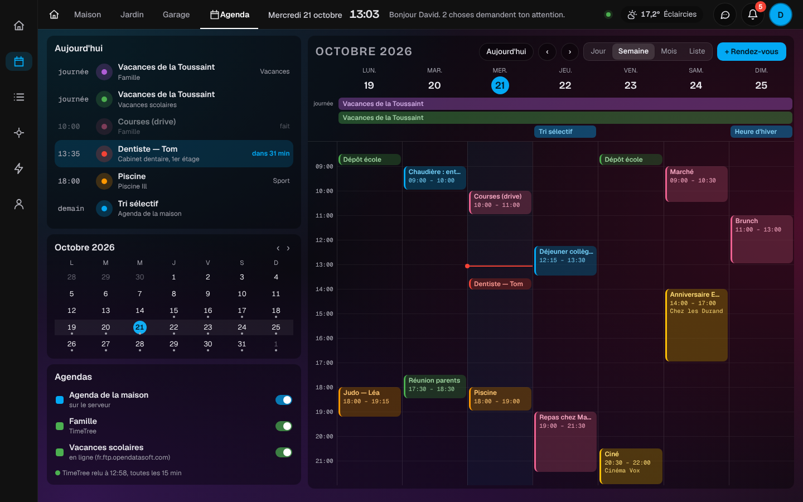
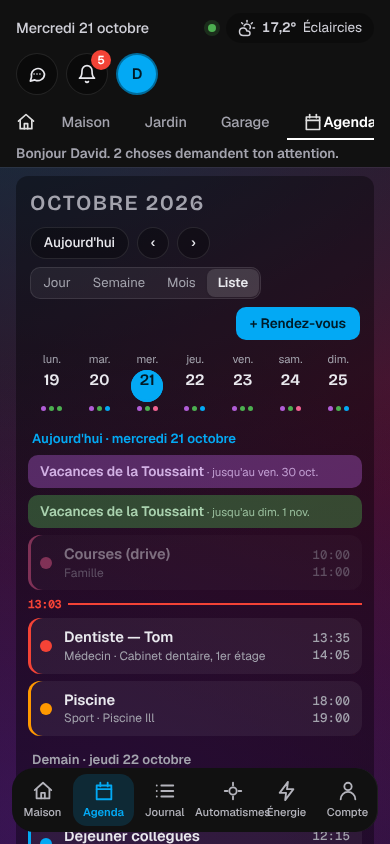

# Étape 75 : l'agenda façon Google Agenda, expliqué



## Le but

Tous les agendas de la maison au même endroit, comme dans Google Agenda :
- le planning de la famille dans **TimeTree** (étape 74) ;
- l'**agenda de la maison** (étape 28) ;
- les agendas en ligne : **vacances scolaires**, **collecte des déchets** (étape 57).

Chaque agenda a sa couleur. Un rendez-vous TimeTree prend la couleur de son étiquette (Médecin en
rouge, Sport en orange…). Tout suit le style choisi : maquette, plan, clair ou sombre.

## Où le trouver

- **L'onglet « Agenda »**, à côté de Maison, Garage… dans la mise en page « tableau » ;
- **l'icône calendrier** du rail de gauche (ordinateur) ou de la barre du bas (téléphone) ;
- **le bouton « Agenda »** en haut, dans la mise en page classique.

Il n'apparaît que s'il y a au moins un agenda.

## Les vues

- **Semaine** : les heures de la journée, avec le trait rouge de l'heure qu'il est.
  - Les rendez-vous qui se chevauchent passent côte à côte.
  - En haut, les bandeaux de ce qui dure toute la journée ou plusieurs jours (vacances, collecte,
    sortie).
  - Toucher un jour l'ouvre seul.
- **Jour** : la même chose, pour un seul jour.
- **Mois** : une grille avec, pour chaque jour, ses trois premiers rendez-vous et « + 2 autres ». Les
  séjours de plusieurs jours forment un bandeau.
- **Liste** : la vue du téléphone. La semaine en haut, avec des points de couleur, puis les
  rendez-vous jour par jour, sur trois semaines.

« Aujourd'hui », ‹ et › se déplacent dans le temps. La vue choisie est retenue sur chaque écran.

**À gauche** (ordinateur) :
- **Aujourd'hui** : le prochain rendez-vous est mis en avant (« dans 35 min »), et le premier de demain
  suit.
- **Le mois** : les jours chargés ont un point ; toucher un jour l'ouvre.
- **Les agendas** : un interrupteur par agenda pour l'afficher ou le cacher, retenu sur chaque écran.
  On y voit aussi quand TimeTree a été relu.

## Un rendez-vous

En le touchant, une fenêtre montre :
- le jour et l'heure ;
- le **lieu** ;
- l'**étiquette** TimeTree (« Médecin ») et l'agenda ;
- les **participants** (Papa, Tom), quand TimeTree les donne ;
- la **note** ;
- **Ouvrir TimeTree**, pour un rendez-vous TimeTree ;
- **Supprimer**, pour un rendez-vous de l'agenda de la maison.

**+ Rendez-vous** ajoute dans l'agenda de la maison : un titre, un jour, et une heure de début et de
fin (sans heure : toute la journée). TimeTree reste en **lecture seule** : pour y ajouter, c'est
l'appli TimeTree.

## Sur la page Maison



Dans la mise en page « tableau », sous les pièces :
- **Agenda · aujourd'hui** : les rendez-vous du jour, le prochain en avant, puis ceux de demain ;
- **Cette semaine** : sept jours, un trait de couleur par rendez-vous ; toucher un jour l'ouvre.

En haut, un repère montre le **prochain rendez-vous** de la journée (« 13:35 Dentiste — Tom »).
Dans l'heure qui précède, la salutation le dit aussi, quand tout est calme (« Tout est calme.
Dentiste — Tom dans 35 min. »).

## Les couleurs

- **Une couleur par agenda.** L'agenda de la maison est bleu, et les autres prennent une couleur
  chacun. Pour choisir, dans `calendriers.yaml` :
  ```yaml
  - nom: Famille
    timetree: Famille Martin
    couleur: "#4caf50"
  ```
- **TimeTree :** un rendez-vous prend la couleur de son étiquette, telle que dans l'appli.

## Ce que donne TimeTree en plus

Le serveur lit maintenant, en plus des rendez-vous :
- les **étiquettes** de l'agenda (nom et couleur) ;
- le **lieu** ;
- les **participants** (les membres de l'agenda cochés sur le rendez-vous).

Ils passent dans le fichier ICS (`LOCATION`, `CATEGORIES`, `COLOR`, `ATTENDEE`), puis dans l'attribut
`events` de l'agenda (`location`, `label`, `color`, `attendees`). Les automatisations y ont accès
avec `trigger.calendar_event.…`.

Un agenda en ligne qui publie ces champs dans son fichier ICS en profite aussi.

## Limites

- Les rendez-vous montrés vont de la semaine passée aux deux mois qui viennent, comme pour le
  déclencheur `calendar`. Plus loin, la vue mois est vide.
- Les participants dépendent de ce que TimeTree envoie : pas encore vérifié sur un vrai compte.
- « Ouvrir TimeTree » ouvre le site de TimeTree, pas directement le rendez-vous.

## Sécurité

- **Rien n'est inséré en HTML.** Titres, lieux et notes, qui viennent d'Internet, sont écrits avec
  `textContent` (vérifié par un test) ; les couleurs ne sont acceptées qu'au format `#rrggbb`.
- **Le lien vers TimeTree** est une adresse fixe, ouverte sans transmettre la page
  (`noopener noreferrer`).
- **Les invités** ne voient pas les agendas (étape 23), donc ni l'onglet ni les tuiles.
- **Ajouter et supprimer** passent par les services de l'agenda de la maison, avec les mêmes droits
  qu'avant.

## Comment c'est construit

- **`crates/ha-api/web/agenda.js`** (nouveau) :
  - les vues semaine, jour, mois et liste, la fenêtre d'un rendez-vous, les tuiles de la page Maison
    et le repère ;
  - les chevauchements : `packColumns` range les rendez-vous qui se recouvrent en colonnes ;
  - les bandeaux : chaque séjour prend la première ligne libre.
- **`style.css`** : les couleurs passent par une variable `--ev`, mélangée au fond avec
  `color-mix()`. Le même code donne du rouge transparent sur la maquette sombre et du rouge pâle sur
  le thème clair.
- **`crates/ha-ics`** :
  - le client TimeTree lit les étiquettes (`/calendar/<id>/labels`) et les membres ;
  - le lecteur ICS lit `LOCATION`, `CATEGORIES`, `COLOR` et `ATTENDEE` ;
  - `couleur:` dans `calendriers.yaml`.
- **`crates/ha-storage`, `crates/ha-agenda`** : `EventExtra`, publié seulement s'il n'est pas vide.

Essayé avec le vrai serveur et un faux TimeTree qui reprend la semaine des maquettes :
- semaine, mois et liste ;
- la fiche du dentiste (lieu, Médecin, Papa et Tom, la note) ;
- les tuiles et le repère de la page Maison ;
- en maquette, en clair et sur téléphone, sans erreur JavaScript.

### Concepts utilisés

**Le positionnement par variables CSS** : la page interdit les styles écrits dans le HTML (politique
de sécurité). Les positions sont donc données par JavaScript avec `style.setProperty("--col", …)` :
c'est permis, et le CSS fait le reste (`grid-column: var(--col) / span var(--span)`).

**Rust : `#[derive(Default)]` pour un ajout sans casse** : `EventExtra::default()` (tout vide) suffit
là où un rendez-vous n'a pas de détails, comme l'agenda de la maison.
