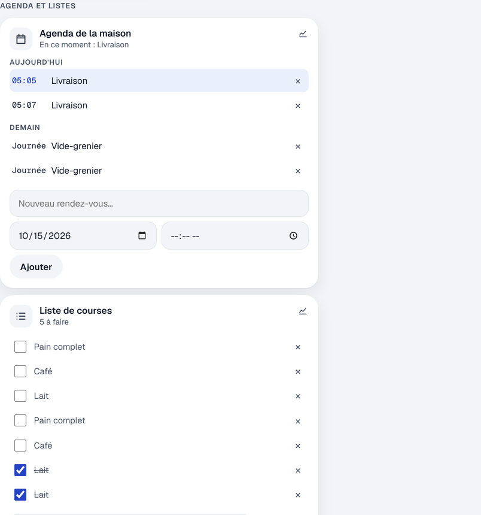

# Étape 28 : l'agenda et les listes de la maison, expliqué



## Le but

Une liste de courses que toute la famille complète, une liste de tâches, et un agenda commun
(« Dentiste jeudi à 18 h 30 », « Vacances du 20 au 27 »), **gardés chez toi**, dans la base de
données du serveur : ni Google, ni Apple, ni aucun service extérieur.

Comme dans Home Assistant, ce sont des entités :

| Entité            | Nom                  | Son état                                           |
| ----------------- | -------------------- | -------------------------------------------------- |
| `todo.courses`    | Liste de courses     | le nombre d'éléments qui restent à faire           |
| `todo.taches`     | Tâches               | idem                                               |
| `calendar.maison` | Agenda de la maison  | `on` pendant un rendez-vous, `off` sinon           |

## L'utiliser

Sur le tableau de bord, section **Agenda et listes** :

- **Listes** : tape un élément et appuie sur Entrée. Coche ce qui est fait (c'est barré), × pour
  retirer, « Retirer ce qui est fait » pour faire le ménage.
- **Agenda** : les rendez-vous du mois qui vient, par jour (« Aujourd'hui », « Demain »…). Pour en
  ajouter un : un titre, un jour, et une heure (sans heure : **toute la journée**). × pour supprimer
  (une confirmation est demandée).
- En haut de la page, le résumé annonce le prochain rendez-vous du jour (« Dentiste à 18:30 »), ou
  celui en cours.

Le journal de bord note le début et la fin de chaque rendez-vous (« début de « Dentiste » »).

## Dans les automatisations

### Un rappel avant un rendez-vous

Le nouveau déclencheur `calendar` réagit au **début** ou à la **fin** d'un rendez-vous, avec un
décalage, comme dans Home Assistant :

```yaml
- id: rappel_rendez_vous
  alias: Rappel 30 minutes avant
  triggers:
    - trigger: calendar
      event: start            # ou end
      entity_id: calendar.maison
      offset: "-00:30:00"     # une demi-heure avant (une semaine au plus)
  actions:
    - action: notify.send_message
      target: {entity_id: notify.telephone}
      data: {message: "Un rendez-vous commence dans 30 minutes"}
```

Il est aussi proposé dans l'éditeur (« Un rendez-vous de l'agenda »).

### Pendant un rendez-vous

L'agenda est `on` pendant un rendez-vous : une condition `state` suffit (« ne pas lancer
l'aspirateur pendant une réunion »).

### Ajouter à une liste, créer un rendez-vous

Les services de Home Assistant :

```yaml
- action: todo.add_item
  target: {entity_id: todo.courses}
  data: {item: "Lait", due_date: "2026-10-20"}     # due_date est facultatif
- action: calendar.create_event
  target: {entity_id: calendar.maison}
  data:
    summary: "Ramonage"
    start_date_time: "2026-11-03 09:00"
    end_date_time: "2026-11-03 11:00"               # sans fin : une heure
```

Aussi : `todo.update_item` (`item`, et `status: completed`, `rename` ou `due_date`),
`todo.remove_item`, `todo.remove_completed_items`, et `calendar.delete_event` (`uid`). Un élément se
désigne par son texte (« Lait ») ou par son numéro (`uid`).

## La sécurité

- **Les invités ne voient ni l'agenda ni les listes** : un agenda dit quand la maison est vide
  (« Vacances »).
- Tout est **vérifié** avant d'être écrit : un titre de 1 à 200 caractères sans caractère de
  contrôle, une description de 1 000 caractères au plus, des dates réelles (pas de 30 février), entre
  2000 et 2100, une fin après le début, un rendez-vous d'un an au plus. Ce qui ne va pas est refusé,
  avec la raison dans le journal du serveur, jamais « corrigé » en silence.
- Des **limites** : 500 éléments par liste, 2 000 rendez-vous à venir. Une automatisation qui
  s'emballe ne peut pas remplir le disque.
- La base elle-même refuse une fin avant le début (`CHECK (end > start)`), en plus de la
  vérification du programme.

## Comment c'est construit

- `crates/ha-storage/src/agenda.rs` et la migration `0014_agenda.sql` : deux tables, `todo_items`
  et `calendar_events`. Les dates sont rangées en heure locale, au format `2026-10-15T18:30:00`.
  Comparer deux textes de ce format revient à comparer les dates : la base trouve les rendez-vous
  d'une période avec un simple `WHERE end > ?2 AND start < ?3`.
- `crates/ha-agenda` : une tâche de fond qui écoute les appels de service sur le bus, vérifie,
  écrit dans la base, et republie l'entité. Toutes les 15 secondes, elle regarde si un rendez-vous
  commence ou se termine.
- Les rendez-vous de la semaine passée et du mois à venir sont publiés dans l'attribut `events` de
  l'agenda. Le **moteur d'automatisations** n'a donc pas besoin de lire la base : à chaque seconde,
  il regarde si « début + décalage » vient de passer, exactement comme pour le lever du soleil.

### Les concepts Rust

**Une erreur qui en regroupe plusieurs.** Un appel peut échouer parce que les données sont fausses,
parce que la liste est pleine, ou parce que la base répond mal :

```rust
enum Refused {
    Check(CheckError),
    Other(String),
    Storage(ha_storage::StorageError),
}

impl From<CheckError> for Refused {
    fn from(error: CheckError) -> Self {
        Self::Check(error)
    }
}
```

Grâce à `impl From<…> for Refused`, l'opérateur `?` **convertit tout seul** une `CheckError` ou une
`StorageError` en `Refused` : `check::required_text(data, "item", MAX_SUMMARY)?` suffit, sans
`map_err` partout.

**Trois cas nommés plutôt qu'un `Option<Option<T>>`.** Pour la date d'une tâche, il faut distinguer
« on ne touche pas à la date », « on l'efface » et « on la change ». On pourrait l'écrire
`Option<Option<String>>` (`None`, `Some(None)`, `Some(Some(date))`), mais c'est facile à confondre :
Clippy, l'outil qui relit le code, le refuse. On écrit plutôt une énumération aux noms clairs :

```rust
pub enum Due {
    Keep,         // due_date absent
    Clear,        // due_date: null
    Set(String),  // due_date: "2026-10-20"
}
```

**`is_none_or`** : `self.loaded_at.is_none_or(|at| at.elapsed() >= RELOAD_EVERY)` est vrai si
l'agenda n'a jamais été lu, **ou** s'il l'a été il y a trop longtemps.
