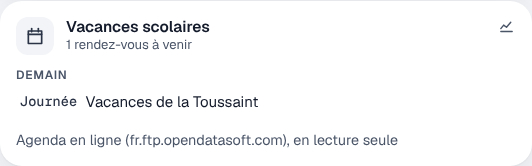

# Étape 57 : les agendas en ligne, expliqués



## Le but

Beaucoup d'agendas sont publiés en ligne au format **ICS** : la collecte des déchets de ta
commune, les vacances scolaires, un agenda Google ou Outlook partagé, le planning d'un club. La
maison les lit et en fait des agendas **en lecture seule**, comme l'intégration « Remote
Calendar » de Home Assistant :

- ils s'affichent dans le tableau de bord, à côté de l'agenda de la maison ;
- le déclencheur `calendar` des automatisations marche avec eux : « la veille de la collecte,
  rappelle-moi de sortir la poubelle », « pendant les vacances, pas de réveil ».

## Mettre en place

Crée `calendriers.yaml` à côté des autres fichiers (ou indique son chemin avec
`HA_CALENDARS_PATH`) :

```yaml
- nom: Vacances scolaires
  url: https://fr.ftp.opendatasoft.com/openscol/fr-en-calendrier-scolaire/Zone-B.ics
- nom: Collecte des déchets
  url: https://www.ta-commune.fr/collecte.ics
```

- `nom` donne l'entité : « Vacances scolaires » devient `calendar.vacances_scolaires`.
- `url` : une adresse `https://` ou `webcal://` (les deux sont acceptées).
- 10 agendas au plus.
- Un agenda **TimeTree** se met ici aussi, avec `timetree:` au lieu de `url:` : voir
  [l'étape 74](timetree.md).

Vérifie le fichier, puis redémarre le serveur :

```powershell
ha-server calendriers check
```

Les vacances scolaires : l'Éducation nationale publie un fichier par zone (A, B, C ; l'Alsace est
en zone B). Pour la collecte des déchets, cherche « calendrier de collecte ICS » sur le site de ta
commune ou de ta communauté de communes. Pour Google Agenda : Paramètres de l'agenda → « Adresse
secrète au format iCal ».

## Exemples

La veille de la collecte, à 19 h :

```yaml
- id: poubelle
  alias: Sortir la poubelle
  triggers:
    - trigger: calendar
      event: start
      entity_id: calendar.collecte_des_dechets
      offset: "-05:00:00"     # la collecte est un événement « journée » : 19 h la veille
  actions:
    - action: notify.send_message
      target: {entity_id: notify.appli}
      data:
        title: Poubelle
        message: Demain, c'est la collecte des déchets.
```

Pas de volets à 7 h pendant les vacances (avec l'[étape 56](jours-ouvres.md)) :

```yaml
- id: volets_matin_hors_vacances
  alias: Volets du matin, hors vacances
  triggers:
    - trigger: time
      at: "07:00:00"
  conditions:
    - condition: state
      entity_id: binary_sensor.jour_ouvre
      state: "on"
    - condition: state
      entity_id: calendar.vacances_scolaires
      state: "off"
  actions:
    - action: cover.open_cover
      target: {entity_id: cover.chambre}
```

## Ce qui est compris

Les événements d'une journée ou à une heure (en temps universel, avec un fuseau horaire ou en
heure locale), leur durée, les événements annulés (ignorés), et les répétitions courantes :
chaque jour, chaque semaine (« le mardi », « un jeudi sur deux »), chaque mois (« le 2e mardi »,
« le dernier jour »), chaque année, avec une fin ou un nombre de fois, les dates exclues et les
occurrences déplacées. Une répétition plus compliquée ne garde que sa première date : mieux vaut
un rendez-vous de moins qu'un faux.

L'agenda publie la semaine passée et les deux mois à venir. Il est relu toutes les 6 heures (15
minutes après un échec). Si le site ne répond pas, la dernière version lue reste affichée.

## Sécurité

- **HTTPS seulement**, sans suivre de redirection, 2 Mio au plus par fichier.
- **L'adresse n'est jamais écrite** dans les logs ni dans l'état de l'agenda : celle d'un agenda
  Google contient une clé secrète. Seul le nom du site apparaît (« fr.ftp.opendatasoft.com »).
- Les agendas en ligne sont **en lecture seule** : le tableau de bord n'affiche ni bouton
  « Supprimer » ni formulaire d'ajout.

## Comment c'est construit

| Fichier | Rôle |
|---------|------|
| [ha-ics/src/ics.rs](../crates/ha-ics/src/ics.rs) (nouveau) | Lire un fichier ICS et calculer les répétitions |
| [ha-ics/src/lib.rs](../crates/ha-ics/src/lib.rs) (nouveau) | `calendriers.yaml`, le téléchargement, et l'état des agendas (le même que l'agenda de la maison) |
| [web/app.js](../crates/ha-api/web/app.js) | La tuile en lecture seule |
