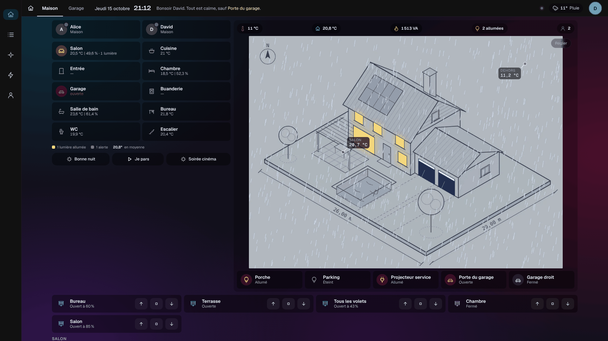
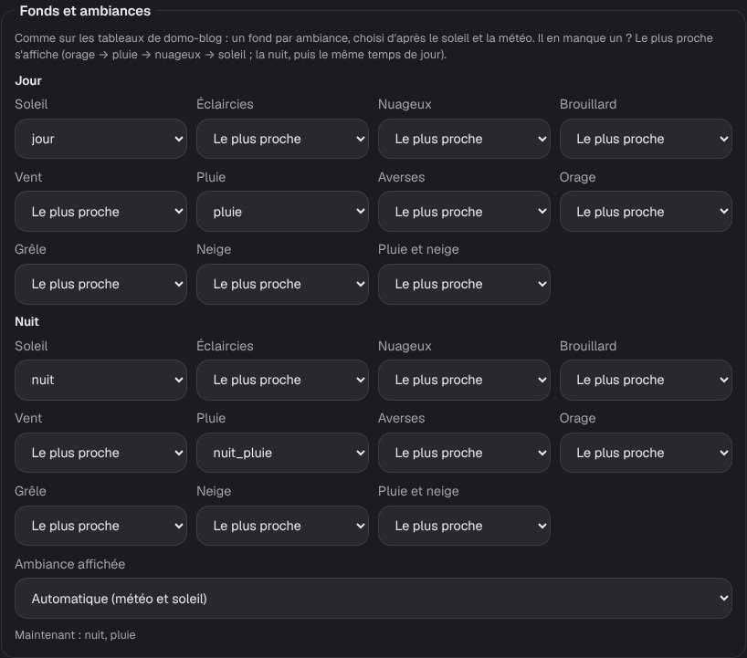
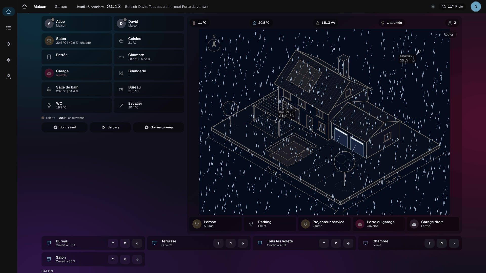

# Étape 39 : les ambiances météo du dessin, expliquées

## Le but

Comme sur les tableaux de domo-blog, la maquette **vit avec le temps qu'il fait**, de jour comme de
nuit, et pour **tous les temps** que donne la météo. Le dessin choisit tout seul le bon fond,
d'après le soleil (`sun.sun`) et la météo (`weather`).

| Temps            | Conditions de la météo                  | S'il manque le fond…  |
| ---------------- | --------------------------------------- | --------------------- |
| Soleil           | `sunny`, `clear-night`                  | (le fond de jour ou de nuit) |
| Éclaircies       | `partlycloudy`                          | soleil                |
| Nuageux          | `cloudy`, `exceptional`                 | soleil                |
| Brouillard       | `fog`                                   | nuageux               |
| Vent             | `windy`, `windy-variant`                | nuageux               |
| Pluie            | `rainy`                                 | nuageux               |
| Averses          | `pouring`                               | pluie                 |
| Orage            | `lightning`, `lightning-rainy`          | pluie                 |
| Grêle            | `hail`                                  | orage                 |
| Neige            | `snowy`                                 | nuageux               |
| Pluie et neige   | `snowy-rainy`                           | neige                 |

Soit 33 fonds possibles par onglet (11 temps, de jour, au crépuscule et de nuit), tous facultatifs
sauf le fond de jour.

### Le crépuscule et la neige, comme sur domo-blog

- **Le crépuscule** : quand le soleil est entre −6° et +6° au-dessus de l'horizon (l'attribut
  `elevation` de `sun.sun`), le dessin prend les fonds « Crépuscule ». Il ne s'en sert que si
  l'onglet en a **au moins un** : sans fond de crépuscule, rien ne change (jour, puis nuit au
  coucher du soleil). S'il manque le fond du temps qu'il fait, on remonte les temps au crépuscule,
  puis on prend la nuit (soleil couché) ou le jour (soleil encore levé).
- **La neige par la sonde** : de la pluie ou des averses annoncées avec **1 °C ou moins dehors**,
  c'est de la neige. La température vient de la sonde extérieure de la pompe à chaleur
  (`sensor.temperature_exterieure`), sinon de la météo.

### Les calques de saison et de gel

Un fond d'ambiance remplace toute l'image. Pour un effet qui **s'ajoute** au temps qu'il fait
(les feuilles d'automne sous la pluie, le givre un jour de soleil), on prend un **calque** : une
image transparente, posée sur le fond, qui s'affiche selon l'état d'une entité.

| Calque               | Entité                | États       | Moment       |
| -------------------- | --------------------- | ----------- | ------------ |
| Feuilles d'automne   | `sensor.saison`       | `automne`   | Le jour      |
| Givre                | `binary_sensor.gel`   | `on`        | Le jour      |

- **La saison** (`sensor.saison`) est calculée par le serveur avec le soleil : `printemps`, `ete`,
  `automne`, `hiver`. Voir [le soleil](soleil.md).
- **Le gel** vient de la sonde extérieure, par un seuil dans `config/derived.yaml` (l'exemple
  `gel` de [derived.example.yaml](../derived.example.yaml)) : allumé sous 0 °C, éteint au-dessus de
  1 °C, pour ne pas clignoter autour de zéro.
- Le calque se règle comme les autres (Mon compte → Dessin de la maison… → Calques), avec le moment
  « Le jour » si l'image a été faite de jour.

**Faire le calque** : demander à l'IA la même image avec l'effet seul (« Only change: autumn leaves
on the lawn »), puis la comparer à l'image de jour (mode « Différence » d'un logiciel de retouche) :
ce qui a changé devient l'effet, le reste devient transparent. On l'enregistre en PNG ou en WebP
avec transparence.

## Régler les fonds

**Mon compte → Dessin de la maison… → Fonds et ambiances**, pour chaque onglet :

- seul le **fond de jour** est nécessaire ; les autres sont facultatifs ;
- **il en manque un ?** Le plus proche s'affiche : on remonte les temps (grêle → orage → pluie →
  nuageux → soleil) au même moment, puis, la nuit, la même chose de jour. Un fond de nuit seul
  suffit donc à avoir le jour et la nuit, comme avant ; un fond « pluie » sert aussi aux averses,
  aux orages et à la grêle ;
- **Ambiance affichée** : « Automatique », ou une ambiance imposée, pour essayer ses images sans
  attendre la pluie ;
- « Maintenant : crépuscule, pluie » dit l'ambiance qui serait choisie en ce moment.

Le passage d'une ambiance à l'autre se fait en fondu. Les calques (garage ouvert, lumières…) et
les valeurs restent posés par-dessus.

### Faire les images

Toutes les demandes, ambiance par ambiance, sont dans le réglage du dessin (« Faire les images
avec l'IA ») et dans le guide de l'[étape 44](images-ia.md). En bref :

Toujours à partir de l'image de jour validée (jamais d'une variante, sinon le dessin dérive), en
demandant à l'IA de garder **exactement** le cadrage :

> Same image, IDENTICAL composition, camera angle and framing. Only change: heavy rain, wet
> reflective ground, overcast sky light.

> Same image, IDENTICAL composition, camera angle and framing. Only change: night time, light snow
> on the roofs and the garden.

## Sécurité

- Les fonds d'ambiance sont des images comme les autres : PNG, JPEG ou WebP, vérifiées à leur
  contenu ; une image qui sert à une ambiance ne peut pas être retirée.
- Le serveur n'accepte que les ambiances connues (`jour-` ou `nuit-` puis un des 10 temps), et une
  ambiance imposée parmi les 22.

## Comment c'est construit

- `ha-api/src/drawing.rs` : chaque onglet a `ambiances` (`{"jour-pluie": "image"}`) et `forced`.
- `house.js` : `weatherKind` traduit la condition de la météo en temps ; `ambianceOf` donne
  l'ambiance (ou celle imposée) ; `backgroundFor` remonte la chaîne des temps « parents » jusqu'au
  premier fond qui existe. Le fond d'ambiance est une image posée sur le fond de jour, qui change en fondu.
