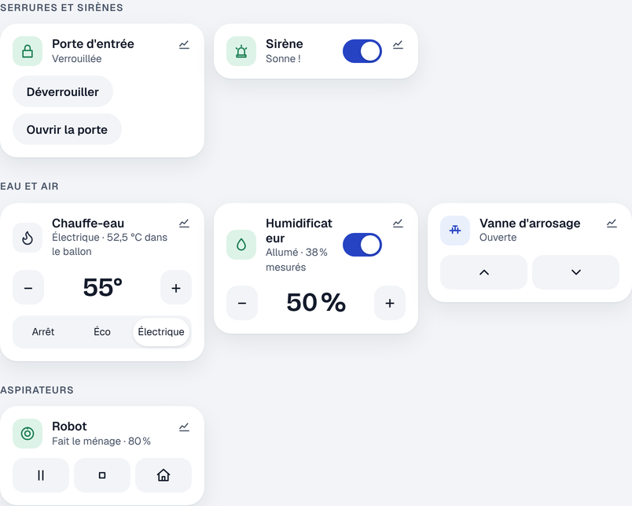
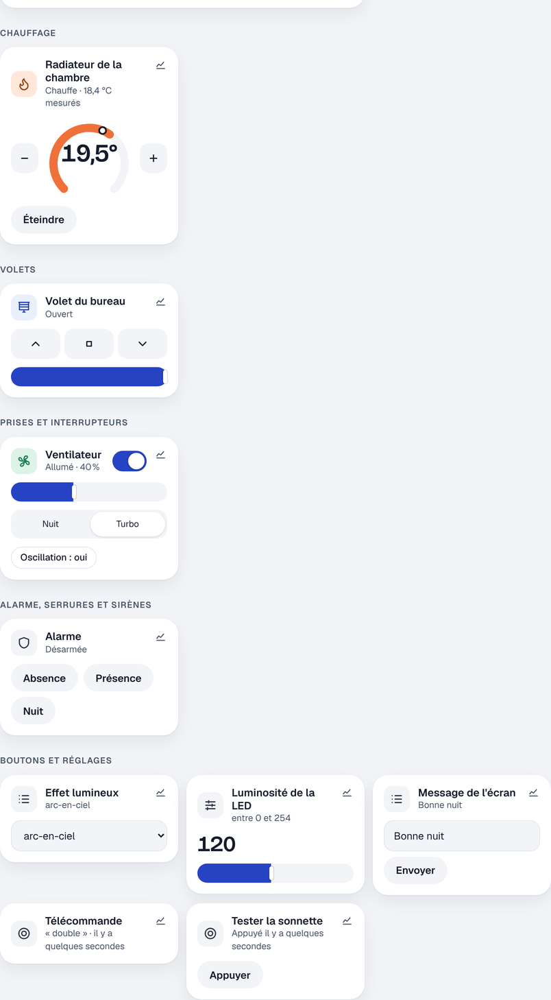

# Étape 27 : serrures, sirènes, vannes, aspirateurs, humidificateurs, chauffe-eau, expliqué



## Le but

Jusqu'ici, la découverte MQTT (étape 4) comprenait les capteurs, les détecteurs, les prises et les
lumières. Elle comprend maintenant six nouveaux types d'appareils, annoncés exactement comme dans Home
Assistant. Zigbee2MQTT, ESPHome, Tasmota ou un montage maison les déclarent donc tout seuls :

| Type MQTT       | Exemple                        | Sur le tableau de bord                            |
| --------------- | ------------------------------ | ------------------------------------------------- |
| `lock`          | serrure connectée              | Verrouiller / Déverrouiller (mot de passe), Ouvrir |
| `siren`         | sirène                         | bouton glissant, « Sonne ! »                       |
| `valve`         | vanne d'arrosage, d'eau        | Ouvrir / Fermer                                    |
| `vacuum`        | robot aspirateur               | Lancer, Pause, Arrêter, Retour à la base, batterie |
| `humidifier`    | humidificateur, déshumidificateur | marche / arrêt, humidité voulue (− / +)         |
| `water_heater`  | chauffe-eau, ballon            | modes (Éco, Électrique…), température (− / +)      |

Rien à configurer : dès que l'appareil publie sa description sur `homeassistant/<type>/…/config`,
la tuile apparaît, et le journal de bord raconte ce qu'il fait (« Porte d'entrée s'est
déverrouillée par david », « Robot est rentré à sa base »).

Les commandes sont aussi proposées dans l'éditeur d'automatisations (« Renvoyer à sa base »,
« Régler l'humidité voulue »…).

## La sécurité d'abord

### Déverrouiller demande le mot de passe

Verrouiller est immédiat. **Déverrouiller ou ouvrir** une porte redemande ton mot de passe (et ton
code de double authentification si tu l'as activée), même si tu es administrateur. La confirmation
reste valable 15 minutes, comme pour modifier une automatisation (étape 13).

Pourquoi ? Un téléphone oublié déverrouillé sur une table, ou une session restée ouverte sur la
tablette du salon, ne doit pas suffire à ouvrir la maison. Le contrôle est fait **par le serveur** :
appeler l'API directement ne permet pas de le contourner.

```rust
pub(crate) fn needs_confirmation(domain: &str, service: &str) -> bool {
    matches!((domain, service), ("lock", "unlock" | "open"))
}
```

`matches!` compare une valeur à un **motif** : ici un couple `(domaine, service)` dont le second
élément est `"unlock"` **ou** `"open"`. C'est une liste de ce qui est sensible : un nouveau service
de verrou serait d'abord refusé à l'invité (règle des rôles), et on ajouterait ici ceux qui ouvrent.

« Basculer » une serrure (`lock.toggle`) n'existe volontairement pas : appuyer deux fois par erreur
ne doit jamais laisser la porte ouverte.

### Les invités ne voient ni les serrures ni les sirènes

Savoir si la porte est verrouillée, c'est savoir si la maison est ouverte. Comme la présence de la
famille et l'alarme (étape 23), les serrures et les sirènes sont cachées aux invités. Ils ne peuvent
pas non plus commander les vannes, l'aspirateur, l'humidificateur ou le chauffe-eau.

### Ce qu'envoie un appareil est vérifié

Comme pour les autres appareils MQTT, tout ce qui arrive du réseau est contrôlé :

- un **état** inconnu (`"???"` au lieu de `LOCKED`) est ignoré, l'état reste le dernier connu ;
- les **modes** d'un chauffe-eau doivent être une courte liste de textes simples ;
- les **bornes** (humidité de 30 à 70 %, eau de 40 à 65 °C) doivent avoir du sens.

Et dans l'autre sens, ce qu'on publie ne reprend **jamais** un texte de l'appelant tel quel :

```rust
Payload::Number { field, min, max } => {
    let value = data
        .get(*field)
        .and_then(Value::as_f64)
        .filter(|value| value.is_finite())
        .ok_or(CommandError::Invalid(field))?;
    if value < *min || value > *max {
        return Err(CommandError::OutOfRange { … });
    }
    Ok(format_number(value))
}
```

- `and_then` enchaîne des étapes qui peuvent chacune échouer (`None`) : le champ existe-t-il ?
  est-ce un nombre ?
- `filter` garde la valeur seulement si elle est **finie** (pas l'infini, pas « NaN »).
- `ok_or(…)?` transforme « rien » en erreur, et `?` arrête la fonction avec cette erreur.

Un mode (`set_operation_mode`) doit faire partie de la liste **annoncée par l'appareil** : on renvoie
le texte de cette liste, pas celui reçu.

## Comment c'est construit

Un capteur ou une prise n'ont qu'un sujet d'état. Un humidificateur en a trois : son état
(`ON`/`OFF`), l'humidité voulue, et l'humidité mesurée. Chaque entité MQTT a donc maintenant un
**profil** (`crates/ha-mqtt/src/profile.rs`) qui dit :

- les **états** possibles (`LOCKED` reçu → `locked`) ;
- les **sujets d'attributs** (`h/consigne` → l'attribut `humidity`) ;
- ce qu'il faut **publier** pour chaque commande (`lock.unlock` → `UNLOCK` sur le sujet de commande).

Quand un message arrive, le pont met à jour l'état **sans effacer** les attributs reçus avant :
l'humidificateur qui envoie « ON » garde sa consigne de 45 %.

Un aspirateur envoie tout dans un seul message (`{"state": "cleaning", "battery_level": 61}`) : le
pont s'abonne **une seule fois** à ce sujet, et en tire l'état et la batterie.

## Tester sans appareil

Avec `mosquitto_pub`, tu peux annoncer un faux verrou :

```bash
mosquitto_pub -h <broker> -u <compte> -P <mot de passe> -r \
  -t homeassistant/lock/entree/config \
  -m '{"name": "Porte d'"'"'entrée", "stat_t": "maison/serrure", "cmd_t": "maison/serrure/set"}'
mosquitto_pub -h <broker> -u <compte> -P <mot de passe> -t maison/serrure -m LOCKED
```

et regarder les ordres envoyés : `mosquitto_sub -t maison/serrure/set -v`.

---

# Étape 29 : volets, ventilateurs, thermostats, boutons, réglages, télécommandes et alarmes



## Le but

En comparant avec le code de Home Assistant (`homeassistant/components/mqtt/`), il manquait neuf
types que Zigbee2MQTT, ESPHome ou Tasmota annoncent tous les jours. Ils sont maintenant compris,
avec les **mêmes valeurs par défaut et les mêmes abréviations** que Home Assistant :

| Type MQTT             | Exemple                               | Sur le tableau de bord                          |
| --------------------- | ------------------------------------- | ----------------------------------------------- |
| `cover`               | volet roulant, store, porte de garage | Ouvrir / Arrêter / Fermer, position             |
| `fan`                 | ventilateur, VMC                      | marche / arrêt, vitesse, modes, oscillation     |
| `climate`             | tête thermostatique Zigbee, clim      | le cadran de l'étape 25 (consigne, mesure)      |
| `button`              | « redémarrer », « tester la sonnette » | Appuyer (l'état : la date du dernier appui)     |
| `number`              | luminosité d'une LED, durée           | curseur ou − / +                                |
| `select`              | effet lumineux, mode                  | liste déroulante                                |
| `text`                | message d'un écran                    | champ de texte (masqué en mode « mot de passe ») |
| `event`               | télécommande, interrupteur sans fil   | dernière touche (« double ») et quand            |
| `alarm_control_panel` | centrale d'alarme                     | Absence / Présence / Nuit, Désarmer (mot de passe) |

## Une télécommande dans une automatisation

Chaque appui publie l'événement `event_received`, avec l'appareil et la touche :

```yaml
- id: telecommande_double
  alias: Double appui = tout éteindre
  triggers:
    - trigger: event
      event_type: event_received
      event_data: {entity_id: event.telecommande, event_type: double}
  actions:
    - action: scene.turn_on
      target: {entity_id: scene.bonne_nuit}
```

Une sorte d'appui que l'appareil n'a pas annoncée (`event_types`) est ignorée.

## La sécurité

- **Désarmer l'alarme redemande le mot de passe**, comme déverrouiller une porte (étape 27). Armer
  est immédiat. L'alarme est cachée aux invités.
- **Le code d'une alarme** (`code` dans la description) n'est ni gardé ni affiché : la vraie
  protection est le mot de passe redemandé par le serveur, pas un code à 4 chiffres tapé dans le
  navigateur.
- **Pas de modèles de commande** : une alarme qui demande un `command_template` autre que
  `{{ action }}` est refusée. Un modèle Jinja est un petit langage de programmation ; on n'en exécute
  jamais un venu du réseau.
- **Tout ce qui part vers l'appareil est vérifié** : un nombre entre les bornes annoncées (une
  position de 0 à 100 %, convertie en 0 à 255 si l'appareil le demande), un choix dans la liste
  annoncée, un texte de la bonne longueur sans caractère de contrôle, un oui / non pour
  l'oscillation.
- **Un texte en mode « mot de passe »** n'est jamais affiché sur le tableau de bord ni écrit dans le
  journal de bord (« a été modifié »).

## Une erreur corrigée en lisant le code de Home Assistant

En comparant notre table d'abréviations avec `abbreviations.py`, deux erreurs de l'étape 27 sont
apparues : un état de vanne fermée s'abrège `stat_clsd` (et non `stat_closed`), et « en train de se
fermer » `stat_closing` (et non `stat_clsing`). Une vanne qui utilisait ces abréviations aurait
gardé ses valeurs par défaut sans prévenir. C'est corrigé.

## Le journal de bord, plus calme

Après un redémarrage, chaque appareil annonce son état (« inconnu » → « désarmée »). Ce n'est pas un
événement de la maison : ces lignes ne sont plus écrites.

## Les concepts Rust

**Une énumération dont chaque cas porte ses données.** Ce qu'on publie pour un service :

```rust
pub enum Payload {
    Fixed(String),
    Number { field: &'static str, min: f64, max: f64, scale: Option<(f64, f64)> },
    Flag { field: &'static str, on: String, off: String },
    Text { field: &'static str, min: usize, max: usize },
    Choice { field: &'static str, options: Vec<String> },
}
```

Un `match` sur `Payload` oblige à traiter **chaque** cas : en ajoutant `Flag` et `Text`, le
compilateur a montré tous les endroits à compléter.

**`if let … && let …` (« let chains »).** Pour ne traiter un message que s'il vient du bon sujet
**et** qu'il est compris :

```rust
if config.state_topic.as_deref() == Some(topic)
    && let Some(action) = event_received(config, id, payload, states)
{
    actions.push(action);
}
```

Chaque `let` ne réussit que si la valeur a la bonne forme ; sinon tout le `if` est sauté, sans
`unwrap`.
