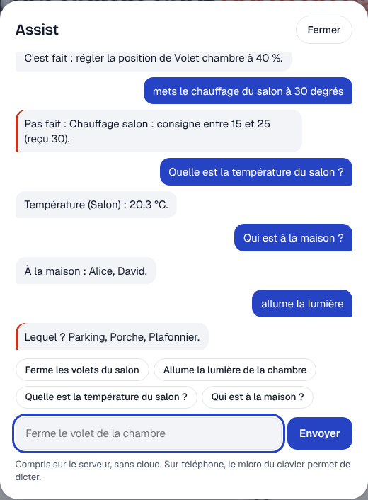

# Étape 54 : Assist, expliqué



## Le but

Commander la maison **avec une phrase**, comme l'Assist de Home Assistant :

> Ferme le volet de la chambre.
> Éteins les lumières du salon.
> Mets le chauffage du salon à 21 degrés.
> Ouvre le volet du bureau à 40 %.
> Quelle est la température du salon ?
> Qui est à la maison ?

Le bouton en forme de bulle, en haut de l'écran, ouvre Assist. La phrase est **comprise sur ton
serveur**, sans cloud ni intelligence artificielle : rien ne sort de la maison. Sur téléphone, le
micro du clavier permet de la dicter. Avec l'écoute installée, un bouton **micro** permet de la
dire, écoutée sur le serveur lui aussi ([étape 84](voix.md)), qui comprend aussi les nombres en
lettres et « ajoute du pain à la liste de courses ».

## Ce qu'Assist comprend

| Tu dis | Il fait |
|--------|---------|
| allume, active, lance | allumer (lumière, prise, ventilateur), activer une scène ou un script |
| éteins, coupe, désactive | éteindre |
| ouvre, monte, lève | ouvrir un volet ou une vanne ; « à 40 % » règle la position |
| ferme, descends, baisse | fermer |
| arrête, stop | arrêter un volet ; éteindre le reste |
| verrouille, déverrouille | la serrure (déverrouiller redemande le mot de passe, voir plus bas) |
| mets, règle, passe … à 21 degrés | la consigne d'un thermostat ; « à 50 % » : la luminosité ou la vitesse |
| quel, quelle, combien, est-ce que, qui… ? | une réponse lue dans l'état de la maison |

**Trouver l'appareil**, dans cet ordre :

1. **par son nom** : tous ses mots sont dans la phrase (« volet chambre » dans « ferme le volet
   de la chambre ») ;
2. **par sa pièce et son type** : « les lumières du salon », « le chauffage de la chambre ». La
   pièce seule désigne les lumières (« éteins le salon »), ou les volets avec « ouvre » et
   « ferme » ;
3. **par son type seul** : « toutes les lumières », « tous les volets » ; ou le seul appareil de
   ce type. S'il y en a plusieurs, Assist demande lequel.

Les pièces sont celles de `areas.yaml` ([étape 9](pieces.md)). La pièce dite départage deux
appareils du même nom (« la lampe du salon », pas celle de la chambre).

**Une valeur** compte derrière « à », ou avec son unité : « à 40 % », « à 21 degrés », « 50 % ».
Le nombre d'un nom (« la chambre 2 », « la lampe 2 ») n'est jamais pris pour une valeur.

## Les mêmes règles qu'un toucher

Assist ne contourne rien : chaque ordre passe par le même chemin qu'un toucher dans le tableau de
bord.

- **Le compte** : Assist ne voit que les appareils que le compte peut voir. Un invité ne peut pas
  demander qui est à la maison, ni toucher à la serrure.
- **La garde** ([étape 48](garde.md)) : un ordre d'invité dans une pièce protégée attend une
  validation (« En attente de validation : fermer Volet chambre »).
- **Ouvrir la maison** : déverrouiller une porte ou désarmer l'alarme redemande le mot de passe.
  Assist ne le demande pas lui-même : il dit de toucher l'appareil dans le tableau de bord.
- **Les valeurs** ([étape 53](ordres.md#étape-53--vérifié-avant-lenvoi)) : « mets le chauffage à
  30 degrés » répond « consigne entre 15 et 25 (reçu 30) ».
- **Le journal** : chaque ordre est écrit dans le journal d'audit et le journal de bord, au nom du
  compte. La phrase elle-même n'est écrite nulle part.

**« C'est fait » veut dire que l'appareil a obéi** ([étape 95](confirmation.md)) : Assist attend
au plus 3 secondes qu'il change d'état. Sinon : « J'ai envoyé l'ordre, mais Volet chambre n'a pas
encore répondu », ou « … est indisponible ».

## Pour les développeurs

`POST /api/conversation/process` avec `{"text": "ferme le volet de la chambre"}`, comme dans Home
Assistant. La réponse :

```json
{"response": {"response_type": "action_done", "language": "fr",
  "speech": {"plain": {"speech": "C'est fait : fermer Volet chambre."}}}}
```

`response_type` vaut `action_done`, `query_answer` ou `error`.

## Comment c'est construit

| Fichier | Rôle |
|---------|------|
| [ha-assist/src/lib.rs](../crates/ha-assist/src/lib.rs) (nouveau) | Comprendre la phrase : verbe, appareil, valeur ; répondre aux questions |
| [ha-api/src/assist.rs](../crates/ha-api/src/assist.rs) (nouveau) | La route : les appareils visibles du compte, puis les ordres |
| [ha-api/src/rest.rs](../crates/ha-api/src/rest.rs) | `execute` : le chemin commun d'un ordre, partagé avec `POST /api/services` |
| [web/app.js](../crates/ha-api/web/app.js) | La fenêtre Assist |

Limites : Assist ne comprend que le français, et des phrases simples (une action par phrase). Les
nombres s'écrivent en chiffres (« 21 », pas « vingt et un ») : la dictée du clavier les écrit
ainsi.
