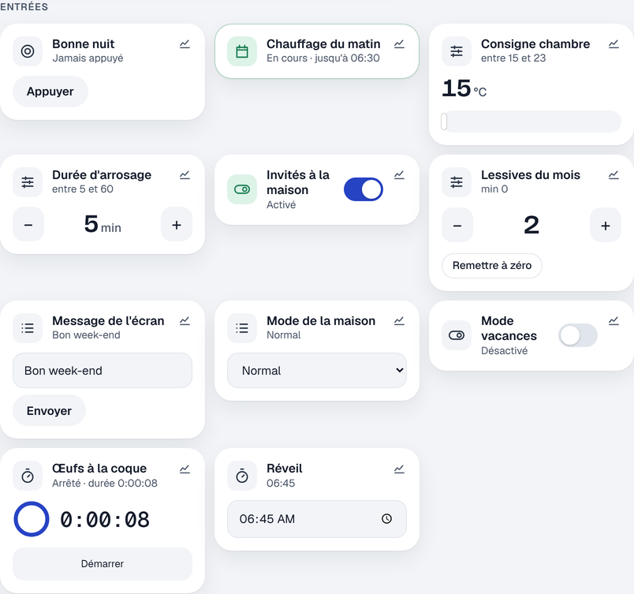

# Étape 30 : les assistants du quotidien, expliqué



## Le but

Home Assistant appelle « helpers » de petites entités pratiques qu'on crée soi-même. Il en manquait
plusieurs, trouvées en comparant avec son code (`homeassistant/components/`). Elles sont de deux
sortes.

**Des entrées qu'on règle** (fichier `inputs.yaml`, comme à l'étape 20) :

| Entrée            | Exemple                    | Services                                              |
| ----------------- | -------------------------- | ----------------------------------------------------- |
| `counter`         | lessives du mois           | `increment`, `decrement`, `reset`, `set_value`        |
| `input_text`      | message d'un écran         | `set_value` (mode `password` : jamais affiché)        |
| `input_datetime`  | heure du réveil            | `set_datetime` (`time`, `date` ou `datetime`)         |

**Des assistants calculés** à partir d'autres appareils (nouveau fichier `derived.yaml`) :

| Assistant        | Entité créée                          | Ce qu'il fait                                          |
| ---------------- | ------------------------------------- | ------------------------------------------------------ |
| `group`          | `light.lumieres_du_bas`               | allumé si un membre l'est ; une commande va à tous     |
| `schedule`       | `schedule.chauffage_matin`            | `on` pendant les plages de la semaine                  |
| `min_max`        | `sensor.temperature_moyenne`          | min, max, moyenne, médiane, somme, écart, dernier      |
| `threshold`      | `binary_sensor.salle_de_bain_humide`  | au-dessus / au-dessous d'un seuil, avec une marge       |
| `utility_meter`  | `sensor.electricite_du_jour`          | consommation depuis minuit, lundi, le 1er du mois…      |

Les exemples commentés sont dans `inputs.example.yaml` et `derived.example.yaml`. Pour vérifier un
fichier avant de redémarrer :

```bash
ha-server inputs check
ha-server derived check
```

Avec Docker, le fichier se met dans `config/derived.yaml` (`HA_DERIVED_PATH`).

## L'heure du réveil, réglable depuis le tableau de bord

Le déclencheur `time` accepte maintenant une entrée `input_datetime`, comme dans Home Assistant :

```yaml
- id: reveil
  alias: Ouvrir les volets au réveil
  triggers:
    - trigger: time
      at: input_datetime.reveil
  actions:
    - action: cover.open_cover
      target: {entity_id: cover.chambre}
```

Change l'heure sur la tuile « Réveil » : l'automatisation suit, sans rien modifier. Avec une date et
une heure (`has_date` et `has_time`), elle ne se lance qu'une fois, ce jour-là.

## Les groupes

```yaml
group:
  lumieres_du_bas:
    name: Lumières du bas
    type: light               # light, switch, fan, cover ou binary_sensor
    entities: [light.salon, light.cuisine]
    all: false                # true : allumé seulement si tous le sont
```

- L'état suit les membres ; un groupe de volets donne aussi la **position moyenne**.
- « Allumer », « éteindre », « ouvrir »… sur le groupe sont **transmis à chaque membre**, au nom de
  la même personne : le journal de bord dit « par david » sur chaque lampe.
- **Pas de groupe dans un groupe** : « A commande B qui commande A » tournerait sans fin. Le fichier
  est refusé.
- **Les droits passent à travers le groupe.** Le serveur vérifie chaque membre : un invité ne peut
  pas ouvrir la porte du garage en passant par un groupe « Tous les volets » qui la contient. Le
  bouton ne lui est même pas montré.

## Les plages horaires

```yaml
schedule:
  chauffage_matin:
    monday: [{from: "06:30", to: "08:00"}, {from: "18:00", to: "22:00"}]
    saturday: [{from: "08:00", to: "24:00"}]   # 24:00 : jusqu'à minuit
```

`schedule.chauffage_matin` est `on` pendant les plages ; l'attribut `next_event` dit quand il change.
Une automatisation s'en sert avec un simple déclencheur `state` (`to: "on"`), ou une condition.
Deux plages qui se chevauchent sont refusées.

## Moyenne et seuil

```yaml
min_max:
  temperature_moyenne: {type: mean, entities: [sensor.salon, sensor.chambre], round_digits: 1}
threshold:
  salle_de_bain_humide: {entity_id: sensor.humidite_sdb, upper: 70, hysteresis: 3}
```

Le seuil a une **hystérésis** (une marge) : avec `upper: 70` et `hysteresis: 3`, il s'allume au-dessus
de 73 % et ne s'éteint qu'en dessous de 67 %. Sans elle, un ventilateur branché dessus
s'allumerait et s'éteindrait sans arrêt quand l'humidité hésite autour de 70 %.

Un capteur qui ne répond pas (`unavailable`) est simplement laissé de côté dans la moyenne.

## La consommation par période

```yaml
utility_meter:
  electricite_du_jour: {source: sensor.compteur_electricite, cycle: daily}
```

La source doit être un **compteur qui ne fait que monter** (un index en kWh, en m³). L'assistant
additionne ce qui est compté depuis le début de la période, et garde le total de la période précédente
(`last_period`). Si le compteur **baisse**, c'est qu'il a été remis à zéro (compteur remplacé) : ce
qu'il affiche alors est compté comme nouveau, comme dans Home Assistant. Ne le branche donc pas sur une
température ou une puissance instantanée.

Après un redémarrage, il reprend là où il en était (la valeur et le dernier index lu sont gardés avec
l'état). Si le serveur était arrêté au moment du changement de période, la nouvelle période commence
au démarrage.

## Comment c'est construit

- `crates/ha-input` : les trois nouvelles entrées, sur le modèle des autres.
- `crates/ha-derived` (nouveau) : `config.rs` lit et vérifie le fichier, `compute.rs` fait les calculs
  (sans attente : l'heure et les états sont passés en paramètre, ce qui les rend faciles à tester),
  `lib.rs` est la tâche qui écoute les changements d'état et les commandes.
- `crates/ha-automation` : le déclencheur `time` accepte une entrée `input_datetime`.

### Les concepts Rust

**`f64::total_cmp` pour trier des nombres à virgule.** Les `f64` ne sont pas « totalement ordonnés » :
`NaN` (« pas un nombre ») n'est ni plus grand ni plus petit qu'un autre. Rust refuse donc
`values.sort()` sur des `f64`. `sort_by(|a, b| a.total_cmp(b))` donne un ordre complet, utilisé pour
la médiane.

**Une étiquette sur une boucle.** Pour trouver le prochain changement d'une plage horaire, on parcourt
les jours, puis les heures de chaque jour. Quand on trouve, on sort **des deux boucles** d'un coup :

```rust
'days: for offset in 0..8_i64 {
    for moment in moments {
        if moment > now && schedule_on(week, moment) != on {
            next = Some(moment);
            break 'days;
        }
    }
}
```

**Un piège trouvé par les tests.** La bibliothèque de dates `jiff` accepte de lire une **heure** dans
« 2026-10-16 07:30:00 » (elle garde l'heure et oublie la date). Un réveil réglé pour un jour précis
aurait sonné tous les jours. Le test l'a montré ; le code vérifie maintenant qu'il n'y a pas de date
avant de lire une heure seule.
