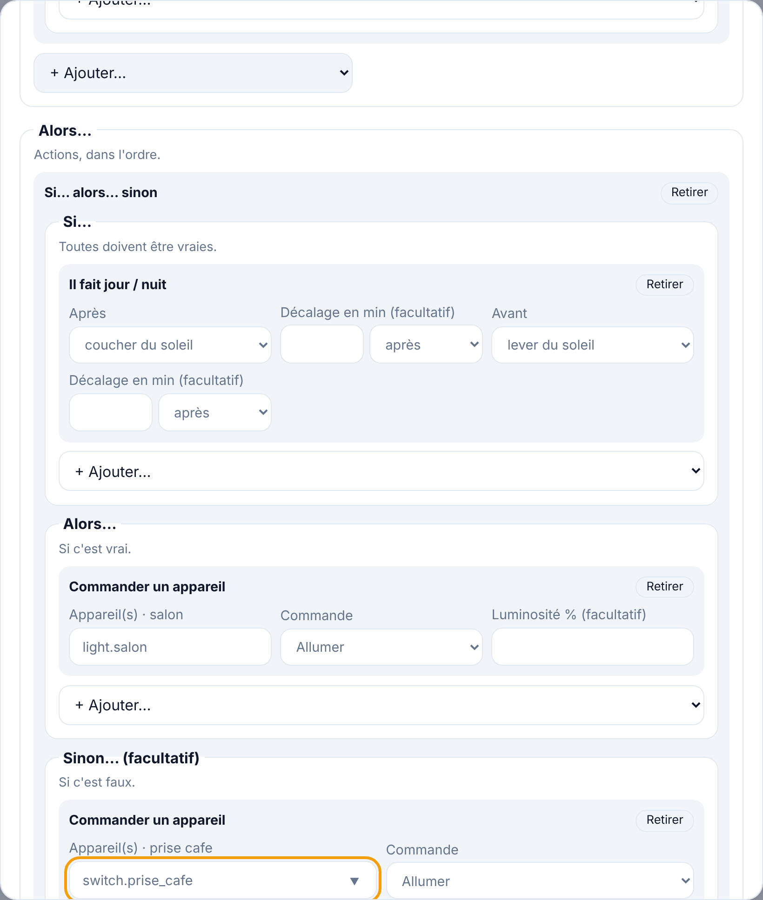

# Étape 17 : des automatisations plus riches, expliqué



## Le but

Jusqu'ici, une automatisation était une suite simple : « quand X, si **toutes** ces conditions,
alors fais A puis B ». Dans la vraie vie, on a vite besoin de plus :

- « s'il fait nuit **ou** que personne n'est là » ;
- « **si** c'est la nuit, allume le salon, **sinon** la prise » ;
- **une seule** automatisation pour l'arrivée et le départ, qui agit selon ce qui l'a déclenchée ;
- décider ce qui se passe si elle se redéclenche **pendant** qu'elle attend (`delay`).

Tout cela existe dans Home Assistant, avec la même écriture YAML : une automatisation trouvée sur
un forum fonctionne telle quelle.

## Conditions : « ou », « et », « non »

```yaml
conditions:
  - condition: or            # au moins une
    conditions:
      - condition: state
        entity_id: device_tracker.telephone_david
        state: not_home
      - condition: sun
        after: sunset
  - condition: not           # aucune
    conditions:
      - condition: state
        entity_id: climate.salon
        state: "off"
```

`and` (toutes) sert à l'intérieur d'un `or` : « (A et B) ou C ». Les conditions s'imbriquent
jusqu'à 5 niveaux.

## Savoir ce qui a déclenché l'automatisation

Chaque déclencheur peut avoir un `id`. La condition `trigger` permet ensuite de tester lequel a
lancé l'automatisation :

```yaml
triggers:
  - trigger: state
    entity_id: binary_sensor.porte_entree
    to: "on"
    id: ouverture
  - trigger: state
    entity_id: device_tracker.telephone_david
    to: not_home
    id: depart
```

Sans `id`, un déclencheur s'appelle `"0"`, `"1"`… selon sa position, comme dans Home Assistant.

## Actions : « si… alors… sinon », « selon le cas », « seulement si »

```yaml
actions:
  # Si… alors… sinon
  - if:
      - condition: sun
        after: sunset
    then:
      - action: light.turn_on
        target: {entity_id: light.salon}
    else:                       # facultatif
      - action: switch.turn_on
        target: {entity_id: switch.prise_cafe}

  # Selon le cas : la première option dont les conditions sont vraies
  - choose:
      - conditions:
          - condition: trigger
            id: ouverture
        sequence:
          - action: light.turn_on
            target: {entity_id: light.entree}
      - conditions:
          - condition: trigger
            id: depart
        sequence:
          - action: light.turn_off
            target: {entity_id: light.entree}
    default:                    # facultatif : si aucune option ne convient
      - delay: 1s

  # Seulement si : arrête l'automatisation ici si c'est faux
  - condition: state
    entity_id: binary_sensor.fenetre
    state: "off"
  - action: notify.send_message
    target: {entity_id: notify.telephone}
    data: {message: "Fenêtre fermée, chauffage relancé"}
```

Un exemple complet (arrivée et départ dans une seule automatisation) est dans
[automations.example.yaml](../automations.example.yaml). Les scripts (`scripts.yaml`) acceptent les
mêmes actions.

## Les modes : si elle se redéclenche pendant qu'elle tourne

Exemple : « porte ouverte → lumière 5 minutes ». La porte se rouvre au bout de 2 minutes. Que
faire ?

| `mode` | Ce qui se passe | Pour… |
|--------|-----------------|-------|
| `single` (par défaut) | Le nouveau déclenchement est **ignoré** | La plupart des cas |
| `restart` | On **recommence** depuis le début : la lumière reste 5 minutes de plus | Minuteries |
| `queued` | Le nouveau déclenchement **attend** la fin du premier | Actions qui ne doivent pas se mélanger |
| `parallel` | Les deux tournent **en même temps** | Actions indépendantes (notifications) |

Avec `queued` et `parallel`, `max` limite le nombre d'exécutions en attente ou simultanées (10 par
défaut, 20 au plus). La protection contre les boucles (10 déclenchements par minute au plus)
reste active dans tous les modes.

## Dans l'éditeur du tableau de bord

- Conditions : « Au moins une de ces conditions (ou) », « Toutes (et) », « Aucune (non) »,
  « Selon le déclencheur ». Elles s'imbriquent dans le formulaire.
- Déclencheurs : un champ « Identifiant (facultatif) ».
- Actions : « Si… alors… sinon » (avec ses trois blocs), « Continuer seulement si… ».
- « Selon le cas » (`choose`) s'affiche dans le formulaire, et se modifie dans l'onglet YAML.
- En haut : « Si elle se redéclenche pendant qu'elle tourne encore » (le mode).

## Les garde-fous

- Imbrication limitée à **5 niveaux**, et **200** actions et conditions au plus par automatisation :
  un fichier ne peut pas construire une automatisation démesurée.
- Une liste vide (`or` sans condition, `if` sans `then`, `choose` sans option) est refusée, avec
  un message qui dit quoi corriger. Une action inconnue aussi : « action inconnue : il faut
  « action », « delay », « if », « choose » ou « condition » ».
- Une condition `sun` cachée au fond d'un `if` est détectée : sans la position de la maison,
  l'automatisation est refusée, comme avant.
- Les entités citées à l'intérieur des blocs sont vérifiées, et signalées dans l'éditeur si elles
  n'existent pas.

## Comment c'est construit

| Fichier | Contenu |
|---------|---------|
| [config/](../crates/ha-automation/src/config/) | Lecture, vérification (profondeur, budget), modes |
| [evaluator.rs](../crates/ha-automation/src/evaluator.rs) | `Checker` : les conditions, imbriquées ; quel déclencheur a fonctionné |
| [engine.rs](../crates/ha-automation/src/engine.rs) | Exécution des blocs, modes `single` / `restart` / `queued` / `parallel` |
| [app.js](../crates/ha-api/web/app.js) | Les blocs imbriqués dans l'éditeur |

**Concepts Rust rencontrés :**

- **Récursivité** : une condition `or` contient des conditions, qui peuvent être des `or`… Le type
  `enum Condition { Or(Vec<Condition>), … }` est récursif, et la fonction qui l'évalue s'appelle
  elle-même. Un `Vec` suffit pour que le compilateur connaisse la taille du type.
- **Une fonction `async` récursive** (`run_actions`, pour `if` dans `choose` dans…) doit renvoyer
  son `Future` dans une `Box` (`Box::pin`), sinon sa taille serait infinie.
- **Un `Deserialize` écrit à la main** pour les actions : on regarde quelle clé est présente
  (`action`, `if`, `choose`…), puis on lit la bonne forme. Le message d'erreur dit précisément ce
  qui ne va pas, au lieu d'un vague « aucune forme ne correspond ».
- **Un verrou équitable** (`tokio::sync::Mutex`) pour le mode `queued` : chaque exécution attend
  son tour, dans l'ordre d'arrivée.
- **Le temps simulé** dans les tests (`#[tokio::test(start_paused = true)]`) : quand tout attend,
  tokio avance l'horloge d'un coup. Le test des modes vérifie des durées **exactes** (1 000 ms,
  1 400 ms, 2 000 ms) en moins d'une seconde, quelle que soit la vitesse de la machine.

## Testé

- Lecture d'une automatisation riche (or, not, trigger, choose, if/else, condition, mode), et
  aller-retour YAML → JSON → YAML identique (l'éditeur ne perd rien).
- Erreurs expliquées : action inconnue, faute de frappe dans un `if`, listes vides, `max` sans
  mode adapté ou trop grand, mode inconnu, imbrication trop profonde.
- Avec un vrai noyau : selon le déclencheur (`choose`), selon la situation (`if`/`else`), arrêt
  sur une condition fausse, conditions `or`/`not` qui bloquent l'automatisation.
- Les quatre modes, déclenchés deux fois à 400 ms d'écart pendant une attente d'une seconde :
  `single` → un appel à 1 s ; `restart` → un appel à 1,4 s ; `queued` → 1 s puis 2 s ;
  `parallel` → 1 s et 1,4 s.
- Scripts avec `if`.
- Dans Chromium : construire au formulaire un « ou » et un « si… alors… sinon », passer en YAML
  (propre), ajouter un `choose` en YAML et revenir au formulaire, enregistrer. L'automatisation
  s'est déclenchée sur le serveur en marche. Aucune erreur JavaScript. L'éditeur a aussi refusé,
  à raison, une condition `sun` cachée dans le `if` tant que la position n'était pas indiquée.
