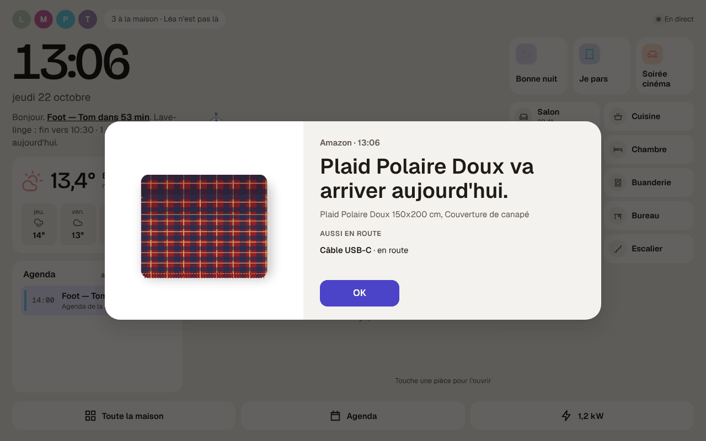

# Étape 87 : les colis Amazon sur la tablette, expliqués



## Le but

Comme l'Echo d'Amazon qui affiche « Plaid va arriver aujourd'hui. D'Amazon », la **tablette
murale** ouvre une fenêtre, avec la photo de l'article :

| Quand | La fenêtre dit |
|---|---|
| le colis part en livraison | « Plaid Polaire Doux va arriver aujourd'hui. » |
| il est livré | « Plaid Polaire Doux a été livré. » |
| le livreur n'a pas pu le livrer | « Plaid Polaire Doux n'a pas pu être livré. » (en rouge) |

- Elle s'ouvre **par-dessus tout**, même quand la tablette est en veille, comme pour la
  [sonnette](sonnette.md) (qui passe d'abord si les deux arrivent ensemble).
- En dessous : les **autres colis en route** (« Câble USB-C · en route »), comme « Où est ma
  commande ? » sur l'Echo.
- **OK** la ferme ; sinon elle se ferme seule au bout de 30 minutes. Chaque annonce n'est montrée
  **qu'une fois** par tablette.
- La phrase de la **vue hub** le dit aussi : « … · 1 colis arrive aujourd'hui. », puis « 1 colis
  livré aujourd'hui ».
- **À la voix** ou dans Assist : « J'ai un colis ? », « Il y a une livraison aujourd'hui ? » →
  « Plaid Polaire Doux arrive aujourd'hui ; Câble USB-C est en route. »
- Sur un téléphone, pas de fenêtre : on peut se faire prévenir par une
  [automatisation](#une-notification-sur-le-téléphone).

## Comment ça marche

Amazon ne donne pas accès au suivi des colis d'un particulier (l'Echo, lui, est chez Amazon). Mais
il envoie **un e-mail à chaque étape** : « Expédié : « Plaid… » », « Votre colis arrive
aujourd'hui », « Livré : « Plaid… » ». La maison lit donc ces e-mails dans ta boîte **Gmail**,
toutes les 3 minutes, et en tire l'état de chaque colis :

- **l'étape**, d'après l'objet de l'e-mail (expédié, en cours de livraison, livré, en retard, pas
  livré) ;
- **l'article**, d'après l'objet aussi ; le nom court (« Plaid Polaire Doux ») pour la fenêtre, le
  nom complet en dessous ;
- **la commande** (`405-1234567-7654321`), pour relier les e-mails d'un même colis ;
- **la photo** de l'article, téléchargée depuis les serveurs d'images d'Amazon.

Un colis apparaît quelques minutes après l'e-mail d'Amazon : souvent un peu après l'Echo.

Ce que la maison publie :

| Entité | Ce qu'elle contient |
|---|---|
| `sensor.colis_amazon` | le nombre de colis en route ; `aujourdhui` (arrivent aujourd'hui), `livres_aujourdhui`, la liste `colis` (10 au plus) et le `dernier` à annoncer |
| `camera.colis_amazon` | la photo de l'article du dernier colis |

Et deux évènements, pour les automatisations : `colis_en_livraison` et `colis_livre` (avec
`article`, `article_complet`, `phrase`).

## L'installer (5 minutes)

La maison lit une boîte **Gmail**. Les e-mails d'Amazon arrivent sur Hotmail ou Outlook.com ?
Fais d'abord l'étape [Avec Hotmail](#avec-hotmail-ou-outlookcom), puis celles-ci avec la boîte
Gmail qui les reçoit.

### 1. Un mot de passe d'application Google

La maison ne reçoit **pas** ton mot de passe Gmail : Google donne un mot de passe à part, pour
elle seule, qu'on peut retirer à tout moment.

1. La **validation en deux étapes** doit être active sur le compte Google (myaccount.google.com →
   Sécurité).
2. Ouvre [myaccount.google.com/apppasswords](https://myaccount.google.com/apppasswords), donne le
   nom `Maison`, puis **Créer**.
3. Google affiche 16 lettres (`abcd efgh ijkl mnop`) : garde-les pour l'étape suivante. Elles ne
   sont montrées qu'une fois.

L'accès IMAP de Gmail est actif d'office. S'il te le demande : Gmail → Paramètres → Transfert et
POP/IMAP → Activer IMAP.

### 2. Associer la boîte

Sur le mini-PC :

```bash
sudo ha-maison colis pair
```

Il demande le serveur (Entrée pour `imap.gmail.com`), l'adresse Gmail et le mot de passe
d'application (rien ne s'affiche en le collant ; les espaces ne comptent pas). Il vérifie la boîte
et affiche les colis des deux dernières semaines :

```text
associée !
colis Amazon des deux dernières semaines :
  22/10 07:15  Plaid Polaire Doux va arriver aujourd'hui.
  21/10 18:40  Câble USB-C est en route.
```

Puis `sudo systemctl restart ha-maison`. C'est fini.

### Vérifier, défaire

```bash
sudo ha-maison colis status   # la boîte, et les colis qu'elle voit
sudo ha-maison colis forget   # oublie la boîte
```

Pour couper aussi l'accès côté Google : supprime le mot de passe « Maison » sur
myaccount.google.com/apppasswords.

### Plus prudent : une boîte rien que pour les colis

Un mot de passe d'application ouvre **toute** la boîte (Google ne sait pas limiter l'accès à
certains e-mails), même si la maison ne lit que ceux d'Amazon. Si tu préfères qu'elle ne voie
rien d'autre :

1. crée un compte Gmail pour la maison (`maison.colis@gmail.com`) ;
2. dans ta boîte : Paramètres → Transfert et POP/IMAP → **Ajouter une adresse de transfert**
   (celle de la maison), puis un **filtre** « De : `amazon.fr` » → **Transférer** à cette
   adresse ;
3. associe la boîte de la maison (`colis pair`) au lieu de la tienne.

Un e-mail transféré tel quel garde la signature d'Amazon : la maison le reconnaît pareil
(`colis status` prévient si ce n'est pas le cas).

### Avec Hotmail (ou Outlook.com)

Depuis fin 2024, Microsoft **refuse les mots de passe** (même les mots de passe d'application)
aux programmes qui lisent une boîte Hotmail, Outlook.com, Live ou MSN : il faut une application
enregistrée chez Microsoft Azure, avec un compte Azure. `colis pair` refuse donc une adresse
Hotmail, et explique quoi faire.

Le plus simple : **Hotmail redirige les e-mails d'Amazon vers une boîte Gmail**, et la maison lit
celle-ci. Avec un compte Gmail créé exprès pour la maison, elle ne voit **que** les e-mails
d'Amazon : rien d'autre de ta boîte Hotmail.

1. **Une boîte Gmail pour la maison** : crée un compte Google (par exemple
   `maison.colis.dupont@gmail.com`), active la validation en deux étapes, et crée son mot de
   passe d'application ([étape 1](#1-un-mot-de-passe-dapplication-google)).
2. **La règle dans Hotmail**, sur [outlook.live.com](https://outlook.live.com) depuis un
   ordinateur :
   1. la roue dentée (Paramètres) → **Courrier** → **Règles** → **Ajouter une nouvelle règle** ;
   2. nom : `Colis Amazon` ;
   3. condition : **L'adresse de l'expéditeur inclut** → `amazon.fr` ;
   4. action : **Rediriger vers** → l'adresse Gmail de la maison ;
   5. **Enregistrer**.

   Choisis bien **Rediriger vers**, pas « Transférer à » : un transfert devient un e-mail venant
   de toi, sans la signature d'Amazon, et la maison l'ignore. Avec la redirection, l'e-mail
   arrive tel qu'Amazon l'a envoyé. Tu continues de le recevoir aussi dans Hotmail.
3. **Associer** la boîte Gmail de la maison : `sudo ha-maison colis pair`
   ([étape 2](#2-associer-la-boîte)).

La règle ne vaut que pour les **nouveaux** e-mails : la maison verra les colis à partir du
prochain e-mail d'Amazon. Après celui-ci, vérifie :

```bash
sudo ha-maison colis status
```

Le colis doit apparaître. Si la commande dit « e-mail(s) d'Amazon ignoré(s) : la signature
d'Amazon n'a pas été vérifiée », la redirection l'a abîmée : dis-le-moi. Si rien n'arrive dans
la boîte Gmail, Microsoft bloque parfois la redirection vers une autre adresse pour un compte
récent ou non vérifié : Paramètres → Courrier → Transfert indique alors pourquoi. Et si les
e-mails d'Amazon arrivent dans les **Spams** de la boîte Gmail, ouvre-en un et clique
**Signaler comme non-spam** : la maison ne lit pas les spams.

### Une notification sur le téléphone

Les évènements servent aux automatisations. Par exemple, un message quand un colis est livré :

```yaml
- id: colis_livre
  alias: Colis livré
  triggers:
    - trigger: event
      event_type: colis_livre
  actions:
    - action: notify.send_message
      target: {entity_id: notify.appli}
      data:
        title: Colis
        message: "{{ trigger.event.data.phrase }}"
        tag: colis
```

## Sécurité

- **Lecture seule** : la maison ouvre la boîte en lecture seule (`EXAMINE`), lit les e-mails sans
  les marquer comme lus (`BODY.PEEK`), et ne connaît aucune commande qui modifie, déplace ou
  supprime un e-mail. Elle n'envoie jamais d'e-mail.
- **Seulement Amazon** : elle ne demande à Gmail que les e-mails des 14 derniers jours dont
  l'expéditeur contient « amazon » (60 au plus), et n'en lit que les en-têtes utiles et le début.
- **Seulement le vrai Amazon** : un e-mail compte si l'expéditeur est sur un domaine d'Amazon
  (`amazon.fr`, `amazon.com`…) **et** si Gmail a vérifié sa signature (DKIM ou DMARC, l'en-tête
  `Authentication-Results` ajouté par Gmail). Un faux « Livré : appelez le 0800… » envoyé par
  quelqu'un d'autre est ignoré.
- **Le mot de passe d'application est chiffré** dans la base (clé `ha.key`), jamais affiché ni
  écrit dans les journaux. La connexion à Gmail est chiffrée (TLS, certificat vérifié par les
  autorités du système).
- **La photo** n'est téléchargée que depuis les serveurs d'images d'Amazon
  (`m.media-amazon.com`…), en HTTPS, sans suivre de redirection, 2 Mio au plus, et seulement si
  c'est un JPEG ou un PNG. Elle reste en mémoire, comme celle de la sonnette.
- **Ce qui est gardé** : l'article, l'étape, l'heure et la commande des colis des deux dernières
  semaines, en mémoire. Rien du reste de l'e-mail (adresse, prix, nom) n'est publié.
- Les colis se voient comme les autres capteurs : un [invité](roles.md) ne voit que ce que
  ses droits lui montrent.

## Comment c'est construit

| Fichier | Rôle |
| ------- | ---- |
| [crates/ha-colis/src/imap.rs](../crates/ha-colis/src/imap.rs) | Nouveau : un petit client IMAP qui ne sait que lire (`LOGIN`, `LIST`, `EXAMINE`, `UID SEARCH`, `UID FETCH` avec `BODY.PEEK`), tailles bornées |
| [crates/ha-colis/src/mail.rs](../crates/ha-colis/src/mail.rs) | Lire un e-mail : en-têtes, mots encodés, quoted-printable, base64 ; la signature d'Amazon ; la photo et le numéro de commande |
| [crates/ha-colis/src/amazon.rs](../crates/ha-colis/src/amazon.rs) | L'étape d'après l'objet, le nom de l'article, et les colis d'après les e-mails |
| [crates/ha-colis/src/client.rs](../crates/ha-colis/src/client.rs) | La boucle : la boîte relue toutes les 3 minutes, les entités, les évènements, la photo |
| [crates/ha-storage/src/mail.rs](../crates/ha-storage/src/mail.rs) | La boîte, mot de passe chiffré (migration `0025_colis`) |
| [crates/ha-server/src/cli.rs](../crates/ha-server/src/cli.rs) | `colis pair`, `status`, `forget` |
| [web/colis.js](../crates/ha-api/web/colis.js) | Nouveau : la fenêtre de la tablette, et la phrase de la vue hub |
| [crates/ha-assist/src/lib.rs](../crates/ha-assist/src/lib.rs) | « J'ai un colis ? » |

Essayé contre un faux Gmail (sur le PC) : l'association avec la vraie commande (un faux e-mail
« Amazon » non signé ignoré), puis sur la tablette « Plaid Polaire Doux va arriver aujourd'hui. »
avec sa photo, par-dessus la vue hub, et « 1 colis arrive aujourd'hui » dans sa phrase ; pas de
fenêtre sur le téléphone, ni de nouveau après avoir rechargé la page ; puis « a été livré » et
l'évènement `colis_livre`. Pas encore essayé avec une vraie boîte Gmail.

### Concepts utilisés

**IMAP** : la façon standard de lire une boîte aux lettres à distance (comme le fait l'appli Mail
d'un téléphone). Les e-mails restent sur le serveur de Google ; la maison en demande une copie.

**DKIM** : Amazon signe chacun de ses e-mails avec une clé que lui seul possède ; Gmail vérifie
la signature à la réception et note le résultat dans l'e-mail (`dkim=pass header.i=@amazon.fr`).
N'importe qui peut écrire « Amazon » comme expéditeur ; personne d'autre ne peut produire cette
signature.

**Mot de passe d'application** : un mot de passe de 16 lettres que Google crée pour un seul
programme. Il ne permet pas de changer le mot de passe du compte ni de passer la validation en deux
étapes, et on le retire sans toucher au reste.
