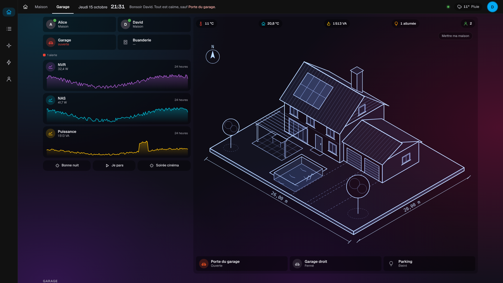
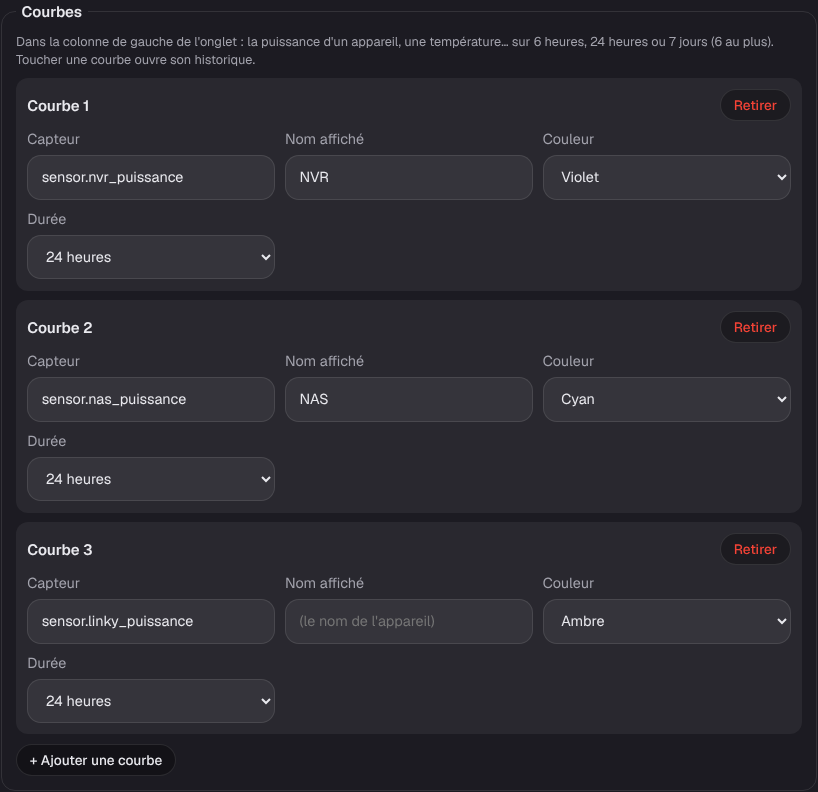
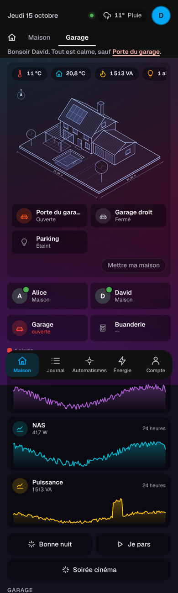

# Étape 40 : les courbes dans les onglets, expliquées

## Le but

Comme dans l'onglet Garage des tableaux de domo-blog, on veut voir **d'un coup d'œil** comment
évolue une valeur : la puissance du NVR et du NAS, celle du compteur, la température dehors.
Chaque onglet peut donc montrer des **courbes** dans sa colonne de gauche, sous les pièces.

Une courbe, c'est une carte :

- en haut, l'icône, le nom et la **valeur du moment** (« NAS · 41,7 W »), et la durée affichée ;
- dessous, la **courbe**, d'une couleur au choix, avec un léger dégradé sous la ligne.

Toucher la carte ouvre l'**historique** complet de l'appareil, comme partout ailleurs.

## Régler les courbes

**Mon compte → Dessin de la maison… → Courbes**, pour chaque onglet :

| Champ        | Pour…                                                              |
| ------------ | ------------------------------------------------------------------ |
| Capteur      | l'appareil à suivre : `sensor.nas_puissance`, `sensor.meteo_temperature`… |
| Nom affiché  | facultatif : « NAS » plutôt que « NAS puissance »                   |
| Couleur      | ambre, orange, rouge, vert, cyan, bleu, violet ou rose              |
| Durée        | 6 heures, 24 heures ou 7 jours                                      |

Six courbes au plus par onglet. Il faut un capteur **numérique** : un appareil sans valeur chiffrée
donne une carte vide.

Les couleurs suivent le thème : les couleurs de Home Assistant en Maquette, une encre plus sobre
en plan d'architecte.

## Sur téléphone

Les courbes passent sous les pièces, sur toute la largeur de l'écran.

## Sécurité

- Les courbes sont lues avec la route d'historique habituelle : il faut le droit « lire
  l'historique ». Sans ce droit, la carte dit « Historique réservé » et rien n'est demandé au
  serveur.
- Le serveur **vérifie** chaque courbe : un appareil bien écrit, une couleur et une durée de la
  liste, un nom de 30 caractères au plus, 6 courbes au plus. Rien d'autre n'est gardé.
- Un **invité** ne reçoit pas les courbes des appareils qui lui sont cachés (une personne,
  l'alarme…) : le serveur les retire avant de répondre, comme les calques et les valeurs.
- La courbe est dessinée en SVG, sans `innerHTML` ni style écrit dans la page : la politique de
  sécurité ne change pas.

## Comment c'est construit

- `crates/ha-api/src/drawing.rs` : chaque onglet a un champ `charts`
  (`{"entity_id", "name"?, "color", "hours"}`), vérifié avec le reste.
- `crates/ha-api/web/house.js` : les cartes, la courbe et le réglage. Les points viennent de
  `GET /api/history/{appareil}/series?hours=24` (300 points au plus, la moyenne de chaque tranche).
  Ils sont gardés **5 minutes** en mémoire ; la valeur du moment, elle, est ajoutée au bout de la
  courbe à chaque changement d'état.
- La courbe est un `<svg>` étiré sur la largeur (`preserveAspectRatio="none"`) ; le trait garde son
  épaisseur grâce à `vector-effect: non-scaling-stroke`. Sa couleur vient du CSS (`currentColor`),
  donc du thème.
