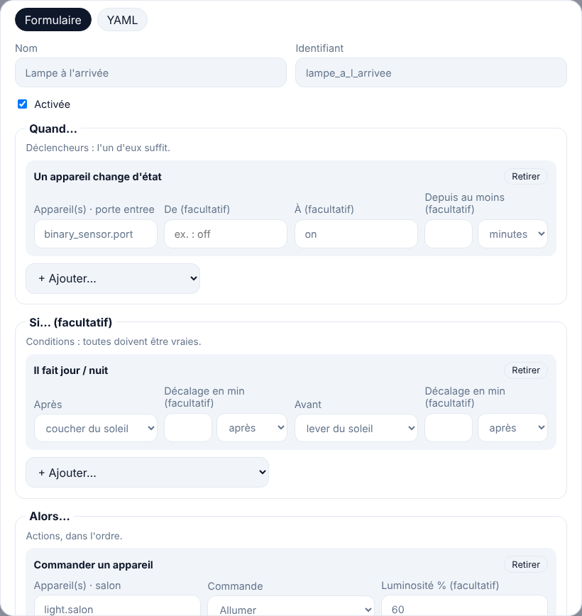
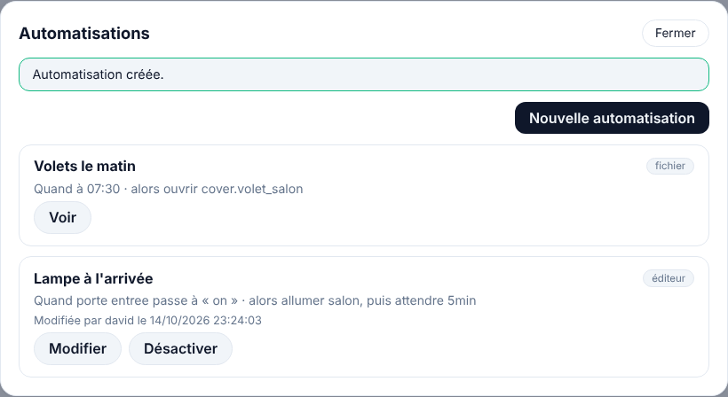

# Étape 13 : l'éditeur d'automatisations, expliqué



## Le but

Jusqu'ici, une automatisation s'écrivait dans `automations.yaml`, puis il fallait redémarrer le
serveur. Comme dans Home Assistant, on peut maintenant les **créer et les modifier depuis le
tableau de bord**, sur l'ordinateur ou le téléphone, et elles prennent effet **tout de suite**.

## Utiliser l'éditeur

Bouton **Automatisations** en haut du tableau de bord.



- La **liste** montre chaque automatisation avec un résumé en français (« Quand porte entrée passe
  à « on » · alors allumer salon »), d'où elle vient (**fichier** ou **éditeur**) et si elle est
  désactivée ou invalide.
- **Nouvelle automatisation** ouvre le **schéma** (étape 35) : des blocs reliés, façon n8n, expliqué
  dans [son guide](schema.md). L'onglet **Formulaire** montre la même automatisation en trois blocs :
  - **Quand…** : un appareil change d'état, une valeur passe un seuil, une heure, le soleil ;
  - **Si…** (facultatif) : un appareil est dans un état, une plage horaire et des jours, il fait jour
    ou nuit ;
  - **Alors…** : commander un appareil (allumer, fermer les volets, lancer une scène, envoyer une
    notification…) ou attendre.

  Les champs « Appareil(s) » proposent les appareils connus. L'identifiant est fabriqué à partir du
  nom (« Lampe à l'arrivée » → `lampe_a_l_arrivee`).
- Le serveur **vérifie** l'automatisation pendant que tu tapes : « ✓ Automatisation valide », ou
  l'erreur à corriger. Un appareil qui n'existe pas (souvent une faute de frappe) est signalé, sans
  bloquer : il est peut-être simplement débranché.
- L'onglet **YAML** montre la même automatisation en texte, comme dans `automations.yaml`. On peut
  l'écrire directement, ou coller une automatisation copiée du fichier ou d'un forum.
- **Désactiver / Activer** depuis la liste, **Dupliquer** pour partir d'une automatisation
  existante, **Versions** pour revenir en arrière (les 20 dernières versions sont gardées, même
  après une suppression).

### Et le fichier `automations.yaml` ?

Il continue de fonctionner, **en lecture seule** : le serveur ne le modifie jamais (avec Docker, le
dossier `config` est même monté en lecture seule). Ses automatisations apparaissent dans la liste
avec le bouton **Voir**. Pour en déplacer une dans l'éditeur : **Dupliquer**, enregistrer la copie,
puis la retirer du fichier.

Les automatisations de l'éditeur sont rangées dans la **base de données** (`ha.db`) : elles sont
donc incluses dans les sauvegardes de l'étape 7.

## La sécurité

Une automatisation peut ouvrir les volets à 3 h du matin ou couper une prise. Créer ou modifier une
automatisation est donc protégé plus fortement que le reste :

- **Confirmer son identité.** Avant la première modification, le tableau de bord redemande le **mot
  de passe** (et le code à usage unique si la double authentification est activée). La confirmation
  vaut **15 minutes**, pour cet onglet seulement, et disparaît à la déconnexion. Un jeton volé, ou un
  téléphone resté déverrouillé, ne suffit donc pas. Les essais sont limités comme à la connexion.
- **Les mêmes vérifications que le fichier**, à chaque enregistrement et à chaque démarrage : une
  automatisation ne peut toujours **que** commander des appareils et attendre. Pas de commande système,
  pas de code ; les modèles `{{ … }}` (étape 34) ne savent que lire des états. Champs inconnus refusés, durées limitées à 24 h, 200 automatisations au
  plus, 20 déclencheurs, conditions ou actions par automatisation.
- **Tout est tracé.** Le journal d'activité signé note les confirmations (et leurs échecs), les
  créations, modifications et suppressions, avec qui et depuis quelle adresse.
- **Tu es prévenu.** Si les notifications sont configurées (étape 12), chaque modification envoie
  « Automatisation modifiée : « Lampe à l'arrivée » créée par david » sur ton téléphone. Si ce
  n'est pas toi, tu le sais tout de suite.
- **Possibilité de tout verrouiller.** Avec `HA_AUTOMATION_EDITOR=off`, l'éditeur reste consultable,
  mais toute modification est refusée.
- **Une automatisation abîmée ne bloque pas la maison.** Si une automatisation de l'éditeur devient
  invalide (par exemple : elle utilise le soleil, et la position de la maison a été retirée), elle est
  mise de côté, signalée dans les logs et dans la liste, et les autres tournent normalement.

En cas de doute, sur la machine elle-même :

```powershell
cargo run -p ha-server -- automations list            # toutes, avec qui les a modifiées
cargo run -p ha-server -- automations check           # fichier, scripts, scènes et éditeur
cargo run -p ha-server -- automations delete <id>     # supprimer sans le tableau de bord
cargo run -p ha-server -- audit                       # le journal
```

## Un piège du YAML : `on` sans guillemets

En YAML, `on`, `off`, `yes` ou `true` **sans guillemets** veulent dire « vrai » ou « faux », pas le
texte « on ». Home Assistant a le même piège. Le serveur refuse donc `to: on` avec un message clair
(« écris-la entre guillemets, par exemple "on" »), au lieu de deviner. En revanche, un nombre sans
guillemets (`state: 3`) est accepté comme du texte.

## Comment c'est construit

| Fichier | Contenu |
|---------|---------|
| [config/](../crates/ha-automation/src/config/) | `AutomationConfig` : la forme écrite, en YAML ou en JSON, et sa vérification |
| [editor.rs](../crates/ha-automation/src/editor.rs) | Fichier + base, vérifications, enregistrement, versions |
| [engine.rs](../crates/ha-automation/src/engine.rs) | Rechargement du moteur sans redémarrage |
| [automations.rs (stockage)](../crates/ha-storage/src/automations.rs) | Tables `automations` et `automation_versions` |
| [automations.rs (API)](../crates/ha-api/src/automations.rs) | Routes `/api/automations…` et `/api/auth/confirm` |
| [app.js](../crates/ha-api/web/app.js) | La liste, le formulaire, le mode YAML, la confirmation |

Les routes de l'API :

| Méthode | Chemin | Rôle |
|---------|--------|------|
| GET | `/api/automations` | La liste (fichier et éditeur) |
| POST | `/api/automations/check` | Vérifie sans enregistrer ; sert aussi à passer du formulaire au YAML |
| PUT | `/api/automations/{id}` | Crée ou modifie (confirmation requise) |
| DELETE | `/api/automations/{id}` | Supprime (confirmation requise) |
| GET | `/api/automations/{id}/versions` | Les versions précédentes |
| PUT | `/api/automations/{id}/layout` | La place des blocs du schéma (sans confirmation, voir [le schéma](schema.md)) |
| POST | `/api/auth/confirm` | Confirme son identité pour 15 minutes |

**Le rechargement sans redémarrage.** Après un enregistrement, l'éditeur envoie la nouvelle liste au
moteur. Les automatisations **inchangées** continuent comme si de rien n'était : une action en cours
(« éteindre dans 10 minutes ») n'est pas interrompue, une attente `for:` non plus. Seules celles qui
ont été modifiées ou supprimées sont arrêtées.

**Concepts Rust rencontrés :**

- **`Serialize` et `Deserialize` sur la même structure.** `AutomationConfig` sait se lire depuis du
  YAML (le fichier, le mode texte) ou du JSON (le formulaire), et s'écrire dans les deux formats.
  Tout passe par elle : une automatisation est donc toujours réécrite sous une forme unique, et le
  formulaire et le YAML ne peuvent pas diverger.
- **Un canal `watch`** (`tokio::sync::watch`) pour le rechargement : il ne garde que la **dernière**
  valeur envoyée. Deux enregistrements rapprochés ? Le moteur ne charge que le plus récent.
- **Un `Visitor` serde écrit à la main** (`Text`) : il accepte du texte ou un nombre, et refuse un
  booléen avec un message en français. C'est la façon de contrôler finement ce qu'on accepte.
- **Un `Mutex` asynchrone** (`tokio::sync::Mutex`) dans l'éditeur : un seul enregistrement à la fois.
  Deux modifications simultanées ne peuvent ni se mélanger, ni dépasser ensemble la limite de 200.
- **Une transaction SQL** pour chaque enregistrement : l'automatisation et sa nouvelle version sont
  écrites ensemble, ou pas du tout.

## Testé

- Le même YAML donne exactement la même automatisation, qu'il vienne du fichier, du mode texte ou du
  formulaire (aller-retour YAML → JSON → YAML).
- Création, modification, désactivation, suppression, versions (même après suppression), limite de
  200, identifiant déjà pris par le fichier, soleil sans position, valeurs invalides : refusées avec
  un message clair.
- Une ligne abîmée dans la base est signalée et mise de côté, sans empêcher les autres de tourner.
- Rechargement : une automatisation créée pendant qu'une autre attend (`delay`) se déclenche aussitôt,
  et l'attente de l'autre continue. Une automatisation supprimée ne se déclenche plus.
- API : chaque route exige d'être connecté ; modifier exige une confirmation récente, liée au jeton
  (un autre jeton doit confirmer à son tour, et la déconnexion l'efface) ; mode lecture seule ; tout
  est dans le journal d'audit.
- De bout en bout dans Chromium, sur ordinateur et téléphone : création au formulaire, passage en
  YAML et retour, erreur affichée, mauvais mot de passe refusé **sans déconnecter** (un bug trouvé et
  corrigé grâce à ce test), enregistrement, désactivation, versions, automatisation du fichier en
  lecture seule. Aucune erreur JavaScript, aucun débordement sur téléphone.
- Sur le serveur en marche : l'automatisation créée dans le navigateur s'est déclenchée à
  l'ouverture de la porte (simulée), **sans redémarrage**, et est toujours là après un redémarrage.
