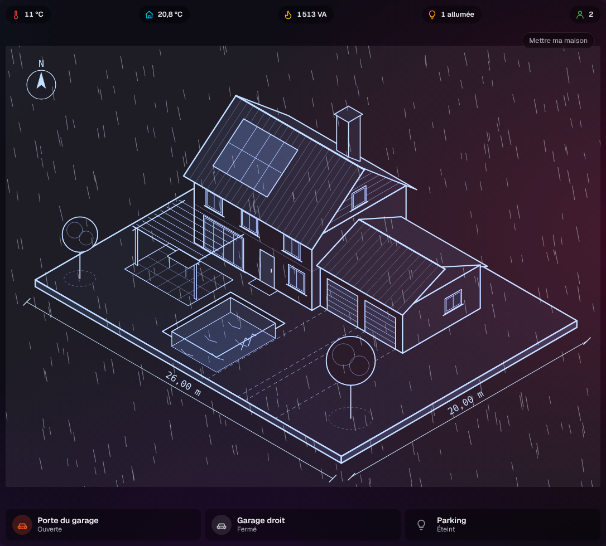
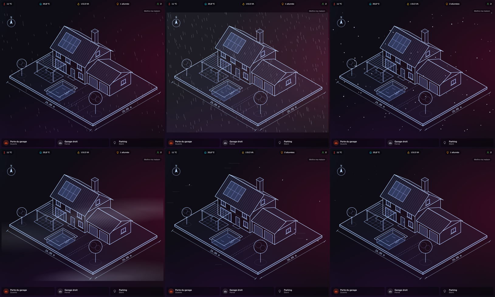

# Étape 43 : les effets météo animés sur la maquette, expliqués

## Le but

Depuis l'[étape 39](ambiances.md), le fond de la maquette change avec le temps qu'il fait, mais
l'image reste fixe. Maintenant, **la maquette bouge** : il pleut dessus, il neige, un éclair passe.
Même sans fond d'ambiance dédié, on voit d'un coup d'œil le temps qu'il fait dehors.

| Temps (météo locale)      | Effet                                                                    |
| ------------------------- | ------------------------------------------------------------------------ |
| Pluie                     | des gouttes en biais                                                     |
| Averses                   | des gouttes plus longues, plus rapides, plus serrées                     |
| Orage                     | une forte pluie, et un éclair de temps en temps (un flash en deux temps) |
| Grêle                     | des grains rapides, avec un peu de pluie                                 |
| Neige                     | des flocons qui tombent doucement en zigzag                              |
| Pluie et neige            | des gouttes, des flocons et un léger voile                               |
| Brouillard                | de grands voiles flous qui dérivent lentement                            |
| Vent                      | des traînées et quelques feuilles qui passent                            |
| Nuit claire               | des étoiles qui scintillent                                              |
| Soleil, éclaircies, nuages | rien : le dessin reste net                                               |

L'effet suit **le même temps que l'ambiance**, donc la météo locale (`weather`) et le soleil
(`sun.sun`). Si une ambiance est imposée pour essayer, l'effet la suit aussi.

## Régler les effets

**Mon compte → Dessin de la maison… → Effets animés**, pour chaque onglet :

| Réglage   | Choix                                                             |
| --------- | ----------------------------------------------------------------- |
| Effets    | **Automatiques** (selon la météo), **Désactivés**, ou **Toujours : neige**, etc., pour essayer |
| Intensité | **Discrète** (moitié moins), **Normale**, **Forte** (presque deux fois plus, éclairs plus fréquents) |

L'aperçu du réglage montre l'effet tout de suite, et « Maintenant : … » dit celui qui s'afficherait
d'après la météo du moment.

Les effets se posent **sur le dessin seulement**. Les valeurs et les zones à toucher restent
par-dessus, lisibles et cliquables. Les gouttes sont claires sur la Maquette et le plan de nuit, et
à l'encre bleue sur le plan d'architecte de jour.

## Léger, et sans gêne

- **Un seul `<canvas>`** par dessin et **une seule boucle d'animation** pour toute la page.
  Chaque type de trait est dessiné en un seul tracé.
- **La boucle s'arrête** dès que la page est cachée (autre onglet, écran éteint), et quand il
  n'y a aucun effet.
- Le nombre de particules suit la taille du dessin : moins sur téléphone, et jamais plus de 900.
  Sur la démonstration en 1920 × 1080, l'animation tient 60 images par seconde, orage fort compris.
- **Si l'appareil demande de réduire les mouvements**, l'effet s'affiche en image fixe (des
  gouttes, des flocons immobiles), **sans éclair**.

## Sécurité

- Côté serveur, deux réglages par onglet, vérifiés : `effects` (`off`, ou un effet de la liste)
  et `effects_level` (`discret` ou `fort`). Le reste est refusé.
- Rien d'autre ne change : pas de nouvelle route, pas de nouvelle donnée, toujours aucun
  `innerHTML`. Dessiner sur un `<canvas>` ne demande rien de plus à la politique de sécurité.

## Comment c'est construit

- `crates/ha-api/web/house.js` :
  - `effectOf()` choisit l'effet de l'onglet (imposé, sinon d'après l'ambiance) ;
  - `setFx()` le pose sur le dessin ;
  - `fxTick()` fait avancer toutes les particules à chaque image ;
  - les vitesses sont en pixels par seconde, multipliées par le temps écoulé : l'animation va au
    même rythme sur un écran à 60 ou à 120 Hz.
- La couleur vient du CSS (`--fx-ink`, en « r g b »), donc du style choisi.
- `crates/ha-api/src/drawing.rs` : les deux réglages et leur vérification.
