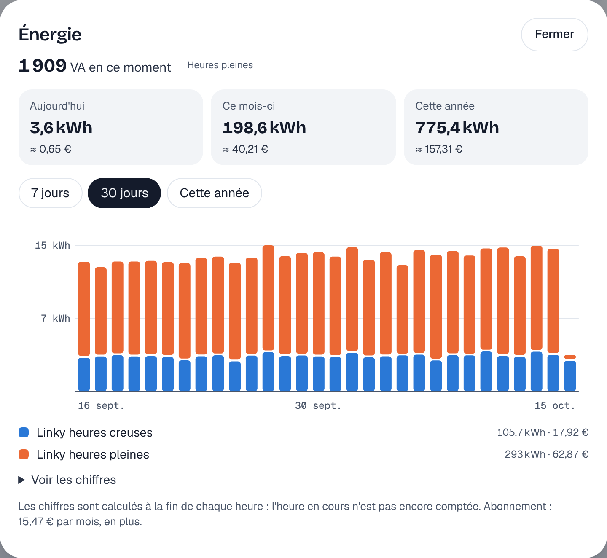
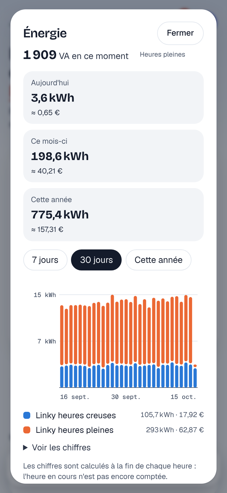

# Étape 32 : le compteur Linky et le bilan énergétique, expliqué



## Le but

Savoir ce que la maison consomme, quand, et ce que ça coûte, avec les données de **ton propre
compteur**, sans compte Enedis ni cloud. Le Linky a une prise prévue pour ça : la **TIC**
(télé-information client), sous son cache, avec trois bornes `I1`, `I2` et `A`. Elle envoie en
continu les index de consommation, la puissance et la période tarifaire.

Deux morceaux arrivent ici :

| Morceau                | Ce qu'il fait                                                                         |
| ---------------------- | ------------------------------------------------------------------------------------- |
| Lecture du Linky       | capteurs `sensor.linky_…` : index (kWh), puissance (VA), intensité, période tarifaire |
| Bilan énergétique      | bouton **Énergie** : par jour, par mois, sur l'année, avec le coût                    |

## Brancher le compteur

Il faut un petit **module TIC** entre le Linky et la maison. Trois possibilités :

| Module                                                     | Réglage                                    |
| ---------------------------------------------------------- | ------------------------------------------ |
| Clé USB sur la machine du serveur (µTeleinfo, Teleinfo USB…) | `HA_TELEINFO=/dev/ttyUSB0`               |
| Module réseau qui renvoie la liaison telle quelle (ser2net, ESP « pont série ») | `HA_TELEINFO=tcp://192.168.1.50:3333` |
| Module qui publie sur MQTT (ESPHome, Tasmota, ZLinky en Zigbee…) | rien : ses capteurs arrivent par la découverte MQTT (étape 4) |

Le **mode** de la TIC est reconnu tout seul :

- **historique** (le plus courant) : 1200 bauds, étiquettes `BASE`, `HCHC`, `HCHP`, `PAPP`… ;
- **standard** (souvent activé pour les panneaux solaires) : 9600 bauds, étiquettes `EAST`,
  `EASF01`…, `SINSTS`, et la production injectée `EAIT`.

Sur une clé USB, le serveur essaie une vitesse, puis l'autre au bout de 15 secondes sans trame
lisible. `HA_TELEINFO_MODE=historique` ou `standard` impose le mode.

Avec Docker, décommente dans [compose.yaml](../compose.yaml) les lignes `HA_TELEINFO`, `devices` et
`group_add` : le conteneur ne voit que ce port-là, et seulement en lecture.

### Les capteurs créés

| Entité                         | Exemple            | Remarque                                          |
| ------------------------------ | ------------------ | ------------------------------------------------- |
| `sensor.linky_energie`         | 35 802,5 kWh       | tout ce qui a été consommé ; option tarifaire, puissance souscrite et numéro masqué en attributs |
| `sensor.linky_heures_creuses`… | 12 345,7 kWh       | un capteur par index : base, heures creuses, heures pleines, EJP, les 6 index Tempo |
| `sensor.linky_production`      | 250 kWh            | mode standard, s'il y a de la production          |
| `sensor.linky_puissance`       | 920 VA             | puissance apparente, toutes les 10 secondes       |
| `sensor.linky_intensite`       | 4 A                | la plus forte des phases                          |
| `sensor.linky_tension`         | 232 V              | mode standard seulement                           |
| `sensor.linky_periode`         | Heures creuses     | change dans le journal de bord : « passe à Heures creuses » |

Le compteur envoie une trame toutes les 1 à 2 secondes : on ne publie les index **qu'une fois par
minute**, et la puissance toutes les 10 secondes, pour ne pas noyer l'historique. Ces capteurs
servent dans les automatisations comme les autres :

```yaml
- id: chauffe_eau_heures_creuses
  alias: Chauffe-eau en heures creuses
  triggers:
    - trigger: state
      entity_id: sensor.linky_periode
      to: Heures creuses
  actions:
    - action: switch.turn_on
      target: {entity_id: switch.chauffe_eau}
```

Si le module se tait (câble débranché), les capteurs passent « indisponible » au bout d'une minute,
et une **alerte de réparation** apparaît au bout d'une heure (étape 31).

## Étape 60 : la couleur Tempo du jour et du lendemain

Avec un contrat **Tempo**, le prix du kWh dépend de la couleur du jour : bleu (le moins cher),
blanc, ou rouge (22 jours par an, l'hiver, très cher en heures pleines). La couleur du lendemain est
annoncée la veille. Le compteur la reçoit, et l'envoie dans la TIC : le serveur la lit **sur le
compteur**, sans Internet, sans compte et sans service extérieur.

| Entité                          | Valeurs                                | D'où elle vient                                   |
| ------------------------------- | -------------------------------------- | ------------------------------------------------- |
| `sensor.linky_tempo_aujourdhui` | `Bleu`, `Blanc`, `Rouge`               | historique : la période (`PTEC` = `HPJR`…) ; standard : le registre d'état `STGE` (bits 24-25) |
| `sensor.linky_tempo_demain`     | `Bleu`, `Blanc`, `Rouge`, ou `unknown` | historique : `DEMAIN` ; standard : `STGE` (bits 26-27) |

- **Un jour Tempo va de 6 h à 6 h** le lendemain : à 3 h du matin, « aujourd'hui » est encore la
  couleur de la veille. Les heures creuses vont de 22 h à 6 h.
- Demain vaut `unknown` tant que le compteur n'a pas reçu la couleur : elle arrive dans la journée,
  à une heure qui dépend du compteur.
- Ces deux capteurs n'existent qu'avec un contrat Tempo : hors Tempo, le compteur n'annonce aucune
  couleur, et rien n'est publié.
- Un module qui publie sur MQTT (ZLinky, ESPHome…) a ses propres capteurs : ceux-ci viennent
  seulement de `HA_TELEINFO`.

Sur le tableau de bord, la tuile **Tempo aujourd'hui** montre la couleur du jour et celle de demain,
et le panneau **Énergie** les rappelle à côté de la puissance. Un **jour rouge**, aujourd'hui ou
demain, apparaît dans « ce qui demande ton attention » (et sur l'écran de veille). La couleur est
toujours écrite en toutes lettres, pas seulement dessinée.

Les capteurs servent dans les automatisations, comme dans Home Assistant avec l'intégration
« RTE Tempo » (ici sans Internet) :

```yaml
# La veille d'un jour rouge, prévenir sur le téléphone (étape 50).
- id: tempo_demain_rouge
  alias: Demain, jour rouge
  triggers:
    - trigger: state
      entity_id: sensor.linky_tempo_demain
      to: Rouge
  actions:
    - action: notify.send_message
      target: {entity_id: notify.appli}
      data:
        title: Demain, jour rouge
        message: L'électricité coûtera bien plus cher de 6 h à 22 h. Lance les machines cette nuit.
        tag: tempo

# Un jour rouge, le chauffage passe en éco (étape 16) ; il revient au confort après.
- id: tempo_chauffage
  alias: Chauffage selon Tempo
  triggers:
    - trigger: state
      entity_id: sensor.linky_tempo_aujourdhui
      to: [Bleu, Blanc, Rouge]
  actions:
    - if:
        - condition: state
          entity_id: sensor.linky_tempo_aujourdhui
          state: Rouge
      then:
        - action: climate.set_preset_mode
          target: {entity_id: climate.salon}
          data: {preset_mode: eco}
      else:
        - action: climate.set_preset_mode
          target: {entity_id: climate.salon}
          data: {preset_mode: confort}
```

La liste `to: [Bleu, Blanc, Rouge]` ignore `unavailable` (module débranché) : le chauffage ne
change pas pour une coupure du module.

Pour le coût dans le bilan, mets dans `energy.yaml` les six index Tempo
(`sensor.linky_tempo_bleu_creuses`, `sensor.linky_tempo_bleu_pleines`… jusqu'à
`sensor.linky_tempo_rouge_pleines`), chacun avec le prix de ta facture.

## Le bilan énergétique

Le bouton **Énergie** (en haut, ou dans la barre du bas sur téléphone) montre :

- la **puissance du moment** et la période tarifaire (si le Linky est branché) ;
- ce qui a été consommé **aujourd'hui, ce mois-ci et cette année**, avec le coût ;
- un graphique **par jour** (7 ou 30 jours) ou **par mois** (cette année), un compteur par couleur ;
  la production solaire est dessinée vers le bas ;
- le détail de chaque compteur (kWh et euros), et le **tableau des chiffres**.



Les chiffres viennent des **statistiques long terme** (étape 24) : elles sont calculées à la fin de
chaque heure et gardées des années. Rien d'autre n'est enregistré, et l'heure en cours n'est pas
encore comptée.

### Les prix

Sans réglage, les index du Linky sont comptés, sans les prix. Pour avoir les euros, copie
[energy.example.yaml](../energy.example.yaml) en `energy.yaml` :

```yaml
consumption:
  - entity: sensor.linky_heures_creuses
    price: 0.1696        # € par kWh
  - entity: sensor.linky_heures_pleines
    price: 0.2146
production:
  - entity: sensor.linky_production
    price: 0.1276        # prix de revente
subscription: 15.47      # € par mois, affiché à part
```

N'importe quel compteur en kWh peut y figurer : une prise qui mesure sa consommation, un compteur
MQTT, un `utility_meter` (étape 30)… Une prise qui ne donne que sa puissance (W) passe par une
**intégrale** (`integration`, [étape 65](assistants.md#lintégrale-et-la-dérivée-étape-65)), qui
la change en kWh. Vérifier le fichier : `ha-server energy check`.

L'API : `GET /api/energy?days=30` (il faut le droit de lire l'historique : pas un invité).

## Sécurité

- Le compteur ne fait qu'**envoyer** : rien ne peut lui être commandé.
- Tout ce qui arrive est vérifié avant usage : somme de contrôle de chaque groupe, étiquettes et
  valeurs limitées (une ligne trop longue est jetée), valeurs absurdes ignorées.
- Le **numéro du compteur** identifie le foyer : seuls ses 4 derniers chiffres sont montrés
  (`…0246`).
- `HA_TELEINFO` n'accepte qu'un port `/dev/…` ou une adresse `tcp://hôte:port`.
- La liaison série est réglée avec la bibliothèque `nix`, qui donne une interface **sûre** (sans
  `unsafe`) aux réglages du système. Sous Windows, seule la version réseau est possible.
- Les invités ne voient pas le bilan (il dit quand la maison est vide).

## Comment c'est construit

- `crates/ha-teleinfo` (nouveau) : `frame.rs` décode les trames, `meter.rs` les traduit en index,
  puissance, période et couleurs Tempo (étape 60), `lib.rs` lit la source et publie les capteurs ;
- `crates/ha-energy` (nouveau) : `energy.yaml` et le calcul du bilan à partir des statistiques ;
- `crates/ha-api` : la route `/api/energy` ; `web/app.js` : le panneau Énergie.

### Concepts Rust utilisés

**Un automate dans une structure** (`Decoder`) : les octets arrivent par paquets de taille
quelconque, qui ne respectent pas les trames. Le décodeur garde où il en est (dans une trame ? dans
un groupe ?) entre deux appels à `feed`, et ne rend que les trames complètes.

**`#[cfg(unix)]`** : la lecture série n'existe que sous Linux et macOS. Le même module `serial`
existe en deux versions ; le compilateur ne garde que celle du système visé. Sous Windows, elle
répond simplement « utilise un module réseau ».

**Un fil d'exécution pour ce qui bloque** : lire un port série bloque jusqu'à l'arrivée d'octets.
Plutôt que de bloquer une tâche `tokio`, la lecture tourne dans un `std::thread` à part, qui envoie
les octets par un canal (`blocking_send`). Le port est réglé pour rendre la main chaque seconde : le
fil voit ainsi que le canal est fermé (serveur arrêté) et s'arrête proprement.

**Des étiquettes de boucle** (`'sources: loop`) : quand la source est perdue ou qu'il faut changer
de vitesse, `continue 'sources` repart de la boucle extérieure (rouvrir la source), depuis
l'intérieur de la boucle de lecture.

**Des entiers pour l'énergie** : le compteur envoie des Wh entiers ; on les écrit en kWh
avec `format!("{}.{:03}", wh / 1000, wh % 1000)`, sans passer par un nombre à virgule qui pourrait
afficher `12345.677999`.
