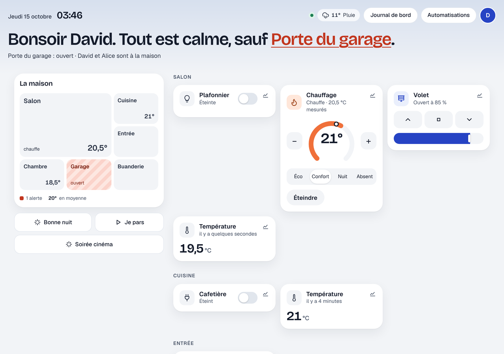
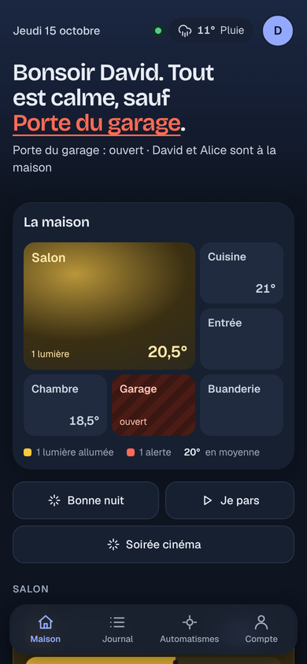

# Étape 6 : l'interface web, expliquée

## Ce que tu obtiens

Un tableau de bord dans le navigateur, sur ordinateur comme sur téléphone, mis à jour **en
direct** :





- **Lumières** : toucher la tuile allume ou éteint ; un curseur règle la luminosité.
- **Prises et interrupteurs** : toucher la tuile allume ou éteint.
- **Capteurs** : la valeur, son unité, et depuis quand elle n'a pas changé.
- **Détecteurs** : « Ouverte / Fermée » pour une porte, « Mouvement / Calme » pour un détecteur
  de présence…
- Thème **clair ou sombre** selon le réglage de ton ordinateur ou téléphone.
- Sur téléphone : « Ajouter à l'écran d'accueil » donne une icône qui ouvre le tableau de bord
  comme une appli.

Une tuile « clignote » entre le moment où tu la touches et celui où l'appareil **confirme** : on
voit l'état réel, pas un état supposé.

(La tuile au nom bizarre `` sur la capture est un **test de sécurité** : un
faux appareil au nom piégé. Il s'affiche comme du simple texte, rien n'est exécuté.)

## Comment c'est construit

```
navigateur                                   ha-server
──────────                                   ─────────
GET /            ──────────────────────────► index.html, app.js, style.css
                                             (intégrés au programme)
POST /api/auth/login   {nom, mot de passe} ► jeton
WebSocket /api/websocket ◄─────────────────► états + changements en direct
POST /api/services/light/toggle  + jeton   ► ordre à l'appareil (MQTT, Hue…)
```

Choix volontairement **simple** : trois fichiers (HTML, CSS, JavaScript moderne), **sans
framework ni outil de construction** (pas de React, pas de npm). Aucune dépendance JavaScript ne
peut donc être piratée, et rien n'est à installer en plus de Rust. Les fichiers sont dans
[crates/ha-api/web/](../crates/ha-api/web/) ; tu peux les lire et les modifier directement.

| Fichier | Contenu |
|---------|---------|
| [index.html](../crates/ha-api/web/index.html) | La structure : écran de connexion et tableau de bord |
| [style.css](../crates/ha-api/web/style.css) | L'apparence : tuiles, couleurs, thème sombre, téléphone |
| [app.js](../crates/ha-api/web/app.js) | Connexion, WebSocket en direct, tuiles, commandes |
| [web.rs](../crates/ha-api/src/web.rs) | Côté Rust : sert ces fichiers et définit la politique de sécurité |

## Les concepts rencontrés

**`include_str!` (Rust).** Les fichiers de la page sont lus **à la compilation** et intégrés au
programme, comme les migrations SQL. Il n'y a qu'un seul fichier à installer, et la page servie ne
peut pas être modifiée sans recompiler.

**Les « layers » de tower (Rust).** `SetResponseHeaderLayer` ajoute les en-têtes de sécurité à
**toutes** les réponses, page comme API, sans toucher aux gestionnaires de routes. Une couche
(« layer ») enveloppe le routeur, comme les poupées russes.

**Construire la page sans HTML (JavaScript).** La fonction `el()` crée chaque élément avec
`document.createElement` et met le texte avec `textContent`. Même les icônes SVG sont construites
élément par élément.

**Grille CSS automatique.** `grid-template-columns: repeat(auto-fill, minmax(210px, 1fr))` : le
navigateur met autant de tuiles par ligne que l'écran le permet. Il n'y a rien à écrire pour le
téléphone.

## Choix de sécurité de cette étape

- **Jamais de HTML venu de l'extérieur.** Les noms d'appareils viennent du réseau (MQTT, pont
  Hue). Ils sont insérés **uniquement** avec `textContent`, jamais avec `innerHTML`. Un test Rust
  vérifie que `app.js` n'utilise ni `.innerHTML`, ni `eval(`, ni leurs cousins.
- **Politique de sécurité du contenu (CSP)** sur chaque réponse : le navigateur ne charge **que**
  des fichiers venant du serveur, et **refuse tout script écrit dans la page**. Même si un nom
  piégé arrivait à s'insérer comme du HTML, il ne pourrait rien exécuter. Deuxième ceinture de
  sécurité.
- **Piège des clés spéciales.** Les libellés (« Ouverte », « Fermée »…) sont cherchés avec
  `Object.hasOwn`. Sinon, un appareil qui annoncerait le type `__proto__` ou l'état `constructor`
  obtiendrait des objets internes de JavaScript.
- **Autres en-têtes** : `X-Frame-Options: DENY` (la page ne peut pas être intégrée dans un autre
  site pour piéger tes clics), `X-Content-Type-Options: nosniff`, `Referrer-Policy: no-referrer`.
- **Le jeton** est gardé dans `sessionStorage` : il disparaît à la fermeture de l'onglet. La
  déconnexion le révoque côté serveur. Il passe dans le premier message du WebSocket, jamais dans
  une adresse.
- La page elle-même est publique (c'est juste le formulaire de connexion), mais **toutes les
  données et les commandes demandent un jeton**.

## Testé dans un vrai navigateur

En plus des tests Rust (fichiers servis, types, en-têtes, absence de `innerHTML`), la page a été
testée dans **Chromium**, piloté automatiquement, contre le vrai serveur et un broker MQTT avec de
faux appareils qui obéissent :

- connexion refusée avec un mauvais mot de passe, acceptée avec le bon ;
- prise allumée, lampe éteinte, luminosité réglée à 25 % au curseur, à chaque fois confirmé par
  l'appareil ;
- nom piégé affiché comme du texte, aucune balise injectée, aucune alerte ;
- déconnexion qui efface le jeton ;
- aucune erreur JavaScript, pas de défilement de travers sur téléphone.

## Essayer

```powershell
cargo run -p ha-server
```

Puis ouvre **http://127.0.0.1:8123/** dans ton navigateur et connecte-toi avec le compte créé à
l'étape 3.

**Depuis ton téléphone** : par défaut, le serveur n'écoute que sur ton ordinateur. Pour y accéder
depuis le téléphone, sur le même Wi-Fi, il faut l'ouvrir au réseau local :

```powershell
$env:HA_BIND = "0.0.0.0:8123"
cargo run -p ha-server
```

puis ouvrir `http://<adresse-IP-du-PC>:8123/` sur le téléphone. Attention : la connexion n'est
alors **pas chiffrée** sur ton Wi-Fi (le mot de passe y passe en clair). C'est acceptable sur un
réseau domestique de confiance pour essayer. Pour un usage quotidien et depuis l'extérieur, ce
sera l'étape 7 : HTTPS et accès via VPN, jamais d'ouverture directe sur Internet.
