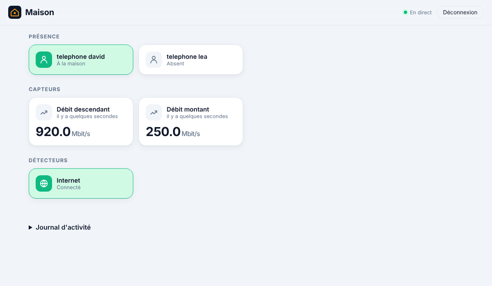

# Freebox : accès à distance par VPN, et présence à la maison, expliqué

Deux usages de ta Freebox Ultra :

1. **[le VPN WireGuard de la Freebox](#1-laccès-à-distance-par-le-vpn-de-la-freebox)** : accéder au tableau de
   bord depuis ton téléphone, n'importe où, sans service extérieur ;
2. **[l'intégration au serveur](#2-lintégration-freebox)** : savoir qui est à la maison, l'état de la
   connexion Internet, et être prévenu quand un appareil inconnu rejoint ton réseau.

## 1. L'accès à distance par le VPN de la Freebox

### Le principe

```
 téléphone (4G)                    Freebox Ultra                  chez toi
┌──────────────┐  tunnel WireGuard ┌─────────────┐  réseau local  ┌───────────┐
│ appli        │══════════════════►│ serveur VPN │───────────────►│ ha-server │
│ WireGuard    │   (chiffré)       │             │                │  :8123    │
└──────────────┘                   └─────────────┘                └───────────┘
```

Une fois le tunnel ouvert, ton téléphone est **comme branché sur ton Wi-Fi** : le tableau de bord
s'ouvre à son adresse locale. Tout reste chez toi, sans service extérieur. Et WireGuard ne
répond à **personne** qui n'a pas la bonne clé : pour un robot qui balaie Internet, le port du
VPN a l'air fermé.

### Mettre en place

**1. Ouvrir le tableau de bord au réseau local.** Le serveur doit être joignable depuis la
Freebox, et pas seulement depuis sa propre machine. Avec Docker, crée un fichier `.env` à côté
de `compose.yaml` (voir l'[étape 7](etape-7-deploiement.md#ouvrir-au-réseau-local-facultatif)) :

```
HA_PUBLISH=192.168.1.10
```

(l'adresse de la machine du serveur). Dans Freebox OS, rubrique DHCP, **réserve cette adresse**
pour la machine, pour qu'elle ne change pas.

**2. Activer le serveur VPN.** Dans Freebox OS (<http://mafreebox.freebox.fr>, depuis chez toi) :
Paramètres de la Freebox → **Serveur VPN**, onglet **WireGuard** : active-le et enregistre.

**3. Créer un utilisateur VPN pour ton téléphone.** Dans le même écran, onglet
**Utilisateurs** : ajoute un utilisateur (par exemple `telephone-david`), de type WireGuard.
Freebox OS te donne alors le **fichier de configuration** de cet utilisateur.

**4. Installer l'appli WireGuard** sur le téléphone (App Store ou Play Store, éditeur
« WireGuard Development Team »), et y importer ce fichier de configuration.

**5. Essayer** : coupe le Wi-Fi du téléphone (pour passer en 4G), active le tunnel dans l'appli
WireGuard, et ouvre `http://192.168.1.10:8123`.

Les menus de Freebox OS changent parfois de nom d'une version à l'autre : si tu ne trouves pas
un intitulé exact, cherche « VPN » dans les paramètres.

### Les règles de sécurité

- **Un utilisateur VPN par appareil.** Si un téléphone est perdu, tu supprimes son utilisateur
  dans Freebox OS : les autres continuent de fonctionner.
- **Ne partage jamais le fichier de configuration** : il contient la clé privée du tunnel. Ne
  l'envoie pas par e-mail ou messagerie ; importe-le directement sur le téléphone.
- **Laisse désactivé l'« accès à distance » à Freebox OS** (rubrique « Accès à distance » des
  paramètres) : avec le VPN, tu n'en as pas besoin, et c'est une porte de moins sur Internet.
- **N'ouvre aucun port** vers le serveur (redirection de ports) : le VPN suffit.
- Le tableau de bord reste en HTTP dans le tunnel : la connexion est chiffrée par WireGuard
  entre le téléphone et la Freebox, mais pas sur ton Wi-Fi. Si tu veux du HTTPS de bout en bout,
  `tailscale serve` le fait (voir l'[étape 7](etape-7-deploiement.md#solution-conseillée--tailscale)).

## 2. L'intégration Freebox



### Ce qu'elle apporte

| Entité | Ce qu'elle indique |
|---|---|
| `device_tracker.telephone_david` | « À la maison » ou « Absent », selon que ton téléphone est connecté au réseau |
| `binary_sensor.freebox_internet` | Internet connecté ou non |
| `sensor.freebox_debit_descendant`, `sensor.freebox_debit_montant` | Débits instantanés, en Mbit/s |
| `sensor.freebox_nouvel_appareil` | Le dernier appareil **inconnu** apparu sur ton réseau |

Chaque nouvel appareil est aussi inscrit dans le **journal d'activité** (en rouge), et signalé
dans les logs. Au tout premier relevé, les appareils déjà présents sont mémorisés sans alerte.

### Associer la Freebox

Depuis chez toi :

```powershell
cargo run -p ha-server -- freebox pair
# avec Docker :
docker compose run --rm ha-server freebox pair
```

1. Le programme trouve la Freebox (`mafreebox.freebox.fr`), affiche l'empreinte de son
   certificat, puis demande une autorisation.
2. **Va voir l'écran de la Freebox** et accepte l'application « ha-rust » (tu as 2 minutes).
3. Le programme affiche les **droits** accordés. ha-rust ne fait que **lire** : décoche ce que tu
   peux dans Freebox OS (Paramètres → Gestion des accès → Applications), puis vérifie avec
   `freebox devices`. En cas de « droits insuffisants », recoche le dernier droit retiré.

Si `mafreebox.freebox.fr` ne répond pas (autre serveur DNS), donne l'adresse de la Freebox :
`freebox pair 192.168.1.254`.

### Suivre ta présence

```powershell
cargo run -p ha-server -- freebox devices
```

```
  adresse MAC        type            nom
● AA:BB:CC:DD:EE:01  smartphone      iPhone de David
● AA:BB:CC:DD:EE:04  workstation     PC bureau
○ AA:BB:CC:DD:EE:02  smartphone      Pixel de Léa

● actif   ○ inactif
```

Repère ton téléphone, puis :

```powershell
cargo run -p ha-server -- freebox track AA:BB:CC:DD:EE:01 telephone_david
```

et redémarre le serveur. Autres commandes : `freebox status`, `freebox untrack telephone_david`,
`freebox forget`.

**Adresse MAC « privée »** : iPhone et Android utilisent une adresse différente par réseau Wi-Fi.
Elle reste en général la même pour ton Wi-Fi, donc ça fonctionne. Mais si l'option « adresse
privée » est réglée sur **rotative** (iPhone récent), l'adresse change de temps en temps :
choisis « fixe » pour le réseau de ta maison.

**Pourquoi « absent » seulement après 10 minutes ?** Un téléphone en veille coupe parfois son
Wi-Fi quelques minutes. Sans ce délai, tu partirais et reviendrais sans cesse.

### Des automatisations avec la présence

```yaml
# Volets fermés et prise coupée quand tout le monde est parti.
- id: tout_le_monde_est_parti
  triggers:
    - trigger: state
      entity_id: device_tracker.telephone_david
      to: not_home
      for: 5min
  conditions:
    - condition: state
      entity_id: device_tracker.telephone_lea
      state: not_home
  actions:
    - action: cover.close_cover
      target:
        entity_id: [cover.volet_salon, cover.volet_chambre]
    - action: switch.turn_off
      target:
        entity_id: switch.prise_cafe

# Lumière de l'entrée au retour, la nuit.
- id: retour_maison
  triggers:
    - trigger: state
      entity_id: device_tracker.telephone_david
      to: home
  conditions:
    - condition: time
      after: "19:00"
      before: "06:00"
  actions:
    - action: light.turn_on
      target:
        entity_id: light.entree
```

(Vérifiées avec `automations check`. Adapte les noms à tes appareils.)

### Sécurité

- **Lecture seule.** ha-rust n'utilise que deux routes de lecture : la liste des appareils du
  réseau et l'état de la connexion. Il ne peut rien modifier sur ta Freebox, et tu peux lui
  retirer tous les droits inutiles dans Freebox OS.
- **Le jeton ne circule jamais.** À chaque connexion, la Freebox envoie un « défi » (un texte
  aléatoire) et ha-rust répond `HMAC-SHA1(jeton, défi)`. La Freebox vérifie qu'on a le jeton
  sans qu'il passe sur le réseau. Le test le vérifie.
- **Certificat épinglé**, comme pour Hue et Somfy : une fausse Freebox est refusée (testé).
- **Jeton chiffré** dans la base, avec la clé de `ha.key`.
- **Tout ce que dit le réseau est nettoyé.** N'importe quel appareil peut s'annoncer sous
  n'importe quel nom, y compris un nom piégé (séquences d'échappement) : les noms sont nettoyés
  avant d'être affichés ou écrits dans le journal. Les adresses MAC sont vérifiées, les réponses
  limitées à 4 Mio et 1 000 appareils.
- `freebox forget` efface le jeton et les listes d'appareils. Pense aussi à retirer « ha-rust »
  dans Freebox OS.

### Comment c'est construit

| Fichier | Contenu |
|---------|---------|
| [api.rs](../crates/ha-freebox/src/api.rs) | API Freebox OS : autorisation, session par défi, appareils, connexion |
| [presence.rs](../crates/ha-freebox/src/presence.rs) | Présence, débits, nouveaux appareils (sans réseau, testé) |
| [pairing.rs](../crates/ha-freebox/src/pairing.rs) | Association, appareils suivis et connus |
| [client.rs](../crates/ha-freebox/src/client.rs) | Relevé toutes les 30 s, reconnexion |
| [tests/fake_freebox.rs](../crates/ha-freebox/tests/fake_freebox.rs) | Fausse Freebox en HTTPS |

**Concepts Rust rencontrés :**

- **Le calcul en entiers.** Les débits arrivent en octets par seconde. Pour afficher des
  Mbit/s avec une décimale, on calcule en dixièmes (`octets × 8 / 100 000`), puis on sépare
  partie entière et décimale avec `/ 10` et `% 10`. Pas de nombre à virgule (`f64`), donc pas
  d'arrondi surprenant.
- **`saturating_mul` et `saturating_duration_since`.** Ces calculs « saturent » au lieu de
  déborder : une valeur folle envoyée par le réseau donne un grand nombre, jamais un plantage.
- **`HashSet::insert` renvoie un booléen** : `true` si l'élément n'y était pas. Une seule
  opération dit à la fois « est-il nouveau ? » et « retiens-le ».
- **La chaîne des causes d'une erreur.** `reqwest` résume ses erreurs (« erreur d'envoi »). La
  méthode `source()` donne la cause, qui a elle-même une cause… On les affiche toutes, pour que
  tu voies « certificat inattendu » et pas seulement « erreur d'envoi ».

### Testé

Avec une **fausse Freebox** (serveur HTTPS local) :

- identification, autorisation (attente de la validation sur l'écran), session, droits ;
  jeton chiffré dans la base, relu, oublié ;
- autorisation refusée ; fausse Freebox avec un autre certificat refusée ;
- la réponse au défi est le bon HMAC, et **le jeton n'apparaît jamais** dans les requêtes ;
- présence à la maison, Internet et débits publiés ; session expirée rouverte toute seule ;
- nouvel appareil (au nom piégé) : signalé une seule fois, nom nettoyé, inscrit au journal ;
- premier relevé : appareils mémorisés sans alerte.

Puis de bout en bout, contre une fausse Freebox en Python : `freebox pair`, `devices`, `track`,
et tableau de bord dans Chromium (sans erreur), sur ordinateur et téléphone.

**Pas encore testé avec ta vraie Freebox Ultra.** L'API utilisée est celle de Freebox OS
(version 6 des routes, comme l'intégration Freebox de Home Assistant). Si quelque chose coince,
copie-moi les lignes du journal qui commencent par `Freebox :`.
