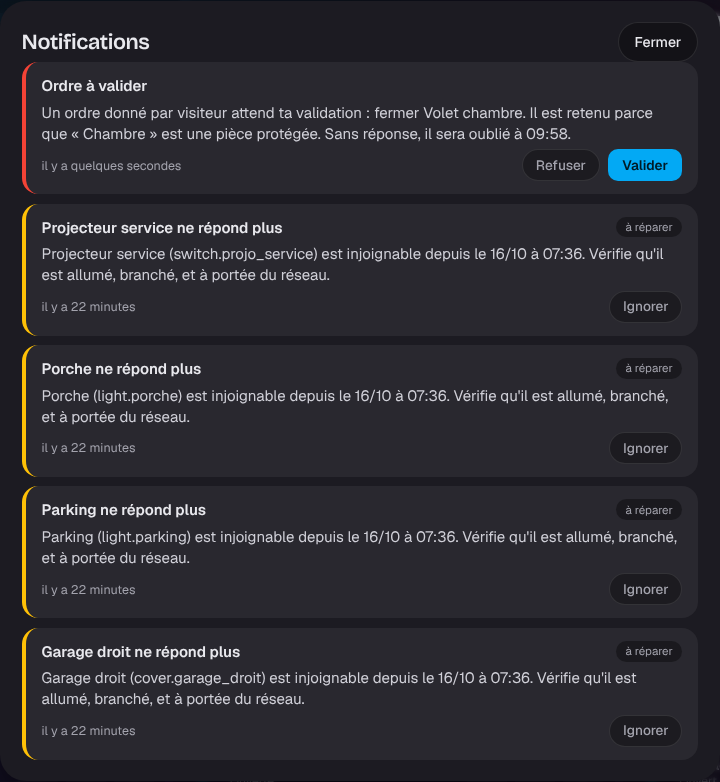

# Étape 48 : pièces protégées et heures calmes, expliquées



## Le but

Alexa obéit à tout ce qui ressemble à « Alexa, allume la chambre », y compris la télévision à
23 h. Un invité peut couper le chauffage du bureau ou ouvrir le volet de la chambre où quelqu'un
dort. Rien de grave, mais rien de souhaitable non plus.

C'est la troisième idée reprise de [Moli OS](https://github.com/rudy-io/moli-os), après la
[supervision](supervision.md) et les [ordres avec réponse](ordres.md) : certaines pièces sont
**protégées**. Un ordre qui les vise depuis une source moins sûre **attend qu'un membre de la
famille le valide**.

## Qui est retenu, et qui ne l'est jamais

| D'où vient l'ordre | Pièce protégée |
| ------------------ | -------------- |
| La voix (Alexa) | **retenu**, Alexa répond que l'appareil ne répond pas |
| Un compte **invité** (tableau de bord ou API) | **retenu**, « Ordre en attente de validation : « Chambre » est une pièce protégée. » |
| Un compte administrateur ou famille | toujours obéi : c'est lui qui décide |
| Une automatisation, un script, une scène, le thermostat | toujours obéi : ils sont écrits par la famille |

Un ordre retenu affiche une notification **« Ordre à valider »** dans la cloche, en tête de liste,
et la cloche passe au rouge. Elle dit qui a donné l'ordre, ce qu'il demande, et pourquoi il est
retenu :

> Un ordre donné à la voix (Alexa) attend ta validation : allumer Lampe de chevet. Il est retenu
> parce que « Chambre » est protégée pendant les heures calmes (22:00 – 07:00). Sans réponse, il
> sera oublié à 23:22.

- **Valider** : l'ordre part, comme s'il venait d'être donné. Le journal de bord dit toujours qui
  l'a donné (« à la voix ») ; le journal d'audit dit qui l'a validé.
- **Refuser** : il est oublié.
- **Sans réponse en 10 minutes**, il est oublié aussi : la lumière qu'on voulait allumer à 23 h ne
  doit pas s'allumer à minuit.

Un groupe compte comme ses membres : « toutes les lumières » est retenu si la lampe de la chambre
en fait partie.

## Mettre en place

Copie [guard.example.yaml](../guard.example.yaml) en `guard.yaml` (avec Docker :
`config/guard.yaml`, ou indique un autre chemin avec `HA_GUARD_PATH`) :

```yaml
protected_areas: [Chambre]            # des pièces de areas.yaml
protected_entities: [climate.bureau]  # et/ou des appareils un par un
quiet_hours:                          # facultatif
  from: "22:00"
  to: "07:00"
```

| Ce que tu écris | Ce qui est protégé |
| --------------- | ------------------ |
| Des pièces ou appareils, sans heures calmes | ces appareils, toute la journée |
| Des pièces ou appareils, avec heures calmes | ces appareils, pendant les heures calmes seulement |
| Seulement des heures calmes | **toute la maison**, pendant les heures calmes |
| Rien (fichier absent) | rien : la garde ne retient aucun ordre |

Les heures sont en heure locale (`TZ=Europe/Paris` dans l'image Docker) et peuvent passer minuit.
Vérifie, puis redémarre le serveur :

```powershell
cargo run -p ha-server -- guard check
```

```
guard.yaml : valide
  - climate.bureau (climate.bureau) protégé
  - cover.volet_chambre (Chambre) protégé
  - light.chambre (Chambre) protégé
  heures calmes 22:00 – 07:00 : la protection ne vaut que pendant ces heures
```

Une pièce inconnue, une heure mal écrite (`7h`) ou une clé mal orthographiée empêchent le
démarrage, avec un message clair : une garde qu'on croit active alors qu'elle ne l'est pas serait
pire que pas de garde du tout.

## L'API

| Requête | Qui | Réponse |
| ------- | --- | ------- |
| `POST /api/services/light/turn_on` (invité, appareil protégé) | invité | `202`, `{"result": "held", "message": "ordre en attente de validation : …"}` |
| `GET /api/approvals` | famille, administrateur | les ordres qui attendent (`id`, `entity_id`, `domain`, `service`, `by`, `reason`, `held_since`) |
| `POST /api/approvals/{id}` avec `{"approve": true}` ou `false` | famille, administrateur | `200`, `"sent"` ou `"refused"` ; `404` s'il n'attend plus |

Fermer la notification (`persistent_notification.dismiss`) revient à refuser.

## Sécurité

- **Un invité ne valide jamais** ses propres ordres : `GET` et `POST /api/approvals` demandent le
  droit « tous les appareils » (famille, administrateur). Il ne voit pas non plus les
  notifications.
- **Personne ne fabrique une fausse demande** : les identifiants `persistent_notification.approval_…`
  sont réservés au serveur, comme `repair_…`.
- **Les ordres retenus sont bornés** : 20 au plus (le plus ancien est oublié), 10 minutes au plus.
  Ils sont gardés en mémoire seulement : après un redémarrage, ils sont perdus, et leurs
  notifications disparaissent.
- La garde **s'ajoute** aux droits, elle ne les remplace pas : un invité ne commande toujours ni
  serrure, ni portail, ni garage (`403`), même avec validation ; une serrure demande toujours le
  mot de passe.
- Chaque étape est dans le journal d'audit : `held` (retenu, avec qui), `approve` ou `deny` (avec
  qui a validé ou refusé).

## Comment c'est construit

| Fichier | Rôle |
| ------- | ---- |
| [ha-core/src/guard.rs](../crates/ha-core/src/guard.rs) (nouveau) | La règle (`Policy::check`), les heures calmes, les ordres retenus (`Core::hold`, `release`, `expire_held`) |
| [ha-areas/src/guard.rs](../crates/ha-areas/src/guard.rs) (nouveau) | Lecture et vérification de `guard.yaml`, avec les pièces de `areas.yaml` |
| [ha-server/src/main.rs](../crates/ha-server/src/main.rs) | Charge la garde au démarrage, avec l'heure locale (`jiff`) ; `guard check` |
| [ha-api/src/rest.rs](../crates/ha-api/src/rest.rs) | Retient les ordres des invités (`202`) ; `GET /api/approvals`, `POST /api/approvals/{id}` |
| [ha-alexa/src/server.rs](../crates/ha-alexa/src/server.rs) | Retient les ordres à la voix |
| [ha-notices/src/lib.rs](../crates/ha-notices/src/lib.rs) | Les notifications « Ordre à valider », mises à jour à chaque changement ; fermer = refuser |
| [web/app.js](../crates/ha-api/web/app.js) | Les boutons « Valider » et « Refuser », le message du `202` |

Le noyau ne connaît pas les fuseaux horaires : le serveur lui donne une horloge (`fn() -> u16`, la
minute de la journée en heure locale) en même temps que la règle. Les tests en donnent une fixe.
