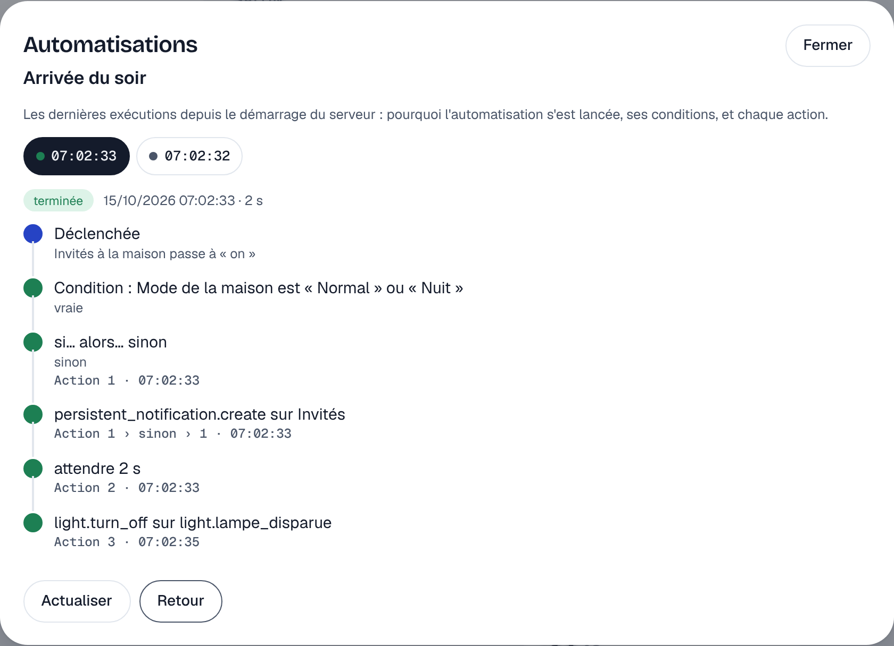
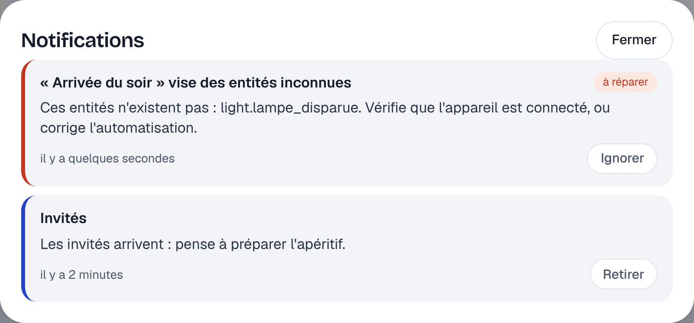

# Étape 31 : l'historique des exécutions, les notifications et les alertes, expliqué



## Le but

« Pourquoi la lumière ne s'est-elle pas allumée hier soir ? » Jusqu'ici, il fallait lire les
journaux du serveur. Home Assistant répond à cette question avec ses **traces** (l'historique des
exécutions), et prévient sur le tableau de bord avec ses **notifications persistantes** et ses
**réparations**. Les trois arrivent ici.

| Quoi                        | Où le voir                                            | D'où ça vient                          |
| --------------------------- | ----------------------------------------------------- | -------------------------------------- |
| Historique des exécutions   | Automatisations → **Historique**                      | le moteur d'automatisations            |
| Notifications               | la **cloche**, en haut à droite                       | `persistent_notification.create`       |
| Alertes de réparation       | la cloche aussi, avec le badge « à réparer »          | le serveur, tout seul                  |

## L'historique des exécutions

Pour chaque automatisation, les **10 dernières exécutions** sont gardées, chacune avec :

- **la raison** : « Invités à la maison passe à « on » » ;
- **chaque condition**, vraie ou fausse (on s'arrête à la première fausse, comme le moteur) ;
- **chaque action**, avec l'heure, sa place (`Action 1 › sinon › 1` : la première action de la
  branche « sinon » du premier `if`) et son résultat : la branche choisie, le nombre de tours, une
  attente dépassée, une commande refusée…
- **la fin** : terminée, conditions non remplies, arrêtée par une condition, interrompue
  (relancée en mode `restart`, modifiée ou serveur arrêté), ou pas lancée du tout (déjà en cours,
  trop d'exécutions, boucle).

Dans la liste des automatisations, chaque carte dit aussi quand elle a tourné pour la dernière
fois : « Dernière exécution il y a 5 minutes · terminée ».

L'API : `GET /api/automations/{id}/traces` (il faut le droit de lire les automatisations, donc pas
un invité).

**Sécurité** : les données envoyées par les actions (`data`) ne sont **jamais** enregistrées : elles
peuvent contenir un code d'alarme. On garde seulement « `alarm_control_panel.alarm_disarm` sur
Alarme ». L'historique est en mémoire : il repart de zéro à chaque redémarrage, comme dans Home
Assistant. Une répétition de 100 tours n'enregistre pas plus de 200 étapes.

## Les notifications du tableau de bord



Une automatisation peut laisser un message sur le tableau de bord, qui reste jusqu'à ce qu'on le
retire :

```yaml
- action: persistent_notification.create
  target:
    entity_id: persistent_notification.garage
  data:
    title: Garage
    message: La porte du garage est ouverte depuis 30 minutes.
```

`persistent_notification.dismiss` sur la même entité la retire (une automatisation peut donc la
retirer quand la porte se ferme). Le formulaire de l'éditeur propose les deux actions.

Chaque notification est une entité `persistent_notification.<nom>`, comme dans les anciennes
versions de Home Assistant : elle est **gardée dans la base** et retrouvée après un redémarrage, sans
rien de plus. Elles n'encombrent ni les sections du tableau de bord ni le journal de bord : elles ont
leur cloche.

Garde-fous :

- 50 notifications au plus (une automatisation qui boucle ne remplit pas l'écran) ;
- titre de 100 caractères, message de 1 000, caractères de contrôle retirés ;
- recréer la même notification ne change rien (pas d'événement, la date reste celle du début) ;
- les invités ne les voient pas (elles parlent de la maison : « porte ouverte ») ;
- les noms `persistent_notification.repair_…` sont **réservés au serveur** : une automatisation ne
  peut pas fabriquer une fausse alerte.

## Les alertes de réparation

Le serveur signale lui-même trois sortes de problèmes :

| Alerte                                         | Quand                                                               |
| ---------------------------------------------- | ------------------------------------------------------------------- |
| « Lampe du salon ne répond plus »              | un appareil est `unavailable` depuis plus d'une heure               |
| « Arrivée du soir » vise des entités inconnues | une automatisation cite une entité qui n'existe pas (souvent un appareil renommé) |
| « Automatisation en boucle »                   | la protection contre les boucles a bloqué une automatisation        |

Les vérifications attendent **2 minutes** après le démarrage (le temps que les appareils se
reconnectent), puis tournent toutes les minutes (appareils) ou toutes les 5 minutes (automatisations,
et quelques secondes après chaque modification dans l'éditeur).

Une alerte **disparaît toute seule** quand le problème est réglé. Le bouton « Ignorer » la cache en
attendant (« 1 alerte ignorée ») ; elle disparaît pour de bon quand le problème est réglé.

## Comment c'est construit

- `crates/ha-automation/src/trace.rs` : les traces, partagées entre le moteur et l'API ;
- `crates/ha-automation/src/engine.rs` : chaque action est notée pendant l'exécution ;
- `crates/ha-notices` (nouveau) : le service `persistent_notification`, les alertes et la
  surveillance des appareils injoignables ;
- `crates/ha-api/web/app.js` : la cloche, la liste des notifications, la vue « Historique ».

### Concepts Rust utilisés

**`Arc<Mutex<…>>`** : les traces sont écrites par le moteur et lues par l'API, deux tâches
différentes. `Arc` (« compteur de références atomique ») permet d'avoir plusieurs propriétaires de la
même donnée ; `Mutex` garantit qu'une seule tâche la modifie à la fois. On prend le `Mutex` de la
bibliothèque standard et non celui de tokio, car on ne garde jamais le verrou pendant un `.await`
(c'est plus simple et plus rapide).

**`Drop`, le destructeur** : quand une exécution est interrompue (`abort()`), sa tâche s'arrête net,
sans atteindre la fin de son code. Mais Rust détruit proprement tout ce qu'elle possédait, et appelle
`drop` sur chaque valeur. Le `Recorder` (qui enregistre l'exécution) en profite :

```rust
impl Drop for Recorder {
    fn drop(&mut self) {
        if !self.finished {
            self.close(Outcome::Aborted);
        }
    }
}
```

Aucune exécution ne peut donc rester « en cours » pour toujours dans l'historique. C'est le même
mécanisme (le « RAII ») qui ferme un fichier ou relâche un verrou automatiquement.

**`PoisonError::into_inner`** : si une tâche panique pendant qu'elle tient un `Mutex`, Rust le marque
« empoisonné » et `lock()` renvoie une erreur. Pour un simple historique, on préfère récupérer la
donnée quand même (`unwrap_or_else(PoisonError::into_inner)`) plutôt que tout bloquer, et sans
`unwrap()`.

**`AtomicU64`** : le numéro de chaque exécution vient d'un compteur partagé qu'on augmente sans
verrou (`fetch_add`), en une seule opération que le processeur garantit indivisible.

**Le `Future` en boîte et le chemin** : `run_actions` s'appelle elle-même pour les `if`, `choose` et
`repeat`. Elle reçoit maintenant aussi `prefix` (« 1 › sinon »), pour que chaque action sache où elle
se trouve.
