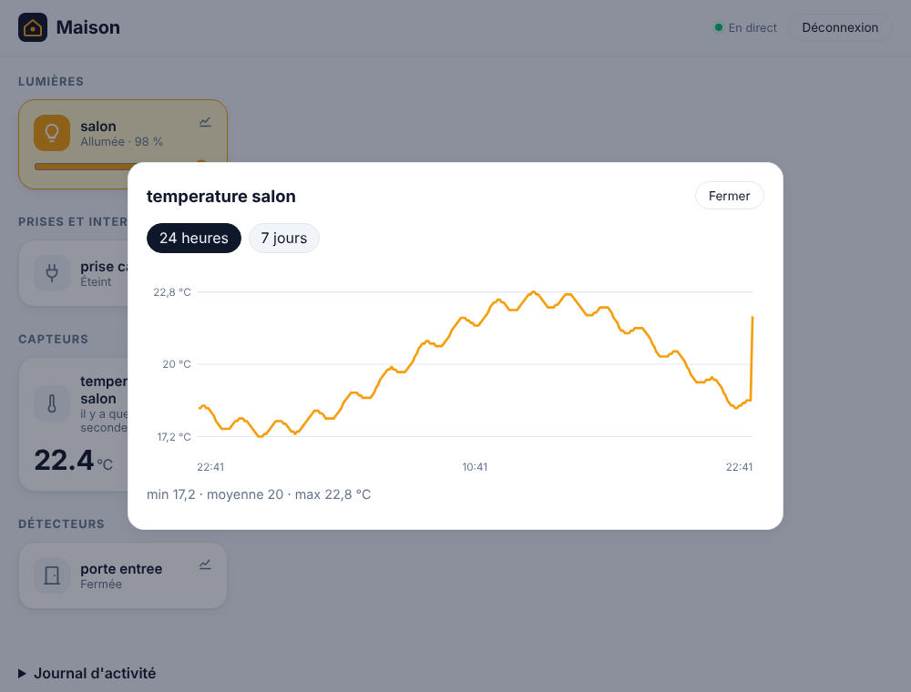
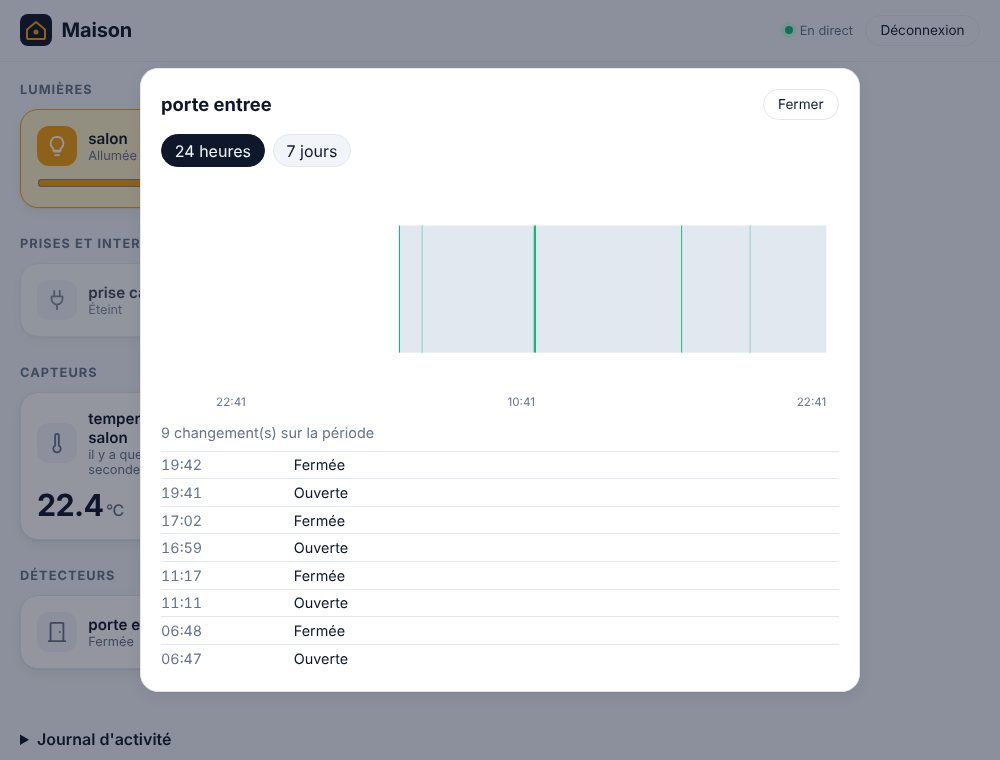

# Étape 10 : l'historique en graphiques, expliqué

## Le but

Depuis l'étape 2, chaque changement est enregistré dans `ha.db`. Il manquait de quoi le
**voir** : quelle température cette nuit, à quelle heure la porte s'est ouverte, combien de
temps la prise est restée allumée. C'est la fenêtre « historique » de Home Assistant.

## L'utiliser

Chaque tuile du tableau de bord a un petit bouton **graphique**, en haut à droite. Il ouvre une
fenêtre avec :

- pour un **capteur numérique** (température, débit Internet…) : une **courbe**, avec une bande
  claire qui montre le minimum et le maximum de chaque moment, et un résumé « min · moyenne ·
  max » ;
- pour le **reste** (porte, présence, prise, soleil…) : une **frise**, en couleur quand c'est
  actif (ouvert, allumé, à la maison), et la liste des derniers changements.

Deux périodes : **24 heures** et **7 jours**. L'historique est gardé 10 jours par défaut
(`HA_HISTORY_DAYS`).

## Comment c'est construit

### Côté serveur : résumer avant d'envoyer

Le simulateur enregistre une température **chaque seconde** : 86 400 lignes par jour, plus de
600 000 sur une semaine. Les envoyer toutes au téléphone serait lent et inutile : un écran fait
quelques centaines de points de large.

La nouvelle route `GET /api/history/<appareil>/series?hours=24` demande donc à **SQLite** de
résumer :

- **pour la courbe**, la période est coupée en 300 tranches, et pour chacune SQLite calcule la
  moyenne, le minimum et le maximum (`GROUP BY`). Les valeurs qui ne sont pas des nombres
  (« unavailable ») sont écartées : elles ne deviennent pas des zéros qui feraient plonger la
  courbe ;
- **pour la frise**, seuls les **vrais changements** sont gardés : `LAG(state)` donne la valeur
  de la ligne précédente, et on ne garde que les lignes où elle diffère. Une mise à jour
  d'attribut seul (la luminosité qui change) ne compte pas. La valeur **au début** de la période
  (dernier relevé avant) est ajoutée, pour que la frise ne commence pas dans le vide.

Un nouvel index (`entity_id`, `recorded_at`) permet de trouver directement les lignes d'une
entité sur une période, sans parcourir tout l'historique.

Limites : 31 jours au plus par requête, 1 000 points, 2 000 changements. Une période invalide
(`hours=0`, `hours=abc`) est refusée.

### Côté tableau de bord : du SVG, sans bibliothèque

Les graphiques sont dessinés en **SVG**, élément par élément (`createElementNS`), comme le reste
de la page : aucune bibliothèque extérieure à charger (la politique de sécurité de la page les
interdirait), et aucun texte inséré comme du HTML. Les couleurs viennent de la feuille de style :
le mode sombre fonctionne aussi.

Le bouton « historique » est **à côté** du bouton qui allume la prise, et non dedans : en HTML,
un bouton ne peut pas en contenir un autre. La tuile d'une prise a donc été réorganisée comme
celle d'une lampe (une tuile, avec un bouton à l'intérieur).

## Concepts rencontrés

- **Les fonctions de fenêtre SQL (`LAG … OVER`)**. Elles regardent les lignes voisines sans
  regrouper : « la valeur de la ligne d'avant », ici pour repérer les changements.
- **`clamp`** : `buckets.clamp(1, 1000)` ramène une valeur dans un intervalle en une opération,
  au lieu de deux `if`.
- **Faire travailler la base de données.** Agréger en SQL, là où sont les données, évite de
  transférer et de parcourir des centaines de milliers de lignes en Rust.

## Testé

- SQLite : moyennes, minimum et maximum par tranche ; « unavailable » écarté ; seuls les vrais
  changements gardés, avec la valeur du début de période ; période vide ou à l'envers.
- API : la route exige d'être connecté ; résumé correct après des changements réels ; périodes
  invalides refusées.
- Dans Chromium, avec 24 heures de mesures : courbe et résumé « min 17,2 · moyenne 20 · max
  22,8 °C », frise de la porte avec ses ouvertures, passage à 7 jours ; la prise s'allume
  toujours d'un clic ; aucune erreur.
