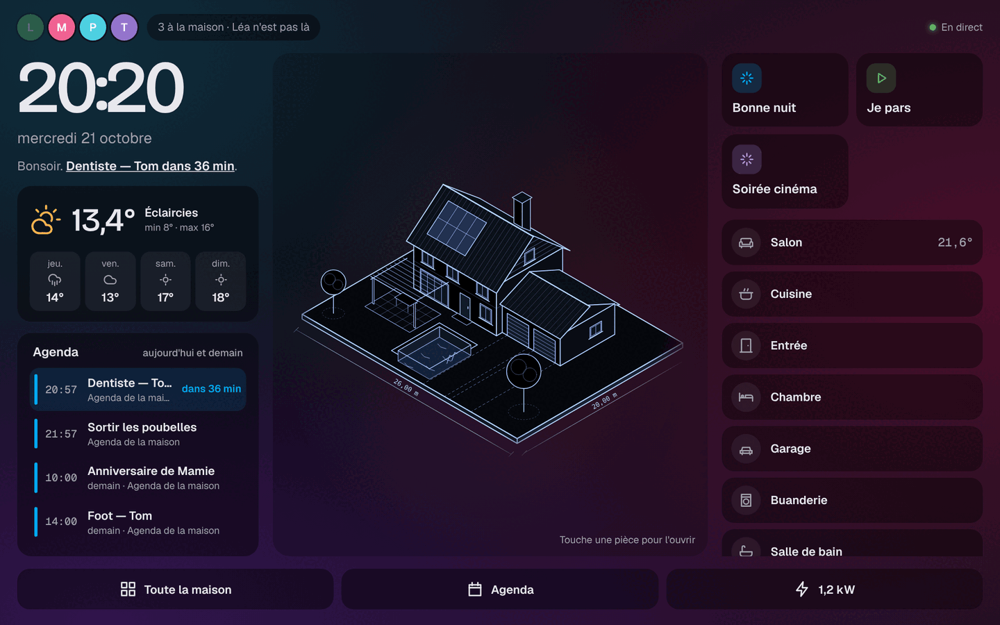

# Étape 80 : la vue hub de la tablette murale, expliquée

## Le but

La tablette accrochée au mur ([étape 78](tablette-murale.md)) affichait jusqu'ici le tableau de
bord complet : des dizaines de tuiles, faites pour un téléphone qu'on tient en main. Au mur, on
passe devant, on regarde deux secondes, on touche une chose. La **vue hub** est faite pour ça :
tout tient sur un seul écran, sans faire défiler, avec **le dessin de la maison au centre**.

## Ce qu'elle montre

La tablette **à l'horizontale** :

- **en haut** : qui est à la maison (une pastille par personne, grisée si elle est absente, et
  « 3 à la maison · Léa n'est pas là »), l'**alerte du moment** et, si c'est un volet ou une porte
  de garage, un bouton **Fermer**. Un ordre qui attend d'être validé ([garde](garde.md)) passe en
  premier, avec **Voir** ;
- **à gauche** : la grande horloge, la date, une phrase (« Bonsoir. Dentiste — Tom dans 37 min. »),
  la **météo** avec les 4 jours suivants, et l'**agenda** d'aujourd'hui et de demain
  ([TimeTree](timetree.md), l'agenda de la maison…) : le prochain rendez-vous est mis en avant,
  un contact l'ouvre avec ses détails ;
- **au centre** : le **dessin de la maison**, le vrai, avec ses calques (lumières, volets, pluie).
  Une pièce du dessin se touche pour s'ouvrir, comme d'habitude. Si le dessin a plusieurs vues
  (« Devant », « Jardin »), des boutons en haut passent de l'une à l'autre ;
- **à droite** : les **scènes et scripts** (6 au plus : « Bonne nuit », « Je pars »…), puis la
  liste des **pièces**, avec leur température et ce qui y est allumé ou ouvert. Un contact ouvre
  la pièce par-dessus la vue hub ;
- **en bas** : **Toute la maison** (le tableau de bord complet), **Agenda** (l'agenda en grand),
  **Énergie** (avec la puissance du moment, « 1,2 kW ») et **Annonce à la maison** : une phrase
  tapée sur la tablette, lue sur les enceintes ([étape 73](sonos.md)).

Chaque bouton n'apparaît que si la maison a ce qu'il faut : pas de carte météo sans météo, pas
d'annonce sans enceinte ni voix.

**Le dessin 3D** (une image faite avec l'IA, sur fond noir, [étape 44](images-ia.md)) se fond dans le fond
sombre des thèmes Maquette, Sombre et Plan d'architecte de nuit : pas de rectangle noir autour de la maison.

## Revenir à la vue hub

**Toute la maison** et **Agenda** quittent la vue hub. Elle revient d'elle-même avec le
**retour à l'accueil** du mode tablette, après 2 minutes sans contact. L'[écran de
veille](veille.md) prend le dessin de la maison après 5 minutes, et le rend à la vue hub au réveil.

## La régler

Dans **Mon compte**, sous **Mode tablette murale** : **Vue hub, la maison au centre** (cochée par
défaut). Comme le mode tablette et l'écran de veille, c'est un réglage **de cet appareil
seulement**.

La vue hub ne s'affiche que :

- en **mode tablette murale** ;
- sur un écran **à l'horizontale d'au moins 900 pixels** de large (une tablette de 10 pouces).
  Tournée à la verticale, ou sur un téléphone, c'est le tableau de bord habituel.

## Sécurité

Rien de nouveau côté serveur : la vue hub affiche ce que le tableau de bord a déjà reçu, avec les
droits du compte de la tablette (un compte **invité** n'y voit que ses appareils, et pas les
ordres à valider). Chaque bouton passe par les mêmes services que le tableau de bord : une pièce
protégée demande toujours une validation, une serrure toujours le mot de passe. Le texte de
l'annonce est envoyé tel quel au service `tts.speak`, comme depuis une automatisation.

## Comment c'est construit

| Fichier | Rôle |
| ------- | ---- |
| [web/hub.js](../crates/ha-api/web/hub.js) | Nouveau : quand afficher la vue hub (`hubShouldShow`), `showHub` / `hideHub`, et le contenu de chaque carte |
| [web/index.html](../crates/ha-api/web/index.html) | Le bloc `#hub`, la fenêtre d'annonce, la case dans Mon compte |
| [web/style.css](../crates/ha-api/web/style.css) | La grille en trois colonnes, les couleurs de chaque thème, le dessin 3D fondu dans le fond |
| [web/start.js](../crates/ha-api/web/start.js) | L'écran de veille rend le dessin à la vue hub au réveil |
| [web/account.js](../crates/ha-api/web/account.js) | Le retour à l'accueil (2 minutes) ramène la vue hub |
| [web/tiles.js](../crates/ha-api/web/tiles.js) | Chaque mise à jour de l'accueil met aussi la vue hub à jour (toutes les 30 secondes au moins, pour l'horloge) |
| [src/web.rs](../crates/ha-api/src/web.rs) | `hub.js` servi comme les autres fichiers (compressé, avec son empreinte) |

Le dessin de la maison n'est pas recopié : comme pour l'écran de veille, le même élément
(`#house-stage`) est **déplacé** au centre, puis remis à sa place. Ses calques et ses effets
continuent sans être recréés.

Essayé dans le navigateur (tablette 1280 × 800) dans les thèmes Maquette, Clair et Plan : la vue
hub à l'horizontale, le dessin au centre, une pièce ouverte par-dessus, l'écran de veille et le
retour, « Toute la maison » puis le retour à l'accueil, l'agenda, la vue Jardin, le réglage
décoché, et un téléphone (jamais de vue hub). Aucune erreur JavaScript.

### Concepts utilisés

**`matchMedia`** : la même question qu'une règle CSS `@media` (« l'écran fait-il au moins 900 pixels
de large, à l'horizontale ? »), posée depuis JavaScript. Son évènement `change` prévient quand la
tablette tourne : la vue hub apparaît ou disparaît aussitôt.

**`mix-blend-mode: lighten`** : pour chaque pixel, la couleur la plus claire entre l'image et ce
qu'il y a derrière. Le noir de l'image 3D disparaît dans le fond, la maison éclairée reste.
