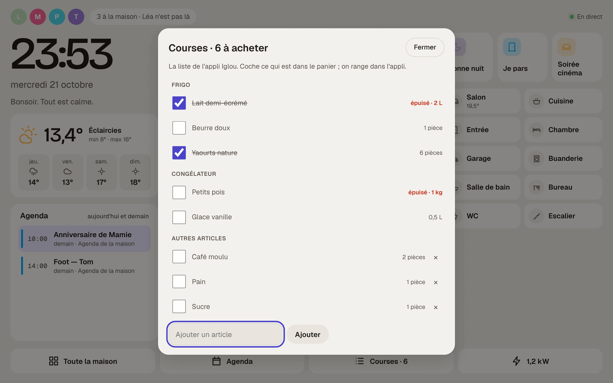
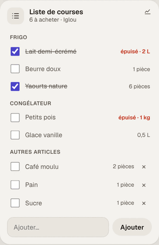

# Étape 81 : la liste de courses d'Iglou, expliquée



## Le but

**Iglou** est l'appli de la famille pour le frigo et le congélateur : chacun voit ce qu'il reste, et
la liste de courses en découle (ce qui est sous son « stock plein », plus ce qu'on ajoute à la main).

Désormais, la liste de courses de la maison **est** celle d'Iglou :

- sur la **tablette murale**, le bouton **Courses · 6** du [hub](hub.md) l'ouvre en grand ;
- sur le **tableau de bord**, la tuile « Liste de courses » montre la même liste ;
- ce qu'on ajoute au mur (« Sucre ») apparaît aussitôt sur les téléphones, dans l'appli, et
  inversement (relu chaque minute) ;
- les **automatisations** qui ajoutaient à `todo.courses` écrivent maintenant dans Iglou.

## Ce que la maison fait, et ne fait pas

| Dans la maison | Dans Iglou |
| --- | --- |
| voir la liste, par frigo et congélateur, avec la quantité à racheter et « épuisé » | idem |
| **cocher** ce qui est dans le panier | la case « dans le panier » se coche aussi |
| **ajouter** un article (une pièce) | il apparaît dans « Autres articles » |
| retirer ou renommer un article ajouté à la main | idem |
| — | **ranger les courses** (« J'ai rangé les courses ») : remettre le frigo à plein |

La maison **ne touche jamais aux quantités** du frigo : c'est l'appli qui les tient. Un aliment du
frigo quitte la liste quand on range les courses dans l'appli, pas avant. Le bouton « Retirer ce qui
est fait » disparaît donc de la tuile.

Un article déjà sur la liste (et pas encore coché) n'est pas ajouté deux fois : « Ajoute du pain »
deux fois de suite ne fait qu'un pain.

## Pourquoi un compte dédié

Iglou n'a pas d'accès prévu pour les autres logiciels. Le serveur se connecte donc **comme
l'appli**, avec une adresse e-mail et un mot de passe, et il garde ce mot de passe pour se
reconnecter (la session dure une heure).

D'où la règle : **un compte Iglou pour la maison**, jamais ton compte personnel.

- Il est **membre** de ta maison Iglou, comme un membre de la famille. Les règles de sécurité de
  l'appli s'appliquent : il ne voit que cette maison.
- Il apparaît dans la liste des membres sous le prénom **Maison**. Pour lui couper l'accès, retire-le
  depuis l'appli, sur ton téléphone.
- Son mot de passe est **chiffré** dans la base, avec la clé `ha.key`, comme celui de TimeTree.

## Mettre en place

1. **Crée le compte de la maison** dans l'appli Iglou (Inscription), avec une adresse à part (par
   exemple `maison.martin@…`) et un mot de passe que tu n'utilises nulle part ailleurs. Puis
   reconnecte-toi avec ton propre compte.
2. **Copie le code d'invitation** de ta maison : dans l'appli, **Réglages → Code d'invitation** (6 caractères).
3. **Associe** le serveur (sur le mini-PC : `sudo ha-maison iglou pair`) :
   ```text
   $ ha-server iglou pair
   projet Firebase : congelateur-…
   clé web Firebase : AIza…
   e-mail du compte Iglou de la maison : maison@exemple.fr
   mot de passe :
   Ce compte n'est membre d'aucune maison Iglou.
   code d'invitation : ABC123
   associé à la maison « Chez nous » !
   liste de courses : 6 article(s) à acheter
     [ ] Lait demi-écrémé (2 L, Frigo)
     …
   ```
   Le **projet** et la **clé web** sont ceux de l'appli : dans son fichier `google-services.json`
   (`project_id`, et `current_key`). Cette clé est publique (elle est dans l'appli installée sur
   chaque téléphone) : seule, elle ne donne accès à rien.
4. **Redémarre** le serveur (`sudo systemctl restart ha-maison` sur le mini-PC).

Ce qui restait sur l'ancienne liste locale (pas encore coché) est recopié dans Iglou au moment de
l'association.

Les autres commandes :

- `ha-server iglou status` : le compte, sa maison, et la liste ;
- `ha-server iglou forget` : oublie le compte ; la liste locale reprend au prochain démarrage.

## Dans les automatisations

Rien ne change : c'est toujours `todo.courses`. Par exemple, quand le capteur du congélateur dit
qu'il est vide de glaçons :

```yaml
- action: todo.add_item
  target: { entity_id: todo.courses }
  data: { item: Glaçons }
```

Son état est le **nombre d'articles à acheter** (pas encore dans le panier) : `{{ states('todo.courses') | int > 10 }}`
dit qu'il est temps d'aller faire les courses.

## Sécurité

- **Un compte à part, membre d'une seule maison**, sous le prénom « Maison » : visible et retirable
  depuis l'appli.
- **Rien d'autre que la liste** : la maison lit les aliments, les appareils et les articles libres
  de sa maison. Elle n'écrit que « dans le panier » (avec son propre identifiant, comme l'exigent les
  règles de l'appli) et les articles libres.
- **Les règles de l'appli s'appliquent** côté Firebase : une autre maison est refusée, même si on
  essayait.
- **Les adresses sont vérifiées** : le projet, la clé, la maison et chaque article sont contrôlés
  avant d'être mis dans une adresse ; une réponse ne peut pas faire lire ailleurs. Réponses limitées
  à 4 Mo, 3 000 documents par collection au plus.
- **Invités** : comme avant, un compte invité ne voit pas la liste de courses.
- **Panne** : si Iglou ne répond pas, la liste passe « indisponible » (le hub le dit) et le serveur
  réessaie seul (5 secondes, puis de plus en plus espacé). Un mot de passe refusé ou un compte retiré
  de la maison attend 30 minutes entre deux essais. Le reste de la maison continue.

## Comment c'est construit

| Fichier | Rôle |
| ------- | ---- |
| [crates/ha-iglou/src/client.rs](../crates/ha-iglou/src/client.rs) | Firebase : connexion (`accounts:signInWithPassword`), Firestore en REST (lire une collection page par page, `runQuery` pour « mes maisons », `commit` pour écrire), rejoindre avec le code |
| [crates/ha-iglou/src/list.rs](../crates/ha-iglou/src/list.rs) | Le calcul de la liste, comme l'appli : ce qui manque, la quantité d'achat ajustée, « 1,5 kg », « 3 pièces », l'ordre des appareils |
| [crates/ha-iglou/src/lib.rs](../crates/ha-iglou/src/lib.rs) | L'entité `todo.courses`, relue chaque minute, et les services `todo.add_item`, `update_item`, `remove_item` |
| [crates/ha-storage/migrations/0022_iglou.sql](../crates/ha-storage/migrations/0022_iglou.sql) | Le compte (mot de passe chiffré) |
| [crates/ha-agenda/src/lib.rs](../crates/ha-agenda/src/lib.rs) | `start_without` : la liste locale `todo.courses` s'efface devant Iglou |
| [web/tiles.js](../crates/ha-api/web/tiles.js), [web/hub.js](../crates/ha-api/web/hub.js) | La tuile (par frigo, quantités, « épuisé ») et la liste en grand du hub |

**Tests** : contre un faux Firebase qui applique les mêmes règles que l'appli (un compte ne lit et
n'écrit que les maisons dont il est membre, le jeton expire) : rejoindre avec le code (et un mauvais
code refusé), lire sur plusieurs pages, ajouter, cocher (avec `modifiePar`, sans toucher aux
quantités), renommer et retirer un article libre (pas un aliment), la maison d'à côté refusée, un
jeton expiré refait une seule fois, un mauvais mot de passe, et l'entité `todo.courses` de bout en
bout (y compris sans doublon).

Essayé dans le navigateur : la tablette (bouton « Courses · 6 », la liste en grand, cocher le lait,
ajouter du sucre deux fois), et la tuile du téléphone.



### Concepts utilisés

**Firestore en REST** : l'appli parle à Firestore avec la bibliothèque de Google ; le serveur, lui,
envoie les mêmes demandes en HTTP simple. Chaque valeur y est « typée » : `{"stringValue": "Lait"}`,
`{"integerValue": "2"}` (un nombre entier écrit en texte), `{"booleanValue": true}`.

**`updateMask`** : n'écrire que certains champs d'un document (« dans le panier »), sans risquer
d'effacer les autres. Et **`setToServerValue: REQUEST_TIME`** : la date d'ajout donnée par le
serveur de Google, comme `serverTimestamp()` dans l'appli.
