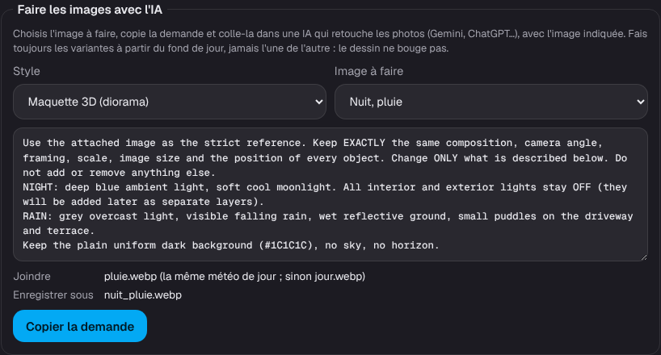

# Étape 44 : faire les images de ta maison avec l'IA, expliqué

## Le but

La maquette, ses ambiances et ses calques sont des images. Le plus simple pour les faire, c'est une
intelligence artificielle qui retouche les photos (Gemini, ChatGPT…), à partir d'une photo de ta
maison. La méthode vient de l'article de
[domo-blog](https://www.domo-blog.fr/tableau-de-bord-home-assistant-3d-isometrique/) ; les demandes
ci-dessous sont les nôtres, adaptées aux noms de ce tableau de bord.

**Mon compte → Dessin de la maison… → Faire les images avec l'IA** :

1. choisis le **style** (Maquette 3D ou plan d'architecte) et **l'image à faire** ;
2. la demande s'affiche. Tu peux la modifier, par exemple pour dire où est le porche ;
3. « **Copier la demande** », puis colle-la dans l'IA **avec l'image indiquée** (« Joindre ») ;
4. enregistre le résultat **sous le nom indiqué** et envoie-le dans « Images ».

Les demandes sont en anglais : c'est ce qui marche le mieux.

## Les trois règles

1. **Une image de départ « au repos »** : au soleil, toutes les lumières éteintes, les portes de
   garage, portails et volets fermés. Ce qui s'allume ou s'ouvre viendra en calque.
2. **Chaque variante se fait à partir de l'image de départ**, jamais l'une de l'autre : sinon le
   dessin dérive un peu à chaque fois (seule exception : la nuit sous la pluie part de la pluie de
   jour). Le même cadrage, la même taille, au pixel près.
3. **Toutes les images à la même taille**, et un **fond uni** sans ciel : `#1C1C1C` pour la
   Maquette, le papier blanc pour le plan.

## Dans l'ordre

| Étape | Image à faire | Joindre | Enregistrer sous |
| ----- | ------------- | ------- | ---------------- |
| 1 | Faire décrire la maison | 1 à 3 photos de trois quarts | rien : relis sa « fiche maison » et corrige-la |
| 2 | Le fond de jour | la meilleure photo | `jour.webp` |
| 3 | La nuit (ciel clair) | `jour.webp` | `nuit.webp` |
| 4 | Les ambiances de jour (pluie, neige…) | `jour.webp` | `jour_pluie.webp`, `jour_neige.webp`… |
| 5 | Les ambiances de nuit | la même météo de jour (sinon `jour.webp`) | `nuit_pluie.webp`… |
| 6 | Les calques | le fond de nuit (une lumière) ou de jour (une porte) | `porche_allume.webp`, `garage_ouvert.webp`… |

Puis, dans le réglage : le fond de jour, le fond de nuit et chaque ambiance dans « Fonds et
ambiances » ; chaque calque dans « Calques », avec son appareil et ses états. Il n'est pas
nécessaire de tout faire : une ambiance qui manque prend la plus proche
([étape 39](ambiances.md)), et les [effets animés](effets.md) ajoutent la pluie ou la neige même
sans fond dédié.

## Les demandes

### 1. Faire décrire la maison (sans image)

> Look carefully at the attached photos of my house. Do NOT generate any image yet.
> Write a numbered HOUSE SHEET: 1. overall shape and number of floors, 2. roof (shape, material,
> colour, chimneys, solar panels), 3. walls and colours, 4. windows on each side, 5. doors,
> 6. garage doors and gates, 7. plot and garden (pool, terrace, hedges, trees, driveway),
> 8. exterior lights. Then list, as questions, everything you are unsure about.

Corrige ce qui est faux (« il y a deux portes de garage, pas une »), **puis** demande le fond.

### 2. Le fond de jour (Maquette 3D)

> Transform the attached photo of my house into a highly detailed 3D isometric miniature model
> (diorama).
> FIDELITY: keep the exact architecture, proportions, roof shape, number and position of windows
> and doors, garage, garden, pool and terrace. Do not add or remove any part of the building.
> CAMERA: true isometric view from a front three-quarter angle, the whole property centred with a
> small margin, nothing cropped.
> STYLE: clean, slightly stylised 3D render, soft global illumination, premium architectural
> scale-model look.
> LIGHTING: bright sunny day, soft shadows. All interior and exterior lights OFF. All garage
> doors, gates and shutters CLOSED.
> BACKGROUND: plain uniform dark background (#1C1C1C), no sky, no horizon.
> EXCLUDE: no text, no labels, no people, no cars, no watermark.
> FORMAT: landscape 16:9, highest resolution.

En style plan d'architecte, le réglage remplace le style par « fine dark-blue ink lines on white
paper… » et le fond par du papier blanc.

### 3 à 5. La nuit et les ambiances

Toutes commencent par :

> Use the attached image as the strict reference. Keep EXACTLY the same composition, camera
> angle, framing, scale, image size and the position of every object. Change ONLY what is
> described below. Do not add or remove anything else.

puis, la nuit :

> NIGHT: deep blue ambient light, soft cool moonlight. All interior and exterior lights stay OFF
> (they will be added later as separate layers).

puis le temps :

| Temps | Ce qu'on demande |
| ----- | ---------------- |
| Éclaircies | PARTLY CLOUDY: bright light with a few soft cloud shadows drifting over the plot… |
| Nuageux | OVERCAST: soft diffuse grey light, no hard shadows, slightly muted colours. |
| Brouillard | FOG: a light mist around the property, the far edges of the plot fading softly… |
| Vent | WINDY: trees and hedges bent by the wind, a few leaves in the air… |
| Pluie | RAIN: grey overcast light, visible falling rain, wet reflective ground, small puddles… |
| Averses | HEAVY DOWNPOUR: dark grey light, dense falling rain, streaming wet ground and roofs… |
| Orage | THUNDERSTORM: very dark stormy light, heavy rain, a cold flash of lightning on the roofs… |
| Grêle | HAIL: small white hailstones scattered on the roofs, lawn and driveway… |
| Neige | SNOW: fresh snow covering the roofs, ground, hedges and trees, a few falling snowflakes… |
| Pluie et neige | SLEET: wet slushy snow patches on the roofs and lawn, rain and snow falling together… |

et on termine en rappelant le fond uni. Le réglage assemble tout cela pour l'ambiance choisie.

### 6. Les calques

Toujours avec la même phrase de départ, puis **une seule** chose qui change. Le réglage propose
les lumières et les volets de l'onglet, avec le nom de leur pièce :

> Only turn ON the light named "Porche" (location: WHERE IT IS, e.g. above the front door): warm
> 2700 K light with a soft halo on the nearby wall and ground.
> Nothing else changes: same light, same weather, same framing, same image size.

> Only the door named "Garage droit" (location: WHERE IT IS, e.g. the left garage door) is fully
> OPEN, with the dark interior visible behind it.

**Remplace « WHERE IT IS »** par l'endroit, en anglais (« above the front door », « the right
garage door »). Une lumière se fait sur le fond de **nuit** (on la voit mieux) ; une porte, sur le
fond de **jour**, puis sur celui de nuit si tu veux les deux.

Ensuite, dans **GIMP** (gratuit) ou Photoshop :

1. ouvre le fond, puis la variante en calque par-dessus ;
2. mode de fusion **Différence** : tout devient noir, sauf ce qui a changé. Si tout le dessin
   apparaît en relief, la variante est décalée : déplace-la aux flèches jusqu'au noir ;
3. repasse en mode Normal, ajoute un masque, et ne garde que la zone qui change (une gomme douce
   pour un halo de lumière) ;
4. exporte **à la taille du fond, sans recadrer**, en **WebP transparent**, qualité 80 à 85.

### Si l'IA se trompe

> You moved the camera. Go back to the exact framing, camera angle and scale of the reference
> image, then apply only the requested change.

> Keep exactly the same image size and aspect ratio as the reference image.

> Remember this style, framing and camera angle: I will ask you for more variations of this same
> model, always from this reference image.

## Les noms des images

Les noms viennent des ambiances : `nuit-pluie` donne `nuit_pluie.webp`. Le nom ne compte pas pour
le tableau de bord : c'est le réglage « Fonds et ambiances » qui relie chaque image à son ambiance.
Il aide simplement à s'y retrouver. Les noms acceptés : lettres minuscules, chiffres, `_` et `-`.

## Sécurité

- Rien ne part vers l'IA depuis le tableau de bord : c'est toi qui copies la demande et qui joins
  la photo, dans l'IA de ton choix. Pense à ce que tu partages : une photo de ta maison n'est pas
  anodine.
- La copie passe par le presse-papiers du navigateur quand la page le permet (HTTPS, ou
  l'ordinateur lui-même). Sur le réseau local en HTTP, le navigateur le refuse : le texte est alors
  sélectionné, et il suffit de le copier.
- Les images reviennent par l'envoi habituel, avec les mêmes vérifications : PNG, JPEG ou WebP
  reconnus à leurs premiers octets, 3 Mio au plus ([étape 36](plan-architecte.md)).

## Comment c'est construit

- `crates/ha-api/web/house.js` : `aiPrompt()` assemble la demande à partir des morceaux
  (`AI_REFERENCE`, `AI_NIGHT`, `AI_WEATHER`…), et indique l'image à joindre et le nom à donner. Ces
  indications utilisent les vrais noms de tes images quand elles existent déjà. `copyText()` copie
  la demande.
- Aucune nouvelle route : tout se passe dans la page.
