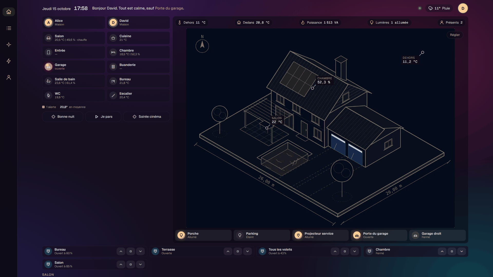
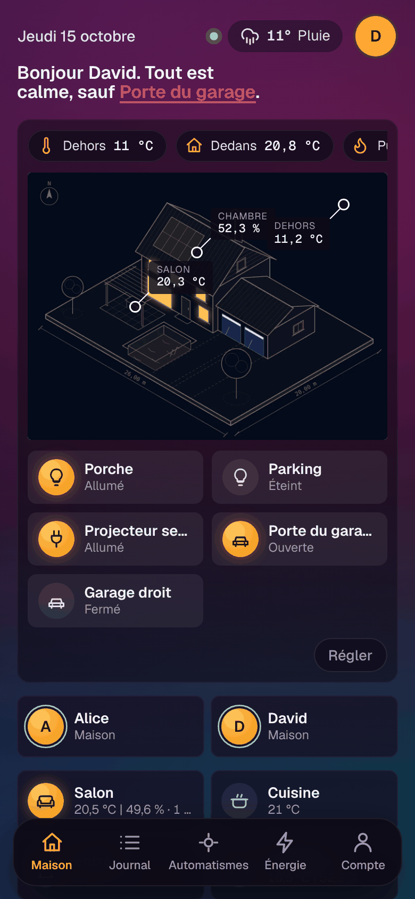

# Étape 37 : la mise en page « tableau » et le thème « Maquette », expliqués

## Le but

Reprendre la mise en page des tableaux de bord isométriques de Home Assistant (merci à
[domo-blog](https://www.domo-blog.fr/tableau-de-bord-home-assistant-3d-isometrique/)) :

- **un rail d'icônes** à gauche (accueil, journal, automatisations, énergie, compte), comme dans
  Home Assistant, et un en-tête d'une seule ligne : la date, l'heure, et « tout est calme, sauf… » ;
- **à gauche**, qui est là (« Alice · Maison »), puis les pièces en petites tuiles : l'icône, le
  nom, « 23,6 °C | 61,4 % » ;
- **au centre**, la maquette de la maison, avec ses calques et ses valeurs
  ([étape 36](plan-architecte.md)) ;
- **au-dessus**, les repères : dehors, dedans, puissance, lumières, présents ;
- **en dessous**, des **boutons rapides** : le porche, le parking, les portes de garage…
- **puis les volets**, sur toute la largeur, trois ou quatre par ligne, avec ▲ ■ ▼, et tous les
  autres appareils comme avant.

Les icônes sont rondes et s'allument en couleur : orange pour une lumière allumée ou une porte
ouverte, rouge pour une alerte.

## Choisir l'apparence

**Mon compte → Apparence → Maquette** : un fond presque noir, avec une lueur magenta en haut à
droite, violette en haut et bleu-vert en bas ; des panneaux plus sombres que le fond, des icônes
rondes qui s'allument en orange, comme sur les tableaux de domo-blog. C'est fait pour une maquette 3D sur fond sombre : l'article de domo-blog
demande à l'IA un fond `#1C1C1C`.

Les deux styles « plan d'architecte » prennent aussi cette mise en page. Clair et sombre gardent
la mise en page habituelle.

## Les boutons rapides

**Mon compte → Dessin de la maison… → Boutons sous le dessin** : choisis jusqu'à 12 appareils.

| Appareil                                   | Un toucher…                 |
| ------------------------------------------ | --------------------------- |
| lumière, prise, ventilateur, interrupteur  | allume ou éteint            |
| volet, porte de garage, portail            | ouvre ou ferme              |
| scène, script                              | lance                       |
| bouton                                     | appuie                      |
| autre (capteur, serrure…)                  | rien : l'état est affiché   |

Le bouton s'allume (icône dorée) quand l'appareil est allumé ou ouvert. Ce que ton compte ne peut
pas commander reste affiché, mais grisé et sans effet. Un invité, par exemple, ne commande jamais
une porte de garage.

## Les volets en lignes

Tous les volets apparaissent sous le dessin, une ligne chacun, avec la position et ▲ ■ ▼. Chaque
ligne porte le nom de sa pièce (« Salon »), ou « Salon · Baie » s'il y a plusieurs volets dans la
pièce. Les portes de garage, les portails et les volets déjà en boutons rapides n'y sont pas.

## Sur téléphone

La maquette vient en premier, puis ses boutons, les pièces sur deux colonnes, les scènes et les
volets. Les repères défilent sur une seule ligne.

## Sur une télé ou un ordinateur

**Tout tient sur un écran**, comme sur les tableaux de référence : l'en-tête d'une ligne, puis les
pièces et la maquette côte à côte, de la même hauteur, puis les volets. La maquette prend la
place qui reste, en gardant ses proportions ; si les volets sont nombreux, elle rétrécit. Les
tuiles sont petites et serrées, « Régler » se pose dans le coin du dessin, et la barre du bas du
téléphone devient un rail d'icônes à gauche. Les autres appareils suivent, en dessous.

## Sécurité

- Les boutons rapides passent par les mêmes commandes que les tuiles. Le serveur vérifie les
  droits à chaque toucher.
- La liste est vérifiée : des appareils bien écrits, 12 au plus, sans doublon. Un invité ne voit
  pas les boutons des appareils qui lui sont cachés.

## Comment c'est construit

- `app.js` pose `data-layout="board"` sur la page pour les styles plan et maquette. Le CSS place
  alors les blocs avec une grille nommée :
  `grid-template-areas: "overview house" "overview covers" "sections sections"`.
  Sur téléphone, une seule colonne, et `order: -1` met le dessin en premier.
- Chaque pièce a sa ligne (icône, nom, mesures), cachée dans la mise en page habituelle. L'icône
  vient du nom : « chambre » donne un lit, « cuisine » une casserole, « garage » une voiture…
- `house.js` dessine les boutons rapides et les volets. L'assemblage du dessin a un nouveau champ,
  `actions`.
- La première rangée a la hauteur de l'écran moins l'en-tête et les volets (`--covers-h`, mesurée
  par un `ResizeObserver`). Le cadre du dessin est un conteneur CSS (`container-type: size`) : le
  dessin y prend `min(100cqw, 100cqh × ratio)`, ses proportions (`--ratio`) étant lues sur l'image
  une fois chargée.
