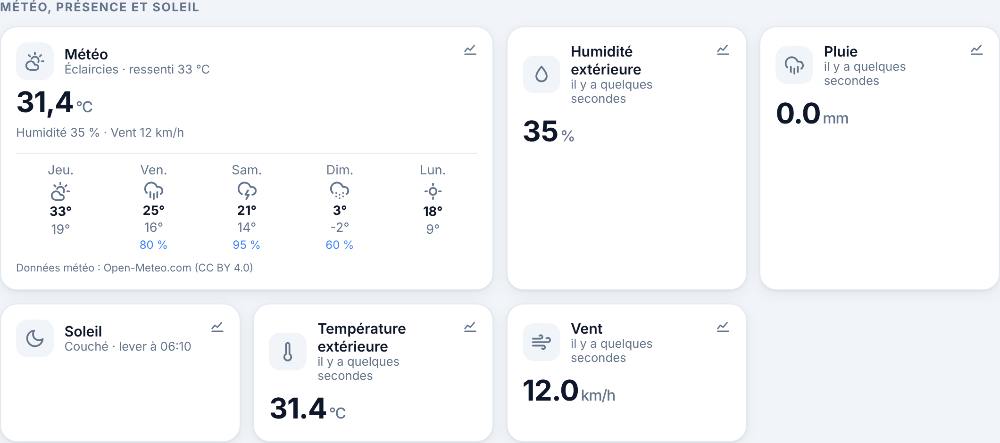

# Étape 15 : la météo locale, expliquée



## Le but

Savoir le temps qu'il fait dehors, et surtout **s'en servir** : fermer les volets quand il fait
plus de 30 °C, être prévenu quand un orage arrive, suivre la température extérieure dans
l'historique. Comme l'intégration météo de Home Assistant.

## La source : Open-Meteo

[Open-Meteo](https://open-meteo.com) rassemble les modèles des services météo nationaux, dont
Météo-France. C'est **gratuit**, **sans compte ni clé**, et les données sont sous licence libre
(CC BY 4.0). La seule obligation est de citer la source : la tuile affiche « Données météo :
Open-Meteo.com ».

Le serveur interroge Open-Meteo **toutes les 15 minutes**, au rythme où ses mesures changent.
Cela fait moins de 100 requêtes par jour, bien en dessous de la limite gratuite.

## Mettre en place

La météo utilise la position de la maison, déjà indiquée pour le soleil (étape 8) :

```powershell
$env:HA_LATITUDE = "48.85"
$env:HA_LONGITUDE = "2.35"
$env:HA_METEO = "on"
cargo run -p ha-server
```

Avec Docker : décommente `HA_LATITUDE`, `HA_LONGITUDE` et `HA_METEO` dans
[compose.yaml](../compose.yaml).

Au démarrage, le serveur affiche :

```
météo : api.open-meteo.com toutes les 15 min (position arrondie à 10 km)
```

## Ce que tu obtiens

| Entité | Contenu |
|--------|---------|
| `weather.maison` | La condition : `sunny` (ensoleillé), `clear-night`, `partlycloudy` (éclaircies), `cloudy`, `fog`, `rainy`, `pouring`, `snowy`, `snowy-rainy`, `lightning-rainy` (orage). En attributs : température, ressenti, humidité, pression, vent, rafales, et les **prévisions des 5 prochains jours** |
| `sensor.meteo_temperature` | Température extérieure (°C) |
| `sensor.meteo_humidite` | Humidité extérieure (%) |
| `sensor.meteo_vent` | Vitesse du vent (km/h) |
| `sensor.meteo_pluie` | Pluie du dernier quart d'heure (mm) |

Les noms de conditions sont ceux de Home Assistant : une automatisation copiée d'un forum
fonctionne telle quelle. Les capteurs ont leur **historique en graphique** (bouton de la tuile),
comme tous les capteurs.

## Dans les automatisations

```yaml
# Fermer les volets quand il fait plus de 30 °C, en journée.
- id: volets_chaleur
  alias: Volets fermés quand il fait chaud
  triggers:
    - trigger: numeric_state
      entity_id: sensor.meteo_temperature
      above: 30
  conditions:
    - condition: sun
      after: sunrise
      before: sunset
  actions:
    - action: cover.close_cover
      target:
        entity_id: cover.volet_salon

# Prévenir quand l'orage arrive.
- id: alerte_orage
  alias: Orage
  triggers:
    - trigger: state
      entity_id: weather.maison
      to: lightning-rainy
  actions:
    - action: notify.send_message
      target:
        entity_id: notify.telephone
      data:
        title: Orage
        message: Un orage arrive sur la maison. Pense à rentrer le linge !
```

Ces deux exemples sont dans [automations.example.yaml](../automations.example.yaml), et se créent
aussi avec l'éditeur du tableau de bord (étape 13).

## Vie privée et sécurité

- **Ta position est floutée.** Elle est arrondie à **0,1°** (environ 10 km) avant d'être envoyée.
  Pour la météo, cela ne change rien : un modèle météo travaille par carrés de plusieurs
  kilomètres. Mais Open-Meteo ne reçoit que « quelque part dans ce coin de 10 km ».
- **Jamais dans les logs.** Piège trouvé en écrivant cette étape : quand une requête échoue, le
  message d'erreur de la bibliothèque HTTP (`reqwest`) contient l'adresse complète, donc la
  position. Le serveur la retire (`without_url`) avant d'écrire quoi que ce soit. Un test vérifie
  qu'une erreur ne contient ni « latitude » ni les coordonnées : sans cette protection, il échoue.
- **Désactivée par défaut** : sans `HA_METEO=on`, rien ne part vers Open-Meteo.
- **HTTPS obligatoire**, et aucune redirection suivie. `HA_METEO_URL` permet d'utiliser ton
  propre serveur Open-Meteo (Docker). Le HTTP non chiffré n'est accepté que vers une adresse du
  réseau local.
- **Réponses vérifiées.** Taille limitée à 256 Kio, lue morceau par morceau. Chaque valeur est
  contrôlée (une température doit être entre -90 et 60 °C, une humidité entre 0 et 100 %) : un
  serveur en panne ou malveillant ne peut pas afficher -500 °C ni déclencher une automatisation
  avec une valeur absurde. Les dates des prévisions doivent avoir la forme `2026-10-15`.
- **Panne d'Open-Meteo.** Le serveur réessaie toutes les 5 minutes, avec un seul message dans les
  logs. Après **2 heures** sans nouvelles, les entités passent « indisponibles » : on ne laisse pas
  croire qu'une température d'il y a 3 heures est à jour, et une automatisation ne se déclenche pas
  sur une valeur périmée.

## Comment c'est construit

| Fichier | Contenu |
|---------|---------|
| [openmeteo.rs](../crates/ha-weather/src/openmeteo.rs) | La requête, la lecture et la vérification de la réponse, les codes météo |
| [lib.rs](../crates/ha-weather/src/lib.rs) | Réglages, relevé toutes les 15 minutes, entités |
| [app.js](../crates/ha-api/web/app.js) | La tuile météo et ses prévisions |

**Les codes météo.** Open-Meteo donne un code de l'Organisation météorologique mondiale (0 : ciel
clair, 61 : pluie, 95 : orage…). Le serveur le traduit en condition Home Assistant. Le code 0 donne
`sunny` le jour et `clear-night` la nuit, grâce à l'indicateur `is_day` d'Open-Meteo.

**Concepts Rust rencontrés :**

- **`Option<f64>` pour les valeurs manquantes.** Open-Meteo peut renvoyer `null` (une prévision de
  pluie absente, par exemple). Le type oblige à décider quoi faire : erreur pour une valeur
  indispensable (la température), simple absence pour une valeur facultative (la pression).
- **`RangeInclusive::contains`** : `(-90.0..=60.0).contains(&t)` vérifie une plage en une ligne.
  Un `NaN` n'est dans aucune plage : il est donc refusé aussi.
- **Lire une réponse par morceaux** (`response.chunk()`), en comptant les octets, plutôt que tout
  charger d'un coup : la mémoire utilisée reste bornée quoi que le serveur envoie.
- **`zip`** pour associer chaque capteur à sa valeur, sans index ni risque de décalage.

## Testé

- Lecture d'une réponse réaliste : condition, valeurs, 5 jours gardés sur 6 reçus, `null` toléré
  là où c'est permis, conditions de jour et de nuit.
- Refus des valeurs absurdes (-500 °C, humidité à 150 %, code inconnu, date piégée) et des
  réponses illisibles ; message clair quand Open-Meteo refuse (« limite atteinte »).
- Position arrondie dans la requête (48,8566 → 48,9), aussi dans l'hémisphère sud ; adresses de
  serveur refusées (HTTP public, identifiants, paramètres).
- Une erreur de connexion ne contient pas la position. Le test a été vérifié en retirant la
  protection : il échoue alors, avec les coordonnées en clair dans le message.
- Avec un **faux serveur Open-Meteo** : entités et capteurs publiés, requête arrondie ; panne
  prolongée → nouveaux essais, puis entités indisponibles.
- **Serveur en marche** : la requête reçue ne contenait que `latitude=48.9&longitude=2.4`, et
  l'automatisation « Fermer les volets quand il fait chaud » s'est déclenchée à 31,4 °C.
- Dans Chromium, ordinateur (thème clair) et téléphone (thème sombre) : tuile météo en tête de
  section, prévisions sur 5 jours, aucune erreur, aucun débordement.
- Pas encore testé avec le vrai Open-Meteo : il refusait les requêtes de la machine de
  développement, dont l'adresse est partagée et avait dépassé sa limite du jour. Le format de
  réponse est celui de sa documentation, et ce refus a permis de vérifier le message d'erreur.
