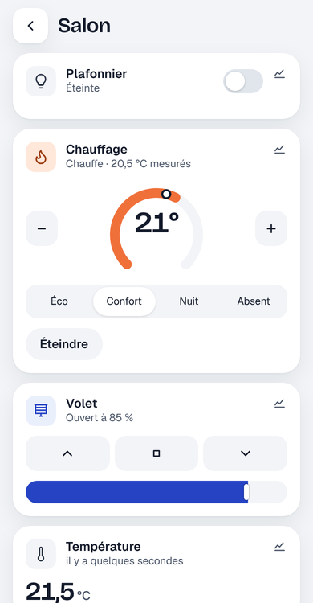
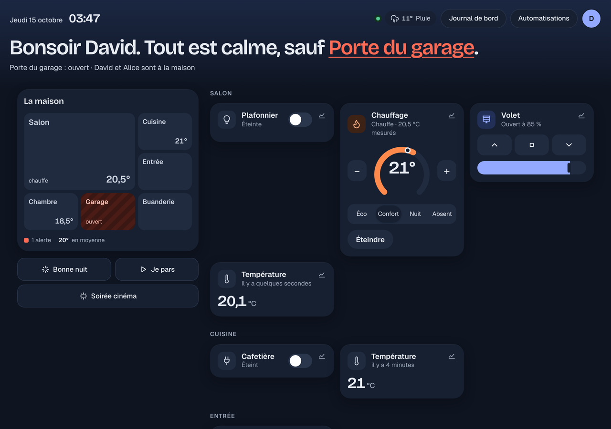
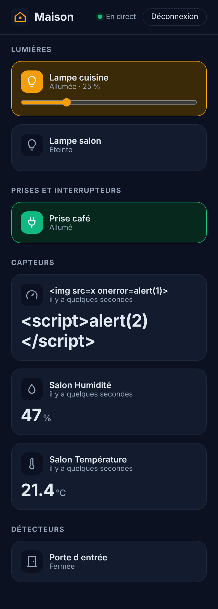

# Étape 25 : la nouvelle mise en forme, expliquée


## Le but

Jusqu'ici, le tableau de bord était une grille de tuiles rangées par type. Pratique, mais il fallait
tout lire pour savoir si « tout va bien ». La nouvelle mise en forme répond d'abord à **la question
qu'on se pose en ouvrant l'application** :

> « Bonsoir David. Tout est calme, sauf **Porte du garage**. »

Puis elle montre la maison **comme une maison** (un plan des pièces), et seulement ensuite les
appareils.

## Ce qui change

### En haut : la phrase du jour

- **Bonjour / Bonsoir** selon l'heure, avec ton nom.
- **« Tout est calme »**, ou la liste de ce qui demande ton attention : porte de garage, portail ou
  porte d'entrée ouverts, détecteur de fumée, de fuite ou alarme déclenchés. Chaque nom est un
  **lien** : il fait défiler jusqu'à la tuile et la sélectionne.
- En dessous, un résumé : les alertes, et **qui est à la maison** (d'après les personnes de
  l'étape 19).
- À droite : la connexion (point vert), la **météo** (étape 15), et ton **avatar** qui ouvre « Mon
  compte » (rôle, déconnexion).

### À gauche : le plan de la maison

Chaque pièce (étape 9) devient une case :

| Ce que tu vois          | Ce que ça veut dire                                   |
| ----------------------- | ----------------------------------------------------- |
| une case **plus grande** | une pièce avec beaucoup d'appareils (4 ou plus)       |
| un **halo doré**         | une lumière allumée                                   |
| des **rayures rouges**   | une alerte (garage ouvert, fumée…)                    |
| `20,5°`                 | la température de la pièce                            |
| « chauffe »             | le thermostat de la pièce est en train de chauffer    |

Toucher une pièce ouvre **la vue de la pièce** : seulement ses appareils, avec un bouton retour.



Sous le plan, les **scènes et scripts** (étape 11) sont des boutons : un appui lance la scène ; un
script en cours s'arrête si on rappuie.

### Les tuiles

- Les interrupteurs ont un vrai **bouton glissant**, bleu quand c'est allumé.
- Une lumière allumée prend une **teinte dorée**, et son curseur montre la luminosité.
- Le **thermostat** a un cadran : l'arc orange va jusqu'à la consigne, le petit point montre la
  température mesurée ; `−` et `+` de part et d'autre, les modes (Éco, Confort, Nuit, Absent) en
  dessous.
- Un **minuteur** a un anneau qui se vide.

### Sur téléphone : la barre du bas

Comme une application : **Maison**, **Journal**, **Automatismes**, **Compte**, toujours à portée de
pouce. Les boutons que ton rôle (étape 23) ne permet pas sont cachés.

## Clair le jour, sombre le soir





Le thème suit **le réglage de ton téléphone ou de ton ordinateur** : si tu as activé le mode sombre
automatique le soir, le tableau de bord passe en sombre en même temps. Rien à configurer.

Depuis l'étape 36, on peut aussi le choisir dans **Mon compte → Apparence** (clair, sombre, ou le
style [« plan d'architecte »](plan-architecte.md)), pour un appareil seulement.

**Le thème clair « Pierre »** (étape 80) : pas de blanc pur, qui fatigue les yeux sur un écran
allumé toute la journée. Le fond est un beige chaud (`#e8e5df`), les cartes sont ivoire
(`#f4f2ee`) et l'accent est indigo (`#4b44c8`), accordés à la lumière chaude des maquettes 3D. Le
texte garde un contraste confortable. Le style « plan d'architecte » a aussi un papier un peu moins
blanc.

Techniquement, toutes les couleurs sont des **variables CSS** déclarées une seule fois :

```css
:root {
  --bg: #e8e5df;
  --accent: #4b44c8;
}
@media (prefers-color-scheme: dark) {
  :root {
    --bg: #0e1420;
    --accent: #93a9ff;
  }
}
.tile { background: var(--card); }
```

`@media (prefers-color-scheme: dark)` est une **condition** : le navigateur l'applique seulement si
le système est en mode sombre. Les tuiles n'écrivent jamais une couleur en dur, elles disent
`var(--card)` : changer de thème, c'est seulement changer la valeur des variables.

## Rien ne vient d'Internet

Une jolie police se charge d'habitude depuis Google Fonts. **Pas ici** : chaque visite préviendrait
Google que tu ouvres ton tableau de bord, et l'interface dépendrait d'un site extérieur.

Les trois polices (Geist pour le texte, Geist Mono pour les heures, Bricolage Grotesque pour les
titres) sont **dans le programme lui-même** :

```rust
const FONT_GEIST: &[u8] = include_bytes!("../web/fonts/geist.woff2");
```

- `include_bytes!` est une **macro** (le `!`) : à la compilation, Rust lit le fichier et met son
  contenu directement dans l'exécutable, sous forme de tableau d'octets.
- `&'static [u8]` : une **référence** vers des octets (`u8`) qui vivent **toute la durée du
  programme** (`'static`), puisqu'ils font partie de l'exécutable. Pas de lecture de fichier au
  démarrage, donc pas d'erreur possible « fichier introuvable ».

Le serveur les sert avec un en-tête `Cache-Control: public, max-age=604800` : le navigateur les garde
une semaine au lieu de les redemander.

La **politique de sécurité du contenu** (CSP, voir l'étape 6) autorise maintenant `font-src 'self'` :
des polices, mais **seulement venant du serveur lui-même**. Un test vérifie que les fichiers servis
sont bien des polices WOFF2 et que la politique est bien là.

Ce sont des polices libres (licence SIL Open Font License) ; leurs licences sont à côté d'elles, dans
`crates/ha-api/web/fonts/`. Elles ne contiennent que les caractères latins (français compris), ce qui
les rend légères : environ 115 Ko pour les trois.

## Pas de style « en ligne »

La CSP interdit aussi les attributs `style="…"` dans le HTML (`style-src 'self'`), parce qu'un
attaquant qui arriverait à injecter du HTML pourrait s'en servir. Quand le JavaScript doit régler une
valeur variable (le remplissage d'un curseur, par exemple), il passe par l'**API du navigateur**, ce
qui reste autorisé :

```js
slider.style.setProperty("--fill", `${pourcentage}%`);
```

et la feuille de style s'en sert : `background: linear-gradient(… var(--fill) …)`.

## Accessibilité

- Si tu as demandé au système de **réduire les animations**, les transitions sont coupées
  (`prefers-reduced-motion`).
- Les boutons glissants restent de vrais boutons, avec `aria-pressed` (« enfoncé » ou non) : un
  lecteur d'écran annonce s'ils sont allumés.
- Les contrastes de texte ont été choisis pour rester lisibles dans les deux thèmes.

## Finitions

### « La porte est ouverte », pas « ouvert »

Le tableau de bord et le journal de bord **accordent** les mots avec le nom de l'appareil : « Porte du
garage : ouverte », « Lampe de chevet s'est éteinte », mais « Plafonnier s'est éteint ».

Comment le programme sait-il qu'un nom est féminin ? Il regarde **le premier mot** du nom (« Porte »
du garage) et le cherche dans une liste de mots féminins courants dans une maison (porte, fenêtre,
lampe, prise, cafetière…). Un article l'aide aussi : « **La** box » est féminin. Si ton appareil a un
nom féminin qui manque à la liste, il suffit de l'ajouter (deux endroits, gardés pareils :
`crates/ha-logbook/src/describe.rs` et `crates/ha-api/web/app.js`).

En Rust, le premier mot s'obtient ainsi :

```rust
let mut words = lower
    .split(|c: char| c.is_whitespace() || matches!(c, '_' | '-' | '\'' | '’'))
    .filter(|word| !word.is_empty());
match words.next() {
    Some("la" | "une") => true,
    Some("le" | "un" | "l") => words.next().is_some_and(|word| FEMININE.contains(&word)),
    Some(word) => FEMININE.contains(&word),
    None => false,
}
```

- `split(|c: char| …)` coupe le texte partout où la **fermeture** (la petite fonction entre `|…|`)
  répond « oui » : espaces, `_` (pour `binary_sensor.porte_entree`), tirets, apostrophes.
- `words` est un **itérateur** : `next()` donne le mot suivant, ou `None` s'il n'y en a plus. C'est
  pour ça qu'il est `mut` : le lire le fait avancer.
- `Some("la" | "une")` : un **motif** qui accepte l'un ou l'autre mot.
- `is_some_and(…)` : vrai seulement s'il y a un mot **et** qu'il est dans la liste.

### Les invités ne voient plus de boutons inutiles

Avant, un invité voyait les boutons du chauffage ou de la porte du garage, et recevait un refus en
appuyant. Maintenant, ces tuiles restent **lisibles** (la température, l'état de la porte) mais leurs
commandes disparaissent, et les scripts aussi.

Les règles ne sont écrites qu'**une fois**, dans le serveur (`crates/ha-api/src/roles.rs`). Il les
envoie au tableau de bord dans `GET /api/` :

```json
"controls": {
  "domains": ["light", "switch", "fan", "scene", "cover"],
  "forbidden_cover_classes": ["garage", "gate", "door"]
}
```

(`null` pour la famille et les administrateurs : tout.) Cacher un bouton n'est qu'une politesse : le
serveur **vérifie toujours** chaque commande, comme avant.

### Le mode tablette murale

Dans **Mon compte**, coche **Mode tablette murale** sur la tablette accrochée au mur :

- l'écran **reste allumé** (l'API *Wake Lock* du navigateur) ;
- le tableau de bord passe en **plein écran**, avec une grande horloge ;
- après **2 minutes sans contact**, il revient à l'accueil (sauf si l'éditeur d'automatisations ou
  la demande de mot de passe sont ouverts : on ne perd jamais un travail en cours).

C'est un réglage **de cet appareil seulement** (gardé dans le navigateur), rien n'est envoyé au
serveur. Le navigateur n'accepte de garder l'écran allumé que sur une page sécurisée : en HTTPS
(étape 7, ou [sur le réseau de la maison](https-maison.md)), ou à l'adresse `localhost`.

Après **5 minutes** sans contact, l'**écran de veille** prend le relais (étape 49, voir
[veille.md](veille.md)).
