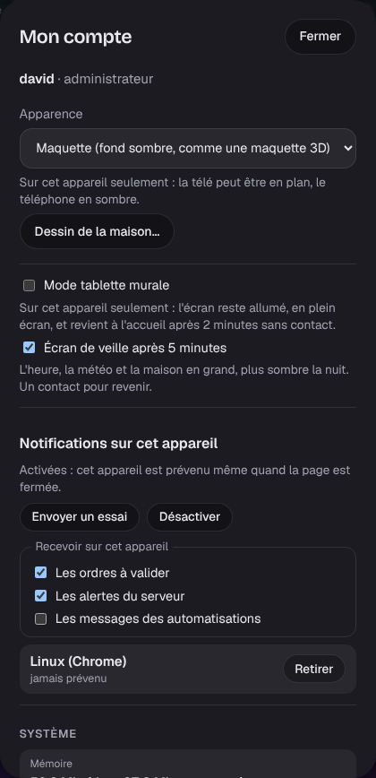

# Étape 50 : les notifications du navigateur, expliquées



## Le but

Un ordre retenu par la [garde](garde.md) (« Ordre à valider ») n'était vu que si quelqu'un ouvrait
la cloche du tableau de bord. Désormais, **le téléphone sonne**, même page fermée, et un toucher
sur la notification ouvre la cloche, avec « Valider » et « Refuser ».

C'est le **Web Push** des navigateurs : rien à installer, pas de compte à créer. Ça complète
[ntfy](notifications.md) (étape 12), qui reste utile pour les messages des automatisations vers
un téléphone sans tableau de bord.

## Ce qui arrive sur le téléphone

| Catégorie | Quand | Exemple |
|-----------|-------|---------|
| **Les ordres à valider** | un ordre à la voix ou d'un invité attend (la garde) | « Ordre à valider : fermer Volet chambre » |
| **Les alertes du serveur** | une alerte grave apparaît dans la cloche | intégration en panne, automatisation en erreur, clé Météo-France refusée |
| **Les messages des automatisations** | une automatisation écrit à `notify.appli` | « Lessive : la machine a fini » |

Chaque appareil choisit ses catégories (le téléphone tout, la tablette du salon rien, par
exemple). Les simples avertissements (« lampe injoignable ») restent dans la cloche, sans faire
sonner le téléphone.

## Mettre en place

Rien à configurer sur le serveur : la clé est créée au premier démarrage.

1. Le tableau de bord doit être ouvert **en HTTPS** (voir l'[étape 7](etape-7-deploiement.md)) :
   sans connexion sécurisée, les navigateurs refusent les notifications.
2. **Sur iPhone** (iOS 16.4 ou plus récent) : dans Safari, touche Partager → « Sur l'écran
   d'accueil », puis ouvre **Maison** depuis l'écran d'accueil. Apple ne permet les notifications
   qu'aux sites ajoutés à l'écran d'accueil. Sur Android, Windows et Mac, rien à faire.
3. **Mon compte → Notifications sur cet appareil → Activer**, et accepte la demande du
   navigateur.
4. **Envoyer un essai** : la notification arrive en quelques secondes.

Tes autres appareils sont listés en dessous, avec la date de la dernière notification reçue ; un
téléphone perdu se retire d'un clic. Un appareil désinstallé est oublié tout seul : le service de
notifications répond qu'il n'existe plus.

### Depuis une automatisation

```yaml
- action: notify.send_message
  target:
    entity_id: notify.appli
  data:
    title: Lessive
    message: La machine a fini.
    users: [david]        # facultatif : sinon, toute la famille
    priority: 4           # 4 ou 5 : réveille le téléphone même en économie d'énergie
```

La vigilance météo orange ou rouge, par exemple (voir l'[étape 33](vigilance.md)) :

```yaml
- id: vigilance_appli
  alias: Vigilance orange ou rouge
  triggers:
    - trigger: state
      entity_id: sensor.vigilance_meteo
      to: [Orange, Rouge]
  actions:
    - action: notify.send_message
      target: {entity_id: notify.appli}
      data:
        title: "Vigilance {{ trigger.to_state.state | lower }}"
        message: >-
          En ce moment : {{ state_attr('sensor.vigilance_meteo', 'niveau_actuel') | lower }}.
        priority: 5
```

### Réglages (facultatifs)

| Variable | Rôle |
|----------|------|
| `HA_PUSH_CONTACT` | ton contact pour les services de notifications (`mailto:toi@exemple.fr`), qui l'utilisent en cas de problème |
| `HA_PUSH=off` | coupe les notifications du navigateur |

## Comment ça marche

1. Le navigateur s'abonne auprès du **service de notifications de son éditeur** (Google pour
   Chrome et Android, Mozilla pour Firefox, Apple pour Safari, Microsoft pour Edge), avec la
   **clé publique** du serveur. Il donne au serveur une adresse chez ce service, et deux clés.
2. Pour notifier, le serveur **chiffre** le message avec les clés du navigateur
   ([RFC 8291](https://www.rfc-editor.org/rfc/rfc8291)), le **signe** avec sa clé privée
   ([VAPID, RFC 8292](https://www.rfc-editor.org/rfc/rfc8292)), et l'envoie à cette adresse.
3. Le service le remet au téléphone ; le **service worker** (`sw.js`) le déchiffre et l'affiche.

## Sécurité

- **Le contenu est chiffré de bout en bout** : Google, Apple ou Mozilla ne voient qu'un bloc
  illisible, et la taille. Seul le navigateur abonné peut le lire.
- **Personne d'autre ne peut écrire à tes appareils** : le service refuse tout envoi qui n'est
  pas signé par la clé privée du serveur. Cette clé est **chiffrée dans la base**, comme les
  jetons Hue et Somfy ; le secret `auth` de chaque appareil aussi.
- **Le serveur n'appelle que les services de notifications** : une adresse d'abonnement doit être
  en HTTPS, sur `fcm.googleapis.com`, `push.services.mozilla.com`, `push.apple.com` ou
  `notify.windows.com` (ou un de leurs sous-domaines), sur le port standard. Une page piégée ne
  peut donc pas faire appeler par ton serveur une adresse de ton réseau (`https://192.168.1.1/…`).
  L'adresse est revérifiée à chaque envoi, et les redirections ne sont jamais suivies.
- **Famille et administrateur seulement** : un invité ne peut pas s'abonner, et un compte devenu
  invité ne reçoit plus rien. Chacun ne voit et ne retire que ses propres appareils.
- **Des limites** : 10 appareils par compte, 50 pour la maison ; 10 messages d'automatisation en
  10 minutes (une automatisation qui boucle ne fait pas vibrer le téléphone sans fin), 60
  notifications en tout. Un message fait 600 caractères au plus.
- **Toucher une notification n'ouvre que le tableau de bord** : le service worker refuse toute
  autre adresse. Il ne met rien en cache et ne voit aucune donnée de la maison.
- **Pas de contenu dans les logs** : le serveur note qu'une notification est partie, pas ce
  qu'elle dit. Abonnements et désabonnements vont au journal d'audit.
- Écris tout de même des messages sans détail sensible : le téléphone les affiche sur l'écran
  verrouillé.

## Comment c'est construit

| Fichier | Rôle |
|---------|------|
| [ha-push/src/crypto.rs](../crates/ha-push/src/crypto.rs) (nouveau) | Chiffrement RFC 8291 et jeton VAPID, avec `ring` (déjà là pour le HTTPS) ; testé avec l'exemple de la RFC |
| [ha-push/src/lib.rs](../crates/ha-push/src/lib.rs) (nouveau) | Vérification des abonnements, quels événements notifient, envoi, limites |
| [ha-storage/src/push.rs](../crates/ha-storage/src/push.rs) (nouveau) | La clé du serveur et les abonnements (migration `0018_push.sql`) |
| [ha-api/src/push.rs](../crates/ha-api/src/push.rs) (nouveau) | `GET /api/push`, `POST /api/push/subscriptions`, `PATCH` et `DELETE /api/push/subscriptions/{id}`, `POST /api/push/test` |
| [web/sw.js](../crates/ha-api/web/sw.js) (nouveau) | Le service worker : affiche la notification, ouvre la cloche au toucher |
| [web/app.js](../crates/ha-api/web/app.js) | La section « Notifications sur cet appareil » de Mon compte |
| `web/icon-192.png`, `icon-512.png`, `apple-touch-icon.png` | Les icônes de l'appli installée (Android et iPhone ne prennent pas le SVG) |

La politique de sécurité du contenu (CSP) autorise désormais `worker-src 'self'` : le service
worker vient du serveur, et de lui seul.
