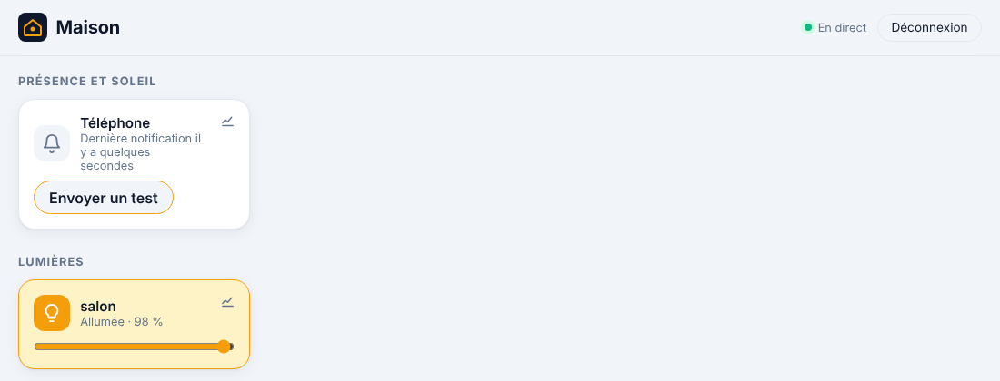

# Étape 12 : les notifications sur le téléphone, expliqué



## Le but

Être **prévenu** quand quelque chose d'important arrive : fumée, intrusion, appareil inconnu
sur le Wi-Fi, Internet coupé… même quand le tableau de bord est fermé.

## L'outil : ntfy

[ntfy](https://ntfy.sh) est une appli libre (Android et iPhone) qui reçoit des notifications
publiées sur un **sujet** (« topic »). Le serveur domotique publie, l'appli affiche. Pas de
compte Google ni Apple à relier, et le serveur ntfy peut même être hébergé chez soi.

### Choisir comment l'utiliser

| Solution | Pour | Contre |
|---|---|---|
| **Serveur public `ntfy.sh`, sujet long et aléatoire** | Rien à installer | Les messages passent par ntfy.sh, et quiconque devine le sujet peut les lire |
| **`ntfy.sh` avec un compte et un jeton d'accès** | Le sujet est protégé | Les messages passent toujours par ntfy.sh |
| **Ton propre serveur ntfy** (Docker) | Tout reste chez toi | À installer ; sur iPhone, ntfy passe quand même par ntfy.sh pour réveiller l'appli (voir la doc de ntfy) |

Dans tous les cas, **écris des messages sans détail sensible** : « Fumée détectée », pas ton
adresse ni le code de l'alarme.

### Mettre en place (serveur public)

1. Invente un **sujet long et aléatoire**, par exemple avec PowerShell :

   ```powershell
   "maison-" + -join ((48..57) + (97..122) | Get-Random -Count 24 | ForEach-Object { [char]$_ })
   ```

2. Installe l'appli **ntfy** sur ton téléphone, et abonne-toi à ce sujet.
3. Indique-le au serveur :

   ```powershell
   $env:HA_NTFY_URL = "https://ntfy.sh"
   $env:HA_NTFY_TOPIC = "maison-k3x9…"        # ton sujet
   # facultatif, si tu as un compte ntfy et un jeton :
   $env:HA_NTFY_TOKEN_FILE = "C:\chemin\ntfy_token.txt"
   cargo run -p ha-server
   ```

   Avec Docker : décommente les lignes `HA_NTFY_…` dans [compose.yaml](../compose.yaml) (le
   jeton va dans un fichier de `secrets/`, jamais dans le fichier lui-même).

4. Sur le tableau de bord, la tuile **Téléphone** a un bouton **Envoyer un test**.

## Dans les automatisations

C'est l'action `notify.send_message` de Home Assistant, avec l'entité `notify.telephone` :

```yaml
- id: alerte_fumee
  triggers:
    - trigger: state
      entity_id: binary_sensor.fumee_salon
      to: "on"
  actions:
    - action: notify.send_message
      target:
        entity_id: notify.telephone
      data:
        title: Fumée !
        message: Le détecteur de fumée du salon s'est déclenché.
        priority: 5          # 1 (discrète) à 5 (urgente), 3 par défaut
```

[automations.example.yaml](../automations.example.yaml) contient aussi des exemples pour un
**nouvel appareil sur le Wi-Fi** (Freebox) et une **coupure d'Internet** de plus de 5 minutes.

## Les protections

- **Pas de HTTP non chiffré vers Internet.** Une adresse `http://` n'est acceptée que vers le
  réseau local (IP privée, `.local`, `.lan`) ; ailleurs, le serveur refuse de démarrer.
- **Pas d'identifiants dans l'adresse** (`https://moi:motdepasse@…` refusé), ni de redirection
  suivie : une réponse ne peut pas renvoyer le jeton vers un autre serveur.
- **Le jeton** est lu dans un fichier (comme pour MQTT), n'apparaît dans aucun log ni affichage
  de débogage, et ne peut pas contenir de retour à la ligne (impossible d'ajouter un en-tête
  HTTP en douce).
- **Le contenu n'est pas écrit dans les logs** : il peut être personnel. Le journal note
  seulement « notification envoyée ».
- **Envoi en JSON**, pas en en-têtes : un titre piégé ne peut rien injecter. Titre et message
  sont nettoyés (caractères de contrôle retirés) et limités en longueur.
- **Au plus 10 notifications en 10 minutes.** Une automatisation qui boucle ne fera pas vibrer
  ton téléphone sans arrêt.
- **Conseil au démarrage** si le sujet est court sur le serveur public sans jeton (facile à
  deviner).

## Comment c'est construit

| Fichier | Contenu |
|---------|---------|
| [ha-notify/src/lib.rs](../crates/ha-notify/src/lib.rs) | Configuration vérifiée, envoi à ntfy, limite anti-rafale |
| [ha-tls](../crates/ha-tls/src/lib.rs) | `web_client` : HTTPS vérifié, HTTP seulement si autorisé, aucune redirection |
| [tests/fake_ntfy.rs](../crates/ha-notify/tests/fake_ntfy.rs) | Faux serveur ntfy |

**Concepts Rust rencontrés :**

- **Le type `Url` plutôt qu'une chaîne.** L'adresse est analysée par la crate `url` : on
  interroge ensuite son protocole, son hôte, ses identifiants, au lieu de chercher des morceaux
  de texte (et de se faire piéger par `https://ntfy.sh@pirate.example`).
- **`VecDeque` comme fenêtre glissante.** Les dates des derniers envois sont rangées dans une
  file : on retire les plus vieilles par devant, on ajoute la nouvelle par derrière.
- **`clamp`** pour la priorité : une valeur de 9 devient 5, une valeur de 0 devient 1.

## Testé

- Configurations : HTTPS public accepté, HTTP local accepté, HTTP vers Internet, autres
  protocoles, identifiants dans l'adresse, sujets et jetons invalides refusés ; jeton masqué.
- Messages nettoyés (caractères de contrôle), bornés en longueur, priorité ramenée entre 1 et 5,
  message vide refusé.
- Faux serveur ntfy : JSON exact, jeton envoyé, autres entités ignorées, rafale de 20 → 10
  envoyées.
- De bout en bout : bouton « Envoyer un test » dans Chromium, message reçu par un faux ntfy avec
  le jeton, rien de personnel dans les logs, démarrage refusé avec `http://ntfy.sh`.
