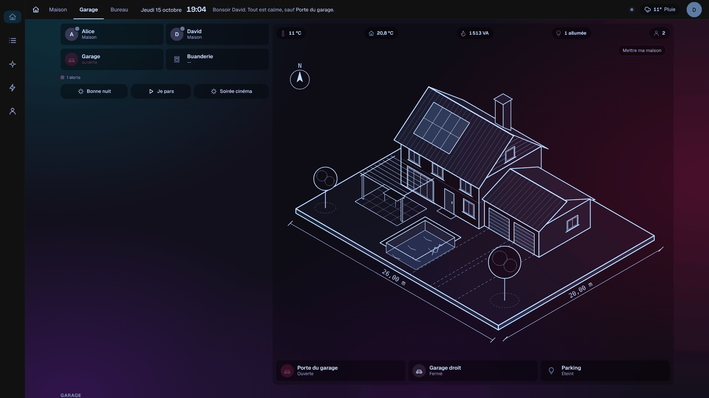
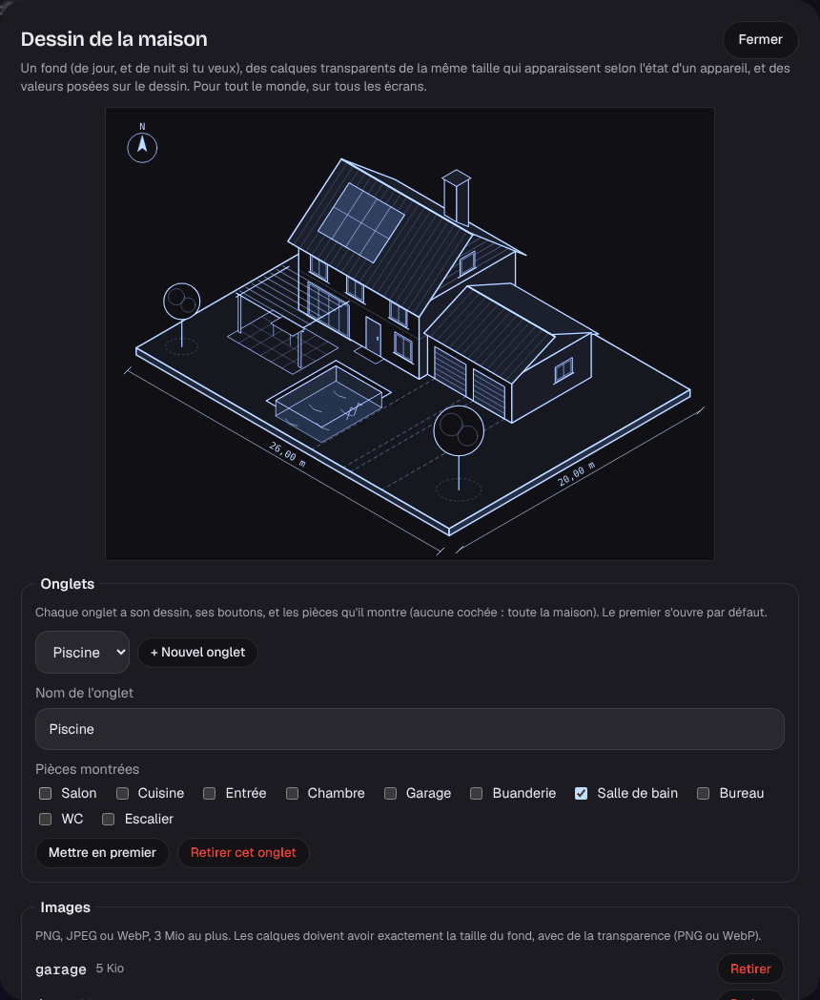
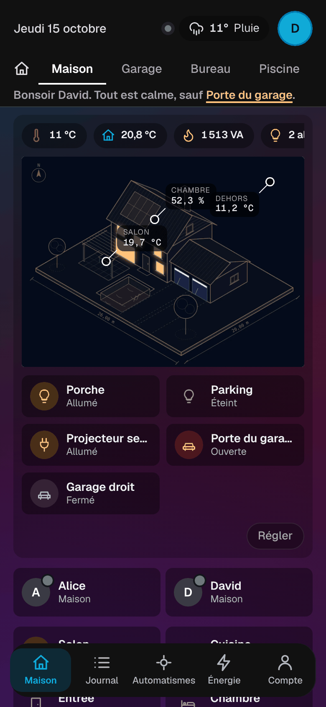

# Étape 38 : les onglets du tableau de bord, expliqués

## Le but

Comme sur les tableaux de domo-blog (Maison, Piscine, Garage, Solaire…), plusieurs **onglets**,
chacun avec :

- son **nom** ;
- son **dessin** : fond de jour, fond de nuit, calques et valeurs ([étape 36](plan-architecte.md)) ;
- ses **boutons rapides** ([étape 37](maquette.md)) ;
- les **pièces** qu'il montre : un onglet « Garage » ne montre que le garage (ses tuiles, ses
  volets, ses appareils) ; sans pièce cochée, l'onglet montre toute la maison.

Les onglets apparaissent dans la mise en page « tableau » (thème Maquette et styles plan) : en
haut à gauche de la barre sur un grand écran, sur une ligne qu'on fait défiler sur téléphone.

## Régler les onglets

**Mon compte → Dessin de la maison… → Onglets** (administrateur) :

- **choisir l'onglet** à régler : tout le reste de la fenêtre (images, fonds, calques, valeurs,
  boutons) concerne cet onglet ; les images, elles, sont communes ;
- **+ Nouvel onglet**, le **renommer**, cocher ses **pièces** ;
- **Mettre en premier** : le premier onglet s'ouvre par défaut ;
- **Retirer cet onglet** (il en reste toujours un).

Rien n'est enregistré avant « Enregistrer ». Ton réglage d'avant les onglets devient l'onglet
« Maison », sans rien perdre.

## L'onglet retenu

Chaque écran retient son onglet (dans le navigateur) : la tablette du garage reste sur « Garage »,
la télé du salon sur « Maison ».

## Sécurité

- Les onglets sont vérifiés par le serveur : 1 à 8, des identifiants courts et uniques
  (`a-z 0-9 -`), des noms de 30 caractères au plus, et des pièces qui existent dans `areas.yaml`.
  Puis le dessin de chacun, comme avant.
- Un invité ne voit, dans chaque onglet, ni les calques, ni les valeurs, ni les boutons des
  appareils qui lui sont cachés.
- Une image ne peut pas être retirée tant qu'un onglet s'en sert.
- Le journal d'audit note la liste des onglets à chaque enregistrement.

## Comment c'est construit

- `ha-api/src/drawing.rs` : l'assemblage devient `{"pages": [...]}`. Chaque onglet (`Page`) a un
  `id`, un `name`, ses `areas`, et les champs du dessin. Ce qui était rangé avant (un seul dessin)
  est relu comme l'onglet « Maison » (`parse_stored`).
- `house.js` : `selectPage` affiche un onglet et met les pièces dans `pageAreas`, que `app.js` lit
  pour le plan des pièces et les sections (`shownAreas`) ; l'onglet retenu est dans
  `localStorage` (`ha-page`).
- La fenêtre de réglage travaille sur une copie de tous les onglets (`drawingEdit.pages`) ; le
  formulaire règle celui qui est choisi (`drawingEdit.draft`).
