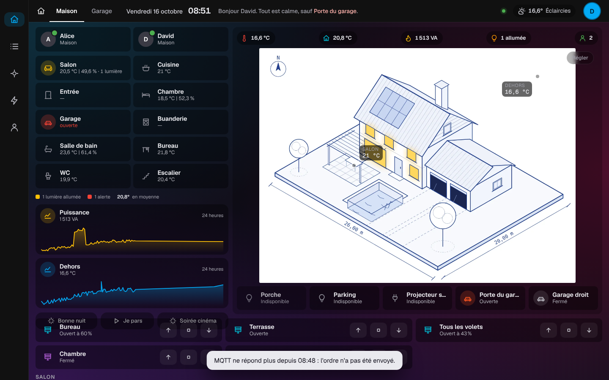

# Étape 46 : des ordres avec réponse, expliqués

## Le but

Toucher une lampe envoyait un ordre sur le bus, puis… rien. Si le pont Hue était débranché, la tuile
clignotait cinq secondes et revenait comme avant, sans un mot. Pire : l'ordre restait en file, et
l'intégration pouvait l'exécuter **en se reconnectant**, deux minutes plus tard. Pour une lampe,
c'est gênant ; pour une porte de garage, ça ne l'est pas du tout.

C'est la deuxième idée reprise de [Moli OS](https://github.com/rudy-io/moli-os) après la
[supervision des intégrations](supervision.md) : « un ordre que personne n'attend plus n'est jamais
exécuté », et on sait s'il a abouti.

## Ce qui change

| Situation | Réponse du serveur | Ce que dit le tableau de bord |
| --------- | ------------------ | ----------------------------- |
| Hue ou Somfy accepte l'ordre | `200`, `"result": "done"` | rien (l'appareil change d'état) |
| Hue ou Somfy le refuse | `502` | « Le pont Hue n'a pas accepté l'ordre. » |
| Pas de réponse en 8 s | `504` | « Hue n'a pas répondu à temps. » |
| L'intégration est en panne (appareils indisponibles) | `503`, **rien n'est envoyé** | « MQTT ne répond plus depuis 08:48 : l'ordre n'a pas été envoyé. » |
| Une intégration qui ne sait pas répondre (MQTT, entrées, scripts…) | `200`, `"result": "sent"` | rien : l'appareil confirmera en changeant d'état |

Et pour toutes les commandes :

- **un ordre périmé n'est jamais exécuté** : chaque ordre porte sa date ; reçu plus de **5 secondes**
  après avoir été donné (pendant une coupure, par exemple), Hue, Somfy et MQTT l'ignorent. La porte du
  garage ne s'ouvre pas toute seule au retour du réseau ;
- les **messages ne citent jamais d'adresse** : le détail de l'erreur (qui peut contenir l'adresse
  du pont) reste dans les logs du serveur.

## Pourquoi seulement Hue et Somfy répondent

Hue et Somfy reçoivent l'ordre par une requête HTTP : le pont ou la box répond « d'accord » ou
« non ». MQTT, lui, dépose un message chez le broker, sans savoir si l'appareil l'a reçu : la seule
confirmation est l'état qui change. Les entrées, scripts et scènes sont dans le serveur lui-même.
Pour eux, l'ordre est simplement envoyé (`"sent"`) ; mais un ordre périmé reste ignoré, et une
intégration en panne est refusée d'office (`503`).

## Sécurité

- Le refus d'office (`503`) évite qu'un ordre attende en file et s'exécute à un moment où plus
  personne ne le veut.
- Les ordres en attente de réponse sont bornés (256 au plus) : une page qui insiste ne remplit pas
  la mémoire.
- Les droits ne changent pas : on vérifie toujours le compte avant tout (`403`), et le mot de passe
  pour une serrure.

## Comment c'est construit

- `crates/ha-core/src/commands.rs` (nouveau) : un numéro par ordre (`Core::call_service_tracked`),
  la réponse de l'intégration (`Core::command_done`), et `is_stale()` (plus de `COMMAND_TTL`, 5 s).
- `Event::CallService` porte maintenant `command` (le numéro, si quelqu'un attend) et `issued_at`
  (sa date).
- `Core::answers_commands("hue")` : les intégrations qui savent répondre ;
  `Core::owner_down(entité)` : l'intégration de l'appareil est-elle en panne ?
- `crates/ha-api/src/rest.rs` (`POST /api/services/…`) : refuse si l'intégration est en panne,
  attend la réponse au plus 8 s (5 s de durée de vie, plus 3 s pour joindre l'appareil) quand elle
  sait répondre.
- `crates/ha-api/web/app.js` : affiche le message en bas de l'écran et arrête le clignotement.
