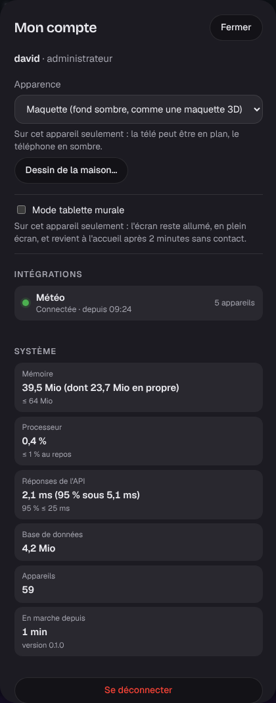

# Étape 47 : la performance, mesurée, expliquée

## Le but

Un serveur domotique tourne jour et nuit, souvent sur une petite machine (un Raspberry Pi, une
box, un vieux portable). Il doit être **léger**, et le rester. Jusqu'ici, on ne mesurait rien :
une version qui consomme deux fois plus de mémoire serait passée inaperçue.

L'idée vient de [Moli OS](https://github.com/rudy-io/moli-os), qui mesure chaque livraison à côté
d'un vrai Home Assistant (2,1 Go de mémoire) : **un budget**, vérifié à chaque fois, et une page qui
montre les chiffres.

## Les mesures

Sur la maison de démonstration (59 appareils, la météo, l'historique de plusieurs jours), version
optimisée (`--release`) :

| Mesure | Ce serveur | Budget | Home Assistant (pour comparer) |
| ------ | ---------- | ------ | ------------------------------ |
| Mémoire résidente | **40 Mio** (24 Mio en propre) | ≤ 64 Mio | ~2 Gio (mesure de Moli OS) |
| Sans la météo (sans client HTTPS) | 18 Mio (3 Mio en propre) | | |
| Processeur au repos | **0,2 %** d'un cœur | ≤ 1 % | 1,5 à 2,5 % (mesure de Moli OS) |
| Réponses de l'API | médiane **1 à 2 ms**, 95 % sous **5 ms** | 95 % ≤ 25 ms | |
| Programme | **17 Mo** | | |
| Image Docker | programme + `distroless/cc` | ≤ 80 Mo | 2,3 Go |

« En propre » : la mémoire anonyme (tas et piles), sans les fichiers chargés (le programme lui-même,
les bibliothèques), que le système peut partager ou relire.

La rapidité des **appareils** eux-mêmes (du toucher à la lampe allumée) est mesurée à part, depuis
l'[étape 63](rapidite.md).

## Voir les chiffres

**Mon compte → Système** (administrateur) : la mémoire, le processeur depuis la dernière lecture, les
réponses de l'API (médiane et 95 %), la taille de la base, le nombre d'appareils, la durée depuis
le démarrage et la version. Une valeur hors budget est marquée en rouge. La page se met à jour
toutes les 10 secondes tant qu'elle est ouverte.

## Le budget, vérifié par la CI

Le job « image Docker » (`.github/workflows/docker.yml`) construit l'image, la démarre, puis
vérifie :

1. **la taille de l'image** : 80 Mo au plus ;
2. **la mémoire au repos** du conteneur, après 10 secondes : 64 Mio au plus ;
3. **le temps de réponse** : sur 60 requêtes vers `/` et vers `/api/`, 95 % en moins de 25 ms.

Une PR qui dépasse le budget échoue : on corrige (ou on explique, et on change le budget en le
justifiant) avant de fusionner.

Pour économiser les minutes de CI, ce job ne tourne que sur les PR qui touchent l'emballage
(`Dockerfile`, `Cargo.lock`, la version de Rust…), et **chaque lundi** pour tout le reste. Une
régression du code lui-même est donc vue au plus tard la semaine suivante ; la page « Système »
la montre, elle, tout de suite.

## Sécurité

- `GET /api/system` est **réservé à l'administrateur** (le droit « lire le journal d'audit ») : les
  chiffres ne disent rien de la maison, mais n'intéressent que lui.
- Les mesures sont lues dans `/proc/self` (le serveur sur lui-même) : rien d'autre n'est lu sur la
  machine. Hors Linux, la mémoire et le processeur ne sont pas affichés.
- Seules les durées sont gardées (les 500 dernières requêtes), jamais les adresses ni les contenus.

## Comment c'est construit

- `crates/ha-api/src/system.rs` (nouveau) :
  - un intermédiaire (`measure`) note la durée de chaque requête `/api/…` (sauf le WebSocket, qui
    dure) dans une file des 500 dernières ;
  - `read_proc()` lit la mémoire (`VmRSS`, `RssAnon`) et le processeur consommé (`utime + stime`) ;
  - le processeur est calculé entre deux lectures de la page ;
  - les budgets sont des constantes (`BUDGET_MEMORY_MIB`, `BUDGET_CPU_PERCENT`, `BUDGET_API_P95_MS`).
- `crates/ha-storage` : `Store::database_size()` (pages × taille d'une page, sans lire le fichier).
- `.github/workflows/docker.yml` : l'étape « Budget de performance ».
