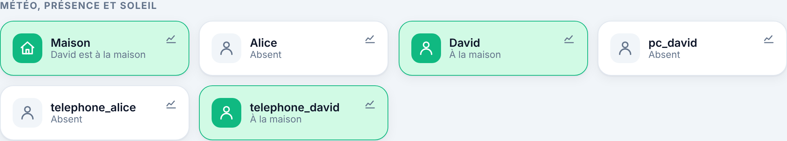

# Étape 19 : personnes et zone Maison, expliqué



## Le but

Depuis l'intégration Freebox, chaque **appareil** suivi a sa présence : `device_tracker.telephone_david`
est « à la maison » ou « absent ». Mais ce qui compte, c'est la **personne** : David peut avoir laissé
son téléphone en charge et être parti avec son ordinateur. Et pour l'automatisation la plus utile de
toutes, « quand le dernier part, tout éteindre », il faut savoir **combien** de personnes sont là.

Comme dans Home Assistant :

- **`person.david`** regroupe les appareils de David : `home` dès que l'un d'eux est à la maison,
  `not_home` quand tous ceux qu'on connaît sont absents, `unknown` si aucun n'est connu ;
- **`zone.home`** (« Maison ») a pour état le **nombre** de personnes présentes, et leurs noms en
  attribut.

## Mettre en place

1. Suis les appareils de chacun avec la Freebox (voir le [guide Freebox](freebox.md)) :

   ```powershell
   cargo run -p ha-server -- freebox devices
   cargo run -p ha-server -- freebox track 3C:22:FB:00:00:01 telephone_david
   ```

2. Copie [persons.example.yaml](../persons.example.yaml) en `persons.yaml` (avec Docker :
   `config/persons.yaml`) :

   ```yaml
   - id: david
     name: David
     trackers:
       - device_tracker.telephone_david
       - device_tracker.pc_david
   ```

   Un `binary_sensor` peut aussi servir (`on` = présent) : un capteur de présence dans le lit, par
   exemple.

3. Vérifie et redémarre :

   ```powershell
   cargo run -p ha-server -- persons check
   ```

## Dans les automatisations

```yaml
# Le dernier est parti (depuis 5 minutes) : tout éteindre, chauffage en « absent ».
- id: dernier_parti
  triggers:
    - trigger: state
      entity_id: zone.home
      to: "0"
      for: 5min
  actions:
    - action: light.turn_off
      target: {entity_id: [light.salon, light.entree]}
    - action: climate.set_preset_mode
      target: {entity_id: climate.salon}
      data: {preset_mode: absent}

# Le premier est arrivé : chauffage en « confort ».
- id: premier_arrive
  triggers:
    - trigger: state
      entity_id: zone.home
      from: "0"
  actions:
    - action: climate.set_preset_mode
      target: {entity_id: climate.salon}
      data: {preset_mode: confort}
```

Et pour une personne : `entity_id: person.david`, `to: not_home`. Ces exemples sont dans
[automations.example.yaml](../automations.example.yaml).

## Et les autres zones (bureau, école…) ?

Dans Home Assistant, d'autres zones existent (« au bureau », « à l'école »), grâce au **GPS** de
l'application mobile. Ici, la présence vient de la Freebox : elle sait seulement si un appareil est
connecté au Wi-Fi de la maison, pas où il se trouve ailleurs. Il n'y a donc que la zone Maison. Ce
n'est pas un oubli : sans application mobile, on ne pourrait pas savoir où tu es, et c'est aussi
bien pour ta vie privée.

## Les limites à connaître

- **Un téléphone en veille** peut se déconnecter du Wi-Fi. L'intégration Freebox attend déjà
  **10 minutes** avant de le déclarer absent. Ajoute aussi un `for: 5min` sur « le dernier est
  parti » (comme dans l'exemple).
- **Plusieurs appareils** : une personne est présente dès qu'**un** appareil l'est. Si quelqu'un
  laisse son ordinateur allumé à la maison, il restera « présent ». Ne mets dans `trackers` que les
  appareils qu'on emporte avec soi (le téléphone, surtout).
- **Un appareil indisponible** (Freebox injoignable…) est ignoré : on ne déclare pas quelqu'un
  absent faute de nouvelles.

## Comment c'est construit

| Fichier | Contenu |
|---------|---------|
| [ha-person/src/lib.rs](../crates/ha-person/src/lib.rs) | Lecture de `persons.yaml`, état des personnes, zone Maison |
| [app.js](../crates/ha-api/web/app.js) | Tuiles « Maison » et personnes, en tête de la section présence |

**Concepts Rust rencontrés :**

- **`Option<bool>` à trois valeurs** : `Some(true)` (à la maison), `Some(false)` (absent), `None`
  (on ne sait pas). Le compilateur oblige à traiter le troisième cas, celui qu'on oublie
  facilement avec un simple `bool`.
- **`Option::or_else`** : « garde le premier appareil absent trouvé », sans `if` ni variable mutable
  en plus.

## Testé

- Le fichier : noms, valeurs par défaut, et refus des identifiants invalides, listes vides, entités
  d'un autre type, doublons, champs inconnus.
- La règle : jamais vu → inconnu ; un appareil absent → absent ; un capteur présent → présent ; un
  appareil indisponible est ignoré.
- Avec un vrai noyau : personnes et zone à jour dès le démarrage, puis à chaque changement ; le
  bon appareil indiqué comme source.
- **« Le dernier est parti »** avec le vrai moteur d'automatisations : rien quand le premier part,
  l'action quand le dernier part.
- Sur un serveur en marche : appareils créés par l'API, `zone.home` est passée de 0 à 1 ; dans
  Chromium, « Maison : David est à la maison », puis Alice et David, puis leurs appareils. Aucune
  erreur.
