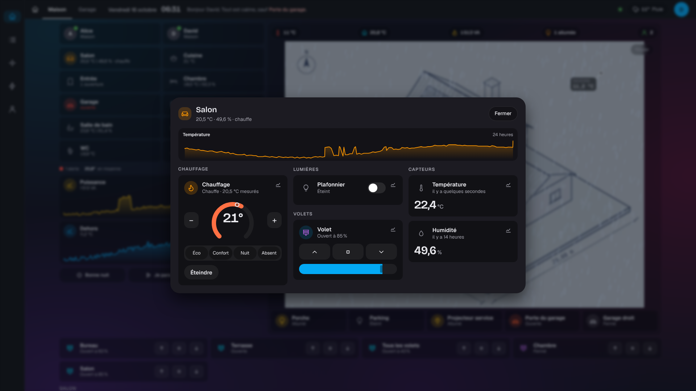
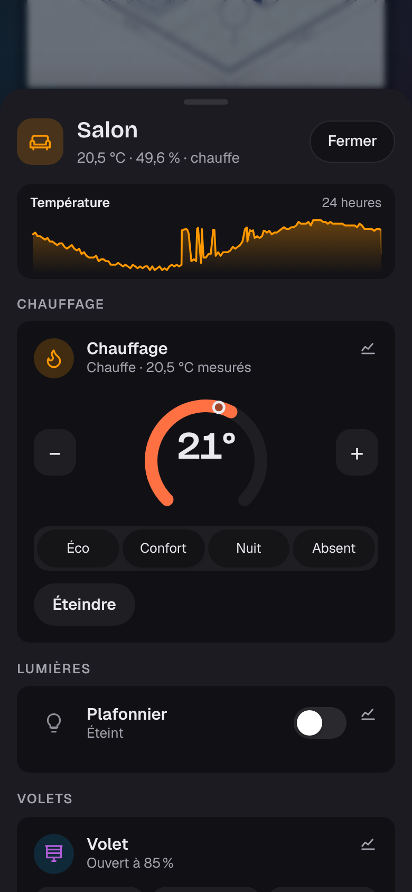

# Étape 42 : une fenêtre par pièce, expliquée

## Le but

Dans les tableaux Home Assistant à la domo-blog (les cartes « bubble »), toucher une pièce ouvre
une fenêtre avec **tout ce qu'elle contient**, sans quitter le tableau. Jusqu'ici, la tuile d'une
pièce montrait sa température et ses lumières, et la mise en page « tableau » ne savait rien en
faire de plus.

Dans la mise en page « tableau » (styles Maquette et plan d'architecte), **toucher une pièce**
ouvre sa fenêtre, par-dessus la maquette. On peut toucher sa tuile à gauche, ou une **zone de la
maquette** réglée sur cette pièce. Dans la mise en page habituelle (clair, sombre), rien ne
change : la pièce s'affiche seule à la place des sections, comme avant.

## Ce qu'il y a dans la fenêtre

- **En haut** : l'icône de la pièce (dorée si une lumière est allumée, orange si elle chauffe,
  rouge en cas d'alerte), son nom, et ses mesures : « 20,5 °C · 49,6 % · 1 lumière allumée ·
  chauffe ».
- **La température sur 24 heures**, si la pièce a un capteur de température. Toucher la courbe
  ouvre l'historique.
- **« Éteindre les lumières (2) »**, quand des lumières de la pièce sont allumées. Le bouton
  éteint seulement les lumières, pas les prises : une prise peut porter un frigo ou une box.
- **Les appareils de la pièce**, rangés comme les sections : chauffage, lumières, volets, prises,
  capteurs, détecteurs, scènes… avec **les tuiles habituelles**. On règle la consigne avec + et −,
  l'intensité d'une lumière ou la position d'un volet avec le curseur, et le bouton d'historique
  est dans le coin de chaque tuile.

Les tuiles se mettent à jour en direct, comme celles du tableau.

## Fermer

- « Fermer », la touche Échap, ou un toucher à côté de la fenêtre ;
- sur téléphone, on peut aussi la **tirer vers le bas** par son en-tête.

## Sur téléphone

La fenêtre monte du bas de l'écran et prend presque toute la hauteur. Les tuiles sont sur une
colonne. Sur un grand écran, la fenêtre est au centre et les groupes se rangent sur deux ou trois
colonnes.

## Une zone de la maquette qui ouvre une pièce

**Mon compte → Dessin de la maison… → Zones à toucher** : pour chaque zone, « Un toucher… »
propose maintenant **« Commander un appareil »** (comme à l'[étape 41](zones.md)) ou **« Ouvrir
une pièce »**, avec la liste des pièces de `areas.yaml`. On trace la zone sur le salon de la
maquette : un toucher ouvre la fenêtre du salon.

## Sécurité

- **Rien de nouveau côté commandes** : la fenêtre utilise les tuiles du tableau, et chaque
  commande passe par les mêmes routes. Le serveur vérifie les droits à chaque fois. Ce qu'un
  compte ne peut pas commander s'affiche grisé, sans boutons.
- La fenêtre ne montre que les appareils que le serveur a envoyés : un **invité** n'y voit pas ce
  qui lui est caché.
- Une zone de pièce est vérifiée : **un appareil ou une pièce, pas les deux**, et la pièce doit
  exister dans `areas.yaml`.

## Comment c'est construit

- `crates/ha-api/web/index.html` : la fenêtre `#room` (un `<dialog>`, comme l'historique).
- `crates/ha-api/web/house.js` :
  - `openRoom()` remplit la fenêtre une seule fois. Les tuiles viennent de `renderTile()` (app.js),
    rangées par les groupes de `SECTIONS`, plus « Scènes » ;
  - l'en-tête (mesures, courbe, bouton) est redessiné à chaque changement d'état ;
  - la courbe reprend celle de l'[étape 40](courbes.md) ;
  - pour la tirer vers le bas, on suit le doigt sur l'en-tête (`setPointerCapture`) et on ferme
    au-delà de 90 px.
- `crates/ha-api/web/app.js` :
  - une tuile peut maintenant être deux fois dans la page (dans les sections et dans la fenêtre) ;
  - à chaque changement d'état, les deux sont remplacées ;
  - « en attente » s'applique aux deux.
- `crates/ha-api/src/drawing.rs` : une zone a `entity_id` **ou** `area`.
