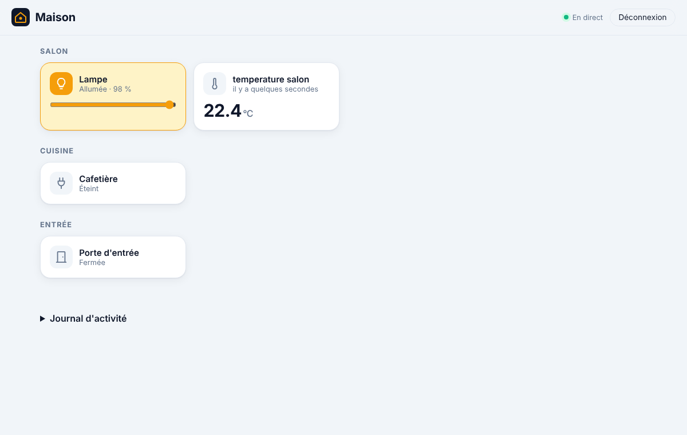

# Étape 9 : les pièces, expliqué



## Le but

Avec quelques lampes, des volets, des capteurs, la présence et le soleil, le tableau de bord
rangé par **type** (« Lumières », « Volets »…) devient vite long. Home Assistant permet de
ranger chaque appareil dans une **pièce** (« area ») : on regarde le salon, et on y trouve tout
ce qui s'y trouve.

On en profite pour donner un **nom lisible** à chaque appareil : « Cafetière » plutôt que
« prise cafe ».

## Mettre en place

Copie [areas.example.yaml](../areas.example.yaml) en `areas.yaml` (avec Docker :
`config/areas.yaml`) et adapte-le :

```yaml
- area: Salon
  entities:
    - entity: light.salon
      name: Lampe
    - entity: cover.volet_salon
      name: Volet
    - sensor.temperature_salon      # sans nom : le nom de l'appareil est gardé

- area: Cuisine
  entities:
    - entity: switch.prise_cafe
      name: Cafetière
```

Les noms d'entités (`light.salon`…) sont ceux du tableau de bord : survole une tuile, ou regarde
`ha-server freebox devices`, `somfy devices`, ou l'API `GET /api/states`.

Puis vérifie et redémarre :

```powershell
cargo run -p ha-server -- areas check
```

```
areas.yaml : 3 pièce(s) valide(s)
  - Salon (3 appareil(s))
  - Cuisine (1 appareil(s))
  - Entrée (1 appareil(s))
```

Le tableau de bord affiche une section par pièce, **dans l'ordre du fichier**. Les appareils qui
ne sont dans aucune pièce restent rangés par type, en dessous. Un appareil listé mais absent
(débranché, pas encore associé) n'est simplement pas affiché.

## Pourquoi un fichier, et pas des réglages dans l'interface ?

Comme les automatisations : un fichier se relit, se sauvegarde, se compare d'une version à
l'autre, et se **vérifie** avant d'être utilisé. Il est lu en lecture seule par le serveur (avec
Docker, le dossier `config` est monté en lecture seule) : même quelqu'un qui prendrait le
contrôle du tableau de bord ne pourrait pas le modifier. L'étape 13 apportera un éditeur dans
l'interface, avec les mêmes vérifications.

## Les vérifications

Un fichier invalide **empêche le démarrage**, avec un message qui dit quoi corriger :

- faute de frappe dans un champ (`entites:`) ;
- identifiant d'appareil invalide (`Lampe du salon` au lieu de `light.salon`) ;
- pièce en double, ou appareil dans **deux** pièces (lequel afficher ?) ;
- nom vide, trop long (60 caractères au plus) ou contenant des caractères de contrôle ;
- plus de 50 pièces, plus de 100 appareils par pièce, fichier de plus de 256 Kio.

Côté tableau de bord, les noms de pièces et d'appareils sont insérés comme du **texte**
(`textContent`), jamais comme du HTML : un nom comme `` s'afficherait tel quel,
sans rien exécuter.

## Comment c'est construit

| Fichier | Contenu |
|---------|---------|
| [ha-areas/src/lib.rs](../crates/ha-areas/src/lib.rs) | Lecture et vérification de `areas.yaml` |
| [rest.rs](../crates/ha-api/src/rest.rs) | `GET /api/areas` (connexion requise) |
| [app.js](../crates/ha-api/web/app.js) | Une section par pièce, puis le reste par type |

**Concepts Rust rencontrés :**

- **`#[serde(untagged)]`** : un appareil s'écrit `light.salon` **ou**
  `{entity: light.salon, name: Lampe}`. Serde essaie chaque forme dans l'ordre, et garde la
  première qui convient.
- **`HashSet::insert` pour repérer les doublons** : `insert` renvoie `false` si l'élément y
  était déjà. Une seule ligne pour « ajoute-le, et dis-moi s'il était déjà là ».
- **Valider à l'entrée, faire confiance ensuite.** Le fichier est transformé en `Vec<Area>` où
  chaque `EntityId` est déjà vérifié. Le reste du programme n'a plus à se demander si un
  identifiant est valide : le type le garantit.

## Testé

- Pièces et noms lus dans l'ordre ; pièce vide ; fichier vide ou absent.
- Fautes de frappe, identifiants invalides, noms vides, trop longs ou piégés, doublons : refusés.
- `GET /api/areas` exige d'être connecté, et renvoie les pièces telles que configurées.
- Démarrage refusé avec un fichier incohérent (« light.salon est dans deux pièces »).
- De bout en bout dans Chromium, sur ordinateur et téléphone : sections « Salon », « Cuisine »,
  « Entrée » avec les noms choisis, aucune erreur.
