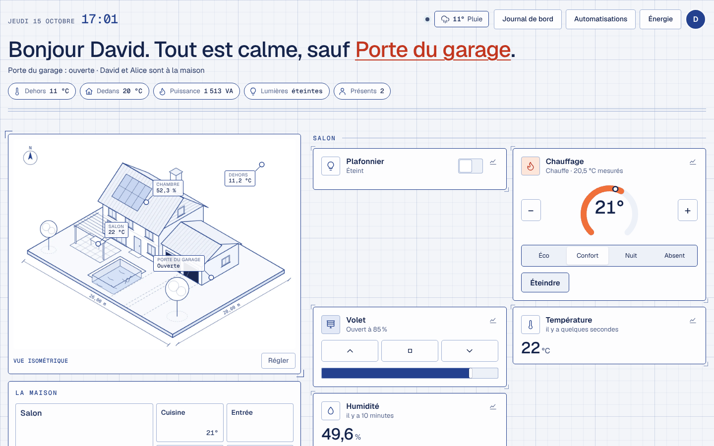
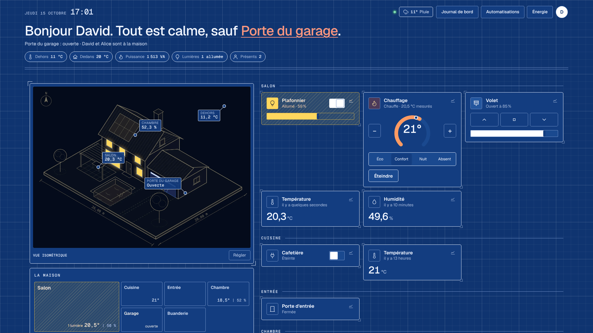
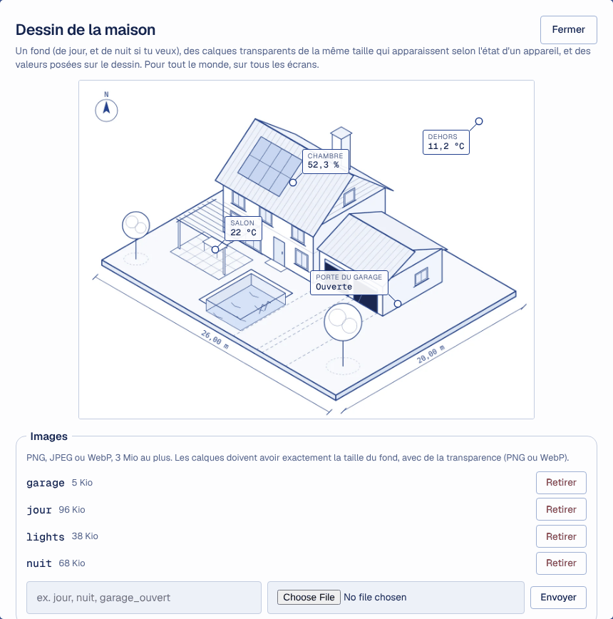
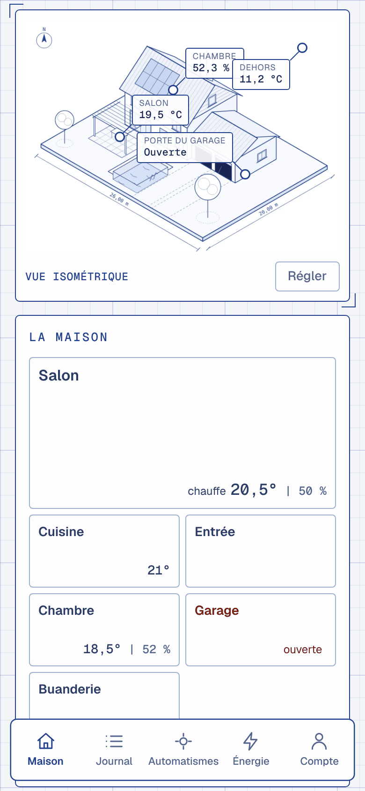

# Étape 36 : le style « plan d'architecte », expliqué

## Le but

Un tableau de bord qui ressemble à un **plan d'architecte**, pour la télé du salon comme pour le
téléphone. Le papier est quadrillé, les traits d'encre fins et les icônes au trait. Au centre, la
maison est dessinée en perspective, avec ses valeurs posées dessus. En haut, des repères (dehors,
dedans, puissance, lumières, présents) ; en bas, un cartouche comme sur un vrai plan.

C'est une **option** : le tableau de bord habituel ne change pas. Depuis l'[étape 37](maquette.md),
les styles plan prennent la mise en page « tableau » (les pièces à gauche, le dessin au centre), et
un thème sombre « Maquette » s'ajoute.

## Choisir l'apparence

**Mon compte → Apparence** :

| Apparence                         | Pour…                                                  |
| --------------------------------- | ------------------------------------------------------ |
| Automatique                       | clair ou sombre, comme l'appareil (comme avant)        |
| Clair, Sombre                     | forcer l'un des deux                                   |
| **Plan d'architecte**             | encre bleue sur papier quadrillé                       |
| **Plan d'architecte, de nuit**    | encre blanche sur papier bleu, comme un tirage         |

Le choix vaut **pour cet appareil seulement** : la télé peut être en plan, le téléphone en sombre.

## Le dessin de la maison

Sans réglage, un **dessin d'exemple** s'affiche : une maison avec garage, piscine et pergola. Pour
mettre **ta** maison, il faut être administrateur : **Mon compte → Dessin de la maison…** (ou
« Mettre ma maison » sous le dessin).

Le principe est celui des tableaux de bord isométriques de Home Assistant (merci à
[domo-blog](https://www.domo-blog.fr/tableau-de-bord-home-assistant-3d-isometrique/)). On empile :

1. **un fond de jour** : ta maison au repos (lumières éteintes, garage fermé) ;
2. **un fond de nuit**, facultatif : le même dessin, de nuit. Il remplace le fond quand le soleil
   est couché (`sun.sun`) ;
3. **des calques** : des images **transparentes de la même taille que le fond**, qui ne
   contiennent qu'un élément (le garage ouvert, le porche allumé). Chacun apparaît quand un
   appareil est dans l'un des états choisis, toujours, le jour ou la nuit seulement ;
4. **des valeurs** : un appareil (température, humidité, puissance, porte…) posé où tu veux sur le
   dessin. Pour le poser, appuie sur « Placer », puis touche le dessin. Toucher une valeur ouvre son
   historique.

Exemples de calques :

| Image             | Appareil          | Quand son état est | Moment   |
| ----------------- | ----------------- | ------------------ | -------- |
| `garage_ouvert`   | `cover.garage`    | `open, opening`    | Toujours |
| `porche_allume`   | `light.porche`    | `on`               | La nuit  |
| `piscine_couverte`| `cover.piscine`   | `closed`           | Le jour  |

« Sauf ces états » inverse la règle : le calque est visible pour tous les autres états.

Un changement d'état fait apparaître ou disparaître le calque en fondu (sans animation si
l'appareil demande de les réduire). Une valeur trop près du bord passe de l'autre côté de son point
pour rester lisible.

### Étape 71 : les volets à mi-hauteur

Un volet n'est pas seulement ouvert ou fermé : à 25 %, il est aux trois quarts baissé. Pour le
dessiner ainsi, coche **« Suit la position du volet »** sur son calque :

- **l'image** est le volet **fermé** (une fenêtre par calque, ou plusieurs sur la même façade) ;
- **les états** ne servent plus : le calque suit `current_position`, de 0 (fermé) à 100 (ouvert).
  Un volet qui ne donne pas sa position est dessiné fermé ou caché, selon `closed` ou `open` ;
- **le volet descend** depuis le haut de la fenêtre, et son bord du bas suit la pente de la
  fenêtre, vue en perspective. Il glisse en 1,2 s quand la position change.

| Position | Sur le dessin |
| --- | --- |
| 100 (ouvert) | rien |
| 75 | le quart du haut |
| 25 | les trois quarts |
| 0 (fermé) | tout le volet |

Avec la protection solaire ([étape 70](protection-solaire.md)), on voit donc chaque volet
descendre à sa position.

**Comment c'est fait :** à son premier affichage, le tableau de bord lit une seule fois l'image du
volet, sur une copie réduite. Il repère où le volet commence et finit, à gauche et à droite. Le
calque est ensuite découpé (`clip-path`) par une ligne parallèle au haut de la fenêtre. Le serveur
refuse « suit la position » sur autre chose qu'un volet (`cover.…`).

### Faire les images

Depuis l'[étape 44](images-ia.md), le réglage du dessin donne la demande à copier pour chaque
image, et le guide détaille toute la méthode. En bref :

Une intelligence artificielle qui retouche les photos (Gemini, ChatGPT…) fait cela très bien, à
partir d'une photo de ta maison de trois quarts, en pleine lumière. Les demandes en anglais
marchent le mieux. Pour le style plan :

> Transform the attached photo of my house into a clean isometric architectural blueprint drawing:
> fine dark-blue ink lines on white paper, light blue tints for glass and water, technical
> hatching on roofs. Keep the exact shape of the house, roof, openings, garage, garden and pool.
> Camera: 3/4 isometric view from above, the whole plot visible with a margin. All lights OFF, all
> garage doors, gates and shutters CLOSED. No text, no people, no cars. Plain white background.

Puis, **toujours à partir de cette image de jour** (pas d'une variante, sinon le dessin dérive) :

> Same image, IDENTICAL composition, camera angle and framing. Only change: the left garage door is
> fully OPEN, showing a dark interior.

> Same image, IDENTICAL composition, camera angle and framing. Only change: night time, the
> windows of the living room are lit with a warm yellow light.

Pour faire un **calque**, ouvre les deux images l'une sur l'autre dans GIMP (ou Photoshop), mode de
fusion « Différence » : seul ce qui a changé reste visible. Garde cette zone avec un masque, efface
le reste, puis exporte **à la taille du fond** (sans recadrer), en PNG ou en WebP avec transparence.
Exporte en WebP, qualité 80 à 85 : c'est léger, et le serveur refuse au-delà de 3 Mio.

## Le plan des pièces, les repères, le cartouche

- **Les pièces** montrent la température **et l'humidité** (« 18,5° | 52 % »). L'humidité vient
  d'un capteur d'humidité de la pièce (`areas.yaml`) ou de son thermostat.
- **Les repères** du haut : la température dehors (météo), la moyenne dedans, la puissance du
  compteur Linky, les lumières allumées et le nombre de personnes présentes. Ils n'apparaissent que
  si l'information existe.
- **Le cartouche**, en bas : le nom de la maison, le nombre de pièces et d'appareils, la date.

Sur un écran large (à partir de 1 000 px), le dessin prend 40 % de la largeur ; sur une télé, la
page s'élargit jusqu'à 1 760 px. Sur téléphone, les repères défilent sur une seule ligne.

## Sécurité

- **Seules des images PNG, JPEG ou WebP** sont acceptées, reconnues à leurs premiers octets : ce
  que le navigateur annonce ne compte pas. Un SVG (qui peut contenir du script) ou une page HTML
  déguisée en image est refusé. 3 Mio par image, 64 images au plus (40 calques par onglet), noms `a-z 0-9 _ -`.
- Les images repartent avec `nosniff` et la politique de sécurité de toutes les réponses. Même une
  image piégée ne s'exécute pas.
- Elles ne sont lisibles qu'avec un jeton. Une balise `` ne sait pas l'envoyer, alors la page
  les lit avec `fetch`, puis les affiche depuis sa mémoire (`blob:`). C'est le seul ajout à la
  politique de sécurité : `img-src 'self' blob:`.
- **Changer le dessin** (images, assemblage) demande un nouveau droit, réservé à l'administrateur :
  « changer le dessin de la maison ». La famille et les invités le voient, sans pouvoir le modifier.
  Chaque changement va dans le journal d'audit.
- Un **invité** ne voit ni les calques ni les valeurs des appareils qui lui sont cachés : la
  présence des personnes, l'alarme… Le serveur les retire avant de répondre.
- L'assemblage est vérifié et réécrit : des images qui existent, des appareils bien écrits, des
  positions entre 0 et 100 %, des textes courts. Rien d'autre n'est gardé. Une image qui sert
  encore ne peut pas être retirée.
- L'apparence choisie reste dans le navigateur (`localStorage`) : rien n'est envoyé au serveur.

## Comment c'est construit

- `crates/ha-api/web/house.js` (nouveau) : le dessin, ses calques et ses valeurs, les repères, le
  cartouche et la fenêtre de réglage ;
- `crates/ha-api/web/house.svg` (nouveau) : le dessin d'exemple, généré en perspective
  isométrique ;
- `crates/ha-api/web/style.css` : les deux styles « plan », à la fin ; le sombre se choisit
  maintenant aussi à la main ;
- `crates/ha-api/src/drawing.rs` (nouveau) : les routes, et la vérification des images et de
  l'assemblage ;
- `crates/ha-storage/migrations/0016_home_drawing.sql` : les images et l'assemblage ;
- `ha-auth` : le droit `EditDashboard`.

| Méthode | Chemin | Rôle |
| ------- | ------ | ---- |
| GET | `/api/home/drawing` | L'assemblage et la liste des images |
| PUT | `/api/home/drawing` | Change l'assemblage (administrateur) |
| GET | `/api/home/images/{nom}` | Une image |
| PUT / DELETE | `/api/home/images/{nom}` | Ajoute, remplace, retire une image (administrateur) |

Les images restent dans le navigateur d'un rechargement à l'autre, comme les fichiers du tableau
de bord (voir `tableau-leger.md`) : `GET /api/home/drawing` donne la `version` de chaque image, qui
change à chaque envoi, et la page la demande à `/api/home/images/{nom}?v={version}`. À cette
adresse, le serveur répond `Cache-Control: private, max-age=31536000, immutable` : la tablette ne
la redemande plus. Sans version, c'est `private, no-cache` avec une empreinte (`ETag`, le SHA-256
de l'image) : le navigateur redemande, et le serveur répond `304` sans l'image si elle n'a pas
changé. Toujours `private` (jamais un cache partagé) et toujours avec le jeton.

### Le thème, avant le premier affichage

Jusqu'ici, le sombre suivait le système avec `@media (prefers-color-scheme: dark)`. Pour pouvoir le
choisir, c'est maintenant `app.js` qui pose `data-theme="dark"` (ou `light`, `plan`, `plan-nuit`)
sur la page, **dès sa première ligne**, avant tout affichage. En « Automatique », il écoute aussi
le système : passer l'appareil en sombre change la page tout de suite. Le CSS vise
`[data-theme|="plan"]` : `|=` veut dire « vaut `plan`, ou commence par `plan-` ». Une règle couvre
donc les deux versions du plan.

### Le dessin d'exemple

Il est calculé, pas dessiné à la main. Chaque point de la maison `(x, y, z)` en mètres devient un
point de l'écran par la projection isométrique :
`écran_x = (x − y) × cos 30°`, `écran_y = (x + y) × sin 30° − z`. Les faces sont remplies de blanc
et tracées du fond vers l'avant : chaque face cache ce qui est derrière elle, sans calcul de parties
cachées. En version de nuit, un filtre CSS inverse l'encre (`invert` puis `hue-rotate`) et
`mix-blend-mode: screen` laisse voir le papier bleu à travers le blanc.

### Les calques bien alignés

Chaque calque est posé exactement sur le fond (`position: absolute; inset: 0`), à 100 % de sa
largeur et de sa hauteur. C'est pour cela qu'il doit avoir **la même taille** que le fond : aucune
coordonnée à régler, comme dans Home Assistant. Les valeurs, elles, sont placées en pourcentages
de l'image : elles restent au bon endroit sur la télé comme sur le téléphone.
