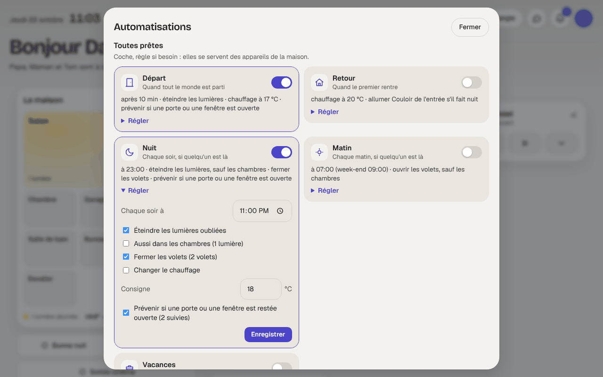

# Étape 85 : les automatisations toutes prêtes, expliquées

## Le but

Les automatisations les plus utiles sont les mêmes dans presque toutes les maisons : tout éteindre
quand on part, accueillir quand on rentre, fermer la maison le soir, l'ouvrir le matin, la garder
pendant les vacances. Plutôt que de les écrire une par une, on les **coche**.

En haut de **Automatisations**, la section **Toutes prêtes** :

| | Quand | Ce qu'elle peut faire (on coche) |
|---|---|---|
| **Départ** | tout le monde est parti depuis 10 min (réglable) | éteindre les lumières, fermer les volets, baisser le chauffage (17 °C), prévenir si une porte ou une fenêtre est restée ouverte |
| **Retour** | le premier rentre | remettre le chauffage (20 °C), allumer l'entrée s'il fait nuit |
| **Nuit** | chaque soir à 23 h, si quelqu'un est là | éteindre les lumières oubliées (sauf dans les chambres, au choix), fermer les volets, changer le chauffage, prévenir si une porte ou une fenêtre est ouverte |
| **Matin** | à 7 h en semaine, 9 h le week-end, si quelqu'un est là | ouvrir les volets (sauf ceux des chambres, au choix), remettre le chauffage |
| **Vacances** | la maison est vide depuis 24 h | chauffage hors-gel (12 °C), [simulation de présence](simulation.md) armée, puis désarmée au retour ; un message pour le dire |

Chaque carte dit en une ligne ce qu'elle fera (« après 10 min · éteindre les lumières · chauffage
à 17 °C »). **Régler** ouvre ses cases et ses valeurs ; l'interrupteur l'active ou la désactive.

## Comment ça marche

À l'enregistrement, le serveur **fabrique** l'automatisation d'après les appareils de la maison :

- **les lumières** : toutes, sauf les prises (une prise Hue n'est pas une lumière : le frigo ne
  s'éteint pas au départ) ;
- **les volets** : tous ceux qui ne sont ni un garage, ni un portail, ni une porte ;
- **les chambres** : les appareils d'une pièce dont le nom contient « chambre » ([pièces](pieces.md)),
  ou dont le nom le dit (« Lampe chambre ») ;
- **l'entrée** : une lumière de l'entrée, du couloir ou du hall est proposée pour le retour ;
- **les ouvertures** : les capteurs de porte et de fenêtre, la porte du garage, le portail ;
- **les messages** vont sur le téléphone ([notifications de l'appli](notifications-navigateur.md)),
  sinon sur le tableau de bord. Ils disent ce qui est resté ouvert : « Encore ouvert : Fenêtre
  cuisine. ».

« Tout le monde est parti » et « le premier rentre » se lisent sur `zone.home`, le nombre de
[personnes](personnes.md) à la maison. Sans personnes suivies, Départ, Retour et Vacances ne sont pas
proposées (la carte dit pourquoi).

Le résultat est une **automatisation ordinaire** : `pret_depart`, `pret_nuit`… Elle apparaît dans la
liste avec l'étiquette « toute prête », son historique d'exécutions, ses versions. On peut l'ouvrir
dans le schéma pour voir ce qu'elle fait. Pour la changer, mieux vaut passer par sa carte : elle est
refabriquée à chaque enregistrement, une modification à la main serait écrasée.

**Un appareil ajouté plus tard** n'est pas pris tout seul : la liste est faite à l'enregistrement.
Il suffit d'enregistrer la carte à nouveau.

**Décochée**, l'automatisation est gardée, désactivée : ses réglages restent.

## Sécurité

- Les mêmes règles qu'une automatisation écrite à la main : il faut le droit de modifier les
  automatisations (famille ou administrateur, jamais un invité), et **redonner son mot de passe**
  (valable 15 minutes). Chaque enregistrement est dans le journal d'audit et prévient le téléphone.
- L'automatisation fabriquée est **vérifiée** comme les autres (appareils, durées, modèles), et ne
  peut que commander des appareils et envoyer des messages.
- Les réglages sont contrôlés : heures, consignes de 5 à 30 °C, délais bornés, lumière choisie parmi
  celles de la maison ; un réglage inconnu est refusé.
- Elles ne touchent jamais une serrure ni une alarme. Un garage ou un portail (reconnus à leur type,
  `device_class: garage` ou `gate`) n'est pas fermé avec les volets : il ne fait que déclencher le
  message « Encore ouvert ».

## Comment c'est construit

| Fichier | Rôle |
| ------- | ---- |
| [crates/ha-automation/src/presets.rs](../crates/ha-automation/src/presets.rs) | Nouveau : les cinq automatisations, leurs réglages par défaut, et leur fabrication (`build`) d'après la maison (`House`) |
| [crates/ha-api/src/presets.rs](../crates/ha-api/src/presets.rs) | Nouveau : ce que la maison a (`house`), `GET /api/automations/presets`, `PUT /api/automations/presets/{nom}` |
| [crates/ha-storage/migrations/0023_automation_presets.sql](../crates/ha-storage/migrations/0023_automation_presets.sql) | Les réglages cochés, pour chaque automatisation toute prête |
| [web/pretes.js](../crates/ha-api/web/pretes.js) | Nouveau : les cartes, leurs cases et leur résumé |

Essayé dans le navigateur (ordinateur et téléphone, thèmes clair et sombre) : Départ cochée (le mot
de passe demandé, puis l'automatisation créée et active), Nuit réglée à 22 h 30 avec les chambres,
la carte « toute prête » dans la liste, aucune erreur. Puis Nuit réglée sur la minute suivante :
elle s'est déclenchée, a éteint les lumières, fermé les volets et prévenu « Encore ouvert : Fenêtre
cuisine ».

### Concepts utilisés

**Fabriquer plutôt qu'écrire** : une automatisation est une donnée (des déclencheurs, des
conditions, des actions). Le serveur l'assemble comme on assemblerait un formulaire, à partir des
cases cochées et de la liste des appareils, puis la fait passer par la même vérification que si
elle avait été tapée.

**`zone.home`** : le nombre de personnes à la maison. « Passe à 0 depuis 10 minutes » : tout le
monde est parti, et pas seulement le temps d'aller chercher le courrier. « Quitte 0 » : quelqu'un
rentre.
