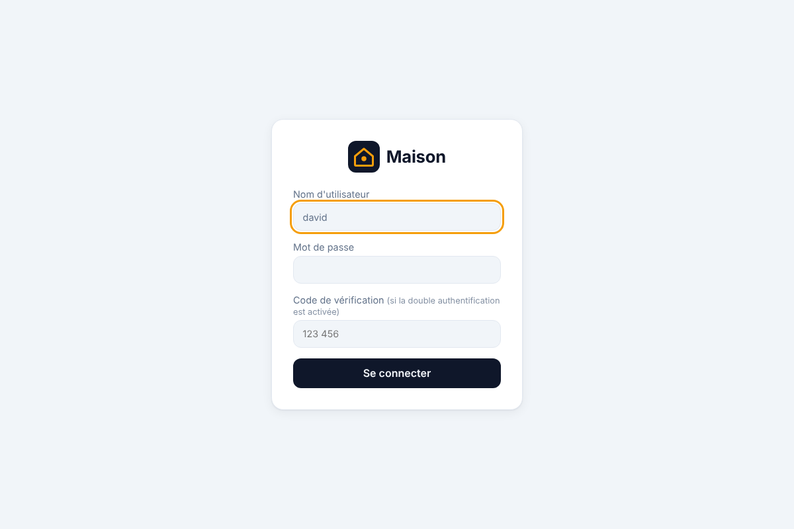

# Renforcement de la sécurité, expliqué

Trois améliorations, dans l'ordre :

1. [les jetons des appareils chiffrés dans la base](#1-les-jetons-des-appareils-chiffrés) ;
2. [la double authentification](#2-la-double-authentification-totp) ;
3. un journal d'audit (à venir).

## 1. Les jetons des appareils, chiffrés

### Le problème

Pour piloter tes lampes et tes volets, le serveur garde deux secrets dans `ha.db` : la **clé
d'application** du pont Hue et le **jeton** de la box Somfy. Il doit pouvoir les relire à chaque
démarrage, donc on ne peut pas les « hacher » comme les mots de passe.

Jusqu'ici, ils étaient en clair. Une copie de `ha.db` (une sauvegarde oubliée sur une clé USB,
un disque revendu…) suffisait pour piloter ta maison depuis ton réseau.

### La solution

Les secrets sont maintenant **chiffrés**, avec une clé rangée dans **un autre fichier** :

```
ha.db   ──  enc:v1:8f3a…c41e   (jeton Somfy chiffré : illisible)
ha.key  ──  la clé (64 caractères), lisible par toi seul
```

- Sans Docker, `ha.key` est créé à côté de `ha.db` au premier démarrage. La variable
  `HA_KEY_PATH` permet de le mettre ailleurs (sur une clé USB, par exemple).
- Avec Docker, la clé est dans son propre volume (`ha-cle`). L'outil de sauvegarde ne copie
  que la base : **une sauvegarde volée ne permet pas de piloter tes appareils**.
- Les associations faites avant cette mise à jour sont **chiffrées automatiquement** au
  démarrage suivant (le journal affiche « jeton de la box Somfy chiffré dans la base »).
- **Si la clé est perdue**, le serveur démarre quand même. Il signale l'association illisible
  et demande de refaire `hue pair` ou `somfy pair`. Le reste de la maison continue de fonctionner.

Mets la clé de côté une fois (gestionnaire de mots de passe) : la commande est dans le
[guide de l'étape 7](etape-7-deploiement.md#sauvegarder-et-restaurer).

### Ce que ça protège, et ce que ça ne protège pas

| Situation | Protégé ? |
|---|---|
| Quelqu'un récupère une sauvegarde de `ha.db` | **Oui** : les jetons sont illisibles |
| Quelqu'un modifie un jeton chiffré dans la base | **Oui** : la modification est détectée, le jeton est refusé |
| Quelqu'un recopie le jeton Somfy à la place de la clé Hue | **Oui** : chaque secret est lié à son usage |
| Quelqu'un a accès à toute la machine (base **et** clé) | **Non** : aucun chiffrement ne protège de ça. C'est le rôle des droits du système, de Docker et du chiffrement du disque (BitLocker sous Windows) |

### L'algorithme

**XChaCha20-Poly1305**, de la bibliothèque RustCrypto (Rust pur, sans `unsafe` de notre côté) :

- c'est un chiffrement **authentifié** : en plus de cacher le contenu, il détecte toute
  modification ;
- chaque secret a son propre **nonce** aléatoire de 24 octets. Le même jeton chiffré deux fois
  donne deux résultats différents ;
- le **contexte** (`"hue_bridge.app_key"`, `"somfy_box.token"`) est ajouté comme « donnée
  associée » : il n'est pas chiffré, mais il est vérifié au déchiffrement.

### Concepts Rust rencontrés

- **`Arc` pour partager sans copier.** Le `Store` est cloné partout (enregistreur, API, Hue,
  Somfy). La clé est dans un `Arc` : tous les clones pointent vers la même clé en mémoire, au
  lieu d'en faire des copies.
- **Effacer la mémoire (`zeroize`).** La clé et les secrets déchiffrés sont dans des
  `Zeroizing<…>` : ils sont remplis de zéros quand on n'en a plus besoin, au lieu de traîner en
  mémoire. Le chiffreur lui-même efface sa clé (option `zeroize` de la crate).
- **Un `Debug` écrit à la main.** `#[derive(Debug)]` afficherait la clé dans un message de
  débogage. On écrit donc `impl Debug` nous-mêmes, pour afficher `SecretKey(<masquée>)`.
- **`split_first_chunk::<24>()`.** Cette méthode coupe une tranche en « les 24 premiers octets »
  (un tableau de taille connue à la compilation) et « le reste ». Elle renvoie `None` si la
  tranche est trop courte : pas d'indice qui déborde, pas de `panic`.

### Testé

- Chiffrer puis déchiffrer redonne le secret ; deux chiffrements du même secret diffèrent.
- Mauvaise clé, mauvais contexte, secret modifié ou tronqué : tous refusés.
- Le fichier de clé est créé avec les droits 600, puis réutilisé ; un fichier de clé abîmé
  est refusé avec un message clair.
- Base relue après redémarrage : le secret se déchiffre. Base **sans sa clé** : impossible.
- Hue et Somfy : la valeur en base ne contient plus le jeton, et une ancienne association en
  clair est rechiffrée à la lecture.
- Clé perdue : le serveur démarre, signale l'association illisible et passe aux appareils
  restants.
- Docker : clé créée dans `/cle/ha.key` (droits 600, utilisateur sans privilège), conteneur
  « healthy ».

## 2. La double authentification (TOTP)

### Le principe

Un mot de passe peut fuiter : réutilisé sur un site piraté, tapé sur un faux site, vu par-dessus
ton épaule. Avec la double authentification, il faut **en plus** un code à 6 chiffres qui change
toutes les 30 secondes, affiché par une appli de ton téléphone. Un mot de passe volé ne suffit
plus.

C'est le même système (TOTP, RFC 6238) que pour ta banque ou ton compte Google. N'importe quelle
appli d'authentification convient : Aegis, 2FAS, Google Authenticator, Microsoft Authenticator,
ou ton gestionnaire de mots de passe.

### L'activer

Sur la machine du serveur (personne ne peut l'activer, ni la désactiver, par le réseau) :

```powershell
cargo run -p ha-server -- user totp david
# avec Docker :
docker compose run --rm ha-server user totp david
```

1. Un **QR code** s'affiche dans le terminal : scanne-le avec l'appli. (Si elle ne le lit pas,
   saisis à la main le code affiché en dessous.)
2. Tape le code à 6 chiffres que l'appli affiche. La double authentification n'est activée
   que si ce code est bon : impossible de s'enfermer dehors avec un QR code mal scanné.
3. Toutes les sessions ouvertes sont fermées. À la prochaine connexion, la page demande le code :



Le code qui a servi à l'activation ne peut pas resservir : pour te connecter juste après,
attends le code suivant (au plus 30 secondes).

Autres commandes : `user list` indique les comptes protégés, `user totp-off david` désactive.

**Si tu perds ton téléphone** : sur la machine du serveur, `user totp-off david`, puis réactive
avec le nouveau téléphone. Pense à noter le code de secours (le code « à la main ») dans ton
gestionnaire de mots de passe au moment de l'activation.

### Les protections

- **Le secret est chiffré** dans la base, avec la clé de la partie 1.
- **Un code ne sert qu'une fois.** Le serveur retient le dernier créneau accepté : un code
  intercepté (par-dessus ton épaule, par exemple) est refusé, même dans les 30 secondes. Deux
  connexions simultanées avec le même code ? Une seule passe : la vérification et
  l'enregistrement se font en une seule opération SQL.
- **Le message d'erreur ne dit rien.** Mauvais nom, mauvais mot de passe, code oublié ou faux :
  toujours « nom d'utilisateur, mot de passe ou code incorrect ». Un attaquant n'apprend même pas
  si le mot de passe était bon.
- **Les codes faux comptent** dans la limite de 5 essais par quart d'heure : impossible
  d'essayer le million de codes possibles.
- **Un créneau d'écart est toléré** (horloge du téléphone en avance ou en retard de
  30 secondes), pas plus.
- **Clé de chiffrement perdue** : la connexion est refusée (sans planter le serveur), et le
  journal explique comment désactiver puis réactiver.

### Comment ça marche

Le téléphone et le serveur partagent un **secret** de 160 bits (dans le QR code). Toutes les 30
secondes, chacun calcule :

```
créneau = secondes depuis 1970 / 30
code    = HMAC-SHA1(secret, créneau) → on garde 6 chiffres
```

Ils trouvent le même code sans jamais se parler. Le calcul est dans
[totp.rs](../crates/ha-auth/src/totp.rs) : 20 lignes, vérifiées avec les exemples officiels de
la RFC 6238.

### Concepts Rust rencontrés

- **`Option<&str>` pour un paramètre facultatif.** `login(nom, mot_de_passe, code, ip)` reçoit
  `Some("123456")` ou `None`. Côté JSON, `#[serde(default)]` rend le champ `code` facultatif,
  tout en refusant toujours les champs inconnus.
- **Les motifs sur les tableaux.** `let Some(&[a, b, c, d]) = … else { … }` lit exactement 4
  octets, ou passe dans le `else`. Pas d'indice qui pourrait déborder.
- **`is_none_or`.** `last_step.is_none_or(|last| step > last)` se lit « pas encore de code
  utilisé, ou ce créneau est plus récent ».
- **Le calcul en temps constant.** La vérification calcule toujours les trois codes possibles
  (créneau précédent, actuel, suivant), même après avoir trouvé le bon : le temps de réponse ne
  révèle rien.

### Testé

- Les exemples officiels de la RFC 6238 donnent les bons codes ; l'encodage base 32 suit la
  RFC 4648.
- Activation refusée avec un mauvais code ; acceptée avec le bon, sessions fermées, secret
  chiffré dans la base.
- Connexion refusée sans code, avec un faux code, avec un bon code et un mauvais mot de passe,
  et en rejouant un code déjà utilisé ; acceptée avec le code suivant.
- Codes mal formés refusés (5 ou 7 chiffres, lettres, chiffres arabes…).
- Secret illisible : connexion refusée sans planter, `totp-off` répare.
- De bout en bout : activation en ligne de commande, QR code **décodé** comme le ferait un
  téléphone (sur fond sombre, comme PowerShell), puis connexion dans Chromium avec le code.
