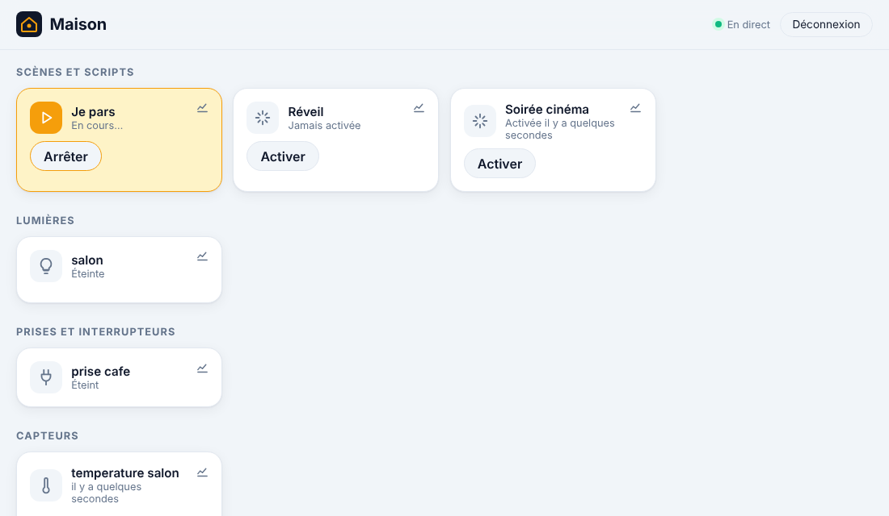

# Étape 11 : scènes et scripts, expliqué



## Le but

Deux outils de Home Assistant pour agir sur plusieurs appareils d'un coup :

- une **scène**, c'est un **état voulu** : « Soirée cinéma » = lampe du salon tamisée, lampe de
  l'entrée éteinte, volet fermé. On l'active, et chaque appareil prend son réglage ;
- un **script**, c'est une **suite d'actions**, avec des attentes : « Je pars » = fermer les
  volets, éteindre les lampes, attendre 2 minutes, couper la cafetière.

Les deux apparaissent en haut du tableau de bord, avec un bouton **Activer** ou **Lancer**. Un
script en cours peut être **arrêté**.

## Les scènes : `scenes.yaml`

Copie [scenes.example.yaml](../scenes.example.yaml) en `scenes.yaml` (avec Docker :
`config/scenes.yaml`) :

```yaml
- id: soiree_cinema
  name: Soirée cinéma
  entities:
    light.salon: {brightness: 40}     # lampe tamisée (1 à 255)
    light.entree: "off"
    cover.volet_salon: closed         # ou open, ou {position: 30}
```

| Appareil | Réglages possibles |
|---|---|
| Lampe (`light.`) | `"on"`, `"off"`, `{brightness: 1 à 255}` |
| Prise (`switch.`) | `"on"`, `"off"` |
| Volet (`cover.`) | `open`, `closed`, `{position: 0 à 100}` |

Une scène ne règle **que** des lampes, des prises et des volets. Une scène qui désarmerait
l'alarme ou ouvrirait une porte est refusée au chargement : ce genre d'action mérite une
réflexion à part (confirmation, code), pas un bouton parmi d'autres.

L'état d'une scène (`scene.soiree_cinema`) est la **date de sa dernière activation**, comme
dans Home Assistant (« Activée il y a 5 minutes »).

## Les scripts : `scripts.yaml`

Copie [scripts.example.yaml](../scripts.example.yaml) en `scripts.yaml` :

```yaml
- id: depart
  alias: Je pars
  sequence:
    - action: cover.close_cover
      target:
        entity_id: [cover.volet_salon, cover.volet_chambre]
    - action: light.turn_off
      target:
        entity_id: [light.salon, light.entree]
    - delay: 2min
    - action: switch.turn_off
      target:
        entity_id: switch.prise_cafe
```

Les actions s'écrivent **exactement comme dans les automatisations** : `action:` avec une
cible, ou `delay:`. Un script est `on` pendant qu'il tourne, `off` sinon.

**Un script ne tourne qu'une fois à la fois.** Le relancer pendant qu'il tourne ne fait rien,
et c'est ce qui empêche un script de se relancer lui-même à l'infini (directement, ou par un
autre script).

## Depuis une automatisation

Une automatisation peut activer une scène ou lancer un script :

```yaml
- id: film
  triggers:
    - trigger: state
      entity_id: switch.tv
      to: "on"
  conditions:
    - condition: sun
      after: sunset
      before: sunrise
  actions:
    - action: scene.turn_on
      target:
        entity_id: scene.soiree_cinema
```

`script.turn_on`, `script.turn_off` et `scene.turn_on` marchent aussi depuis l'API, et chaque
lancement depuis le tableau de bord est inscrit au **journal d'activité**.

## Vérifier

```powershell
cargo run -p ha-server -- automations check
```

```
scripts.yaml : 1 script(s) valide(s)
  - script.depart « Je pars » (4 action(s))
scenes.yaml : 2 scène(s) valide(s)
  - scene.soiree_cinema « Soirée cinéma » (3 appareil(s))
  - scene.reveil « Réveil » (2 appareil(s))
```

Un fichier invalide empêche le démarrage, avec un message précis, par exemple :
`scène « a » : alarm_control_panel.maison : une scène ne règle que des lampes, des prises et
des volets`.

## Comment c'est construit

| Fichier | Contenu |
|---------|---------|
| [scripts.rs](../crates/ha-automation/src/scripts.rs) | Lecture des scripts et des scènes ; une scène est traduite en actions dès le chargement |
| [engine.rs](../crates/ha-automation/src/engine.rs) | Le moteur écoute `script.*` et `scene.*` sur le bus, lance et arrête |
| [app.js](../crates/ha-api/web/app.js) | Tuiles avec bouton Activer / Lancer / Arrêter |

**Concepts Rust rencontrés :**

- **Réutiliser plutôt que recopier.** Les actions des scripts sont lues par le même code que
  celles des automatisations (`check_action`), rendu visible au reste de la crate avec
  `pub(crate)`, mais pas à l'extérieur.
- **Traduire tôt.** Une scène est transformée en liste d'actions dès la lecture du fichier
  (`light.salon: {brightness: 40}` → `light.turn_on` avec `brightness: 40`). Au moment de
  l'activer, il n'y a plus rien à interpréter, donc plus rien qui puisse échouer.
- **`BTreeMap` plutôt que `HashMap`** pour les appareils d'une scène : ils restent triés, et
  l'ordre des actions ne change pas d'un démarrage à l'autre.
- **Le motif sur un tuple.** `match (domaine, état, luminosité, position)` décrit toutes les
  combinaisons permises en un seul endroit ; tout le reste tombe dans un cas « refusé ».

## Testé

- Lecture : scripts, scènes traduites en actions dans un ordre stable, identifiants et noms.
- Refusé : identifiant invalide ou en double, script vide, action sans cible, alarme ou serrure
  dans une scène, luminosité 0 ou 300, position 150, état incompris.
- Moteur : entités créées au démarrage ; script lancé par un appel de service, `on` pendant
  l'exécution, relance ignorée, `off` à la fin ; scène activée par une automatisation.
- De bout en bout dans Chromium : « Activer » une scène (les volets et lampes reçoivent leurs
  ordres), « Lancer » puis « Arrêter » un script, aucune erreur.
