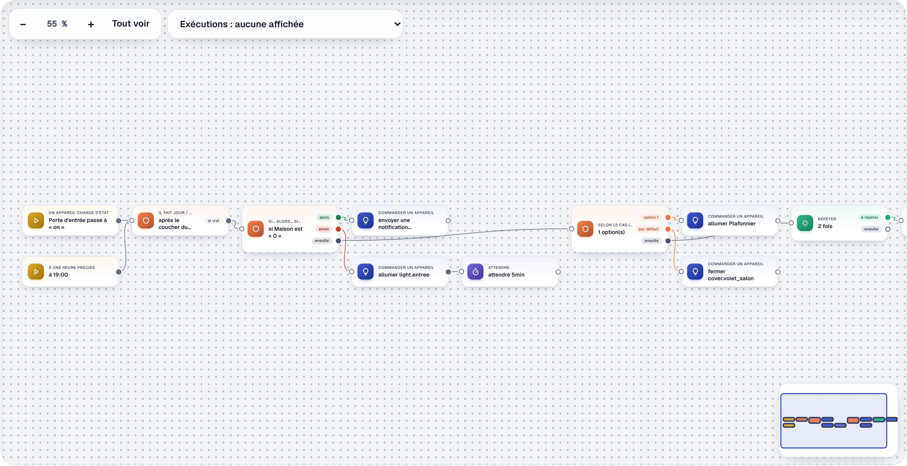
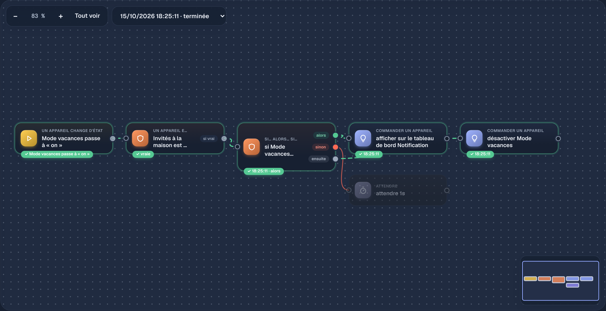
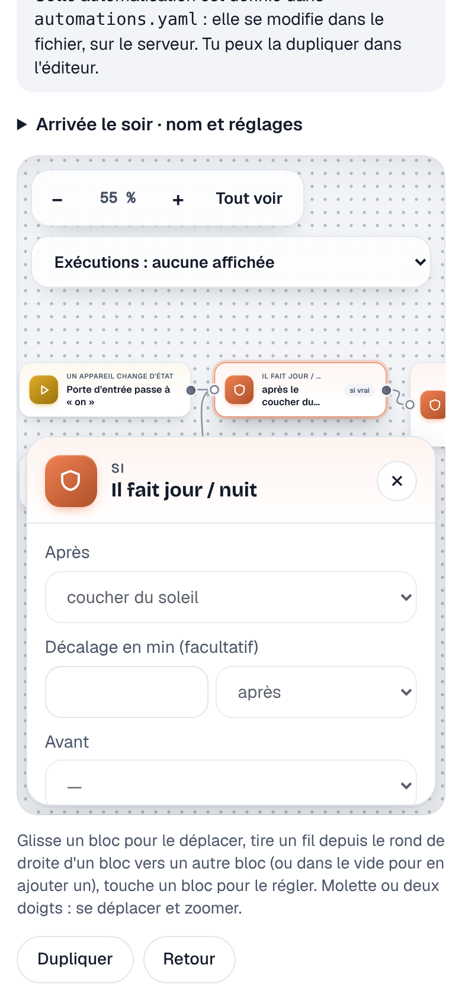

# Étape 35 : le schéma des automatisations façon n8n, expliqué

## Le but

Voir une automatisation **d'un coup d'œil**, et la construire comme dans n8n : des blocs reliés par
des fils, qu'on place où on veut sur un grand canevas. Et comprendre ce qui s'est passé : chaque
exécution passée peut être affichée **sur les blocs**.

## Utiliser le schéma

Dans **Automatisations**, « Nouvelle automatisation », « Modifier » ou « Voir » ouvrent le schéma.
Les onglets **Formulaire** et **YAML** montrent toujours la même automatisation, autrement.

| Pour…                       | Sur ordinateur                                   | Sur téléphone                     |
| --------------------------- | ------------------------------------------------ | --------------------------------- |
| se déplacer                 | glisser le fond, ou la molette                   | glisser le fond avec un doigt      |
| zoomer                      | Ctrl + molette, pincement du pavé tactile, − / + | pincer avec deux doigts           |
| déplacer un bloc            | le glisser (il s'aligne sur une grille de 10 px) | le glisser                        |
| régler un bloc              | cliquer dessus : ses réglages s'ouvrent à droite | le toucher : ils montent du bas   |
| ajouter un bloc relié       | le **+** au bout d'une sortie libre              | pareil                            |
| relier deux blocs           | tirer un fil du rond de droite vers un bloc      | pareil                            |
| ajouter un bloc au bout d'un fil | lâcher le fil dans le vide : un menu s'ouvre | pareil                            |
| retirer un fil              | le choisir, puis « Retirer le fil » (ou Suppr)   | pareil                            |
| retirer un bloc             | « Supprimer le bloc » dans ses réglages (ou Suppr) | pareil                          |
| tout voir / tout ranger     | « Tout voir » ; « Ranger » replace les blocs     | pareil                            |
| revenir à 100 %             | toucher le pourcentage de zoom                   | pareil                            |
| aller ailleurs d'un coup    | la **mini-carte**, en bas à droite (toucher ou glisser) | (cachée : l'écran est trop petit) |
| trouver un bloc à ajouter   | taper son nom dans la recherche du menu, Entrée  | pareil                            |

Un nouveau bloc se pose toujours sur une **place libre**, et la vue glisse pour que les réglages
ouverts ne cachent jamais le bloc qu'on règle.

Chaque famille a sa couleur et son icône : jaune pour les déclencheurs, orange pour les conditions et
les choix, bleu pour les commandes, violet pour les attentes, vert pour les répétitions. Les sorties
sont des pastilles : « alors » en vert, « sinon » en rouge, « ensuite » en gris. Le nom est
toujours écrit : la couleur ne fait que l'accompagner.

Au clavier : Tab passe d'un bloc à l'autre, Entrée ouvre ses réglages, les flèches le déplacent
(Maj + flèche : de 50 px).

### Les blocs et leurs sorties

| Bloc                       | Sorties                                                       |
| -------------------------- | ------------------------------------------------------------- |
| **Quand…** (déclencheur)   | une : tous les déclencheurs arrivent sur le même bloc         |
| **Si…** (condition)        | « si vrai » : sinon, l'automatisation s'arrête là              |
| **Alors…** (action)        | la suivante                                                   |
| Si… alors… sinon           | « alors », « sinon », et « ensuite » (après les deux)         |
| Selon le cas               | « option 1 », « option 2 »…, « par défaut », et « ensuite »   |
| Répéter                    | « à répéter », et « ensuite »                                 |

Chaque bloc n'a qu'**une entrée** : une automatisation est une suite d'étapes, avec des branches,
pas un réseau où tout se croise. Brancher un deuxième fil sur une entrée remplace le premier.

Le schéma est vérifié pendant que tu travailles :

- un bloc relié à rien est entouré de **pointillés rouges**, et l'enregistrement est refusé tant
  qu'il n'est pas relié (ou supprimé) ;
- le serveur vérifie ensuite l'automatisation, exactement comme celle du formulaire ou du YAML
  (« ✓ Automatisation valide », ou l'erreur à corriger).

## Les exécutions sur le schéma

La liste **Exécutions**, en haut du schéma, montre les dix dernières. En en choisissant une :

- le déclencheur qui l'a lancée, les conditions vraies et les actions faites passent en **vert**,
  avec ✓ et l'heure (et la branche choisie : « alors », « option 2 »…) ; le long des fils du chemin
  suivi, le courant s'anime (sauf si le système demande de réduire les animations) ;
- une condition fausse, une action refusée ou une attente dépassée passent en **rouge**, avec ✕ ;
- ce qui n'a pas été atteint est **grisé**.

Le statut est toujours **écrit** sur le bloc (« vraie », « 18:06:37 · alors »), pas seulement
donné par la couleur.

## Sur téléphone

Le même canevas, qu'on déplace avec un doigt et qu'on zoome en pinçant. Les réglages d'un bloc
montent du bas de l'écran, et la vue glisse pour garder le bloc visible au-dessus ; le nom et les
réglages de l'automatisation sont repliés au-dessus du schéma pour lui laisser la place.

## Ce qui est enregistré

- **L'automatisation**, comme avant : la configuration (le même YAML que dans `automations.yaml`),
  vérifiée par le serveur, avec la confirmation d'identité et une nouvelle version à chaque fois. Le
  schéma n'est qu'une **autre vue** : aucun format en plus, un fichier `automations.yaml` écrit à la
  main s'affiche aussi en schéma.
- **La place des blocs**, à part, sous le nom de chaque bloc (« 1 › alors › 2 »). Déplacer un bloc
  l'enregistre tout seul, sans redemander le mot de passe : cela ne change rien à ce que fait
  l'automatisation. Elle se range aussi pour celles du fichier (en lecture seule, mais qu'on peut
  disposer à son goût). Sans place enregistrée, les blocs se placent tout seuls, de gauche à droite.

## Sécurité

- Rien de nouveau ne peut être **exécuté** : le schéma produit la même configuration que le
  formulaire, que le serveur vérifie entièrement avant de l'enregistrer.
- `PUT /api/automations/{id}/layout` demande le droit de modifier les automatisations (pas les
  invités ni la famille) ; le contenu est vérifié (un objet `{bloc: [x, y]}`, 400 blocs au plus,
  noms courts, coordonnées bornées) et réécrit proprement : rien d'autre n'est gardé.
- La page n'utilise toujours ni `innerHTML` ni `eval` (vérifié par un test pour `app.js` et
  `canvas.js`). Les positions passent par l'objet `style` du navigateur, autorisé par la politique de
  sécurité de la page (les attributs `style="…"`, eux, sont refusés).

## Comment c'est construit

- `crates/ha-api/web/canvas.js` (nouveau) : le schéma ;
- `crates/ha-storage/migrations/0015_automation_layouts.sql` : la table des places ;
- `ha-automation/src/editor.rs` : la vérification de la place des blocs ; `trace.rs` : le numéro du
  déclencheur de chaque exécution (pour l'allumer sur le schéma) ;
- `ha-api` : la route `PUT …/layout`, et `canvas.js` servi avec les autres fichiers de la page.

### Comment le schéma reste fidèle au YAML

Une automatisation est un **arbre** : des déclencheurs, puis des conditions, puis des actions, dont
certaines ont des branches. Le schéma garde cette forme :

1. **configuration → schéma** (`configToGraph`) : chaque déclencheur, condition et action devient
   un bloc ; les suites d'actions (`then`, `else`, `sequence`, les options) deviennent des fils
   partant des sorties du bloc ;
2. **schéma → configuration** (`graphToConfig`) : on part des déclencheurs et on suit les fils.
   Un bloc rencontré deux fois (le schéma tourne en rond) ou jamais (relié à rien) est une erreur.

Les deux sens ont été vérifiés sur **toutes les automatisations des guides** (41) et de la démo :
l'aller-retour redonne exactement la même configuration.

### Le dessin

Les fils sont des courbes SVG (`C`, deux points de contrôle à l'horizontale, comme n8n) ; les blocs,
des éléments HTML placés au-dessus. Tout est dans un calque déplacé et agrandi par une seule
transformation CSS (`translate(…) scale(…)`) : se déplacer ou zoomer ne redessine rien.

À l'ouverture, le schéma est cadré pour tenir dans la fenêtre, sans descendre sous 55 % : un
schéma trop grand montre son début (les déclencheurs) plutôt que des blocs illisibles. Le quadrillage
du fond suit le déplacement et le zoom.

Deux pièges évités : donner le focus à un bloc à moitié caché ferait **défiler** le canevas lui-même
(même en `overflow: hidden`) et décalerait la barre d'outils ; et la place du panneau est mesurée
sans son animation d'arrivée (`offsetTop`, qui ignore les transformations CSS).

Les gestes passent par les **Pointer Events**, les mêmes pour la souris, le stylet et les doigts :
deux doigts posés en même temps donnent un pincement (zoom autour de leur milieu, plus le
déplacement de ce milieu).
