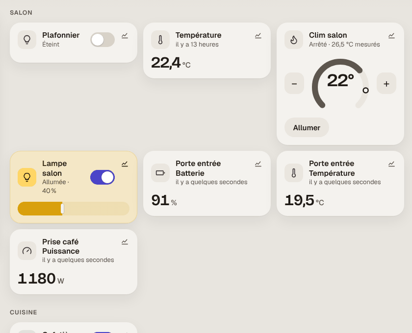

# Étape 86 : la maison SmartThings de Samsung, expliquée



## Le but

Les appareils réglés dans l'appli **SmartThings** (lampes, prises, volets, climatiseurs Samsung,
lave-linge, capteurs de porte…) apparaissent dans le tableau de bord, et se commandent comme les
autres : d'un toucher, avec [Assist](assist.md), [à la voix](voix.md) depuis la tablette, et par
les [automatisations](pretes.md) (« Départ » éteint aussi les lampes SmartThings).

| Dans SmartThings | Dans la maison | Ce qu'on peut faire |
|---|---|---|
| Lampe (avec variateur, blanc chaud/froid) | `light.*` | allumer, éteindre, luminosité, blanc |
| Prise, télé, interrupteur | `switch.*` | allumer, éteindre |
| Volet, store | `cover.*` | ouvrir, fermer, arrêter, position |
| Porte de garage | `cover.*` (garage) | ouvrir, fermer, protégé comme un garage |
| Thermostat | `climate.*` | consigne, mode |
| Climatiseur Samsung | `climate.*` | marche, arrêt, consigne, froid/chaud/déshumidification/ventilation |
| Serrure | `lock.*` | verrouiller, déverrouiller (mot de passe redemandé) |
| Lave-linge, sèche-linge, lave-vaisselle | `sensor.*` : « En marche », « Terminé », le programme, l'heure de fin ; son énergie | lire, et être prévenu à la fin |
| Capteur de porte, de mouvement, de fuite, de fumée, de présence | `binary_sensor.*` | lire |
| Température, humidité, luminosité, pile, puissance, énergie | `sensor.*` | lire |

### Le lave-linge (et le sèche-linge, le lave-vaisselle)

C'est souvent la raison d'avoir SmartThings. La maison suit chaque cycle :

| | Où | Exemple |
|---|---|---|
| L'état | `sensor.lave_linge` | « Arrêt », « En marche », « En pause », « Terminé » |
| Le programme, la fin prévue | ses attributs `cycle`, `reste_minutes`, `fin_heure`, `progression` | « rinçage », 47 min, fin vers 10:30, 62 % |
| Le dernier cycle | `dernier_cycle_minutes`, `dernier_cycle_kwh` | 92 min, 0,85 kWh |
| L'énergie consommée | `sensor.lave_linge_energie` (kWh, pour le [bilan](energie.md)) | 153,15 kWh |

- **La tuile** dit « En marche · 47 min », le programme, l'heure de fin et une barre de progression.
- **La vue hub** de la tablette l'ajoute à sa phrase : « Lave-linge : fin vers 10:30 », puis
  « Lave-linge a fini » pendant 2 heures.
- **À la voix** : « Le linge est fini ? », « Où en est la machine ? » → « Lave-linge : en marche,
  fini vers 10:30 ».
- **À la fin du cycle**, l'évènement `appareil_termine` part, avec la durée et l'énergie : le même
  que pour une machine suivie par sa prise ([étape 67](assistants.md)). L'automatisation toute
  prête **Lessive** ([étape 85](pretes.md)) envoie alors « Lave-linge a fini, en 92 minutes » sur
  le téléphone, et l'annonce sur les enceintes Sonos s'il y en a.

La machine ne se commande pas depuis la maison (ni marche ni arrêt) : on ne lance pas une lessive
à distance sans y avoir réfléchi.

Chaque appareil garde **sa pièce SmartThings** : le tableau de bord le range dans la pièce du même
nom (ou en crée une), Assist comprend « les lumières du salon », et les automatisations toutes
prêtes reconnaissent les chambres et l'entrée.

## L'installer (une fois, 15 minutes)

Samsung ne donne plus d'accès durable avec un simple jeton (il expire au bout de 24 heures). Il
faut créer une petite **application SmartThings** propre à la maison. On le fait une fois, sur un
ordinateur, avec l'outil officiel de Samsung.

### 1. Créer l'application de la maison

Sur un ordinateur (Windows, Mac ou Linux), installe l'outil **SmartThings CLI** : télécharge-le
depuis [github.com/SmartThingsCommunity/smartthings-cli](https://github.com/SmartThingsCommunity/smartthings-cli/releases)
(ou, si Node.js est installé : `npm install -g @smartthings/cli`). Puis :

```bash
smartthings apps:create
```

La première fois, le navigateur s'ouvre pour te connecter à ton compte Samsung. Ensuite, réponds :

| Question | Réponse |
|---|---|
| What kind of app do you want to create? | **OAuth-In App** |
| Display Name | `Maison` |
| Description | `Serveur de la maison` |
| Icon Image URL, Target URL | (laisser vide, Entrée) |
| Select Scopes | coche **r:devices:\***, **x:devices:\*** et **r:locations:\*** (espace), puis Entrée |
| Add or edit Redirect URIs | **Add Redirect URI** : `https://<adresse du mini-PC>:8123/smartthings` (par exemple `https://192.168.1.10:8123/smartthings`), puis **Finish** |

(Les questions peuvent changer un peu d'une version de l'outil à l'autre : l'essentiel est le type
OAuth-In, les trois droits et l'adresse de retour.)

L'outil affiche alors **OAuth Client Id** et **OAuth Client Secret**. Garde-les pour l'étape
suivante : le secret n'est montré **qu'une fois** (sinon : `smartthings apps:oauth:generate`).

> Si SmartThings refuse l'adresse du mini-PC, mets `https://httpbin.org/get` : la page de retour
> sera celle de ce site, qui affiche l'adresse. Le code qu'elle contient ne sert à rien sans le
> secret de l'application, et une seule fois.

### 2. Associer la maison

Sur le mini-PC :

```bash
sudo ha-maison smartthings pair
```

Il demande le **Client ID**, le **Client Secret** (rien ne s'affiche en le collant, c'est normal)
et l'**adresse de retour** (exactement celle de l'étape 1). Il donne une adresse à ouvrir :

1. ouvre-la sur ton téléphone ou ton ordinateur, connecte-toi à Samsung, choisis le **lieu** (ta
   maison) et **autorise** ;
2. tu arrives sur la page « SmartThings a autorisé la maison » du mini-PC (ou sur une erreur de
   certificat si l'appareil n'a pas le [certificat de la maison](https-maison.md) : ce n'est pas
   grave) ;
3. copie **l'adresse complète** de cette page (elle contient `code=`) et colle-la dans le terminal.

Il affiche tes appareils, et ce qu'ils deviennent :

```text
associé !
6 appareils, dont 6 utilisables :
  Clim salon : climate.clim_salon
  Lampe salon : light.lampe_salon
  Lave-linge : sensor.lave_linge
  Porte entrée : binary_sensor.porte_entree, sensor.porte_entree_temperature, sensor.porte_entree_batterie
```

Puis `sudo systemctl restart ha-maison`. C'est fini : le serveur renouvelle ses jetons tout seul.

### Vérifier, défaire

```bash
sudo ha-maison smartthings status    # l'association, et combien de temps vit encore le jeton
sudo ha-maison smartthings devices   # les appareils et leurs entités
sudo ha-maison smartthings forget    # oublie l'association
```

Pour couper aussi l'accès côté Samsung : `smartthings apps:delete` sur l'application « Maison ».

## À savoir

- **Les états sont relus toutes les 30 secondes**, et 2 puis 10 secondes après chaque ordre.
  SmartThings ne prévient pas la maison d'un changement : il faudrait que le mini-PC soit joignable
  depuis Internet, ce qu'on ne fait pas. Une porte ouverte se voit donc jusqu'à 30 secondes plus
  tard : bien pour « prévenir si une fenêtre est restée ouverte », pas pour une alarme.
- **Il faut Internet** : les ordres passent par les serveurs de Samsung, comme dans l'appli.
- **Un appareil renommé dans SmartThings** garde son identifiant (`light.lampe_salon`) : les
  automatisations continuent de marcher. Un appareil retiré disparaît.
- **Le nom d'une autre intégration est gardé** : si `light.lampe_salon` existe déjà (MQTT, Hue),
  la lampe SmartThings devient `light.lampe_salon_2`.

## Sécurité

- **Les secrets sont chiffrés dans la base** (le secret de l'application et les deux jetons), avec
  la clé `ha.key` ; ils ne sont jamais affichés ni écrits dans les journaux.
- **Le jeton de renouvellement ne sert qu'une fois** : le nouveau est enregistré **avant** d'être
  utilisé, et les deux jetons sont remplacés ensemble. Seul le serveur les renouvelle (les
  commandes `status` et `devices` ne le font pas), pour ne jamais en perdre un.
- **Le minimum de droits** : lire et commander les appareils, lire les pièces. Pas les scènes, ni
  les automatisations SmartThings, ni le compte.
- **L'association est vérifiée** : le code de retour n'est accepté qu'avec l'état tiré au hasard
  pour cette demande (protection contre une page piégée).
- **HTTPS vers `api.smartthings.com` seulement**, sans suivre de redirection ; réponses limitées à
  4 Mio, 300 appareils au plus ; les identifiants d'appareils sont vérifiés avant d'entrer dans une
  adresse.
- **Les ordres suivent le chemin d'un toucher** : droits du compte, garde des pièces, mot de passe
  redemandé pour une serrure, porte de garage protégée.
- **La page de retour** (`/smartthings`) n'est qu'un texte : elle ne lit pas le code, ne le
  garde pas ; le serveur n'écrit jamais l'adresse complète des pages dans ses journaux.

## Comment c'est construit

| Fichier | Rôle |
| ------- | ---- |
| [crates/ha-smartthings/src/api.rs](../crates/ha-smartthings/src/api.rs) | L'association OAuth (adresse d'autorisation, retour, échange du code, renouvellement), la liste des appareils, leur état et leurs commandes |
| [crates/ha-smartthings/src/devices.rs](../crates/ha-smartthings/src/devices.rs) | Appareils ⇄ entités : le type d'après les capacités, les mesures à côté, les états, les ordres |
| [crates/ha-smartthings/src/client.rs](../crates/ha-smartthings/src/client.rs) | La boucle : jetons renouvelés 6 heures avant leur fin, relevés toutes les 30 s, ordres |
| [crates/ha-storage/src/smartthings.rs](../crates/ha-storage/src/smartthings.rs) | L'association, chiffrée (migration `0024_smartthings`) |
| [crates/ha-server/src/cli.rs](../crates/ha-server/src/cli.rs) | `smartthings pair`, `status`, `devices`, `forget` |
| [crates/ha-api/src/rest.rs](../crates/ha-api/src/rest.rs) | `GET /api/areas` range aussi les appareils dans leur pièce SmartThings |
| [web/smartthings.html](../crates/ha-api/web/smartthings.html) | La page de retour |

Essayé contre un faux SmartThings (sur le PC) : l'association avec la vraie commande, les jetons
renouvelés et l'ancien refusé, six appareils lus avec leurs pièces, et depuis Assist « allume la
lampe du salon à 40 % », « ferme le volet de la chambre », « mets la clim du salon à vingt-deux
degrés » envoyés à SmartThings et relus. Un lave-linge Samsung (capacités `washerOperatingState` et
`samsungce.washerOperatingState`) : « En marche · 47 min » sur sa tuile et dans la phrase du hub,
puis sa fin, l'évènement `appareil_termine` (0,85 kWh) et le message de l'automatisation Lessive. Pas encore essayé avec un vrai compte Samsung.

### Concepts utilisés

**OAuth** : au lieu de donner son mot de passe Samsung à la maison, on autorise **une application**
(la maison) à faire certaines choses (les « scopes »). Samsung lui donne alors des jetons : un
jeton d'accès (24 heures), et un jeton de renouvellement pour en obtenir un nouveau sans repasser
par le mot de passe. On peut retirer l'autorisation à tout moment, sans changer de mot de passe.

**Les capacités** (*capabilities*) : SmartThings décrit chaque appareil par ce qu'il sait faire
(`switch`, `switchLevel`, `windowShade`…), pas par sa marque. La maison choisit le type d'entité
d'après ces capacités : une même règle marche pour toutes les lampes, de toutes les marques.
