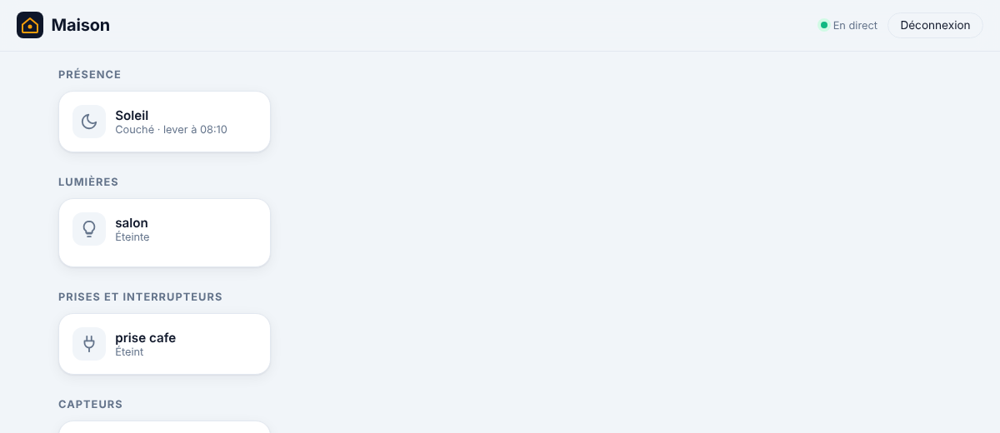

# Étape 8 : le soleil, expliqué



## Le but

Fermer les volets à heure fixe, c'est trop tôt en été et trop tard en hiver. Home Assistant
propose donc le **soleil** comme déclencheur : « au coucher du soleil, plus 30 minutes ». C'est
l'une des automatisations les plus courantes, et elle va très bien avec tes volets Somfy.

Les heures sont **calculées**, pas téléchargées : c'est de l'astronomie, à partir de la position
de ta maison et de la date. Aucune connexion à un service météo.

## Mettre en place

Indique la position de ta maison. **Deux décimales suffisent** (environ 1 km de précision, ce
qui change l'heure du coucher de quelques secondes) : inutile de donner ton adresse exacte.

```powershell
$env:HA_LATITUDE = "48.85"    # nord positif
$env:HA_LONGITUDE = "2.35"    # est positif
cargo run -p ha-server
```

Avec Docker : décommente `HA_LATITUDE` et `HA_LONGITUDE` dans [compose.yaml](../compose.yaml).

Pour trouver ta position : clic droit sur ta ville dans une carte en ligne. Les deux premiers
nombres affichés sont la latitude et la longitude.

La position est une **donnée personnelle** : elle n'est écrite ni dans les logs, ni dans la base,
ni dans l'entité `sun.sun`.

## L'entité `sun.sun`

Comme dans Home Assistant : état `above_horizon` (levé) ou `below_horizon` (couché), mis à jour
chaque minute, avec les attributs `next_rising`, `next_setting`, `next_dawn`, `next_dusk`,
`elevation` (hauteur en degrés) et `azimuth` (direction, 0° = nord, 90° = est). Le tableau de
bord affiche « Couché · lever à 08:10 ».

## Dans les automatisations

**Déclencheur** : `sunrise` (lever), `sunset` (coucher), `dawn` (aube : il commence à faire
jour), `dusk` (crépuscule : il fait nuit). Le décalage `offset` est facultatif, négatif pour
« avant ».

```yaml
- id: volets_coucher_soleil
  triggers:
    - trigger: sun
      event: sunset
      offset: "00:30:00"       # 30 min après le coucher
  actions:
    - action: cover.close_cover
      target:
        entity_id: [cover.volet_salon, cover.volet_chambre]

- id: volets_matin
  triggers:
    - trigger: sun
      event: sunrise
      offset: "-00:15:00"      # 15 min avant le lever
  conditions:
    - condition: time
      weekday: [lun, mar, mer, jeu, ven]
  actions:
    - action: cover.open_cover
      target:
        entity_id: cover.volet_salon
```

**Condition** : `after` et `before`, avec `after_offset` et `before_offset` facultatifs.

```yaml
  conditions:
    # « Il fait nuit » : après le coucher OU avant le lever.
    - condition: sun
      after: sunset
      before: sunrise
```

Comme pour la condition `time` (« après 22 h et avant 6 h »), une plage qui passe minuit
fonctionne : « après le coucher et avant le lever », c'est la nuit.

Si une automatisation utilise le soleil sans que la position soit indiquée, le serveur refuse de
démarrer avec un message clair, plutôt que d'ignorer l'automatisation en silence.

## Les cas particuliers

- **Changement d'heure** : les heures sont calculées en temps universel, puis converties dans le
  fuseau de la machine. Le passage à l'heure d'été ou d'hiver est donc pris en compte.
- **Pays polaires** : en été au nord de la Norvège, le soleil ne se couche pas. Ce jour-là, un
  déclencheur `sunset` ne se produit pas, et une condition qui en dépend est fausse. Le serveur
  ne plante pas. En France, ça n'arrive jamais.

## Comment c'est construit

| Fichier | Contenu |
|---------|---------|
| [ha-sun/src/lib.rs](../crates/ha-sun/src/lib.rs) | Calcul des heures et de la position du soleil, entité `sun.sun` |
| [config.rs](../crates/ha-automation/src/config.rs) | Lecture du déclencheur et de la condition `sun` |
| [evaluator.rs](../crates/ha-automation/src/evaluator.rs) | Quand se déclencher, conditions remplies ou non |

Le calcul est l'« équation du lever du soleil » (méthode de la NOAA, simplifiée) :

1. on compte les jours depuis le 1er janvier 2000 ;
2. on en déduit la position de la Terre sur son orbite, puis la **déclinaison** du soleil (sa
   hauteur dans le ciel selon la saison) et l'heure du **midi solaire** à ta longitude ;
3. le lever et le coucher sont symétriques autour de midi. On cherche le moment où le soleil
   passe à 0,833° sous l'horizon : la réfraction de l'air le rend visible un peu avant qu'il soit
   vraiment levé. Pour l'aube et le crépuscule, c'est 6° sous l'horizon.

**Concepts Rust rencontrés :**

- **Les nombres à virgule (`f64`) et leurs pièges.** `rem_euclid(360.0)` ramène un angle entre 0
  et 360, même s'il est négatif, ce que `%` ne fait pas. Un `f64` peut aussi valoir `NaN` (« pas
  un nombre ») : `(-90.0..=90.0).contains(&latitude)` le refuse, car `NaN` n'est dans aucun
  intervalle.
- **Pas de conversion silencieuse.** Pour passer d'un nombre de secondes à virgule à un instant,
  on utilise `SignedDuration::try_from_secs_f64`, qui **échoue** proprement si le nombre est
  absurde. Avec `as i64`, une valeur folle deviendrait silencieusement une date fausse.
- **`Option<Option<T>>`.** Dans la condition, `None` veut dire « pas de limite `after` », et
  `Some(None)` veut dire « une limite, mais l'événement n'a pas lieu aujourd'hui ». Le type
  distingue ces deux cas, et le compilateur oblige à traiter les deux.

## Testé

- **Paris, comparé aux éphémérides publiées** : le 21 juin 2024, lever calculé à 05 h 46 min 59
  (publié : 05 h 47) et coucher à 21 h 57 min 49 (21 h 58). Le 21 décembre 2024 : 08 h 41 et
  16 h 56, comme publié. Le test exige moins de 2 minutes d'écart.
- Hauteur du soleil à midi en été à Paris : environ 64,6°, plein sud.
- Tromsø (Norvège) : pas de coucher le 21 juin, pas de lever le 21 décembre, et le prochain
  coucher après le 21 juin est bien trouvé (fin juillet).
- Déclencheur avec décalage : se déclenche une seule fois, au bon moment.
- Condition « la nuit » (plage qui passe minuit), condition avec décalage, condition sans position.
- Positions et configurations invalides refusées ; démarrage refusé si le soleil est utilisé
  sans position.
- De bout en bout : à 23 h (heure de Paris) le 14 octobre, le tableau de bord affiche « Couché ·
  lever à 08:10 », l'heure réelle du lever à Paris le lendemain.
