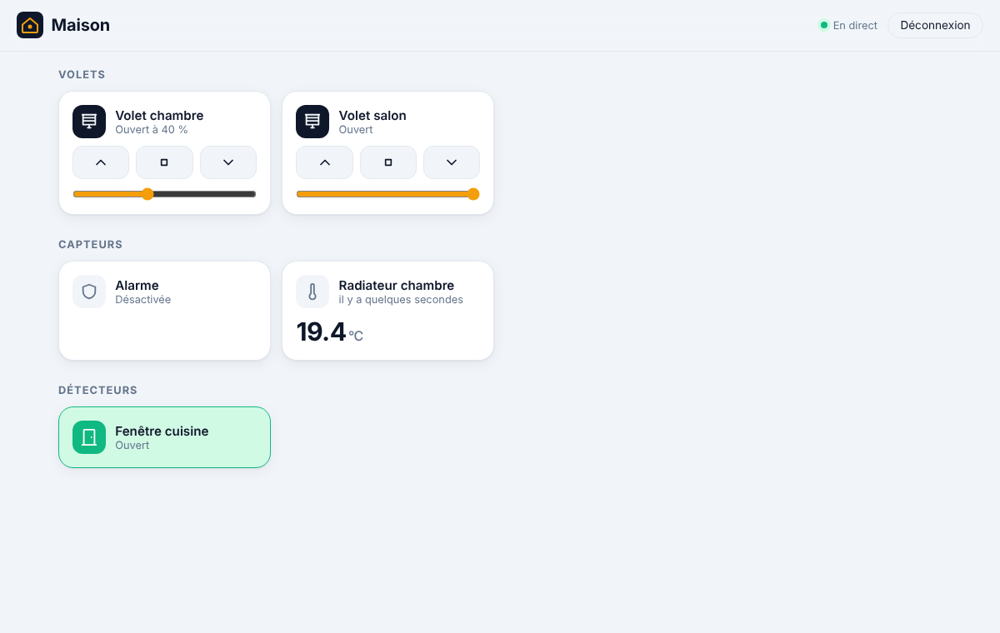

# Somfy TaHoma : volets, capteurs, alarme et chauffage, expliqué



## Le principe

La box **TaHoma** (ou TaHoma switch, Connexoon) pilote tes appareils Somfy en radio (io, RTS).
Elle propose une **API locale officielle**, le « mode développeur » de Somfy : on lui parle
directement sur ton réseau, sans passer par Internet au quotidien.

```
volets, capteurs, ◄─radio io/RTS─► box TaHoma ◄──HTTPS local (port 8443)──► ha-server
alarme, chauffage                      ▲                                    (ha-somfy)
                       appli TaHoma ───┘   (continue de marcher comme avant)
```

Une seule étape passe par Internet : **la création du jeton**, à l'association. Somfy impose de
le créer avec ton compte Somfy. Ensuite, plus aucun échange avec le serveur Somfy.

## Ce qui est pris en charge

| Appareil | Sur le tableau de bord | Pilotable |
|---|---|---|
| Volets roulants, stores, screens | Section **Volets** : ▲ ■ ▼ et curseur de position | **oui** : ouvrir, fermer, arrêter, position en % |
| Détecteurs d'ouverture | « Ouvert / Fermé » | non (capteur) |
| Capteurs de température, de luminosité | valeur et unité | non (capteur) |
| Détecteurs de présence, de fumée | « Présence », « Fumée ! »… | non (capteur) |
| Alarme | « Désactivée », « Activée (totale) », « Intrusion détectée ! »… | **pas encore** |
| Chauffage (radiateurs, vannes) | température (et consigne en attribut) | **pas encore** |
| Pompe à chaleur Atlantic (Pass APC) | Section **Chauffage** : zones, eau chaude, sonde extérieure | **oui** : consigne, confort/éco/programme, marche/arrêt (voir plus bas) |
| Portail, porte de garage | — | ignorés volontairement |

Pourquoi « pas encore » pour l'alarme et les autres chauffages ?

- **Chauffage** : Somfy a des dizaines de modèles, chacun avec ses commandes. Seule la pompe à
  chaleur Atlantic « Pass APC » est pilotée, d'après ses commandes exactes. Pour un autre modèle,
  lance `ha-server somfy devices` et envoie-moi le résultat.
- **Alarme** : la désactiver à distance mérite des protections en plus (confirmation, code,
  journal d'audit). Elle est donc en lecture seule pour l'instant.
- **Portail et porte de garage** : ignorés pour la même raison. On n'ouvre pas une porte
  d'entrée sans y avoir réfléchi spécifiquement.

Les automatisations (étape 5) fonctionnent avec les volets, par exemple :

```yaml
- id: fermer_volets_le_soir
  triggers:
    - trigger: time
      at: "21:30"
  actions:
    - action: cover.close_cover
      target:
        entity_id: [cover.volet_salon, cover.volet_chambre]
```

## Mettre en place

**1. Activer le mode développeur** de ta box : dans ton espace client Somfy (somfy.fr) ou dans
l'appli TaHoma, rubrique de la box, option « mode développeur ». Le **PIN** de la box (format
`1234-5678-9012`) est écrit sous la box.

**2. Trouver l'adresse IP de la box** : dans l'interface de ta box Internet (liste des appareils
connectés), ou dans l'appli TaHoma. Idéalement, réserve cette adresse dans ta box Internet.

**3. Associer** :

```powershell
cargo run -p ha-server -- somfy pair 192.168.1.30
```

Le programme se connecte à la box et affiche l'**empreinte de son certificat**. Il demande ensuite
ton e-mail et ton mot de passe Somfy (le mot de passe ne s'affiche pas). Il crée alors le jeton
local, vérifie qu'il fonctionne, et l'enregistre.

Si tu as déjà un jeton (créé ailleurs) : `somfy pair 192.168.1.30 --token`. Le programme demande
alors le PIN et le jeton, sans rien envoyer à Somfy.

**4. Voir ce que contient ta box** :

```powershell
cargo run -p ha-server -- somfy devices
```

La commande affiche chaque appareil, son type, ses commandes et ses états. **C'est ce résultat
qu'il me faut pour le chauffage.** Il ne contient aucun secret (ni jeton, ni mot de passe).

**5. Lancer le serveur** : `cargo run -p ha-server`. Les appareils apparaissent dans les logs
(`appareil Somfy trouvé : cover.volet_salon`) et sur le tableau de bord.

Autres commandes : `somfy status` (box associée et empreinte), `somfy forget`.

## Le chauffage Atlantic (pompe à chaleur)

La pompe à chaleur Atlantic se règle dans l'appli TaHoma, mais **la box ne la montre pas à son
API locale**. Elle est donc lue et pilotée par le **serveur Somfy**, avec ton compte, comme le
fait l'appli. C'est une boucle à part : si le serveur Somfy ne répond pas, les volets continuent
de marcher.

| Appareil | Entité | Pilotable |
|---|---|---|
| Chaque zone (« Etage », « RdC »…) | `climate.etage`, `climate.rdc`… | consigne (15 à 26 °C), confort / éco / programme, marche / arrêt |
| Eau chaude (ballon) | `climate.eau_chaude` | consigne (40 à 65 °C), confort / éco / boost, marche / arrêt |
| Sonde extérieure | `sensor.temperature_exterieure` | non |
| Pompe à chaleur | `sensor.pompe_a_chaleur` (« chauffage », « arrêt »…) | non |
| Compteurs d'énergie | `sensor.pac_consommation_totale`, `_chauffage`, `_eau_chaude` (kWh) | non |

Sur la page **Maison**, les zones et l'eau chaude s'affichent au-dessus des volets, avec la
température mesurée, la consigne et ses boutons − / +. La sonde extérieure donne la température
« Dehors » (avant la météo).

Changer la consigne d'une zone en mode programme la règle **jusqu'au prochain changement du
programme** (une « dérogation », comme dans l'appli). En mode confort ou éco, c'est la consigne
de ce mode qui change.

**Mettre en place.** Le mot de passe Somfy reste dans un fichier **hors du dépôt** :

1. Crée le fichier `secrets/somfy_password` à côté de `compose.override.yaml`, avec le mot de
   passe sur une seule ligne. Personne d'autre que toi ne le tape.
2. Dans `compose.override.yaml` (lui aussi hors du dépôt), ajoute :

   ```yaml
   services:
     ha-server:
       environment:
         HA_SOMFY_EMAIL: moi@exemple.fr
         HA_SOMFY_PASSWORD_FILE: /run/secrets/somfy_password
       secrets:
         - somfy_password
   secrets:
     somfy_password:
       file: ./secrets/somfy_password
   ```

3. Relance le serveur. Le journal dit `chauffage : connecté, N entités`, et l'intégration
   « Chauffage Atlantic » apparaît dans l'état des intégrations.

Sans Docker : `HA_SOMFY_EMAIL` et `HA_SOMFY_PASSWORD_FILE` (chemin du fichier) dans
l'environnement. `HA_SOMFY_PASSWORD` existe aussi, mais un fichier est plus sûr.

Le serveur Somfy est relevé toutes les 30 s, et toutes les 5 s pendant 90 s après un ordre. Si
le mot de passe est refusé, le serveur attend **une heure** avant de réessayer, pour ne pas faire
bloquer le compte.

**La connexion au compte** se fait comme dans l'appli TaHoma : le serveur des comptes Somfy
(`accounts.somfy.com`) donne un jeton de session, envoyé ensuite à chaque requête. L'ancienne
connexion (`/login` sur le serveur de l'API) est refusée par Somfy, même avec le bon mot de passe.
L'identifiant de l'appli envoyé avec la demande est public (le même pour tout le monde, publié par
la bibliothèque `pyoverkiz` de Home Assistant) : ce n'est pas un secret.

## Sécurité

- **Pour les volets, ton mot de passe Somfy n'est jamais enregistré.** Il sert une seule fois à
  créer le jeton, puis il est effacé de la mémoire, et la session Somfy est fermée.
- **Pour le chauffage**, il est lu dans `secrets/somfy_password`, un fichier hors du dépôt. Il
  n'apparaît jamais dans les logs ni dans un affichage de débogage (vérifié), ni l'e-mail, ni la
  session. Les ordres sont limités aux commandes que l'appareil annonce, et aux plages de
  consigne ci-dessus.
- **La connexion au serveur Somfy** est vérifiée comme dans un navigateur, avec les autorités de
  confiance de ton système (magasin de certificats de Windows).
- **La connexion à la box** utilise le **certificat épinglé** à l'association, comme pour Hue. Un
  appareil qui se ferait passer pour la box sur ton réseau est refusé (un test le vérifie).
- **Le jeton** est rangé **chiffré** dans `ha.db`, avec une clé gardée à part dans `ha.key`
  (voir [le renforcement de la sécurité](renforcement-securite.md)). Il n'apparaît jamais dans les logs ni
  dans un affichage de débogage (vérifié), et est effacé de la mémoire après usage.
- **Tout ce que dit la box est vérifié** : adresses d'appareils au format strict (un appareil
  nommé `io://x/../../exec` est refusé, un test le vérifie), noms limités sans caractères de
  contrôle, réponses limitées à 4 Mio, 500 appareils au plus.
- **Commandes limitées** : seulement ouvrir, fermer, arrêter et une position entre 0 et 100 %, sur
  les volets, et seulement si l'appareil annonce connaître la commande.
- `somfy forget` efface le jeton de ta base. Pour le révoquer complètement côté Somfy, désactive
  puis réactive le mode développeur.

## Comment c'est construit

| Fichier | Contenu |
|---------|---------|
| [cloud.rs](../crates/ha-somfy/src/cloud.rs) | Serveur Somfy : création du jeton, et appareils, ordres, événements pour le chauffage |
| [heating.rs](../crates/ha-somfy/src/heating.rs) | Chauffage Atlantic ⇄ entités, états, ordres (sans réseau, testé) |
| [heating_client.rs](../crates/ha-somfy/src/heating_client.rs) | Boucle du chauffage : connexion, relevé toutes les 30 s, reconnexion |
| [api.rs](../crates/ha-somfy/src/api.rs) | API locale : appareils, commandes, événements |
| [devices.rs](../crates/ha-somfy/src/devices.rs) | Appareils ⇄ entités, états, commandes (sans réseau, testé) |
| [client.rs](../crates/ha-somfy/src/client.rs) | Boucle principale, relevé des événements toutes les 2 s, reconnexion |
| [pairing.rs](../crates/ha-somfy/src/pairing.rs) | Association, sauvegarde |
| [ha-tls](../crates/ha-tls/src/lib.rs) | Connexions HTTPS partagées avec Hue (épinglage, ou vérification système) |
| [tests/fake_box.rs](../crates/ha-somfy/tests/fake_box.rs) | Fausse box TaHoma et faux serveur Somfy en HTTPS |

**Concepts Rust rencontrés :**

- **Une crate partagée.** L'épinglage de certificat écrit pour Hue sert aussi à Somfy. On l'a
  sorti dans `ha-tls`, au lieu de le copier. `ha-hue` le réexporte avec
  `pub use ha_tls as tls;`, donc le code existant n'a pas changé.
- **Un `build.rs`.** C'est un petit programme que Cargo exécute avant de compiler. Celui de
  `ha-storage` dit à Cargo de recompiler quand on **ajoute** une migration SQL. Sans lui, la
  nouvelle table n'était pas créée : c'est un test qui l'a révélé.
- **`tokio::pin!` et une attente réutilisée.** La relecture complète toutes les 10 minutes est une
  seule attente (`sleep`), surveillée à chaque tour du `select!` sans être recréée.

## Testé

Pas encore avec une vraie box : je n'en ai pas. L'API utilisée est celle documentée par Somfy pour
le mode développeur. Les tests vérifient le comportement contre une **fausse box TaHoma** et un
**faux serveur Somfy**, en HTTPS :

- connexion au compte par le serveur des comptes Somfy (mauvais mot de passe refusé), puis
  création du jeton, association et sauvegarde ;
- refus d'un mauvais jeton, et d'une fausse box au certificat différent ;
- volets : apparition, ouverture à 30 % (la box reçoit bien « fermé à 70 % », car Somfy compte la
  fermeture), fermeture ;
- capteurs, alarme et radiateur affichés correctement ;
- portail et appareil piégé ignorés ;
- aucune commande pour une position invalide ou un capteur.

Le tableau de bord a aussi été testé dans Chromium contre le vrai serveur associé à une fausse
box : boutons, curseur, alarme traduite, aucune erreur.

Le chauffage Atlantic est testé sans réseau, avec les vrais types d'appareils de la pompe à
chaleur (zones, sondes, eau chaude, compteurs) : entités, températures, préréglages, ordres
(dérogation en mode programme, consignes, marche/arrêt), et refus des valeurs hors plage.

**Ton premier essai avec la vraie box** nous dira si tout fonctionne. Si quelque chose coince,
copie-moi les lignes du journal qui commencent par `Somfy :`, et le résultat de `somfy devices`.
