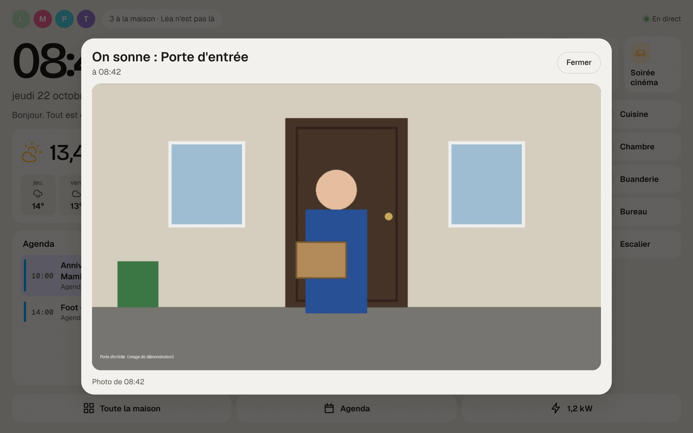
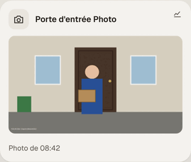

# Étape 82 : la sonnette Ring, expliquée



## Le but

Quelqu'un sonne à la porte. Sur la **tablette murale**, la photo de la porte s'affiche aussitôt en
grand, par-dessus tout, même pendant l'[écran de veille](veille.md). Les **enceintes** annoncent
« On sonne à la porte », et les **téléphones** reçoivent une notification. Le
[journal de bord](journal-de-bord.md) note « Porte d'entrée a sonné ».

Alexa continue de marcher comme avant : rien ne change de son côté.

## Pourquoi pas par Alexa

Alexa reçoit bien les coups de sonnette, mais elle ne les transmet à aucun autre logiciel de la
maison. Ring non plus n'a pas d'accès prévu pour cela. La solution éprouvée, utilisée par des
dizaines de milliers de maisons avec Home Assistant, est **ring-mqtt** : un petit programme libre
qui se connecte à ton compte Ring (comme l'appli Ring sur ton téléphone) et transmet, sur le réseau
de la maison :

- le **coup de sonnette** (`binary_sensor.porte_d_entree_sonnette`, « on » quelques secondes) ;
- le **mouvement** devant la porte (`binary_sensor.porte_d_entree_mouvement`) ;
- la **photo** (`camera.porte_d_entree_photo`), prise à chaque coup de sonnette ;
- la **batterie** (`sensor.porte_d_entree_batterie`), et quelques réglages.

Ces noms viennent de ring-mqtt, en anglais (« Ding », « Snapshot »…) : le serveur les traduit.
Le début (`porte_d_entree`) est le nom de ta sonnette dans l'appli Ring.

**Une sonnette sur batterie** ne peut pas prendre de photo quand on le lui demande : elle dort pour
économiser sa batterie. Avec l'abonnement **Ring Protect**, chaque coup de sonnette est enregistré,
et ring-mqtt récupère la photo de cet enregistrement. C'est ce qui permet d'avoir la photo. Elle
arrive quelques secondes après le coup de sonnette : la fenêtre de la tablette montre d'abord la
photo précédente avec « La nouvelle photo arrive… », puis la remplace.

## Mettre en place, sur le mini-PC

### 1. Mosquitto et ring-mqtt : une commande

Dans le dossier de l'archive du serveur (voir [le mini-PC](mini-pc.md)) :

```bash
sudo ./installer.sh --ring
```

Elle installe et règle tout ([étape 83](tout-compris.md)) :

- **Mosquitto**, le facteur MQTT, qui n'écoute que sur le mini-PC lui-même (`127.0.0.1`), avec un
  compte pour le serveur et un pour ring-mqtt, chacun avec un mot de passe tiré au hasard ;
- **ring-mqtt**, dans un conteneur Docker (le service `ha-maison-ring`), à une version **épinglée par
  son empreinte** : seule cette version exacte peut tourner. Elle change avec les mises à jour du
  serveur, chaque nuit, jamais en cachette ;
- ses réglages (`/var/lib/ring-mqtt/config.json`, lisible par l'administrateur seul).

Si tu préfères tout faire à la main (un autre broker, ring-mqtt ailleurs), voir
[plus bas](#à-la-main).

### 2. Le relier à ton compte Ring

Sur ton téléphone, ouvre **`http://192.168.1.20:55123`** (l'adresse du mini-PC) : connecte-toi avec
le compte Ring, puis tape le **code reçu par SMS**. C'est fait une seule fois : ring-mqtt garde
ensuite un jeton (dans `/var/lib/ring-mqtt`), et cette page s'arrête d'elle-même.

**De préférence, un compte Ring à part** : dans l'appli Ring, Réglages → Utilisateurs partagés →
invite une adresse à toi réservée à la maison, puis connecte ring-mqtt avec ce compte. Tu pourras
lui retirer l'accès depuis l'appli Ring, sans toucher à ton propre compte.

Quelques secondes plus tard, le journal du serveur dit
`entité MQTT découverte : binary_sensor.porte_d_entree_sonnette`, et la tuile de la photo apparaît
sur le tableau de bord.

### 3. Quand prendre une photo

Sur le tableau de bord, la liste **Porte d'entrée Mode photo** : choisis **Ding** (une photo à chaque
coup de sonnette), ou **Motion + Ding** (aussi quand quelqu'un passe devant la porte, mais la batterie
de la sonnette s'use plus vite).

### 4. L'annonce et la notification

Dans `/etc/ha-maison/automations.yaml` (ou avec l'[éditeur](editeur-automatisations.md)) :

```yaml
- id: sonnette
  alias: On sonne à la porte
  triggers:
    - trigger: state
      entity_id: binary_sensor.porte_d_entree_sonnette
      to: "on"
  actions:
    - action: tts.speak
      target: { entity_id: tts.annonces }
      data:
        media_player_entity_id: media_player.salon
        message: On sonne à la porte.
    - action: notify.send_message
      target: { entity_id: notify.appli }
      data:
        title: Sonnette
        message: On sonne à la porte.
        priority: 5
        tag: sonnette
```

La notification ouvre le tableau de bord, où la tuile montre la photo.

## Sur la tablette

La fenêtre « On sonne » s'ouvre seulement en **mode tablette murale** (sur un téléphone, c'est la
notification qui prévient). Elle réveille l'écran de veille, se met à jour quand la nouvelle photo
arrive, et se ferme d'elle-même au bout de **3 minutes** (ou avec **Fermer**). Un deuxième coup de
sonnette la rouvre.



## Sur le dessin de la maison

La porte d'entrée peut aussi s'allumer **sur le dessin**, sur tous les écrans :

1. Sous le dessin, **Régler** → **Zones à toucher** → **+ Placer la sonnette** (le bouton n'apparaît que si une
   sonnette est connue et pas encore placée).
2. **Tracer** la zone sur la porte, dans l'aperçu, puis **Enregistrer**.

Quand on sonne, la zone s'allume en ambre : une cloche qui bat, des ondes, et une petite carte avec
la photo et l'heure. Ensuite, la porte reste marquée **« On a sonné à 08:42 »** pendant un quart
d'heure (la cloche, sans la photo). Toucher la porte ouvre la fenêtre de la sonnette avec la
dernière photo ; un appui long montre l'historique, comme pour les autres zones.

Si les photos du dessin changent, il suffit de **retracer** la zone : rien d'autre à refaire.

## Sécurité

- **La photo ne quitte jamais le mini-PC** autrement que vers le tableau de bord d'un compte
  connecté : elle est gardée en **mémoire seulement** (jamais dans la base, ni dans l'historique,
  ni dans les sauvegardes), et servie avec `Cache-Control: no-store` (le navigateur ne la garde pas).
- **Les invités ne la voient pas** : ni la photo, ni la caméra dans la liste des appareils (comme
  les serrures et la présence de la famille).
- **Seulement des images** : un message qui n'est ni un JPEG ni un PNG est refusé ; 2 Mio au plus ;
  32 caméras au plus.
- **MQTT seulement sur le mini-PC** (`127.0.0.1`), un compte par programme, chacun son mot de passe.
- **ring-mqtt** a le droit de voir tes appareils Ring, comme l'appli Ring : d'où le compte partagé,
  retirable à tout moment. Son jeton reste dans `/var/lib/ring-mqtt`, lisible par l'administrateur
  seul. Il ne parle qu'aux serveurs de Ring (en HTTPS) et au Mosquitto du mini-PC.
- **Alexa** n'est pas touchée : rien ne change pour elle.

**Mettre à jour ring-mqtt** : rien à faire. Quand Ring change quelque chose, ring-mqtt sort une
nouvelle version ; elle arrive avec une mise à jour du serveur (épinglée, vérifiée), la nuit.

## À la main

Sans l'installeur (un autre Linux, un broker à toi) : Mosquitto avec un compte pour le serveur
(`HA_MQTT_HOST`, `HA_MQTT_USER`, `HA_MQTT_PASSWORD_FILE` dans `ha-maison.env`) et un pour ring-mqtt,
puis ring-mqtt [comme son auteur l'explique](https://github.com/tsightler/ring-mqtt/wiki), avec
`"enable_cameras": true` et l'adresse de ton broker dans son `config.json`. Le serveur reconnaît la
sonnette toute seule dès que ring-mqtt publie.

## Comment c'est construit

| Fichier | Rôle |
| ------- | ---- |
| [crates/ha-mqtt/src/discovery.rs](../crates/ha-mqtt/src/discovery.rs) | Le type `camera` (son sujet `topic`, l'encodage `b64` accepté) ; les noms de ring-mqtt traduits, seulement pour un appareil dont le fabricant est Ring |
| [crates/ha-mqtt/src/bridge.rs](../crates/ha-mqtt/src/bridge.rs) | L'image reçue (binaire, plus grosse qu'un état) est vérifiée et rangée ; la caméra passe à `idle` avec `image_at` (le moment de la photo) |
| [crates/ha-core/src/images.rs](../crates/ha-core/src/images.rs) | La dernière image de chaque caméra, en mémoire |
| [crates/ha-api/src/rest.rs](../crates/ha-api/src/rest.rs) | `GET /api/camera_proxy/{entité}`, comme dans Home Assistant |
| [web/sonnette.js](../crates/ha-api/web/sonnette.js) | La fenêtre « On sonne » sur la tablette, et la photo des tuiles (lue avec le jeton) |
| [crates/ha-logbook/src/describe.rs](../crates/ha-logbook/src/describe.rs) | « Porte d'entrée a sonné » dans le journal de bord |

**Tests** : ce que ring-mqtt publie, rejoué tel quel (la sonnette, puis une photo de 100 Kio, plus
qu'un état ordinaire) ; une image en base64 ; un texte refusé à la place d'une image ; la caméra
retirée avec son image ; l'API (photo servie à la famille, `no-store`, introuvable pour un invité) ;
le journal de bord.

Essayé dans le navigateur avec un vrai Mosquitto et les messages exacts de ring-mqtt (une image de
démonstration, dessinée) : la tablette en écran de veille, le coup de sonnette (la veille s'efface,
la fenêtre s'ouvre avec l'ancienne photo et « La nouvelle photo arrive… »), la nouvelle photo
(elle remplace l'ancienne), Fermer, un deuxième coup de sonnette, et le téléphone (pas de fenêtre,
la tuile avec la photo). Aucune erreur JavaScript.

### Concepts utilisés

**Une image dans MQTT** : un message MQTT peut contenir n'importe quels octets, pas seulement du
texte. ring-mqtt y envoie le fichier JPEG tel quel. Le serveur reconnaît une image à ses premiers
octets (`FF D8 FF` pour un JPEG, la « signature » du format), pas à ce que dit le message.

**`Cache-Control: no-store`** : demande au navigateur de ne rien garder sur le disque de la
tablette. La photo n'existe que le temps de l'afficher.
