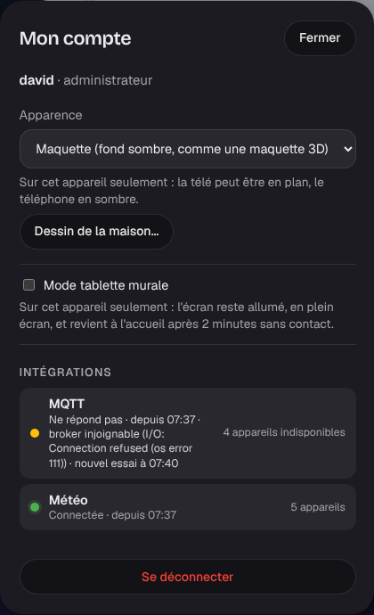
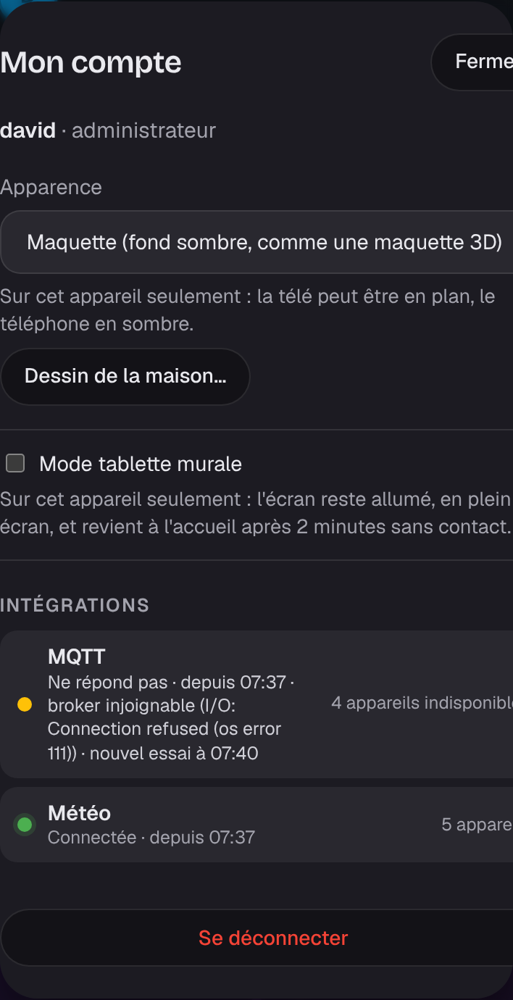

# Étape 45 : la supervision des intégrations, expliquée

## Le but

Une intégration (Hue, Somfy, MQTT, Freebox, le Linky, la météo) parle à un appareil ou à un
service. Que se passe-t-il quand le pont Hue est débranché, quand le broker MQTT redémarre, ou quand
le code d'une intégration plante ?

Jusqu'ici :

- chacune se reconnectait toute seule, mais **une intégration qui plantait restait arrêtée** jusqu'au
  redémarrage du serveur, sans rien dire ;
- ses appareils **gardaient leur dernière valeur**, comme si tout allait bien : une lampe « allumée »
  qu'on ne peut plus joindre, une porte de garage « fermée » dont on ne sait plus rien.

L'idée vient de [Moli OS](https://github.com/rudy-io/moli-os), une autre domotique en Rust :
« une panne de pilote n'emporte jamais le cœur, et ses appareils passent hors ligne le temps de la
panne ».

## Ce qui change

| Situation | Ce qui se passe |
| --------- | --------------- |
| Le pont, la box ou le broker ne répond plus | L'intégration réessaie (1 s, 2 s, 4 s… jusqu'à 1 min) et dit « ne répond pas », avec l'erreur et l'heure du prochain essai |
| L'intégration **plante** (un bogue) | Le serveur la **relance** tout seul, après une attente qui double à chaque échec (jusqu'à 1 min) ; le reste de la maison ne s'arrête jamais |
| La panne dure **plus d'une minute** | Ses appareils passent **« indisponibles »** (`unavailable`, comme dans Home Assistant), en gardant leurs attributs |
| La panne dure **plus de 5 minutes** | **Une** alerte dans la cloche : « Hue ne répond plus », avec l'erreur, le prochain essai et le nombre d'appareils touchés, plutôt qu'une alerte par lampe |
| Elle revient | Ses appareils retrouvent leur dernière valeur connue (ou la nouvelle, si elle l'a déjà republiée), et l'alerte disparaît |

Une coupure de quelques secondes (le pont qui redémarre) ne change donc rien à l'écran : il faut une
minute de panne pour que les appareils passent indisponibles.

Une automatisation peut réagir : un déclencheur « l'état devient `unavailable` » sur la porte de
garage, par exemple, pour être prévenu.

## Voir l'état des intégrations

**Mon compte → Intégrations** : une ligne par intégration, avec une pastille.

| Pastille | État |
| -------- | ---- |
| verte | Connectée, depuis quand |
| orange | Démarrage, ou ne répond pas (avec l'erreur et l'heure du prochain essai) |
| rouge | Plantée et relancée (combien de fois) |

À droite, le nombre d'appareils qu'elle publie, et « indisponibles » s'ils le sont. La liste se met
à jour toutes les 10 secondes tant que la fenêtre est ouverte.

## Sécurité

- **Réservé à ceux qui voient tous les appareils** (administrateur et famille) : un message
  d'erreur peut citer une adresse du réseau local. Un invité reçoit un refus (403).
- Rien ne se commande depuis cette liste : elle ne fait que montrer.
- Une intégration plantée reste enfermée dans sa propre tâche : elle ne peut ni arrêter le serveur,
  ni laisser un verrou bloqué.

## Comment c'est construit

- `crates/ha-core/src/integrations.rs` (nouveau) :
  - `Health` : `starting`, `connected`, `retrying`, `crashed`, `stopped` ;
  - `Core::report()` : une intégration dit où elle en est ; revenue « connectée », ses appareils
    retrouvent leur valeur ;
  - `Core::check_integrations()` : appelée chaque minute, elle met « indisponibles » les appareils
    des intégrations en panne depuis plus d'une minute (`GRACE`) ;
  - `supervise()` : lance l'intégration **dans sa propre tâche** ; si elle panique ou s'arrête
    d'elle-même, elle est relancée après 1 s, 2 s, 4 s… (1 min au plus) ; après une minute de
    bon fonctionnement, l'attente repart de 1 s.
- **Chaque état connaît son intégration** : `StateMachine::set_by("hue", …)`. Le propriétaire est
  rangé dans la base avec l'état (nouvelle colonne `owner`, migration `0017`) : après un
  redémarrage, une intégration qui ne revient pas peut quand même mettre ses appareils
  indisponibles.
- Les six intégrations (Hue, Somfy, MQTT, Freebox, Linky, météo) passent par `supervise()` et
  disent quand elles sont connectées et quand elles réessaient.
- `crates/ha-notices` : l'alerte par intégration (après 5 min), et pas d'alerte par appareil pour
  ceux d'une intégration en panne.
- `GET /api/integrations` : la liste, pour « Mon compte ».

| Champ | Exemple |
| ----- | ------- |
| `id`, `name` | `"mqtt"`, `"MQTT"` |
| `status` | `"retrying"` |
| `since` | depuis quand il est dans cet état (connecté, ou en panne) |
| `error`, `retry_at` | l'erreur, et le prochain essai |
| `restarts` | combien de fois le superviseur l'a relancée |
| `entities`, `unavailable` | ses appareils, et s'ils sont indisponibles |
