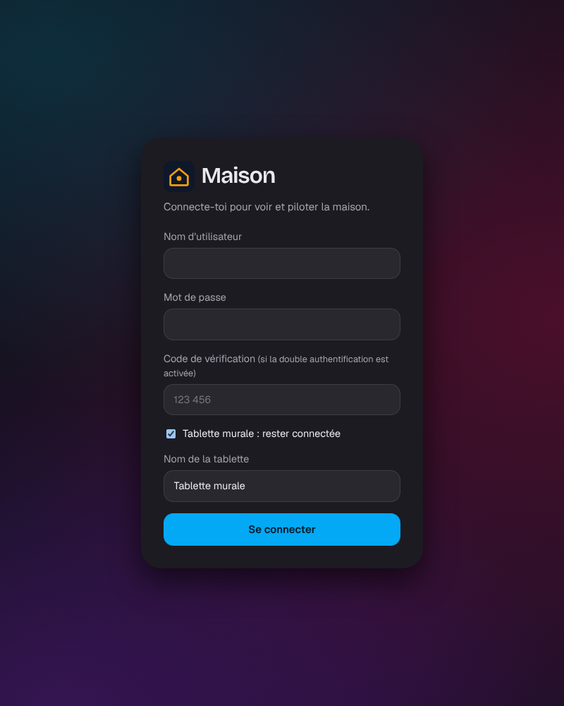
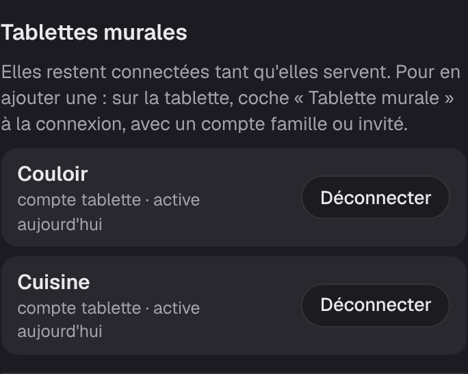

# Étape 78 : la tablette murale associée, expliquée



## Le but

Une tablette Android accrochée au mur sert d'écran central à la maison : on voit d'un coup d'œil
ce qui est allumé, on ferme les volets en passant. Le serveur, lui, tourne sur le
[mini-PC](mini-pc.md) : la tablette n'est qu'un écran. Si elle tombe en panne, la maison continue.

Deux soucis jusqu'ici :

- **la connexion expirait au bout de 30 jours** : il fallait retaper un mot de passe sur la
  tablette une fois par mois ;
- **une tablette volée ou déménagée** gardait sa connexion jusqu'à cette échéance.

Maintenant, une tablette **associée** reste connectée tant qu'elle sert, et l'administrateur la
**déconnecte à distance** depuis son téléphone.

## 1. Un compte pour la tablette

Une tablette au mur est à portée de main de tous : elle a son propre compte, jamais un compte
administrateur. Sur le mini-PC :

```bash
sudo ha-maison user add tablette famille
```

(Sous Windows : `ha-server.exe user add tablette famille`.)

| Rôle | Ce que la tablette peut faire |
| --- | --- |
| **famille** | tout piloter, voir l'historique et les automatisations ; pas de réglage, pas de compte |
| **invité** | seulement les appareils permis aux invités (pas le garage ni les serrures) ; un ordre dans une [pièce protégée](garde.md) attend qu'un membre de la famille le valide |

Avec des visiteurs fréquents (baby-sitter, location), choisis **invité**.

## 2. Associer la tablette

Sur la tablette, ouvre l'adresse du serveur (par exemple `http://192.168.1.20:8123`), puis :

1. le nom `tablette` et son mot de passe ;
2. coche **Tablette murale : rester connectée** ;
3. donne-lui un nom (« Couloir », « Cuisine »), puis **Se connecter**.

La tablette passe tout de suite en **mode tablette murale** : plein écran, retour à l'accueil après
2 minutes, et l'[écran de veille](veille.md) après 5 minutes. À l'horizontale, elle affiche la
[vue hub](hub.md) : le dessin de la maison au centre, l'heure, la météo, l'agenda, les scènes et
les pièces autour.

Dans **Mon compte**, elle affiche « Tablette murale « Couloir » : reste connectée tant qu'elle sert ».

**Combien de temps ?** Chaque jour où elle sert, sa connexion est prolongée de 90 jours. Elle
n'expire que si elle reste **90 jours** éteinte ou débranchée.

## 3. La voir et la déconnecter



Sur **ton** téléphone (compte administrateur), **Mon compte → Tablettes murales** : chaque
tablette, son compte, et le jour où elle a servi pour la dernière fois. **Déconnecter** la ferme :
moins d'une minute après, elle revient à l'écran de connexion.

C'est aussi ce qu'il faut faire si une tablette est volée, vendue ou déménagée. Changer le mot de
passe du compte `tablette` (`sudo ha-maison user passwd tablette`) déconnecte toutes ses tablettes
d'un coup.

## 4. Régler la tablette Android

En [HTTPS](https-maison.md) (d'office sur le mini-PC), le tableau de bord garde lui-même l'écran
allumé. Une appli « kiosque » fait le reste : démarrer avec la tablette, rester en plein écran,
empêcher d'en sortir. C'est **Fully Kiosk Browser**, sur le Play Store.

1. Installe d'abord le **certificat de la maison** sur la tablette
   ([HTTPS, étape 2](https-maison.md#2-installer-le-certificat-de-la-maison-sur-chaque-appareil)).
2. Installe **Fully Kiosk Browser** et ouvre-la. **Start URL** (adresse de départ) :
   `https://192.168.1.20:8123` (`http://` si le serveur n'est pas en HTTPS).
3. Associe la tablette comme plus haut, dans Fully.
4. Dans les réglages de Fully (glisser depuis le bord gauche de l'écran, puis *Settings*) :
   - **Keep Screen On** (écran toujours allumé) : oui ;
   - **Launch on Boot** (démarrer avec la tablette) : oui ;
   - le plein écran (*Fullscreen Mode*) : oui.

   Les noms exacts changent un peu selon les versions. La version gratuite suffit ; le
   verrouillage de la tablette sur cette seule appli (*Kiosk Mode*) est dans la version payante.
5. Dans les réglages d'Android :
   - **Batterie** : retire Fully de l'« optimisation de la batterie », pour qu'Android ne la ferme
     pas la nuit ;
   - si la tablette le propose (Samsung : « Protéger la batterie »), limite la charge à 80–85 % :
     branchée jour et nuit, la batterie dure bien plus longtemps ;
   - **Wi-Fi** : garde-le actif pendant la veille.

La nuit, l'écran de veille passe de lui-même à 45 % de luminosité.

## Sécurité

- **Jamais un administrateur au mur** : la case est refusée à un compte administrateur
  (« connecte-la avec un compte famille ou invité »). Si le compte de la tablette devient
  administrateur plus tard, sa connexion cesse aussitôt de marcher.
- **Rien de plus qu'une connexion ordinaire** : la tablette a exactement les droits de son compte.
  Seule la durée change.
- **Le jeton** (la « clé » que la tablette garde après la connexion) est rangé comme les autres :
  seule son empreinte SHA-256 est dans la base. Une copie de la base ne permet pas de se faire
  passer pour la tablette.
- **Déconnectée à distance en moins d'une minute** : le flux en direct du tableau de bord revérifie
  sa connexion chaque minute, et se coupe si elle a été fermée.
- **Ouvrir la maison demande toujours le mot de passe** : déverrouiller une serrure ou désarmer
  l'alarme le redemande, sur la tablette comme ailleurs. Rester connecté ne suffit pas.
- **Tout est noté** dans le journal d'audit : `login_wall` (la tablette associée, avec son nom) et
  `tablet_forget` (qui l'a déconnectée).
- **Le nom** de la tablette : 1 à 40 caractères, sans caractère de contrôle. Il est affiché comme
  du texte, jamais comme du HTML.

## Comment c'est construit

- **`crates/ha-storage/migrations/0021_wall_tablets.sql`** : deux colonnes dans `access_tokens`,
  `wall_label` (le nom ; vide pour une connexion ordinaire) et `last_used_at`.
- **`crates/ha-auth`** :
  - `login_wall` : vérifie le mot de passe **puis** le rôle (sans le mot de passe, on n'apprend pas
    qu'un compte est administrateur), et crée un jeton de 90 jours ;
  - à chaque vérification du jeton, une tablette est prolongée à 90 jours, **une fois par jour au
    plus** (le tableau de bord vérifie chaque minute : inutile d'écrire à chaque fois) ;
  - `wall_tablets` et `forget_wall_tablet` : la liste, et la déconnexion (qui ne peut pas fermer
    une connexion ordinaire).
- **`crates/ha-api`** :
  - `POST /api/auth/login` accepte `wall_label` ;
  - `GET /api/auth/tablets` et `DELETE /api/auth/tablets/{id}`, réservés à l'administrateur
    (nouveau droit `ManageTablets`) ;
  - `GET /api/` dit à la tablette son nom (`wall_label`).
- **Le tableau de bord** : la case et le nom à la connexion (`app.js`), la section « Tablettes
  murales » de Mon compte (`account.js`).

**Tests** : prolongation (80 jours plus tard, elle repart à 90), une connexion ordinaire jamais
prolongée, expiration après 90 jours sans servir, administrateur refusé (même après coup), noms
invalides, liste et déconnexion une par une, droits de l'API, journal d'audit.

Essayé dans le navigateur : la connexion refusée à l'administrateur avec son message, la tablette
« Couloir » en mode tablette, la liste sur le téléphone, puis « Déconnecter » : la tablette revient
d'elle-même à l'écran de connexion 54 secondes plus tard.

### Concepts utilisés

**Une expiration glissante** : au lieu d'une date fixe, l'échéance avance à chaque usage. C'est ce
que font les applis bancaires (« restez connecté ») : une session qui sert ne meurt pas, une
session abandonnée s'éteint d'elle-même.

**SQL : `DELETE … RETURNING`** : supprime la ligne et renvoie le nom de la tablette dans la même
requête, pour le journal d'audit, sans relire avant.
