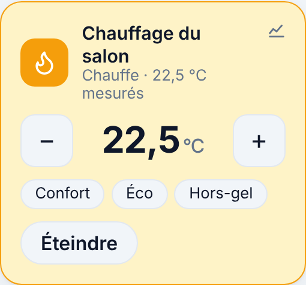

# Étape 16 : le thermostat, expliqué



## Le but

Chauffer une pièce à la bonne température, sans y penser : 20 °C quand tu es là, 17 °C la nuit,
7 °C (hors-gel) pendant les vacances, et rien quand la fenêtre est ouverte. Comme le
`generic_thermostat` de Home Assistant.

## Le principe

Il faut deux choses, que tu as sans doute déjà :

- un **radiateur** électrique branché sur une **prise connectée** (ou un relais) : c'est
  l'entité `switch.…` ;
- un **thermomètre** dans la pièce : l'entité `sensor.…` (MQTT, Somfy, Hue…).

Le thermostat compare la température à la **consigne**, et allume ou éteint la prise. Il crée une
entité `climate.<id>`, la même que dans Home Assistant.

**L'hystérésis.** Pour ne pas allumer et éteindre sans arrêt autour de 19 °C, le thermostat a une
**marge** (0,3 °C par défaut) : il allume à 18,7 °C, éteint à 19,3 °C, et entre les deux ne change
rien. En plus, il ne change pas d'état plus d'une fois toutes les 5 minutes (`min_cycle`), pour
ménager le relais. Sauf si c'est toi qui donnes un ordre : il obéit alors tout de suite.

## Mettre en place

Copie [thermostats.example.yaml](../thermostats.example.yaml) en `thermostats.yaml` (avec Docker :
`config/thermostats.yaml`) :

```yaml
- id: salon
  name: Chauffage du salon
  heater: switch.radiateur_salon
  sensor: sensor.temperature_salon
  window: binary_sensor.fenetre_salon   # facultatif
  target: 19
  presets: {confort: 20, eco: 17, absent: 15, hors_gel: 7}
```

Puis vérifie et redémarre :

```powershell
cargo run -p ha-server -- thermostats check
```

Au **tout premier démarrage**, le thermostat est **arrêté** : rien ne chauffe tant que tu ne l'as
pas allumé depuis le tableau de bord. Ainsi, une erreur dans le fichier (mauvaise prise) ne
déclenche pas un radiateur par surprise. Ensuite, il reprend après chaque redémarrage là où il en
était (marche ou arrêt, consigne, préréglage).

## Dans le tableau de bord

Une section **Chauffage** : la consigne avec **−** et **+** (par demi-degré), la température
mesurée, les **préréglages** (Confort, Éco, Absent, Hors-gel), et **Allumer / Éteindre**. La tuile
devient orange quand le radiateur chauffe. Si le chauffage est coupé pour une raison de sécurité,
elle l'écrit (« fenêtre ouverte : chauffage coupé »).

## Programmer le chauffage

Pas besoin d'un programmateur à part : ce sont des **automatisations**, à écrire dans le fichier ou
à créer avec l'éditeur du tableau de bord (étape 13) :

```yaml
- id: chauffage_matin
  alias: Chauffage confort le matin
  triggers:
    - trigger: time
      at: "06:30"
  conditions:
    - condition: time
      weekday: [lun, mar, mer, jeu, ven]
  actions:
    - action: climate.set_preset_mode
      target:
        entity_id: climate.salon
      data:
        preset_mode: confort
```

Les actions disponibles, comme dans Home Assistant :

| Action | Données |
|--------|---------|
| `climate.set_preset_mode` | `preset_mode: eco` (ou `none`) |
| `climate.set_temperature` | `temperature: 20` |
| `climate.set_hvac_mode` | `hvac_mode: heat` ou `off` |
| `climate.turn_on` / `climate.turn_off` | — |

Avec la présence (Freebox) et la météo, on peut aller plus loin : « préréglage absent quand
personne n'est à la maison », « hors-gel s'il gèle et que la maison est vide »…

## La sécurité

Un radiateur qui chauffe sans contrôle, c'est une facture, voire un risque. Le thermostat coupe
donc le radiateur **immédiatement**, sans attendre les 5 minutes, dans ces cas :

- **température inconnue** : le thermomètre est indisponible, ou envoie autre chose qu'un nombre
  plausible (entre -50 et 60 °C). On ne chauffe pas à l'aveugle ;
- **fenêtre ouverte** (si `window` est indiqué) ;
- **température maximale atteinte** (`max_temp`, 25 °C par défaut), quelle que soit la consigne ;
- **thermostat arrêté**.

Et aussi :

- La consigne est toujours ramenée entre `min_temp` et `max_temp`, et le fichier refuse toute
  valeur hors de 5 à 30 °C : une automatisation qui demanderait 40 °C obtient 25 °C.
- Deux thermostats ne peuvent pas commander le **même radiateur** : ils se contrediraient.
- Un radiateur **injoignable** (prise débranchée) ne reçoit pas une rafale d'ordres : un ordre non
  suivi d'effet est renvoyé au plus une fois par minute.
- Chaque ordre donné depuis le tableau de bord passe par le journal d'activité, comme les autres.

Limite honnête : un thermomètre qui ne donne **plus de nouvelles** mais garde sa dernière valeur
ne peut pas être distingué d'une température stable (le serveur n'enregistre que les
changements). C'est l'intégration du thermomètre qui doit le marquer « indisponible » quand il ne
répond plus, ce que font MQTT et Somfy.

## Comment c'est construit

| Fichier | Contenu |
|---------|---------|
| [logic.rs](../crates/ha-thermostat/src/logic.rs) | La décision : chauffer ou pas, et pourquoi |
| [config.rs](../crates/ha-thermostat/src/config.rs) | Lecture et vérification de `thermostats.yaml` |
| [lib.rs](../crates/ha-thermostat/src/lib.rs) | Écoute du thermomètre, de la fenêtre et des ordres ; commande du radiateur |
| [app.js](../crates/ha-api/web/app.js) | La tuile du thermostat |

**Concepts Rust rencontrés :**

- **Une fonction pure pour la décision** : `decide(entrées) -> (allumer ?, raison)`. Pas d'horloge,
  pas de réseau, pas d'état caché. On peut donc tester tous les cas (froid, chaud, dans la marge,
  fenêtre, capteur en panne…) en quelques lignes, sans rien simuler.
- **Une énumération pour la raison** (`Reason::Cold`, `Reason::WindowOpen`…) plutôt qu'un
  booléen : le code dit *pourquoi*, et `is_safety()` regroupe en un seul endroit les cas qui coupent
  tout de suite.
- **La syntaxe `..valeur`** dans les tests : `Inputs { window_open: true, ..inputs(…) }` copie toutes
  les autres valeurs. On ne change que ce qui compte pour le cas testé.
- **`Option::is_none_or`** : « aucun changement encore, ou le dernier date d'assez longtemps », en
  une expression.

## Testé

- La décision : hystérésis autour de la consigne, et chaque cas de sécurité, qui l'emporte toujours.
- La durée minimale entre deux changements, sauf pour la sécurité et les ordres explicites.
- Le fichier : valeurs par défaut, préréglages, fautes de frappe, types d'entités, bornes,
  radiateur partagé.
- Avec un vrai noyau et un radiateur simulé qui obéit : mise en marche, arrêt dans la marge,
  préréglage, fenêtre ouverte, capteur en panne, consigne absurde ramenée à 25 °C, arrêt.
- Reprise après redémarrage : mode, consigne et préréglage retrouvés.
- Radiateur qui n'obéit pas : **un seul** ordre envoyé malgré une température qui oscille.
- **Deux défauts trouvés et corrigés grâce aux essais** : l'allumage demandé depuis le tableau de
  bord attendait les 5 minutes de sécurité ; et un radiateur injoignable recevait un ordre toutes
  les 15 secondes.
- Dans Chromium, ordinateur et téléphone (thème sombre) : allumer, monter la consigne (le radiateur
  chauffe, la tuile passe en orange), préréglage Éco (le radiateur s'éteint). Aucune erreur, aucun
  débordement.
- Pas encore testé avec un vrai radiateur.
