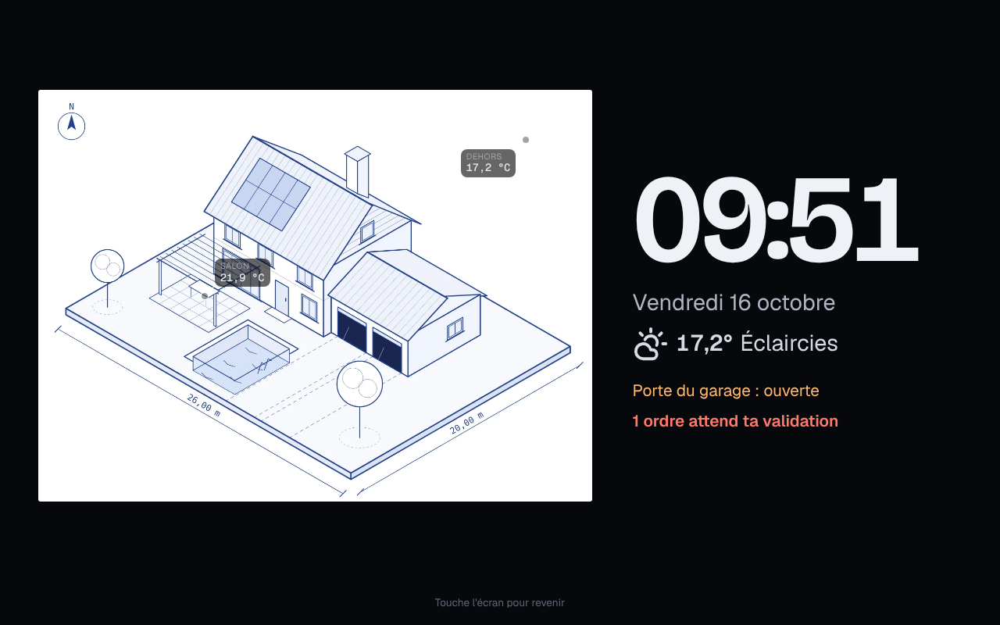

# Étape 49 : l'écran de veille de la tablette murale, expliqué

## Le but

Une tablette accrochée au mur reste allumée toute la journée ([mode tablette murale](mise-en-forme.md#le-mode-tablette-murale)).
Le tableau de bord complet, avec ses dizaines de tuiles, n'est pas fait pour être regardé de loin,
en passant dans le couloir. Ce qu'on veut voir d'un coup d'œil : **l'heure, le temps qu'il fait, et
si quelque chose cloche**.

## Ce qu'il montre

Après **5 minutes sans contact**, en mode tablette :

- le **dessin de la maison** en grand (le vrai : avec ses lumières allumées, la pluie ou la neige
  s'il y en a, ses repères de température) ;
- une **grande horloge** et la date ;
- la **météo** (température et ciel) ;
- **ce qui demande de l'attention**, en orange (« Porte du garage : ouverte »), ou « Tout est
  calme » ;
- les **ordres à valider** de la [garde](garde.md), en rouge.

Le contenu est mis à jour toutes les 20 secondes. En portrait, le dessin passe au-dessus de
l'horloge. Sans dessin (mise en page classique), l'horloge est centrée.

Avec la [vue hub](hub.md) (étape 80), l'écran de veille prend le dessin au centre de la vue hub,
et le lui rend au réveil.

## Pensé pour un mur

- **Plus sombre la nuit** : quand le soleil est couché (`sun.sun`, ou de 22 h à 7 h sans lui), tout
  passe à 45 % de luminosité, et le dessin, souvent clair, encore plus. On peut le voir, il
  n'éclaire pas le couloir.
- **Rien ne reste au même endroit** : le contenu se décale de quelques pixels chaque minute, pour
  ne pas marquer un écran allumé jour et nuit.
- **Un contact pour revenir, et rien d'autre** : le premier contact fait seulement disparaître
  l'écran de veille. Il n'allume pas la lampe qui se trouvait sous le doigt.
- **Jamais sur un travail en cours** : si l'éditeur d'automatisations ou la demande de mot de passe
  sont ouverts, l'écran de veille attend.

## Le régler

Dans **Mon compte**, sous **Mode tablette murale** : **Écran de veille après 5 minutes** (coché par
défaut). Comme le mode tablette, c'est un réglage **de cet appareil seulement**, gardé dans le
navigateur : le téléphone n'a pas d'écran de veille, la tablette du couloir si.

## Sécurité

Rien de nouveau côté serveur : l'écran de veille affiche ce que le tableau de bord a déjà reçu, avec
les droits du compte connecté (un invité n'y voit ni les alertes cachées, ni les ordres à valider).
Il ne commande rien.

## Comment c'est construit

| Fichier | Rôle |
| ------- | ---- |
| [web/index.html](../crates/ha-api/web/index.html) | Le bloc `#saver`, et la case dans Mon compte |
| [web/app.js](../crates/ha-api/web/app.js) | `saverLater` (le compte à rebours), `showSaver` / `hideSaver` (le dessin de la maison est **déplacé** dans l'écran de veille, puis remis à sa place : ses effets continuent sans être recréés), `renderSaver` |
| [web/style.css](../crates/ha-api/web/style.css) | La mise en page (paysage, portrait), la nuit, le décalage (`--shift-x`, `--shift-y`) |

Le premier contact est intercepté **avant** d'atteindre quoi que ce soit (écouteurs en phase de
capture, `preventDefault` et `stopPropagation`) : c'est ce qui garantit qu'il ne commande rien.
