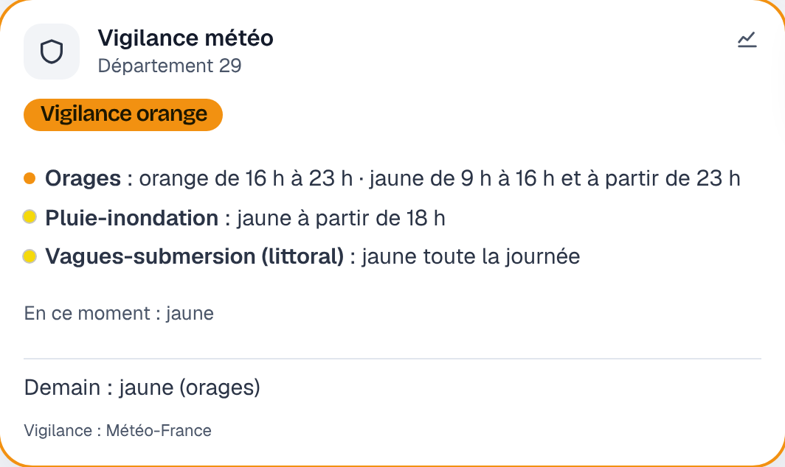

# Étape 33 : la vigilance Météo-France, expliquée



## Le but

Savoir si Météo-France a placé ton département en **vigilance jaune, orange ou rouge** (orages,
vent violent, canicule, neige-verglas…), et s'en servir : être prévenu sur son téléphone, fermer
les volets avant la tempête, ne pas lancer l'arrosage pendant un orage.

Ce sont les données officielles, celles de la carte de [vigilance.meteofrance.fr](https://vigilance.meteofrance.fr),
publiées au moins à 6 h et à 16 h, et à chaque changement.

## Obtenir la clé (une fois, gratuit)

Météo-France demande un compte pour son API. Compte 5 minutes :

1. Crée un compte sur [portail-api.meteofrance.fr](https://portail-api.meteofrance.fr), puis
   connecte-toi.
2. Ouvre l'API **« Données Publiques Vigilance »** (ou « Bulletin Vigilance ») et abonne-toi
   (« Souscrire »), avec l'application par défaut.
3. Dans **Mes API**, choisis cette API et clique sur **Générer API Key**. Pour la durée de
   validité, d'autres logiciels (openHAB) conseillent **0** ; sinon, choisis la plus longue
   proposée. Quand la clé expirera, une alerte te le dira sur le tableau de bord.
4. Copie la clé dans un fichier, lisible par toi seul :

   ```sh
   nano cle-meteofrance.txt        # colle la clé, enregistre
   chmod 600 cle-meteofrance.txt
   ```

## Activer la vigilance

| Variable                    | Exemple                    | Rôle                                   |
| --------------------------- | -------------------------- | -------------------------------------- |
| `HA_VIGILANCE_DEPARTEMENT`  | `67`, `2A`                 | ton département (métropole)            |
| `HA_VIGILANCE_KEY_FILE`     | `/run/secrets/meteofrance` | le fichier qui contient la clé         |

Vérifier la clé avant de démarrer le serveur :

```sh
ha-server vigilance test
# Clé acceptée. Carte publiée le 15/10 à 06:00.
# Aujourd'hui (29) : vigilance orange
#   - Orages : orange
#   - Vagues-submersion (littoral) : jaune
# Demain (29) : vigilance jaune
#   - Orages : jaune
```

Avec Docker, décommente dans [compose.yaml](../compose.yaml) les lignes `HA_VIGILANCE_…` et le
secret `meteofrance`, puis mets la clé dans `secrets/meteofrance.txt`. Le serveur tourne sous
l'utilisateur 65532 : donne-lui le fichier, et à lui seul.

```sh
sudo chown 65532:65532 secrets/meteofrance.txt
sudo chmod 600 secrets/meteofrance.txt
docker compose run --rm ha-server vigilance test
```

Les départements d'outre-mer ont une vigilance à part, qui n'est pas encore prise en charge.

## Ce qu'on obtient

| Entité                          | État                                 | Attributs utiles                          |
| ------------------------------- | ------------------------------------ | ----------------------------------------- |
| `sensor.vigilance_meteo`        | `Vert`, `Jaune`, `Orange` ou `Rouge` | `niveau_actuel` (en ce moment), un attribut par phénomène (`Orages: Orange`), `phenomenes` (avec les heures) |
| `sensor.vigilance_meteo_demain` | pareil, pour demain                  | publié à partir de 6 h ; avant, `unknown` |

Le niveau du jour est le plus haut de la journée, comme sur la carte de Météo-France ; `niveau_actuel`
est celui de l'heure qu'il est (une vigilance orange orages de 16 h à 23 h est encore jaune à 10 h).
Le **littoral** du département compte aussi (vagues-submersion, vent sur la côte) : il est signalé
« (littoral) ».

Sur le tableau de bord :

- la tuile **Vigilance météo** (avec la météo) détaille chaque phénomène et ses heures, et demain ;
- dès le **jaune**, la pastille de la météo, en haut, l'affiche ;
- en **orange** et **rouge**, l'accueil le compte parmi ce qui demande ton attention.

La couleur n'est jamais seule : le niveau est toujours écrit en toutes lettres.

## Dans les automatisations

Être prévenu sur son téléphone (étape 12) :

```yaml
- id: vigilance_telephone
  alias: Vigilance orange ou rouge
  triggers:
    - trigger: state
      entity_id: sensor.vigilance_meteo
      to: [Orange, Rouge]
  actions:
    - action: notify.send_message
      target: {entity_id: notify.telephone}
      data:
        title: "Vigilance {{ trigger.to_state.state | lower }}"
        message: >-
          Vigilance {{ trigger.to_state.state | lower }} aujourd'hui.
          En ce moment : {{ state_attr('sensor.vigilance_meteo', 'niveau_actuel') | lower }}.
        priority: 5
```

Fermer les volets dès que le **vent** passe en orange ou rouge (un attribut, étape 34) :

```yaml
- id: volets_tempete
  alias: Volets fermés en vigilance vent
  triggers:
    - trigger: state
      entity_id: sensor.vigilance_meteo
      attribute: Vent violent
      to: [Orange, Rouge]
  actions:
    - action: cover.close_cover
      target: {entity_id: cover.volets_salon}
```

Les listes, les attributs et les `{{ … }}` sont expliqués dans le guide des [modèles](modeles.md).

## Si ça ne marche pas

- **Alerte « Vigilance météo : clé refusée »** : Météo-France ne reconnaît plus la clé (expirée,
  supprimée). Génères-en une nouvelle (étape 3 ci-dessus), remplace le fichier, redémarre.
- **`sensor.vigilance_meteo` est indisponible** : pas de réponse de Météo-France depuis 3 heures,
  ou ton département absent de la carte. La raison est dans les logs (`docker compose logs`).
  Une vigilance trop ancienne n'est jamais montrée comme si elle était à jour, et un département
  absent n'est jamais pris pour du vert.

## Sécurité et vie privée

- La clé n'apparaît **nulle part** : ni dans les logs, ni dans les messages d'erreur. Elle est
  envoyée seulement dans l'en-tête `apikey`, en HTTPS, à Météo-France.
- La carte demandée est celle de **toute la France** : Météo-France ne sait pas quel département
  t'intéresse. Le serveur garde le tien pour lui. Pas de position, pas d'adresse.
- La réponse est lue avec une taille maximale (4 Mio), et chaque valeur est vérifiée : un
  phénomène ou une couleur inconnus sont ignorés, une date invalide fait rejeter la carte.

## Comment c'est construit

- `crates/ha-weather/src/carte.rs` : le décodage de la carte, d'après le descriptif technique
  officiel de Météo-France ;
- `crates/ha-weather/src/vigilance.rs` : les requêtes toutes les 10 minutes, les capteurs,
  l'alerte de réparation ;
- `crates/ha-api/web/app.js` : la tuile, la pastille et le résumé de l'accueil.

### Concepts Rust utilisés

**`#[serde(untagged)]`** : selon les champs, Météo-France écrit un identifiant `3` ou `"3"`.
L'énumération `Id` accepte les deux formes : `serde` essaie chaque variante dans l'ordre et garde
la première qui convient.

**`Debug` écrit à la main** : `#[derive(Debug)]` afficherait tous les champs, clé comprise, dans
un `{:?}` oublié dans un log. `VigilanceConfig` implémente `fmt::Debug` elle-même et affiche
`<secret>` à la place.

**Ne pas se fier aux noms** : la carte de 16 h appelle ses périodes « J » et « J1 ». Elle reste la
dernière publiée jusqu'à 6 h le lendemain, et après minuit, sa période « J1 » est celle du jour.
Le code choisit donc la période **qui contient l'heure actuelle** (`Map::at`), puis celle qui la
suit (`Map::after`), sans regarder les noms.
