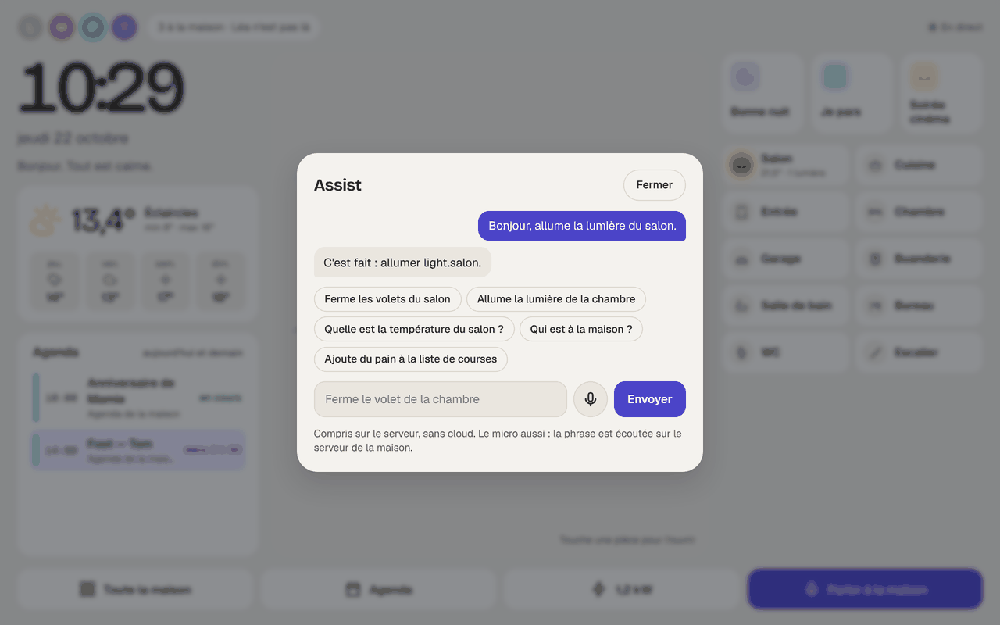

# Étape 84 : parler à la maison depuis la tablette, expliqué



## Le but

Commander la maison **à la voix**, depuis la tablette murale, comme avec Alexa, mais **sans
Alexa** : sans Amazon, sans Google, sans compte, et sans que la voix sorte de la maison.

> Allume la lumière du salon.
> Mets le chauffage à vingt et un degrés.
> Ajoute du pain à la liste de courses.
> Quelle est la température de la chambre ?

On touche **Parler à la maison** (en bas de la [vue hub](hub.md)) ou le **micro** d'Assist, on dit
sa phrase, on se tait : la tablette s'arrête toute seule d'écouter. Quelques secondes plus tard,
la phrase entendue s'affiche, la maison obéit, et **répond à voix haute** sur la tablette
(« C'est fait : allumer Lampe salon »).

## Comment ça marche

1. **La tablette enregistre** la phrase, en 16 000 Hz (la qualité du téléphone, ce qu'il faut pour
   la parole). Elle s'arrête après **1,2 s de silence**, ou au bout de 12 s, ou si on retouche le
   bouton. Si personne ne parle pendant 6 s, elle abandonne.
2. **Le mini-PC l'écoute** avec **Whisper** (le modèle « small » d'OpenAI, gratuit, qui tourne sans
   Internet), par le programme **sherpa-onnx**. Whisper reste chargé en mémoire, dans son propre
   service : une phrase est écrite en 3 à 5 s.
3. **[Assist](assist.md) la comprend** et donne les ordres, exactement comme une phrase tapée :
   mêmes droits, même [garde](garde.md), mot de passe redemandé pour une serrure.
4. **La voix de la maison répond** ([Piper](sonos.md), déjà là pour les annonces) : la réponse est
   lue sur la tablette.

**Rien ne sort de la maison** : ni le son, ni le texte. Ni le son ni la phrase ne sont gardés ou
écrits dans les journaux.

## Ce qu'Assist comprend de plus

**Les nombres dits en lettres** : « vingt et un degrés », « dix-neuf et demi », « cinquante pour
cent », « soixante-dix », « quatre-vingt-dix ». Ce que Whisper écrit parfois (« 20 et 1° ») aussi.
« Un » et « une » seuls restent des mots : « allume une lampe » n'est pas « allume 1 lampe ».

**La liste de courses** (celle de la maison, ou celle d'Iglou si elle est reliée) et les tâches :

| Tu dis | Il fait |
|--------|---------|
| Ajoute du pain à la liste de courses | « Pain » dans la liste de courses |
| Ajoute du lait | « Lait » dans la liste de courses (celle-là sans rien dire) |
| Mets des œufs sur la liste | « Œufs » |
| Rajoute de la sauce à la tomate aux courses | « Sauce à la tomate » |
| Note appeler le plombier dans les tâches | « Appeler le plombier » dans les tâches |

L'article du début (« du », « de la », « des ») est retiré, une majuscule est mise. « Mets » sans
liste nommée reste un ordre à un appareil : « mets le chauffage à 21 » ne va pas dans les courses.

## L'installer

Sur le [mini-PC](mini-pc.md), une option de plus à l'[installation](tout-compris.md) :

```bash
sudo ./installer.sh --voix
```

Elle télécharge **400 Mo** (sherpa-onnx, Whisper « small » et la voix Piper), chaque fichier
**vérifié par son empreinte**, et démarre le service **`ha-maison-ecoute`**. Le bouton micro
apparaît alors tout seul sur les tablettes.

**Le micro ne marche qu'en HTTPS** : un navigateur ne donne le micro qu'à une page sûre. Sur le
mini-PC, c'est le cas d'office ([étape 79](https-maison.md)) ; la tablette doit avoir le certificat
de la maison installé. En `http://`, Assist l'explique au lieu d'ouvrir le micro.

**La première fois**, la tablette demande la permission d'utiliser le micro : réponds
**Autoriser**. Avec Fully Kiosk Browser ([tablette murale](tablette-murale.md)), active aussi
**Web Content Settings → Enable Microphone Access**.

**Ce qu'il faut au mini-PC** : 800 Mo de mémoire en plus, tout le temps (Whisper chargé). Une
phrase occupe les processeurs quelques secondes ; le serveur de la maison passe avant.

### Essayer, et vérifier

```bash
sudo systemctl status ha-maison-ecoute       # le service tourne-t-il ?
sudo ha-maison ecoute /tmp/phrase.wav        # fait écouter un enregistrement
```

`phrase.wav` : 16 bits, mono, 16 000 Hz (par exemple
`ffmpeg -i enregistrement.m4a -ac 1 -ar 16000 /tmp/phrase.wav`). La réponse :
« entendu en 3,8 s : « Ajoute du pain à la liste de courses. » ».

### Sans le mini-PC

Sur un PC, sans service : télécharge `sherpa-onnx-offline` (paquet Python `sherpa-onnx-bin`, et
`libonnxruntime` du paquet `sherpa-onnx-core`) et les trois fichiers de Whisper dans un dossier,
renommés `encoder.onnx`, `decoder.onnx` et `tokens.txt`, puis `HA_ECOUTE=<ce dossier>`. Le programme
est alors lancé pour chaque phrase : 4 à 5 s de plus, le temps de relire le modèle.

| Réglage | Rôle |
|---------|------|
| `HA_ECOUTE=ws://127.0.0.1:10350` | Le service d'écoute (mis par `--voix`) ; seulement sur cette machine |
| `HA_ECOUTE=/chemin/du/dossier` | Ou le programme, lancé pour chaque phrase |
| `HA_PIPER` | La voix qui répond ([étape 73](sonos.md)) ; sans elle, la réponse est seulement écrite |

## Sécurité

- **La voix ne quitte pas la maison** : Whisper et Piper tournent sur le mini-PC.
- **Le service d'écoute n'a pas de mot de passe**, alors il est **fermé au réseau** : systemd ne
  laisse passer que le mini-PC lui-même (`IPAddressAllow=localhost`), et le serveur refuse une
  autre adresse que `127.0.0.1`. Il tourne sous un compte jetable, sans droit d'écrire nulle part
  (note 1,1 de `systemd-analyze security`), avec 1,5 Go de mémoire au plus.
- **Le son est vérifié avant d'être écouté** : un vrai WAV, 16 bits, mono, 16 000 Hz, 15 s au plus
  (refusé au-delà de 473 Kio). Un silence n'est même pas envoyé à Whisper.
- **Les phrases inventées par Whisper** dans un bruit de fond (« Sous-titres réalisés par la
  communauté d'Amara.org », appris dans des vidéos) sont reconnues et ignorées.
- **Il faut être connecté** : le compte de la tablette, avec ses droits. Un invité ne commande que
  ce qu'il peut toucher ; une pièce protégée attend une validation, comme toujours.
- **Une phrase à la fois** : les suivantes attendent leur tour (20 s au plus), pour que l'écoute ne
  sature pas le mini-PC.

## Comment c'est construit

| Fichier | Rôle |
| ------- | ---- |
| [crates/ha-stt](../crates/ha-stt/src/lib.rs) | Nouveau : l'écoute. Vérifie le WAV (`check_wav`), parle au service (WebSocket, [server.rs](../crates/ha-stt/src/server.rs)) ou lance le programme, une phrase à la fois, et nettoie le texte |
| [crates/ha-assist](../crates/ha-assist/src/lib.rs) | Les nombres en lettres (`spoken_numbers`), « … et demi », la liste (`add_to_list`) |
| [crates/ha-api/src/voice.rs](../crates/ha-api/src/voice.rs) | Nouveau : `GET /api/conversation/voice`, `POST /api/conversation/audio` (le son, puis Assist), `POST /api/conversation/speech` (la réponse en WAV, par Piper) |
| [web/voix.js](../crates/ha-api/web/voix.js) | Nouveau : le micro, la fin de phrase au silence, le WAV à 16 000 Hz, la réponse jouée |
| [web/ecoute.js](../crates/ha-api/web/ecoute.js) | Nouveau : le petit programme qui reçoit le son du micro, dans le fil audio du navigateur |
| [packaging/linux/ha-maison-ecoute.service](../packaging/linux/ha-maison-ecoute.service) | Nouveau : le service d'écoute, enfermé |
| [packaging/linux/tout-compris.sh](../packaging/linux/tout-compris.sh) | `--voix` : téléchargement vérifié, installation, réglage `HA_ECOUTE` |

Essayé :
- dans Chromium, avec un micro simulé qui « dit » une phrase : « Bonjour, allume la lumière du
  salon » entendue, la lumière allumée, la réponse lue ; « ajoute du … à la liste de courses »
  ajouté à la liste ;
- dans un Debian 13 avec systemd : `installer.sh --voix` (400 Mo téléchargés et vérifiés), le
  service démarré avec tout son durcissement, une phrase écrite en 3,8 s, une connexion depuis le
  réseau bloquée ; relancé sans option, rien retéléchargé ni redémarré.

La voix de synthèse (Piper) qui a servi à ces essais avale parfois la première syllabe d'une phrase
(« lume la lumière »), Whisper aussi alors ; une vraie voix n'a pas ce défaut. Les essais ont donc
commencé par « Bonjour, … ».

### Concepts utilisés

**La reconnaissance de la parole** (en anglais *speech-to-text*) : Whisper est un réseau de
neurones entraîné sur 680 000 heures de paroles, dans 99 langues. Le modèle « small » (244 millions
de paramètres) est réduit en entiers de 8 bits : quatre fois plus petit, presque aussi juste.

**Un AudioWorklet** : un petit programme que le navigateur fait tourner dans son fil audio, à part
de la page, pour recevoir le son du micro sans à-coups. Le navigateur le charge comme un script du
site : la [CSP](etape-6-interface-web.md) n'a pas besoin d'être assouplie.

**La fin de phrase au silence** : la tablette mesure le niveau du son environ toutes les 40 millisecondes.
Le plus bas entendu est le bruit de la pièce ; nettement au-dessus, c'est la voix. Quand la voix
s'est tue depuis 1,2 s, la phrase est finie.
