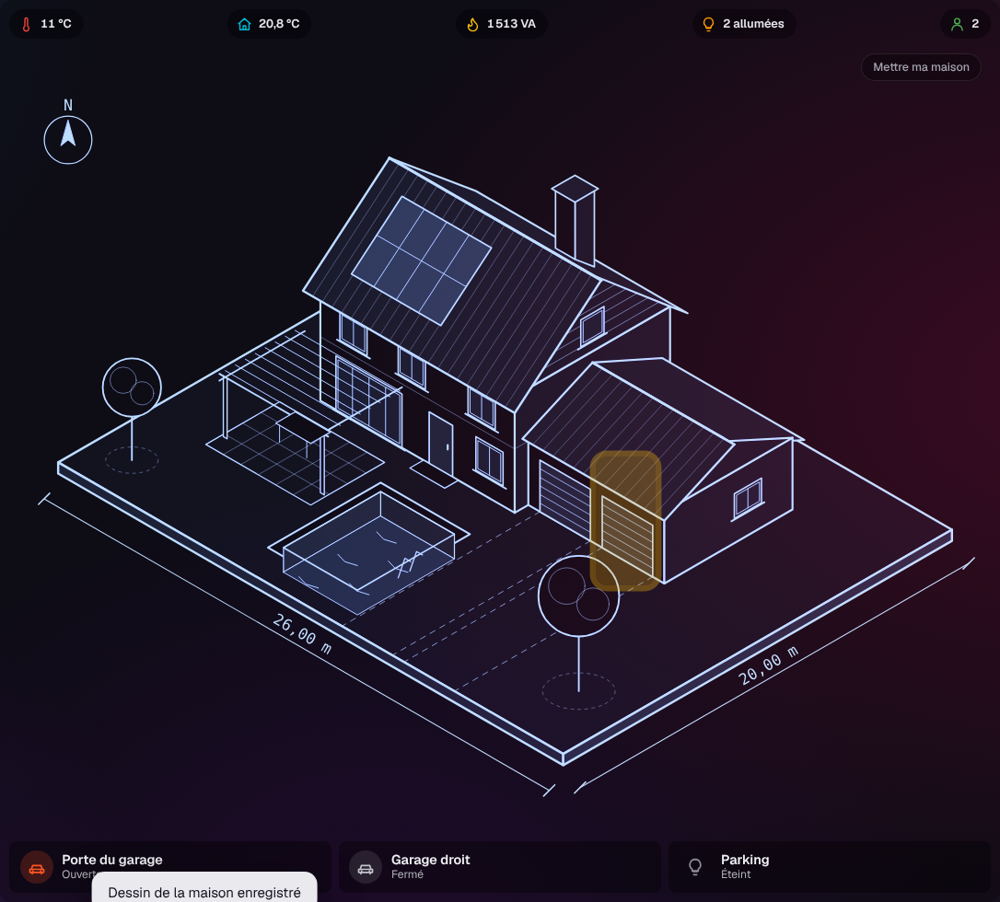
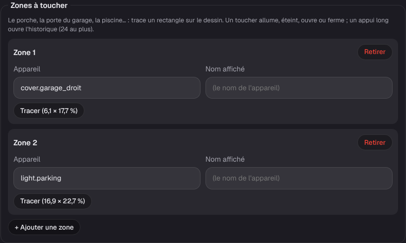
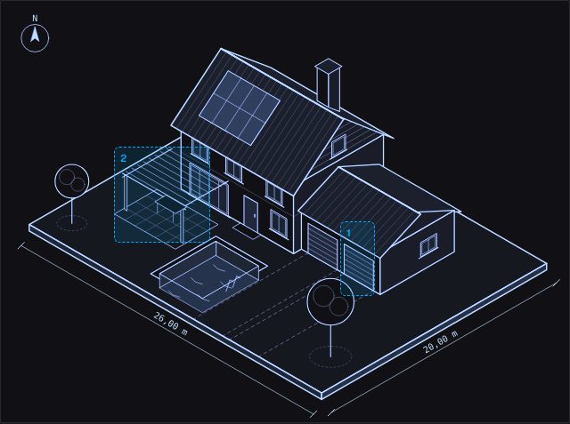

# Étape 41 : toucher la maquette pour commander la maison, expliqué

## Le but

Sur les tableaux de domo-blog, la maquette ne sert pas qu'à regarder : on touche le porche et il
s'allume, on touche la porte du garage et elle s'ouvre. Jusqu'ici, notre maquette montrait l'état
(les calques, les valeurs) sans rien commander. Maintenant, chaque onglet peut avoir des **zones à
toucher** posées sur le dessin.

| Geste                               | Ce qui se passe                                        |
| ----------------------------------- | ------------------------------------------------------ |
| un toucher (ou un clic)             | comme les boutons rapides : allume ou éteint, ouvre ou ferme, lance une scène, appuie |
| un appui long (ou un clic droit)    | ouvre l'historique de l'appareil                       |
| un toucher sur un capteur           | ouvre son historique (il n'y a rien à commander)       |

Les zones sont **invisibles au repos** : la maquette reste propre. Au survol de la souris, un
contour fin montre où toucher. Au toucher, la zone s'éclaire un instant, puis le calque (garage
ouvert, porche allumé) apparaît dès que l'appareil a changé d'état.

## Tracer les zones

**Mon compte → Dessin de la maison… → Zones à toucher**, pour chaque onglet :

1. « + Ajouter une zone », puis écris l'appareil : `cover.garage_droit`, `light.porche`…
2. « Tracer » : l'aperçu remonte. **Fais glisser** sur le dessin, d'un coin de la zone à l'autre,
   au doigt comme à la souris.
3. « Enregistrer ».

Dans l'aperçu, chaque zone est dessinée en pointillé avec son numéro. 24 zones au plus par onglet.
Les zones sont placées en pourcentages du dessin : elles restent au bon endroit sur la télé comme
sur le téléphone. Les valeurs posées sur le dessin passent par-dessus et restent cliquables.

## Sécurité

- Chaque toucher passe par **les mêmes commandes** que les tuiles et les boutons rapides : le
  serveur vérifie les droits à chaque fois. Une zone que ton compte ne peut pas commander (un
  invité devant la porte du garage) ouvre seulement l'historique, si tu peux le lire.
- Le serveur **vérifie** chaque zone : un appareil bien écrit, un rectangle d'au moins 1 % de côté
  qui ne sort pas du dessin, un nom de 60 caractères au plus. Les positions sont arrondies au
  dixième de pour-cent.
- Un **invité** ne reçoit pas les zones des appareils qui lui sont cachés : le serveur les retire
  avant de répondre, comme les calques, les valeurs et les courbes.
- Les zones sont des boutons, avec un nom lu par les lecteurs d'écran (« Garage droit : Fermé.
  Toucher pour ouvrir. ») et un contour au clavier.

## Comment c'est construit

- `crates/ha-api/src/drawing.rs` : chaque onglet a un champ `zones`
  (`{"entity_id", "x", "y", "w", "h", "name"?}`, en % du dessin), vérifié avec le reste.
- `crates/ha-api/web/house.js` :
  - les zones sont des `<button>` posés sur le dessin (`position: absolute`, en %), entre les
    calques et les valeurs ;
  - le toucher reprend la commande des boutons rapides (`actionCommand`) ;
  - l'appui long est un minuteur de 550 ms lancé au `pointerdown`. Le clic droit (`contextmenu`)
    fait la même chose : c'est aussi l'appui long d'Android ;
  - le tracé suit `pointerdown` → `pointermove` → `pointerup` sur l'aperçu, avec
    `setPointerCapture` pour ne pas perdre le doigt s'il sort du dessin. Pendant le tracé,
    `touch-action: none` empêche la page de défiler.
- `crates/ha-api/web/style.css` : l'éclat (`@keyframes zone-hit`), sans animation si l'appareil
  demande de les réduire.
